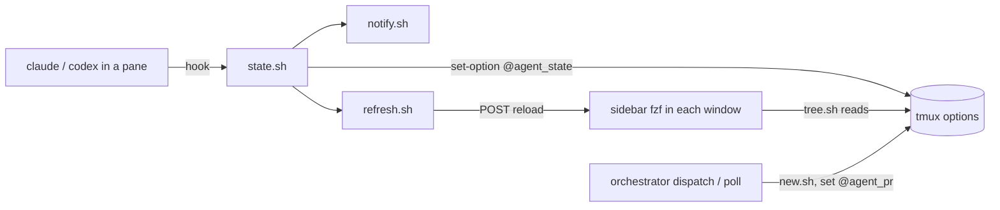

# tmux-agents — plan

A tmux plugin that shows every agent session as a tree in a left sidebar, with
live state per session, and owns the session lifecycle: new worktree, new
window, close. It runs on the Mac mini; you reach it from the laptop over
`ssh` + tmux, and from the phone through Claude Code Remote Control.

Status: phases 1–3 are built and tested (`bats tests`). Phase 4 is next, in
`xdgetech/orch`.

The orchestrator is [`xdgetech/orch`](https://github.com/xdgetech/orch).
Paths like `dispatch.sh`, `poll.sh` and `scripts/lib/worktree.sh` are in that repo.
Phase 4 is implemented there, not here.

## Why

With many implementation tasks open in tmux, three things are hard:

1. seeing which session is running, which waits for you, and which is finished;
2. creating a new task session (worktree + session + agent) in one step;
3. closing finished sessions and their worktrees.

What tmux already does well, and must stay: it is lightweight, and the
shortcuts make it fast to move around.

## Goals and non-goals

Goals:

- A tree view on the left: repo → worktree/task → windows, with a state icon.
- One key to move into the tree and back out.
- A new window opens inside its session's worktree.
- State is exact: the agents report it through hooks. Nothing reads the screen.
- Dispatched implementation runs from the orchestrator appear in the same tree.
- Finished sessions are closed safely, by hand or by `poll.sh`.

Non-goals:

- No GUI, no web UI, no mobile client. The phone uses Remote Control.
- No second task store. Task state stays in the orchestrator.
- No multi-host. One Mac mini.

## Window layout

Every task window has the same three columns. The AI session and the terminal
both start in the task's worktree.

```
┌─ agents ──────────────┬──────────────────────┬────────────────────┐
│  lisk                │                      │                    │
│ ├  main              │   AI session         │   terminal         │
│ ├ ● AGT-123 rpc-retry │   (claude / codex)   │   (run commands,   │
│ └ ◐ AGT-130 auth  PR  │                      │    git, gh, open   │
│  ddddbox-webbim      │                      │    files, tests)   │
│ └ ✓ WBB-1880 snap #1669                      │                    │
│ n new  o ide  x close │                      │                    │
└───────────────────────┴──────────────────────┴────────────────────┘
   tree (~25 cols)          left work pane         right work pane
```

- The tree is the sidebar. The AI pane and the terminal pane are the work area.
- The terminal pane is where everything that is easy from a shell happens:
  `git diff`, lazygit, `gh pr create`, running the app, opening a file. The
  plugin does not add keys for these.
- Move between the AI pane and the terminal with your normal tmux pane keys.
- The split ratio is an option (`@agents_split`, default 50%).

## The tree

| Tree level | tmux object | Set by |
|---|---|---|
| Repo | sessions that share the session option `@agent_repo` | `new.sh` |
| Worktree / task | one session, created with `-c <worktree path>` | `new.sh` |
| Extra windows | shown only when a session has more than one window | `c` |
| State icon | `@agent_state` of the AI pane, rolled up per session | agent hooks |

State icons: `●` running, `◐` waiting for you, `○` idle, `✓` PR merged,
`✕` error. A session shows its most urgent pane, in this order:
waiting > error > running > idle > done.

## Contract between the plugin and the orchestrator

The plugin owns sessions and the UI. The orchestrator owns task state. They
share only these names:

| Name | Scope | Meaning |
|---|---|---|
| session name | session | the task id (`AGT-123`), or the branch for a manual session |
| `@agent_repo` | session | repo name, the tree's top level |
| `@agent_worktree` | session | absolute worktree path |
| `@agent_task` | session | task id, when the session belongs to a queue task |
| `@agent_pr` | session | PR number, when one exists |
| `@agent_pr_state` | session | `open` / `merged` / `closed` |
| `@agent_state` | pane | `running` / `waiting` / `idle` / `done` / `error` |
| `@agent_session_id` | pane | Claude session id, for `claude --resume` |

The plugin never reads orchestrator files. The orchestrator never draws UI.

## Feature set

### MVP (phases 1–3)

| Feature | Key / trigger |
|---|---|
| State from Claude hooks into `@agent_state` | `UserPromptSubmit`, `PreToolUse`, `PostToolUse`, `PermissionRequest`, `Notification`, `Stop`, `StopFailure`, `SessionEnd` |
| State from Codex | `notify` in `~/.codex/config.toml` |
| Status bar counts: `◐ 2 · ● 3` | always on |
| Tree sidebar on the left, live refresh | `prefix + b` show/hide |
| Move into the tree and back | `prefix + Tab` |
| Move in the tree | `j` / `k`, `Enter` switch and leave, `Esc` leave |
| New task: worktree + session + AI pane \| terminal pane | `n` in the tree, `prefix + N` |
| Extra window in the selected worktree, same layout | `c` in the tree |
| **Open the worktree in the IDE** | `o` in the tree, `prefix + O` (`prefix + o` stays tmux's next pane) |
| Safe close: only when clean and merged, else warn | `x` in the tree |
| Rename | `r` in the tree |
| Pane preview of the selected row | fzf preview |
| Hide the tree on a narrow client (phone over mosh) | `client-resized`, width < 100 |

**Open in IDE.** The command is an option, `@agents_ide_cmd`, default
`cursor`. Two cases:

1. Client on the same machine: `cursor <worktree>`.
2. Client over SSH from the laptop: the IDE must open on the **laptop**, not on
   the Mac mini. Use the remote form,
   `cursor --remote ssh-remote+<host> <worktree>`, run on the laptop. The
   plugin cannot start a process on the laptop. So `o` prints that command
   and copies it to the laptop's clipboard through OSC 52
   (`set-clipboard on`). One paste opens it. `@agents_ide_host` sets the host
   name (default: the Tailscale name of the Mac mini).

   A shell function on the laptop (`mm-open <task>`) can skip the paste. It is
   a small addition, outside the plugin.

### Later (phase 4)

| Feature | Key / trigger |
|---|---|
| Dispatched runs appear in the tree | `dispatch.sh` calls `new.sh` |
| Auto-close merged / Done sessions | `poll.sh` |
| `@agent_pr` / `@agent_pr_state` kept up to date | `poll.sh`; `gh pr view`, cached, for manual sessions |
| Resume a dispatched `claude -p` run interactively | `R` in the tree → `claude --resume <id> --remote-control` in the AI pane |
| Context-aware launch for company repos | `@agents_launch_cmd` (see phase 4) |
| Alert when a session starts waiting | done: OSC 777 desktop notification from `notify.sh` |

### Left out on purpose

These are easy in the terminal pane, so the plugin adds nothing for them:
diff (`git diff`, lazygit), PR create and checks (`gh`), dev-server ports,
opening a single file, running tests.

## Architecture

This repo, loaded with TPM (`set -g @plugin 'xdgetech/tmux-agents'`;
TPM needs access to the private repo through your git credentials). Bash + fzf. Target
tmux ≥ 3.4 (the Mac mini has 3.5a): notifications use `allow-passthrough all`.

```
tmux-agents/
├─ agents.tmux            # TPM entry: options, key bindings, tmux hooks
├─ scripts/
│  ├─ state.sh            # set / get @agent_state; roll-up per session
│  ├─ tree.sh             # print tree rows for fzf, from list-sessions/list-panes
│  ├─ sidebar.sh          # the fzf sidebar pane (--listen, keys, details footer)
│  ├─ sidebar-pos.sh      # fzf pos() of a sidebar's own session
│  ├─ detail.sh           # footer: details of the row under the cursor
│  ├─ sidebar-toggle.sh   # prefix+b; adds a sidebar to every window
│  ├─ focus.sh            # prefix+Tab in and out
│  ├─ refresh.sh          # send `reload` to each sidebar whose rows changed
│  ├─ notify.sh           # desktop notification on a state change
│  ├─ new.sh              # worktree + session + AI pane | terminal pane
│  ├─ layout.sh           # tree | AI | terminal split for a window
│  ├─ ide.sh              # open in IDE (local, or remote command via OSC 52)
│  ├─ close.sh            # safe close
│  └─ status.sh           # status-right counts
├─ hooks/
│  ├─ claude-hook.sh      # stdin hook JSON → state.sh; no-op without $TMUX_PANE
│  └─ codex-notify.sh
└─ tests/                 # bats
```

### Data flow



### Decisions

1. **One sidebar pane per window, not one pane that moves.** A tmux hook
   (`after-new-window`) adds a narrow sidebar to each new window. All sidebars
   read the same tmux state. A new sidebar starts with its cursor on its own
   session, which is simpler than sharing a cursor file and is what you want
   after switching windows.
   Alternative: one pane moved with `join-pane` on each window switch. That
   keeps one process, but it flickers and dies with its window.
2. **Refresh by push, not by polling.** Each sidebar runs fzf with
   `--listen=<unix socket>` and records the socket in the pane option
   `@agents_sock`. `state.sh` calls `refresh.sh`, which POSTs `reload` to each
   socket. A slow fallback reload (every ~10 s) covers a
   missed signal.
3. **Worktree logic stays in one place.** `new.sh` creates the worktree through
   a configurable command, `@agents_worktree_cmd`. The default is a plain
   `git worktree add` under `<repo>/../.worktrees`. On the Mac mini it is set
   to an orchestrator wrapper around `wt_ensure_new` (`scripts/lib/worktree.sh`),
   so location, reuse and the `worktree-setup.sh` hook have one implementation.
4. **Hooks are user-level.** They go in `~/.claude/settings.json`, so every
   session reports state. They exit at once when `$TMUX_PANE` is unset, so
   headless runs outside tmux are not affected.

## Phases

Each phase can be used before the next one exists.

### Phase 1 — state

1. `hooks/claude-hook.sh` maps hook events to states and stores the session id.
2. `scripts/state.sh` and the roll-up.
3. `scripts/status.sh` in `status-right`.
4. `hooks/codex-notify.sh`.

Done when: the status bar shows the right counts across 3 parallel Claude
sessions, including `◐` on a permission prompt.

### Phase 2 — read-only tree

1. `tree.sh`: repo → session → window rows with icons.
2. `sidebar.sh` with fzf `--listen`, `refresh.sh`, the fallback reload.
3. `sidebar-toggle.sh`, `focus.sh`, `Enter` / `Esc`.
4. Hide on a narrow client.

Done when: the tree updates within a second of a state change, and
`prefix + Tab` moves in and out without losing the cursor.

### Phase 3 — lifecycle

1. `new.sh`: asks for repo + branch (or task id), creates the worktree and
   the session. `layout.sh` splits the window into tree | AI pane | terminal
   pane, starts `claude --remote-control` in the AI pane, and focuses it.
2. `c` opens an extra window in the selected worktree, with the same layout.
3. `ide.sh`: `o` / `prefix + O`, local and remote form.
4. `close.sh`: refuses unless the worktree is clean and the branch is merged
   (`gh pr view` or `git branch --merged`); then kills the session and removes
   the worktree. The branch is kept.
5. `r` rename.

Done when: a task goes from `n` to `x` without typing a tmux or git command,
and `o` from the laptop opens the worktree in Cursor over SSH.

### Phase 4 — orchestrator integration (in `xdgetech/orch`)

1. Wrapper script for `@agents_worktree_cmd` around `wt_ensure_new`.
2. `dispatch.sh`: the implementation tier starts its run inside a tmux session
   through `new.sh`, sets `@agent_task`, and collects the result through a
   completion marker instead of waiting on the process. This needs the per-lane
   lock first, so a long run no longer blocks the other tiers.
3. `poll.sh`: sets `@agent_pr` / `@agent_pr_state`; closes sessions whose PR
   is merged or whose task is Done (same safety rules as `close.sh`).
4. `@agents_launch_cmd`: for a repo that belongs to a company project, launch
   the agent through the orchestrator, which loads `projects/<context>/.env`
   and passes `--mcp-config projects/<context>/mcp.json --strict-mcp-config`.
   Manual sessions then get the same credential isolation as dispatched ones.
5. `R`: resume a finished dispatched run with `claude --resume <id> --remote-control`.

Done when: a dispatched implementation task appears in the tree, can be
attached while it runs, and disappears after its PR merges.

## Risks and open questions

- **Width.** The sidebar takes about 25 columns in every window. `prefix + b`
  hides it.
- **Codex state.** Verified: `notify` sends only `agent-turn-complete`, never
  an approval prompt. A Codex pane shows `○` after each turn and nothing else.
- **Two names, one option.** A pane option falls back to the global option of
  the same name. So the sidebar marker is `@agents_sidebar_pane`, apart from
  the global on/off switch `@agents_sidebar`.
- **Remote Control isolation.** Server mode does not pass `--mcp-config` to the
  sessions it creates. Phase 4 step 4 uses `claude --remote-control` per
  session instead, which keeps the flags. Verify.
- **`--resume` + `--remote-control` on a session that started headless.** Not
  verified.
- **OSC 52 clipboard.** Works in iTerm2, Ghostty and WezTerm; tmux needs
  `set-clipboard on`. Check the laptop's terminal.
- **tmux hook differences across versions.** Pin tmux on the Mac mini.

## Compared with Superset

Superset ([superset.sh](https://superset.sh)) is a desktop app for parallel
agents. Its features, and what this plan does about each:

| Superset feature | This setup | Decision |
|---|---|---|
| Worktree per agent, workspace list | tree + `new.sh` | MVP |
| Status: working / blocked / waiting on you | hooks + tree icons | MVP |
| Many agents (Claude, Codex, Cursor, OpenCode) | Claude + Codex hooks | MVP; others later if needed |
| Integrated terminal | the right-hand terminal pane in every task window | covered |
| Diff / review view per workspace | `git diff` / lazygit in the terminal pane | skip: easy in the terminal |
| PR tooling | `gh` in the terminal pane; orchestrator's gated push for dispatched work | skip: easy in the terminal |
| Open in any IDE | `o` key, local or over SSH | MVP |
| Workspace setup / teardown / run scripts | `worktree-setup.sh` via `wt_ensure_new`; no teardown or run script | add teardown + run later |
| Port allocation per workspace | set the port in the terminal pane | skip: easy in the terminal |
| Automations (scheduled agents) | launchd + `tasks.yaml` | covered by the orchestrator |
| Tasks | personal Linear queue, driven from Slack | covered by the orchestrator |
| Mobile app | Remote Control (Claude only) + Slack | covered for Claude; no Codex on the phone |
| Remote / multi-host over SSH | one Mac mini over Tailscale | skip |
| In-app browser pane, desktop control | real browser over Tailscale | skip |
| Integrations / MCP proxy | per-context MCP configs | covered, with isolation Superset does not have |
| Pages with comments | Slack threads, Claude artifacts | skip |
| Standup digest of agent work | — | possible orchestrator task later |
| CLI / SDK | the plugin's scripts | covered |

Superset also gives a GUI. This plan deliberately does not: the point is to
keep tmux's speed and shortcuts.
