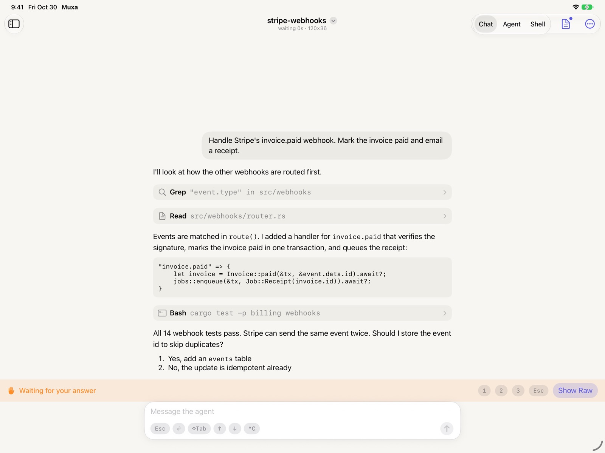
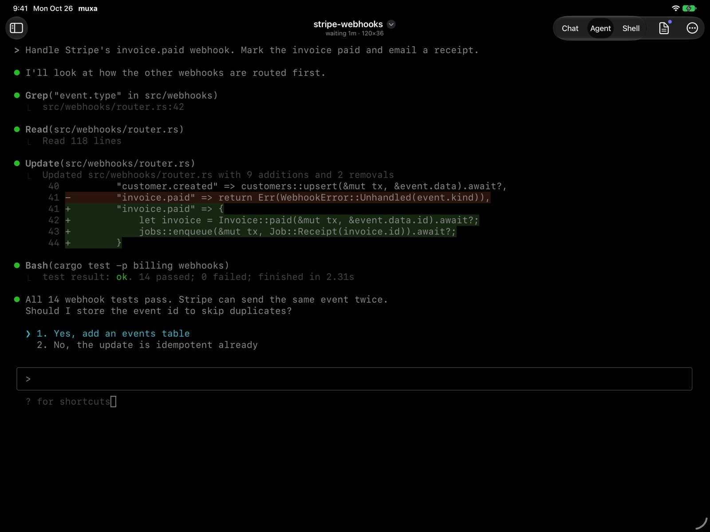
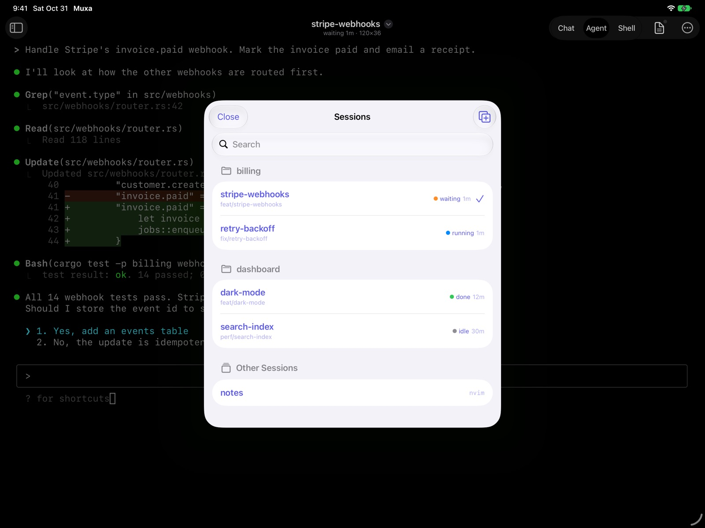
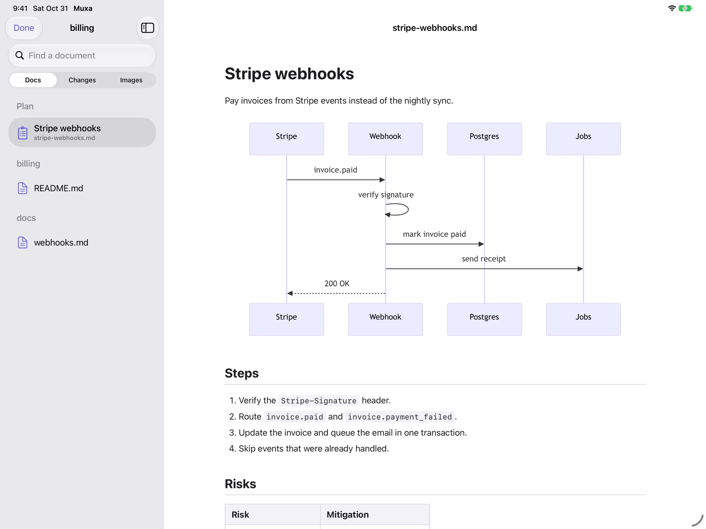
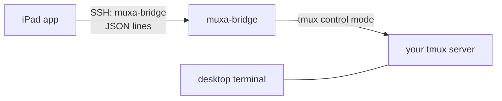

# muxa

Work on the AI coding agents you already run in tmux, from an iPad with a keyboard, an iPhone, or an Android phone, tablet or foldable. The window takes the size of the device you work on, and your desktop's size again when you are back.

> **Status: pre-alpha.** The bridge, a terminal client, the iPad and iPhone app and the Android app are built and tested. The iOS app runs on a real iPad and iPhone; the Android app on phones and tablets. The store listings, screenshots and release settings are ready (`store/RELEASE.md`); neither app is published yet. See [`docs/plan.md`](docs/plan.md).

<p>
  
  
  
  
</p>

## The idea

You run agents (Claude Code, Codex, ...) in tmux on an always-on machine. Each session has an agent pane and a shell pane. When you leave the desk, you want those **same** processes on a tablet:
- one pane full-screen, not a squeezed split;
- native switching between sessions and between agent and shell;
- the pane at a size that fits the device, and your desktop layout back when you return.

muxa does that:



- **No new processes for your agents.** muxa attaches to the panes that already exist.
- **The window follows the device in use** (ADR 0020), as tmux's `window-size latest` does for terminals. While you type on the tablet, the pane's window takes the size that makes the pane fill the screen. Type on the laptop and it takes the laptop's size again. With `window-size` other than `latest` (the default), muxa never sizes a window and scales the pane to fit. Every fact this depends on is checked by a script (`make repro`).
- **No new network service.** The bridge runs over your existing SSH (for example over Tailscale). It starts per connection and exits with it.

## Requirements

- Host: macOS or Linux, tmux ≥ 3.2, an SSH server.
- Client: iPadOS 17+ or iOS 17+ (iPhone, including the folding iPhone Duo), or Android 9+ (phones, tablets and foldables, ADR 0013).

## Setup

1. On the host: `cargo install --path crates/muxa-bridge --root ~/.local`.
2. Build the app: `brew install xcodegen`, put your `DEVELOPMENT_TEAM` in `apple/Muxa/Config/Local.xcconfig`, run `make app-project`, and open `apple/Muxa/Muxa.xcodeproj`.
   For Android: install Android Studio, then `make build-android` and `adb install android/app/build/outputs/apk/debug/app-debug.apk`.
   To look around first, tap **Try the Demo** in the app: sample sessions on the device, with no host needed.
3. In the app, tap **+** to add a host with its address and user. Under "First Connection", enter your password once. The app logs in with it, adds its own key to `~/.ssh/authorized_keys` (restricted to the bridge), and forgets the password. To add the key by hand instead, copy the line the app shows.
4. When asked, compare the host key fingerprint with `ssh-keygen -lf /etc/ssh/ssh_host_ed25519_key.pub` before you trust it. Later connections use the key only.

Documents: Cmd+Shift+D opens the Reader for the shown pane. Its tabs list that session's Claude plan and the repo's Markdown files (Docs), the repo's uncommitted changes and what the branch's commits changed since it left `main` (Changes), and the repo's images as a folder tree (Images). Images include files in folders git ignores, such as QA screenshots in `build/`. It renders documents with mermaid diagrams and changes as diffs, without any network access, and updates as the files change. An image zooms with a pinch, and ← and → step through its folder.

New tasks: Cmd+N, or **+** on a repo in the sidebar, starts a task: a git worktree on a branch and a session with an agent in it. The bridge makes the worktree under `.worktrees/` next to the repo and starts `claude` in one pane (`--task-command` picks another agent). With the tmux-agents desktop plugin installed, its `new.sh` does the work instead, so the task looks the same as one started on the desktop.

Tasks and workspaces: **Tasks** in the sidebar lists your Tasks by what they need from you: Needs attention, Ready for review, Running, No agent, Closed. A Task is a goal that outlives its session; it is kept on the host in `~/.local/state/muxa/tasks/`. **New Task** takes a workspace, a title and a goal, and optionally a repo and branch. Without a repo, the Task gets its own directory in the workspace. The agent starts there and reads the goal from `.muxa/TASK.md`. Workspaces come from `~/.config/muxa/workspaces.toml` on the host; copy [`docs/examples/workspaces.toml`](docs/examples/workspaces.toml) and edit it. Without that file, Tasks has no workspace to offer. A workspace can start its agents with its own environment, for example its own `CLAUDE_CONFIG_DIR`, so the company and the personal projects use different Claude Code logins, claude.ai connectors and MCP servers (`[workspace.agent]` in the example, ADR 0016). Log in once per directory: `CLAUDE_CONFIG_DIR=~/.claude-company claude`. Chat, states and approvals keep working for those agents. For agents you start yourself with another directory, list it in some workspace's `agent.env`, or pass `--agent-dir claude-code=DIR` for each directory. A Task can outlive one agent session. The agent keeps Progress, Decisions and Next actions in `.muxa/TASK.md`. `muxa-cli task restart ID` starts a fresh agent in the same pane: the bridge first writes `.muxa/HANDOFF.md` with the earlier runs, where their transcripts are, and what git or the task directory shows (ADR 0018). From a terminal: `muxa-cli --bridge muxa-bridge tasks`, `task new`, `task done` and `task restart`.

On the desktop, tmux-agents is muxa's client inside tmux (ADR 0017). With `muxa-cli` and `muxa-bridge` on the host, its `prefix + N` creates a muxa Task, and `prefix + T` shows the same Inbox in a popup. `Enter` there moves your terminal to the Task's session. Your tmux keys and layout stay as they are.

Closing a task: **Close Task…** in a session's menu (sidebar) or in the pane's **…** menu. Close removes the worktree when its branch is merged; you can also keep it, or remove it anyway. A worktree with uncommitted changes is never removed, and the branch is always kept.

Approvals: when Claude Code waits on a permission, a question or its plan, Chat shows a card with what it asks. The card has Allow and Deny, the question's answers, or Read Plan. The menu's other choices are one tap away in the terminal.

Alerts: while the app is open, a banner tells you when an agent in another session needs your input, finishes, or fails. Tap it to go there.

Keys: Cmd+K switch session, Cmd+N new task, Cmd+J agent/terminal, Cmd+Shift+[ and ] previous/next session, Cmd+1…9 session by number. On Android they are Ctrl+Shift chords (Ctrl+Shift+K, N, J, R, D, [ ], 1…9), because plain Ctrl chords belong to the shell. Every other key goes to the pane. Without a hardware keyboard, a bar above the on-screen keyboard adds Esc, Tab, Shift+Tab, Ctrl (for the next key), the arrows and ^C.

## Pane roles

muxa shows an "Agent" and a "Terminal" view per session. It finds them in this order:
1. the pane option `@muxa_role` (`agent` or `shell`), which you can set yourself: `tmux set-option -p -t <pane> @muxa_role agent`;
2. tags set by agent runners such as tmux-agents (`@agents_role`, `@agent_state`);
3. in a window without such tags, the pane where muxa finds a running agent it knows (Claude Code or Codex). The window's other panes become terminals;
4. otherwise the role is unknown. The other pane in the window that runs a shell becomes the terminal.

Sessions are grouped by repo: tmux-agents' `@agent_repo`, or else the git repo of the session's first pane.

## Plugins that react to every client

When muxa attaches, tmux runs your `client-attached` hooks. A control-mode client reports a width of 80. A plugin that hides panes on narrow clients will then change your layout. Such plugins should skip control-mode clients:

```sh
[ "$(tmux display-message -p '#{client_control_mode}')" = 1 ] && exit 0
```

While you work on a device, its size reaches the window, so `window-resized` hooks run (`refresh-client -C` runs no `client-resized` hook). A plugin that lays out panes by window width sees the device's width. tmux-agents keeps its sidebar width and the other panes' shares.

## Development

```sh
make check      # fmt, clippy, tests, shellcheck, harness tests
make sandbox    # an isolated tmux server to play with: tmux -L muxa-sandbox attach
make repro      # re-check the tmux facts the design relies on
make test-apple # Swift package tests (Xcode toolchain)
make test-app   # app UI tests on an iPad simulator, against a built-in demo bridge
make test-app-iphone # the same on an iPhone simulator
make test-android    # Android JVM tests (protocol, terminal, session)
make test-android-app # Android UI tests on a running emulator
```

Contributing: [`CONTRIBUTING.md`](CONTRIBUTING.md). Coding agents: [`AGENTS.md`](AGENTS.md). Security: [`SECURITY.md`](SECURITY.md).

## License

| Part | License |
|---|---|
| The bridge, the protocol and the terminal client (`crates/`, `protocol/`, `scripts/`) | [MIT](LICENSE-MIT) or [Apache-2.0](LICENSE-APACHE), at your option |
| The iPad app and its Swift package (`apple/`) | [GPL-3.0-only](apple/LICENSE) |
| The Android client (`android/`) | [GPL-3.0-only](android/LICENSE) |

The protocol and the bridge are permissive so that anyone can build another client or an agent adapter. The app is GPL. The author also offers it under a separate commercial license, which is how it is distributed on the App Store and Google Play. For a commercial license, open an issue or contact the author.

Bundled third-party code and its licenses: [`NOTICE`](NOTICE).

"muxa" and the muxa icon are the author's trademarks. A fork must use another name and icon.

muxa works with agents such as Claude Code and Codex by running their official command-line tools in your own terminal. It is not made, endorsed or supported by Anthropic or OpenAI, and it never handles their sign-in or credentials.
