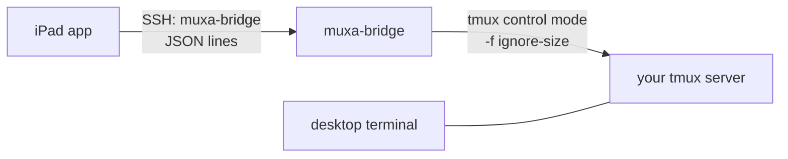

# muxa

Work on the AI coding agents you already run in tmux, from an iPad with a keyboard. muxa does not change your desktop layout.

> **Status: pre-alpha.** The design is verified and the harness is in place. The bridge and the app are not built yet. See [`docs/plan.md`](docs/plan.md).

## The idea

You run agents (Claude Code, Codex, ...) in tmux on an always-on machine. Each session has an agent pane and a shell pane. When you leave the desk, you want those **same** processes on a tablet:
- one pane full-screen, not a squeezed split;
- native switching between sessions and between agent and shell;
- your desktop layout exactly as you left it.

muxa does that:



- **No new processes for your agents.** muxa attaches to the panes that already exist.
- **No layout changes.** The bridge is a tmux control-mode client that never takes part in window sizing. The app renders the pane at its real size, scaled to fit. Every fact this depends on is checked by a script (`make repro`).
- **No new network service.** The bridge runs over your existing SSH (for example over Tailscale). It starts per connection and exits with it.

## Requirements

- Host: macOS or Linux, tmux ≥ 3.2, an SSH server.
- Client: iPadOS 17+. iPhone and Android come later.

## Pane roles

muxa shows an "Agent" and a "Terminal" view per session. It finds them in this order:
1. the pane option `@muxa_role` (`agent` or `shell`), which you can set yourself: `tmux set-option -p -t <pane> @muxa_role agent`;
2. tags set by agent runners such as tmux-agents (`@agents_role`, `@agent_state`);
3. otherwise the role is unknown. The other pane in the window that runs a shell becomes the terminal.

## Plugins that react to every client

When muxa attaches, tmux runs your `client-attached` and `client-resized` hooks. A control-mode client reports a width of 80. A plugin that hides panes on narrow clients will then change your layout. Such plugins should skip control-mode clients:

```sh
[ "$(tmux display-message -p '#{client_control_mode}')" = 1 ] && exit 0
```

## Development

```sh
make check      # fmt, clippy, tests, shellcheck, harness tests
make sandbox    # an isolated tmux server to play with: tmux -L muxa-sandbox attach
make repro      # re-check the tmux facts the design relies on
```

Contributing: [`CONTRIBUTING.md`](CONTRIBUTING.md). Coding agents: [`AGENTS.md`](AGENTS.md). Security: [`SECURITY.md`](SECURITY.md).

## License

Dual-licensed under [MIT](LICENSE-MIT) or [Apache-2.0](LICENSE-APACHE), at your option.
