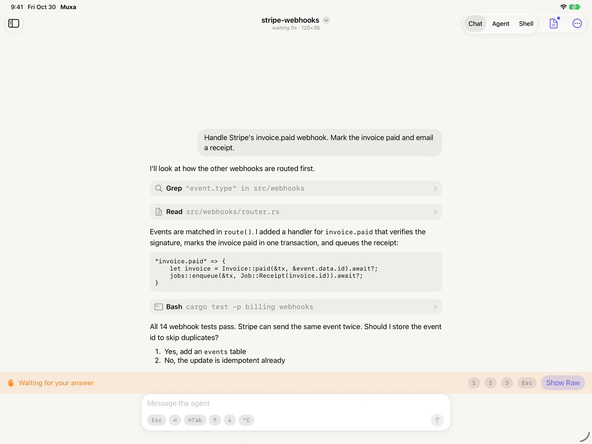
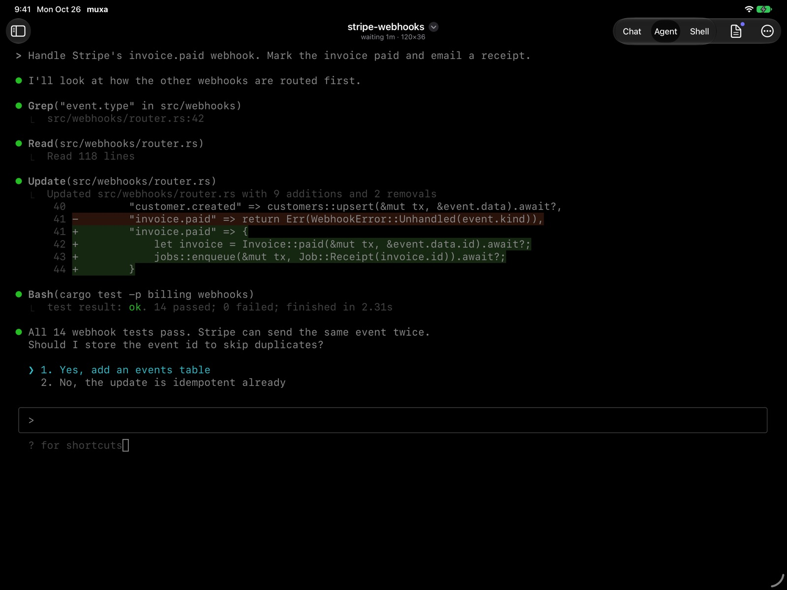
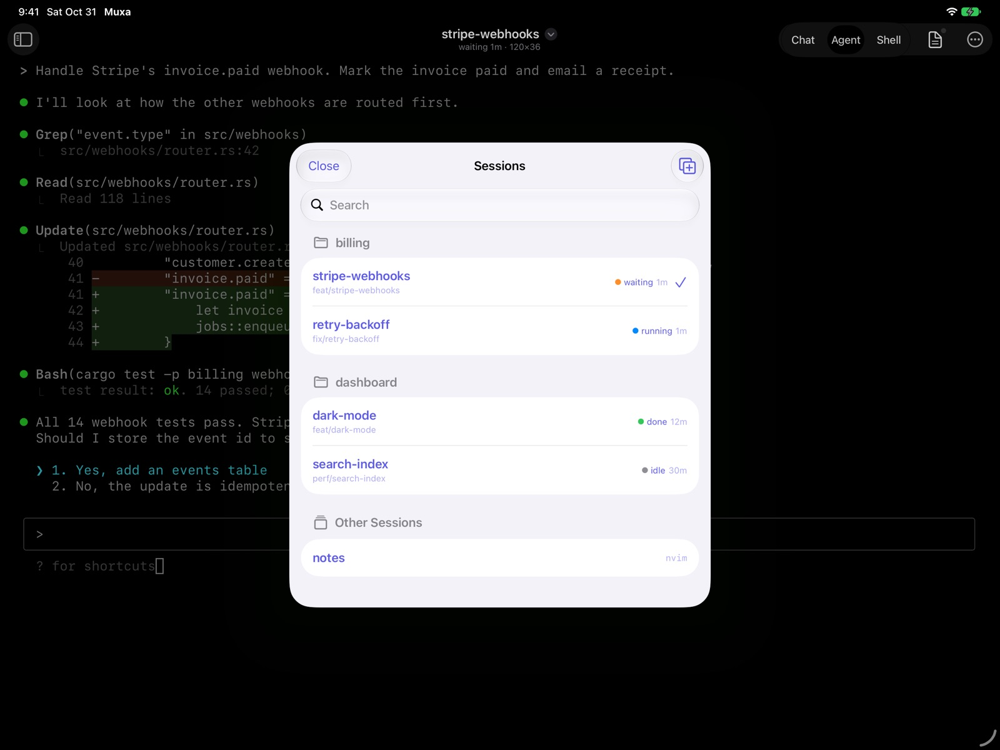
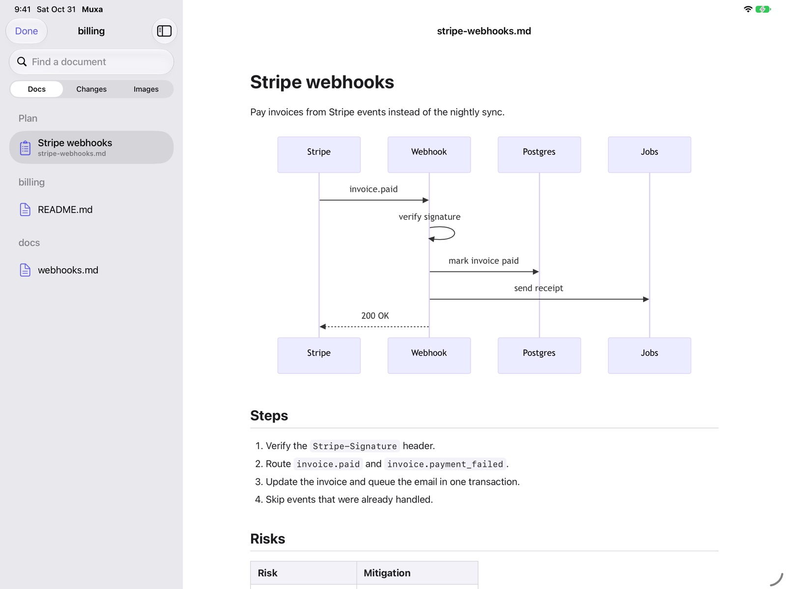
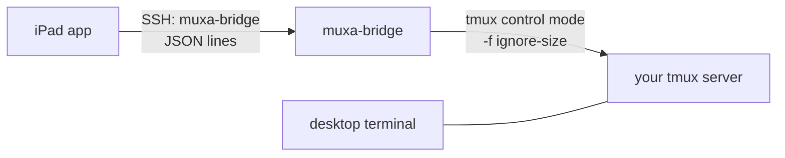

# muxa

Work on the AI coding agents you already run in tmux, from an iPad with a keyboard. muxa does not change your desktop layout.

> **Status: pre-alpha.** The bridge, a terminal client and the iPad app are built, tested, and run on a real iPad. The app is not on the App Store yet. See [`docs/plan.md`](docs/plan.md).

<p>
  
  
  
  
</p>

## The idea

You run agents (Claude Code, Codex, ...) in tmux on an always-on machine. Each session has an agent pane and a shell pane. When you leave the desk, you want those **same** processes on a tablet:
- one pane full-screen, not a squeezed split;
- native switching between sessions and between agent and shell;
- your desktop layout exactly as you left it.

muxa does that:



- **No new processes for your agents.** muxa attaches to the panes that already exist.
- **No layout changes.** The bridge is a tmux control-mode client that never takes part in window sizing. The app renders the pane at its real size, scaled to fit. Every fact this depends on is checked by a script (`make repro`).
- **No new network service.** The bridge runs over your existing SSH (for example over Tailscale). It starts per connection and exits with it.

## Requirements

- Host: macOS or Linux, tmux ≥ 3.2, an SSH server.
- Client: iPadOS 17+. iPhone and Android come later.

## Setup

1. On the host: `cargo install --path crates/muxa-bridge --root ~/.local`.
2. Build the app: `brew install xcodegen`, put your `DEVELOPMENT_TEAM` in `apple/Muxa/Config/Local.xcconfig`, run `make app-project`, and open `apple/Muxa/Muxa.xcodeproj`.
3. In the app, tap **+** to add a host with its address and user. Under "First Connection", enter your password once. The app logs in with it, adds its own key to `~/.ssh/authorized_keys` (restricted to the bridge), and forgets the password. To add the key by hand instead, copy the line the app shows.
4. When asked, compare the host key fingerprint with `ssh-keygen -lf /etc/ssh/ssh_host_ed25519_key.pub` before you trust it. Later connections use the key only.

Documents: Cmd+Shift+D opens the Reader for the shown pane. It lists the uncommitted changes of its git repo, that session's Claude plan, the repo's Markdown files, and its images as a folder tree. Images include files in folders git ignores, such as QA screenshots in `build/`. It renders documents with mermaid diagrams and changes as diffs, without any network access, and updates as the files change. An image zooms with a pinch, and ← and → step through its folder.

New tasks: Cmd+N, or **+** on a repo in the sidebar, starts a task: a git worktree on a branch and a session with an agent in it. With [tmux-agents](https://github.com/xdgetech/tmux-agents) installed, its `new.sh` does the work, so the task looks the same as one started on the desktop. Without it, the bridge makes the worktree in the same place and starts `claude` in one pane (`--task-command` picks another agent).

Closing a task: **Close Task…** in a session's menu (sidebar) or in the pane's **…** menu. Close removes the worktree when its branch is merged; you can also keep it, or remove it anyway. A worktree with uncommitted changes is never removed, and the branch is always kept.

Approvals: when Claude Code waits on a permission, a question or its plan, Chat shows a card with what it asks. The card has Allow and Deny, the question's answers, or Read Plan. The menu's other choices are one tap away in the terminal.

Alerts: while the app is open, a banner tells you when an agent in another session needs your input, finishes, or fails. Tap it to go there.

Keys: Cmd+K switch session, Cmd+N new task, Cmd+J agent/terminal, Cmd+Shift+[ and ] previous/next session, Cmd+1…9 session by number. Every other key goes to the pane. Without a hardware keyboard, a bar above the on-screen keyboard adds Esc, Tab, Shift+Tab, Ctrl (for the next key), the arrows and ^C.

## Notifications while the app is closed

iOS suspends the app in the background, and muxa has no server to push from. To get notified anyway, let tmux-agents send its notifications to a push service. For example, with [ntfy](https://ntfy.sh) and its iOS app:

1. Pick a topic name nobody can guess (anyone who knows it can read it on ntfy.sh), or run your own ntfy server.
2. Save this as `~/.local/bin/agents-ntfy` on the host and make it executable. tmux-agents calls it with the session name and the message, and nothing else is sent.
   ```sh
   #!/bin/sh
   curl -fsS -H "Title: $1" -d "$2" "https://ntfy.sh/<your topic>" >/dev/null
   ```
3. Add `set -g @agents_notify_cmd "$HOME/.local/bin/agents-ntfy"` to your tmux configuration and reload it.
4. Subscribe to the topic in the ntfy app.

tmux-agents does not notify for a window shown on an attached client, for example on the Mac's screen.

## Pane roles

muxa shows an "Agent" and a "Terminal" view per session. It finds them in this order:
1. the pane option `@muxa_role` (`agent` or `shell`), which you can set yourself: `tmux set-option -p -t <pane> @muxa_role agent`;
2. tags set by agent runners such as tmux-agents (`@agents_role`, `@agent_state`);
3. in a window without such tags, the pane where muxa finds a running agent it knows (Claude Code or Codex). The window's other panes become terminals;
4. otherwise the role is unknown. The other pane in the window that runs a shell becomes the terminal.

Sessions are grouped by repo: tmux-agents' `@agent_repo`, or else the git repo of the session's first pane.

## Plugins that react to every client

When muxa attaches, tmux runs your `client-attached` and `client-resized` hooks. A control-mode client reports a width of 80. A plugin that hides panes on narrow clients will then change your layout. Such plugins should skip control-mode clients:

```sh
[ "$(tmux display-message -p '#{client_control_mode}')" = 1 ] && exit 0
```

## Development

```sh
make check      # fmt, clippy, tests, shellcheck, harness tests
make sandbox    # an isolated tmux server to play with: tmux -L muxa-sandbox attach
make repro      # re-check the tmux facts the design relies on
make test-apple # Swift package tests (Xcode toolchain)
make test-app   # iPad app UI test in the simulator, against a built-in demo bridge
```

Contributing: [`CONTRIBUTING.md`](CONTRIBUTING.md). Coding agents: [`AGENTS.md`](AGENTS.md). Security: [`SECURITY.md`](SECURITY.md).

## License

| Part | License |
|---|---|
| The bridge, the protocol and the terminal client (`crates/`, `protocol/`, `scripts/`) | [MIT](LICENSE-MIT) or [Apache-2.0](LICENSE-APACHE), at your option |
| The iPad app and its Swift package (`apple/`) | [GPL-3.0-only](apple/LICENSE) |

The protocol and the bridge are permissive so that anyone can build another client or an agent adapter. The app is GPL. The author also offers it under a separate commercial license, which is how it is distributed on the App Store. For a commercial license, open an issue or contact the author.

Bundled third-party code and its licenses: [`NOTICE`](NOTICE).

"muxa" and the muxa icon are the author's trademarks. A fork must use another name and icon.

muxa works with agents such as Claude Code and Codex by running their official command-line tools in your own terminal. It is not made, endorsed or supported by Anthropic or OpenAI, and it never handles their sign-in or credentials.
