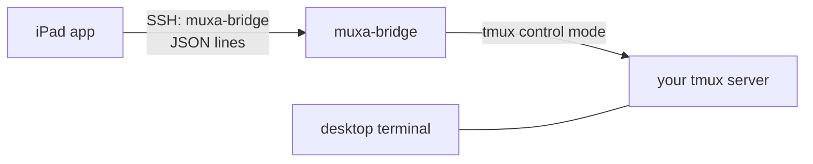

# muxa

Work on the AI coding agents you already run in tmux, from an iPad with a keyboard, an iPhone, or an Android phone, tablet or foldable. The window takes the size of the device you work on, and your desktop's size again when you are back.

> **Status: pre-alpha.** The bridge, a terminal client, the iPad and iPhone app and the Android app are built and tested. The iOS app runs on a real iPad and iPhone; the Android app on phones and tablets. The store listings, screenshots and release settings are ready (`store/RELEASE.md`); neither app is published yet. See [`docs/plan.md`](docs/plan.md).

<p>
  
  
  
  
</p>

## The idea

You run agents (Claude Code, Codex, ...) in tmux on an always-on machine. Each session has an agent pane and a shell pane. When you leave the desk, you want those **same** processes on a tablet:
- one pane full-screen, not a squeezed split;
- native switching between sessions and between agent and shell;
- the pane at a size that fits the device, and your desktop layout back when you return.

muxa does that:



- **No new processes for your agents.** muxa attaches to the panes that already exist.
- **The window follows the device in use** (ADR 0020, 0021), as tmux's `window-size latest` does for terminals. While you type on the tablet, the pane's window takes the size that makes the pane fill the screen, also when it is not the window your laptop shows. Your laptop stays on its own window. Type on the laptop in that window and it takes the laptop's size again. With `window-size` other than `latest` (the default), muxa never sizes a window and scales the pane to fit. Every fact this depends on is checked by a script (`make repro`).
- **No new network service.** The bridge runs over your existing SSH (for example over Tailscale). It starts per connection and exits with it. The optional host daemon for the Task Loop listens only on a Unix socket.

## Requirements

- Host: macOS or Linux, tmux ≥ 3.2, an SSH server.
- Client: iPadOS 17+ or iOS 17+ (iPhone, including the folding iPhone Duo), or Android 9+ (phones, tablets and foldables, ADR 0013).

## Setup

1. On the host, install the bridge and the terminal client into `~/.local/bin` (`PREFIX=...` picks another root):
   ```sh
   make install
   ```
   For the Task Loop, also install the host daemon ([The host daemon](#the-host-daemon)).
2. Build the app: `brew install xcodegen`, put your `DEVELOPMENT_TEAM` in `apple/Muxa/Config/Local.xcconfig`, run `make app-project`, and open `apple/Muxa/Muxa.xcodeproj`.
   For Android: install Android Studio, then `make build-android` and `adb install android/app/build/outputs/apk/debug/app-debug.apk`.
   To look around first, tap **Try the Demo** in the app: sample sessions on the device, with no host needed.
3. In the app, tap **+** to add a host with its address and user. Under "First Connection", enter your password once. The app logs in with it, adds its own key to `~/.ssh/authorized_keys` (restricted to the bridge), and forgets the password. To add the key by hand instead, copy the line the app shows.
4. When asked, compare the host key fingerprint with `ssh-keygen -lf /etc/ssh/ssh_host_ed25519_key.pub` before you trust it. Later connections use the key only.

Documents: Cmd+Shift+D opens the Reader for the shown pane. Its tabs list that session's Claude plan and the repo's Markdown files (Docs), the repo's uncommitted changes and what the branch's commits changed since it left `main` (Changes), and the repo's images as a folder tree (Images). Images include files in folders git ignores, such as QA screenshots in `build/`. It renders documents with mermaid diagrams and changes as diffs, without any network access, and updates as the files change. An image zooms with a pinch, and ← and → step through its folder.

New tasks: Cmd+N (Ctrl+Shift+N on Android), **New Task** under Inbox in the sidebar, **+** on a repo in the sidebar, or New Task in the session list or the More menu opens the New Task sheet. It starts in the repo you started it from, and in the workspace whose `repos` list that repo (else the first workspace). You add a title, a goal and a branch. The host records the Task, makes a git worktree on the branch and starts an agent in a session of its own. The app then opens that session. The worktree goes under `.worktrees/` next to the repo, and the agent is `claude` (`--task-command` picks another). With the tmux-agents desktop plugin installed, its `new.sh` does the work instead, so the task looks the same as one started on the desktop. A bridge older than Tasks gets the old sheet: a repo and a branch, and no record.

Tasks and workspaces: **Inbox** in the sidebar opens Triage, one Task at a time, with Next, Previous, local Snooze and links to Chat, Terminal and the Reader. List keeps all your Tasks grouped by what they need from you: Needs attention, Ready for review, Running, No agent, Closed. Task sessions show their title, state and loop in the sidebar and switcher; manual sessions keep their existing appearance. The sidebar and the switcher list your manual sessions: sessions that run no Task. **All Sessions** lists the Tasks' sessions too; a Task's detail opens its terminal either way. Only the host's Task link decides, not what runs or types in the pane. On phones, Needs attention opens Triage at connect; tablets keep the pane first. Command+T (Ctrl+Shift+T on Android) opens Inbox; inside it, Command+Up/Down, L, O and S move, switch List/Triage, open and snooze (Ctrl+Shift on Android). Snooze clears on reconnect or when the item changes. Approvals remain in Chat. A Task is a goal that outlives its session; it is kept on the host in `~/.local/state/muxa/tasks/`. **New Task** takes a workspace, a title and a goal, and optionally a repo and branch. Without a repo, the Task gets its own directory in the workspace. The agent starts there and reads the goal from `.muxa/TASK.md`. Workspaces come from `~/.config/muxa/workspaces.toml` on the host; copy [`docs/examples/workspaces.toml`](docs/examples/workspaces.toml) and edit it. Without that file, Tasks has no workspace to offer. A workspace can start its agents with its own environment, for example its own `CLAUDE_CONFIG_DIR`, so the company and the personal projects use different Claude Code logins, claude.ai connectors and MCP servers (`[workspace.agent]` in the example, ADR 0016). Log in once per directory: `CLAUDE_CONFIG_DIR=~/.claude-company claude`. Chat, states and approvals keep working for those agents. For agents you start yourself with another directory, list it in some workspace's `agent.env`, or pass `--agent-dir claude-code=DIR` for each directory. From a terminal: `muxa-cli --bridge muxa-bridge tasks`, `task new`, `task done` and `task restart`.

Restart agent: a Task can outlive one agent session. The agent keeps Progress, Decisions and Next actions in `.muxa/TASK.md`. **Restart agent** in a Task's detail, or `muxa-cli task restart ID`, starts a fresh agent in the same pane. The bridge first writes `.muxa/HANDOFF.md` with the earlier runs, where their transcripts are, and what git or the task directory shows (ADR 0018). The app asks before it restarts, and asks again to stop an agent that is still running (`--force` in `muxa-cli`). The Task's detail lists its runs and opens `HANDOFF.md` in the Reader. The continuation prompt waits for an adapter to bind a fresh agent session to the replacement process. With a hook-only agent or Codex’s current time-based conversation matching, continue in Terminal using the prompt shown in the Task note after 30 seconds.

Task Loop: a Task can run a check command after each of its agent's turns, for example `make check` (ADR 0019). The loop runs in the host daemon, so it goes on while no app is connected.
- A failed check types a fixed prompt into the agent: `The check failed. Its output is in .muxa/checks/<n>.log. Fix the cause, then end your turn.`
- A passing check moves the Task from Open to Ready for review. The loop never marks a Task done.
- While the agent waits on you (a permission, a question or a plan), the loop pauses. It never answers for you. It goes on after you answer.
- The loop stops, and the Task moves to Needs attention, after the last allowed failed check (3 by default), a check past its timeout (600 s by default), an agent error, a missing agent, or a prompt it could not type within 30 s.
- It types only when nobody typed in the Task's session in the last 5 seconds.
- `.muxa/CHECK.md` in the Task's directory holds the last check's result and the end of its output. The full output is in `.muxa/checks/`.

To turn the loop on, install the daemon, and allow checks for a workspace with `[workspace.loop]` in `workspaces.toml` (see the example file). In the app, New Task has "Run a check after each turn". A Task's detail has a Loop section with Start loop, Stop loop and Open check log. Without the daemon, the Loop section says what to run on the host. From a terminal: `muxa-cli task new ... --check CMD [--max-attempts N] [--check-timeout S]`, `task loop start ID --check CMD [--reset]`, `task loop stop ID`, and `task stop-loop --all`.

On the desktop, tmux-agents is muxa's client inside tmux (ADR 0017). With `muxa-cli` and `muxa-bridge` on the host, its `prefix + N` creates a muxa Task, and `prefix + T` shows the same Inbox in a popup. `Enter` there moves your terminal to the Task's session. Your tmux keys and layout stay as they are.

Closing a task: **Close Task…** in a session's menu (sidebar) or in the pane's **…** menu. Close removes the worktree when its branch is merged; you can also keep it, or remove it anyway. A worktree with uncommitted changes is never removed, and the branch is always kept.

Approvals: when Claude Code waits on a permission, a question or its plan, Chat shows a card with what it asks. The card has Allow and Deny, the question's answers, or Read Plan. The menu's other choices are one tap away in the terminal.

Alerts: while the app is open, a banner tells you when an agent in another session needs your input, finishes, or fails. Tap it to go there.

Two windows (Android): **Open in New Window** in the pane's More menu opens the pane in a second window, beside the first in split screen or as a desktop window. Each window has its own connection, pane and keyboard, so you can switch one of them to another pane. When both show panes of one tmux window, that window takes the size of the app window you typed in or resized last (ADR 0029).

Keys: Cmd+K switch session, Cmd+N new task, Cmd+J agent/terminal, Cmd+Shift+[ and ] previous/next session, Cmd+1…9 session by number. On Android they are Ctrl+Shift chords (Ctrl+Shift+K, N, J, R, D, [ ], 1…9), because plain Ctrl chords belong to the shell. In the chat's composer, Return starts a new line and Cmd+Return sends (Ctrl+Enter on Android). Every other key goes to the pane. Without a hardware keyboard, a bar above the on-screen keyboard adds Esc, Tab, Shift+Tab, Ctrl (for the next key), the arrows and ^C.

## The host daemon

The Task Loop needs a small daemon on the host (ADR 0019). It is optional: without it, everything else works, and loops are off. It is the same `muxa-bridge` binary, and it opens no network port.

```sh
muxa-bridge daemon install --print  # show the service file; changes nothing
muxa-bridge daemon install          # write the service file, then load and start it
muxa-bridge daemon status           # running or not, its version, socket and log
muxa-bridge daemon restart          # after an upgrade; loops go on
muxa-bridge daemon stop             # stop every loop, then the daemon
muxa-bridge daemon uninstall        # like stop, then remove the service file
```

- `install` needs no sudo. On macOS it writes a LaunchAgent, `~/Library/LaunchAgents/tech.xdge.muxa.daemon.plist`. On Linux it writes a systemd user unit, `~/.config/systemd/user/muxa-daemon.service`. A Linux user service stops at logout unless you run `loginctl enable-linger`.
- `install` writes the absolute paths of `muxa-bridge` and tmux, the flags you give it, and `HOME`, `TMUX_TMPDIR` and `PATH` from your shell. Run it in a shell where `tmux` reaches your server.
- Give `install` the same `--socket`, `--state-dir`, `--workspaces` and `--agent-dir` flags as the bridge's line in `authorized_keys`. Then both use the same tmux server and Task records.
- `stop` keeps the service file, so the daemon starts again at the next login. The loops it stopped stay stopped. After a crash, launchd or systemd starts the daemon again, and its loops go on.
- The daemon reads the agent directories of `[workspace.agent]` when it starts. Run `daemon restart` after you change them. It reads the checks and the other workspace settings on each request.
- Its files are in `~/.local/state/muxa/` (`$XDG_STATE_HOME/muxa`, or `--daemon-dir`): `daemon.sock`, `daemon.lock`, and `daemon.log`, rotated at 1 MiB. On macOS, `daemon.err` holds start-up failures; on Linux, the journal does.
- While a daemon of the bridge's own version runs, each bridge sends Task requests to it. Otherwise the bridge serves them itself, as before.

To update the host:
1. Get the new source.
2. Run `make install`. It also restarts the daemon when one is running.

Until the restart, the bridge does not use the daemon, because its version differs. Tasks still work, but loops are off.

## Pane roles

muxa shows an "Agent" and a "Terminal" view per session. It finds them in this order:
1. the pane option `@muxa_role` (`agent` or `shell`), which you can set yourself: `tmux set-option -p -t <pane> @muxa_role agent`;
2. tags set by agent runners such as tmux-agents (`@agents_role`, `@agent_state`);
3. in a window without such tags, the pane where muxa finds a running agent it knows (Claude Code or Codex). The window's other panes become terminals;
4. otherwise the role is unknown. The other pane in the window that runs a shell becomes the terminal.

Sessions are grouped by repo: tmux-agents' `@agent_repo`, or else the git repo of the session's first pane.

## Plugins that react to every client

When muxa attaches, tmux runs your `client-attached` hooks. A control-mode client reports a width of 80. A plugin that hides panes on narrow clients will then change your layout. Such plugins should skip control-mode clients:

```sh
[ "$(tmux display-message -p '#{client_control_mode}')" = 1 ] && exit 0
```

While you work on a device, its size reaches the window, so `window-resized` hooks run (`refresh-client -C` runs no `client-resized` hook). A plugin that lays out panes by window width sees the device's width. tmux-agents keeps its sidebar width and the other panes' shares.

To size a window that is not your current one, the bridge holds that window in a short-lived session of its own, `_muxa-<pid>-<n>`, tagged `@muxa_device` (ADR 0021). Your sessions keep their current window. Creating and closing it runs `session-created`, `window-linked`, `window-unlinked` and `session-closed` hooks. `choose-tree` shows it while a device watches; a plugin that lists sessions should skip `@muxa_device` (`docs/agents.md`, "Device sessions"). tmux-agents does.

## Development

```sh
make check      # fmt, clippy, tests, shellcheck, harness tests
make sandbox    # an isolated tmux server to play with: tmux -L muxa-sandbox attach
make repro      # re-check the tmux facts the design relies on
make test-apple # Swift package tests (Xcode toolchain)
make test-app   # app UI tests on an iPad simulator, against a built-in demo bridge
make test-app-iphone # the same on an iPhone simulator
make test-android    # Android JVM tests (protocol, terminal, session)
make test-android-app # Android UI tests on a running emulator
```

Contributing: [`CONTRIBUTING.md`](CONTRIBUTING.md). Coding agents: [`AGENTS.md`](AGENTS.md). Security: [`SECURITY.md`](SECURITY.md).

## License

| Part | License |
|---|---|
| The bridge, the protocol and the terminal client (`crates/`, `protocol/`, `scripts/`) | [MIT](LICENSE-MIT) or [Apache-2.0](LICENSE-APACHE), at your option |
| The iPad app and its Swift package (`apple/`) | [GPL-3.0-only](apple/LICENSE) |
| The Android client (`android/`) | [GPL-3.0-only](android/LICENSE) |

The protocol and the bridge are permissive so that anyone can build another client or an agent adapter. The app is GPL. The author also offers it under a separate commercial license, which is how it is distributed on the App Store and Google Play. For a commercial license, open an issue or contact the author.

Bundled third-party code and its licenses: [`NOTICE`](NOTICE).

"muxa" and the muxa icon are the author's trademarks. A fork must use another name and icon.

muxa works with agents such as Claude Code and Codex by running their official command-line tools in your own terminal. It is not made, endorsed or supported by Anthropic or OpenAI, and it never handles their sign-in or credentials.
