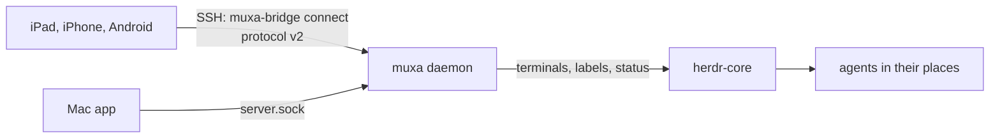

# muxa

Run and follow your AI coding agents from an iPad with a keyboard, an iPhone, an Android phone, tablet or foldable, or a Mac. Capture what comes up into an Inbox, start a Task in its own folder or worktree, watch its agent's terminal or conversation, read what it wrote, and let a check run after every turn.

> **Status: pre-alpha.** The daemon, a terminal client, the iPad and iPhone app, the Android app and the Mac app are built and tested. The store listings and release settings are ready (`store/RELEASE.md`); no app is published yet. See [`docs/plan.md`](docs/plan.md).

## The idea

Agents (Claude Code, Codex, ...) work on an always-on machine. You want to keep them moving from wherever you are, without a laptop:

- one Inbox, in your order, for what needs you: reviews, replies, decisions, failures and your own todos;
- Tasks that each get a place of their own: a new folder, a worktree on a branch, and read-only repos beside it;
- each agent's terminal at the size of the device you look at it on, and its conversation as a chat;
- Routines that run on a schedule and publish to the Inbox.



- **The daemon** runs on the host as a LaunchAgent or a systemd user unit. It serves protocol v2 (`protocol/PROTOCOL-v2.md`) on a Unix socket and opens no network port. Remote devices reach it through your existing SSH, for example over Tailscale.
- **herdr-core** runs the terminals. Every agent muxa starts is a herdr-core terminal with `muxa.*` labels, so a restarted daemon finds it again.
- **No invented state.** muxa shows the state an agent reports itself (OSC 7501), and never answers an agent's menu for you.

## Requirements

- Host: macOS or Linux, herdr-core (`hc` on the `PATH`, or `MUXA_HC`), git, an SSH server.
- Client: iPadOS 17+ or iOS 17+, Android 9+ (phones, tablets and foldables, ADR 0013), or macOS 15+.

## Setup

1. On the host, install the bridge and the terminal client into `~/.local/bin` (`PREFIX=...` picks another root), then the daemon:
   ```sh
   make install
   muxa-bridge daemon install
   ```
2. Describe your workspaces: in an app's **Settings** once you are connected (step 4), or by hand in `~/.config/muxa/workspaces.toml` (see `docs/examples/workspaces.toml`). Both edit the same file.
3. Build an app:
   - iOS: `brew install xcodegen`, put your `DEVELOPMENT_TEAM` in `apple/Muxa/Config/Local.xcconfig`, run `make app-project`, and open `apple/Muxa/Muxa.xcodeproj`.
   - Mac: `make build-mac-app`. It connects to "This Mac" without SSH.
   - Android: install Android Studio, then `make build-android` and `adb install android/app/build/outputs/apk/debug/app-debug.apk`.
   To look around first, tap **Try the Demo**: a built-in server with sample Tasks, Inbox items and Routines, no host needed.
4. In the app, add a host with its address and user. Under "First Connection", enter your password once. The app logs in with it, adds its own key to `~/.ssh/authorized_keys` (restricted to `muxa-bridge`), and forgets the password.
5. When asked, compare the host key fingerprint with `ssh-keygen -lf /etc/ssh/ssh_host_ed25519_key.pub` before you trust it.

## Using it

**Home** is the Inbox and Capture. Type a line such as `reply Anna about the launch #personal due fri`; muxa reads the kind, the workspace and the date into chips, and the item goes on top. Drag items into your order, swipe Done or Later, open one for its note and its Task. A Review's **Approve** (`⌘⏎`) closes its Task: the agent ends and its worktrees go, after a question when one holds work. **Request changes** (`⌘R`) types a one-line comment into the agent, and a Failed item's **Retry** (`⌘R`) runs it again. **New Task** (`⌘⇧N`, or Start Task on an item) picks a workspace, the places, plan mode and a Task Loop, then opens the agent in Focus. It shows what every agent of the workspace gets: its connections and MCP servers. **Needs you** lists the agents that wait on you right now. **Routines** lists each Routine with its next run and last result, and runs one now.

**Focus** is one Task's terminal, with the Tasks and other terminals beside it. The terminal takes the size of the view you look at it in. Beside it, one panel at a time:
- **Inbox** (`⌘⇧I`);
- **Reader** (`⌘⇧R`, `Ctrl+Shift+R` on Android): the Task folder's Markdown and HTML documents, its changed files and the branch's commits as diffs, and its images, kept current while open; a link to another of the documents opens it;
- **Chat** (`⌘⇧C`, `Ctrl+Shift+C`): the agent's conversation from its own records, the approval card when it waits on you, and a line to send it.

**Task Loop:** the Loop button runs a check after each finished turn of a Task's agent, for example `make check` (ADR 0019). A failed check types a fixed prompt: `The check failed. Its output is in .muxa/checks/<n>.log. Fix the cause, then end your turn.` A pass makes a Review item; the last allowed failure (3 by default) makes a Failed item. While the agent waits on you, the loop pauses. Allow checks for a workspace in Settings, or with `[workspace.loop]` in `workspaces.toml`.

**Routines** (ADR 0026, 0036): a `[[routine]]` in a workspace's `.muxa/routines.toml` runs an agent on a schedule, for example at 8:00 on weekdays, in its own folder under `<root>/routines/`. `[workspace.routines]` in `workspaces.toml` allows them. Settings in the apps adds and edits Routines and their instructions too. The agent reads its sources with its own tools and writes briefings and proposals, which a check validates before they reach the Inbox.

**Connections** (ADR 0069, 0075): a workspace names its tokens in `[[workspace.connection]]`; the secrets live in the macOS Keychain and reach every agent of that workspace, as do its `[[workspace.mcp]]` servers.

**Settings** (ADR 0074): the phone's Settings tab, the gear at the foot of the tablet's sidebar, and `⌘,` on the Mac edit every Workspace: its root and repos, agent command, env, loop checks, Routines, connections with their secrets, MCP servers, and the workers. Secrets and env values are write-only: the app sends them to the host and never shows them again. Hand edits to the files still work; an app that saved over a newer file is refused and reloads. `muxa-bridge daemon install --settings-read-only` locks it.

On the Mac: the Go, Pane and Host menus, up to four Tasks side by side in Focus (`⌘\`), and `⌃⌥Space` for a Capture window from any app, where `⌘⏎` adds the item and starts a Task from it (ADR 0070).

On Android with a keyboard: `Ctrl+N` Capture, `Ctrl+Shift+N` a new Task (`Ctrl+Enter` starts it), `Ctrl+Enter` the item's main action (Approve, Retry or Done), `Ctrl+R` Request changes on a Review or Retry on a Failed item, `Ctrl+L` Later, `Ctrl+Backspace` Done, `Alt+↑↓` to reorder, and `Ctrl+Shift+H`, `Ctrl+Shift+F` for Home and Focus.

From a terminal: `muxa-cli --bridge 'ssh host ~/.local/bin/muxa-bridge connect' terminals`, then `inbox`, `capture`, `start-task`, `attach`, `reader`, `chat`, `loops` and the rest (`muxa-cli --help`).

## The daemon

```sh
muxa-bridge daemon install --print  # show the service file; changes nothing
muxa-bridge daemon install          # write the service file, then load and start it
muxa-bridge daemon status           # running or not, its version, socket and log
muxa-bridge daemon restart          # after an upgrade
muxa-bridge daemon stop             # stop it until the next login
muxa-bridge daemon uninstall        # stop it and remove the service file
```

- `install` needs no sudo. On macOS it writes `~/Library/LaunchAgents/tech.xdge.muxa.daemon.plist`; on Linux `~/.config/systemd/user/muxa-daemon.service`. A Linux user service stops at logout unless you run `loginctl enable-linger`.
- `install` writes the absolute path of `muxa-bridge`, the flags you give it (`--state-dir`, `--workspaces`, `--agent-dir`, `--task-command`), and `HOME` and `PATH` from your shell.
- Its files are in `~/.local/state/muxa/` (`$XDG_STATE_HOME/muxa`, or `--daemon-dir`): `server.sock`, `daemon.lock` and `daemon.log`, rotated at 1 MiB. Routine and Inbox state is in `~/.local/state/muxa/tasks/`.
- Task Loops and Routine runs live in files, so a restarted daemon goes on with them.
- The daemon reads the agent directories of `[workspace.agent]` when it starts. Run `daemon restart` after you change them.

To update the host, get the new source and run `make install`. It restarts a running daemon.

## Development

```sh
make check            # fmt, clippy, tests, shellcheck, harness tests
make test-apple       # Swift package tests (Xcode toolchain)
make test-apple-v2    # the Swift v2 client against the real server on a fake backend
make test-app         # app UI tests on an iPad simulator, against the built-in demo server
make test-app-iphone  # the same on an iPhone simulator
make test-android     # Android JVM tests (terminal, transport, session, v2)
make test-android-app # Android UI tests on a running emulator
```

Contributing: [`CONTRIBUTING.md`](CONTRIBUTING.md). Coding agents: [`AGENTS.md`](AGENTS.md). Security: [`SECURITY.md`](SECURITY.md).

iOS UI tests and screenshots reuse host-configured simulators under a shared
lock. Configure the local devices and mounted QA storage as described in
[`docs/ios-qa.md`](docs/ios-qa.md). Mise exposes `qa:ios:iphone`,
`qa:ios:ipad-mini`, `qa:ios:check` and `screenshots:ios`; the Make commands
use the same implementation. Host UUIDs and storage paths are never committed.

## License

| Part | License |
|---|---|
| The daemon, the protocol and the terminal client (`crates/`, `protocol/`, `scripts/`) | [MIT](LICENSE-MIT) or [Apache-2.0](LICENSE-APACHE), at your option |
| The iPad, iPhone and Mac apps and their Swift package (`apple/`) | [GPL-3.0-only](apple/LICENSE) |
| The Android client (`android/`) | [GPL-3.0-only](android/LICENSE) |

The protocol and the daemon are permissive so that anyone can build another client or an agent adapter. The apps are GPL. The author also offers them under a separate commercial license, which is how they are distributed on the App Store and Google Play. For a commercial license, open an issue or contact the author.

Bundled third-party code and its licenses: [`NOTICE`](NOTICE).

"muxa" and the muxa icon are the author's trademarks. A fork must use another name and icon.

muxa works with agents such as Claude Code and Codex by running their official command-line tools on your own machine. It is not made, endorsed or supported by Anthropic or OpenAI, and it never handles their sign-in or credentials.
