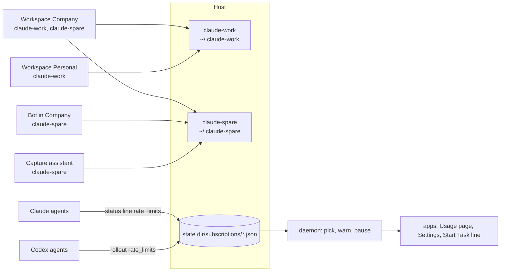

# 0091: AI subscriptions are named logins that Workspaces share

## Status

Proposed (2026-11-24). Builds on ADR 0016, 0069, 0074, 0075. Amends ADR 0082 §1 and 0087 §1 (which login a Bot runs on) and ADR 0084 (the Capture assistant's login).

## Context

- A Workspace picks a login by a path in its env. Two Workspaces that use one Claude Max account each set the same `CLAUDE_CONFIG_DIR`. Nothing says they share one limit.
- Claude Max and ChatGPT plans have 5-hour and weekly windows. An agent that hits one stops mid-turn. An unattended Routine or Bot run then fails after up to 2 h.
- What each vendor lets a local program read (details in `docs/findings/agent-usage.md`):

  | Agent | Usage and limits | Documented | Per-run tokens |
  |---|---|---|---|
  | Claude Code (Pro/Max/Ultra) | status line stdin `rate_limits.{five_hour,seven_day}.{used_percentage,resets_at}`, since 2.1.80, only while a session runs | yes | `message.usage` in the session `.jsonl` |
  | Claude Code | `GET /api/oauth/usage` with the user's OAuth token | no; the terms forbid third parties to "collect, store, or intermediate" claude.ai tokens | — |
  | Codex (ChatGPT login) | `rate_limits` in `token_count` rollout events (`primary`/`secondary` `{used_percent, window_minutes, resets_at}`, `plan_type`); app-server `account/rateLimits/read` and `account/read` | rollouts: no, seen on 0.171; app-server: yes | `token_count` events |
  | Gemini CLI | `/stats` is interactive; the quota call is a private endpoint; replaced by Antigravity CLI for some plans | no | OTEL only |

## Decision

1. **A subscription is a named agent login on the host.** `[[subscription]]` in `workspaces.toml`:
   ```toml
   [[subscription]]
   name = "claude-work"
   agent = "claude-code"        # or "codex"
   home = "~/.claude-work"      # its CLAUDE_CONFIG_DIR or CODEX_HOME
   plan = "Max 20x"             # a label only
   ```
   A subscription whose `home` is `~/.claude` is Claude Code's default login: muxa then sets no `CLAUDE_CONFIG_DIR`. The default login keeps its `.claude.json` in the home folder, and `CLAUDE_CONFIG_DIR=~/.claude` would make a new, empty one in `~/.claude` (`docs/findings/agent-usage.md`).
   Subscriptions sit beside Workspaces, not inside one, because one account has one limit, whichever Workspace uses it. Thresholds are constants for now: warn at 80%, switch at 95%.

2. **muxa never holds a subscription's credential.** The login stays where the agent keeps it: the Keychain entry Claude Code keys to its config dir, or Codex's `auth.json`/keyring in `CODEX_HOME`. muxa stores a name and a path. To log in, the user runs the agent's own login in a terminal muxa opens for that home (decision 7). muxa never calls `/api/oauth/usage` and never reads a token. API keys (`ANTHROPIC_API_KEY`, `OPENAI_API_KEY`) are not subscriptions; they stay connections (ADR 0069), with no plan limits tracked.

3. **A subscription is not a connection.** A connection is a secret muxa holds and gives to a tool. A subscription is the agent's own login, which muxa only points at. Settings shows them in separate tabs.

4. **Who uses which subscription.** Each user of a subscription names an ordered list. An agent takes the first entry of its own kind that is below 95%. The kind comes from the agent command (Claude Code or Codex); a Claude agent never falls back to a Codex login.

   | Who | Where it is set | When unset |
   |---|---|---|
   | A Workspace: its Tasks, restarts and Routine runs without a Bot | `subscriptions = ["claude-work", "claude-spare"]` in `[[workspace]]`; Settings → Workspace → Agent → Subscriptions | as today: the env's `CLAUDE_CONFIG_DIR`/`CODEX_HOME`, else the agent's default login |
   | A Bot: its runs, talks and team members | `subscriptions = ["claude-spare"]` on `[[bot]]` in `routines.toml`; Settings → Bots → the Bot → Subscription | the Workspace's list |
   | The Capture assistant | `subscriptions = [...]` in `[assistant]`; Settings → Capture assistant → Subscription | as today: the default login |

   - **A Bot's list is a subset of its Workspace's list.** A login carries more than a limit: claude.ai connectors, user settings, hooks and `CLAUDE.md`. A Bot on a login its Workspace does not list would break ADR 0087 §3, "the Workspace is the only boundary". To run Bots on a cheaper login, add it to the Workspace's list and put it first in the Bots' lists.
   - The Capture assistant has no Workspace and no connections (ADR 0084); any Claude subscription may be in its list.
   - A Workspace with `subscriptions` may not also set `CLAUDE_CONFIG_DIR` or `CODEX_HOME` in its env; the loader refuses it. A Workspace without `subscriptions` works as today, so nothing migrates by force.
   - **An unknown name never blocks.** A name in `routines.toml` or `[assistant]` that names no subscription, or one outside the Workspace's list, is skipped and shown as a `problem` (as ADR 0075 did for connections). Agents write `routines.toml`, so a stale name must not block a Remove or a load. Removing a subscription that a Workspace names is refused, with the list.
   - Start Task has no picker. ADR 0075 removed pickers for the same reason: a forgotten choice costs more than it gives. Start Task shows one line: the subscription the agent will use and its %.
   - A Routine without a Bot has no list of its own. It runs on its Workspace's list (decided 2026-11-24).
   - A Worker's `agent` decides the kind; it has no subscription of its own.

5. **A running conversation stays on its login.**
   - Every agent carries the label `muxa.subscription`.
   - A restart reuses the subscription on the ended agent's label, also above 95%, because its conversation lives in that home. A subscription that no longer exists falls back to the order, and the restart says so.
   - Adopting a place (ADR 0076) uses the home where `projects/<folder>/` holds a conversation, among the Workspace's subscriptions.
   - The adapters search every `[[subscription]] home` beside today's dirs (ADR 0016), and the daemon reloads that list after a `settings-update`. Without this, Chat, agent states and approval cards stop for those agents.

6. **How muxa reads usage.**
   - **Claude Code:** muxa always writes `.muxa/claude-settings.json` for a Claude agent and passes `--settings` (today only Tasks with other places and Bots with rules get one; one writer merges places, Bot rules and the status line). It adds `statusLine`: `muxa-bridge statusline --subscription <name>`. That command reads stdin, records only `rate_limits` and the time, then runs the login's own status line command and prints its output, so the user keeps their line.
     - **Gate (S0), passed on the default login on 2026-11-24** (`scripts/repro/agent-usage.sh claude`). A probe must show that `--settings` replaces the user's `statusLine`, and that the chained command can read the login's, the project's and the local settings and run the right one. If it cannot, muxa adds the status line only for a login with no status line of its own, and the Usage page says "no data: this login has its own status line".
   - **Codex:** muxa reads `rate_limits` from the `token_count` events of the rollouts of that subscription's running agents. `account/rateLimits/read` through a one-shot `codex app-server` is a later step, after a finding shows it starts no daemon in the home.
   - **The record.** `<state dir>/subscriptions/<name>.json` keeps each window's `used_percent`, `resets_at` and `as_of`. The writer is reachable by any agent, so the input is checked as untrusted (invariant 3): the name must exist, percentages 0–100, `resets_at` within 8 days. Writes are atomic. A report with an older `resets_at` than the stored one is dropped. A window past its `resets_at` shows as "reset, no new data".
   - **Logged in** is not read. A subscription shows "last reported <time>" from its record, and "no data yet" before its first agent runs.
   - **Tokens per Task:** summed from the agent's transcript (Claude `message.usage`, Codex `token_count`), by Task and by Workspace per day. muxa shows tokens, never a share of the plan limit: the vendors do not give one, and invariant 6 forbids inventing it.

7. **Onboarding.**
   1. **Find.** Settings → Subscriptions, empty, lists the logins muxa can see without opening a file: `~/.claude` and `~/.codex` if the folders exist, and each Workspace's env `CLAUDE_CONFIG_DIR`/`CODEX_HOME`. Each row has a suggested name. "Add all" makes them subscriptions in one `settings-update`. A Workspace whose env path is added gets `subscriptions = [<name>]`, and the env key is removed in the same update, so its agents keep the same login.
   2. **Add a new login.** Name, agent, folder (suggested `~/.claude-<name>`), plan label.
   3. **Log in.** The sheet opens a terminal on the host, labelled `muxa.kind = login` and `muxa.subscription`, that runs the agent with that home (`claude`, which offers `/login`; `codex login`). The user logs in there, also from a phone. The command to copy is shown beside it for a shell on the host. muxa cannot see whether the login worked. The subscription shows "no data yet" until its first agent reports.
   4. **Use it.** The last step goes to the Workspace's Subscriptions list, where the new login can be added and ordered.
   - "Not now" leaves everything as today. Nothing changes until a subscription is added.

8. **Settings and the Usage page.**
   - **Settings → Subscriptions** (a tab beside Connections on the Mac and tablet, a row on the phone's Settings tab):
     - the list: name, agent, plan label, and a one-line meter;
     - Add: name, agent, home folder (suggested `~/.claude-<name>`), plan label;
     - a subscription's page: its fields, **Log in again** (the login terminal), **Used by** (Workspaces, Bots, the Capture assistant), and Remove.
   - **Usage page** (a place in Home's sidebar on the Mac and tablet; under Settings on the phone):
     ```
     Usage
     claude-work   Max 20x   5h  ████████░░ 82%  resets 14:00   as of 10:42
                             7d  ███░░░░░░░ 31%  resets Thu
     chatgpt       Plus      5h  ██░░░░░░░░ 18%  resets 12:10   as of 10:30
     claude-spare  Max 5x    no data yet

     Today by Workspace     tokens in / out
     Company                1.2M / 84k
     Personal               310k / 22k
     Today by Task          top 10, each opens its Task
     ```
   - A Task and a Routine run show their subscription, and their tokens from S5.

9. **Near a limit.**
   - **Warn:** crossing 80% in a window makes one Read item per subscription and window: "claude-work at 82% of its 5-hour limit, resets 14:00".
   - **Switch:** new agents take the next subscription of their kind in their list. A running agent is never moved (decision 5).
   - **Pause unattended work (S4):** when every subscription in the list is at or above 95%, a due Routine run, a Bot handoff and a Task Loop's next fix prompt wait until the earliest `resets_at`. The Routine shows "waiting for a limit reset". A user's own Start Task is warned and still starts.
     - Built in S4: a scheduled run is not claimed while it waits, so the schedule's one catch-up starts it after the reset. A team lead's next step waits the same way. A lead's handoffs stay in its run folder with `.muxa/team/held.json` beside them, and the daemon's tick starts them when each member has room. `routines` carries `waiting_until`.
     - The Task Loop waits on its agent's own login, which cannot change (decision 5). A failed check while that login is full pauses the loop with reason `limit-reset` and `resumes_at`; the fail prompt is typed at the reset, after one more look at the record. A turn the user starts meanwhile arms the loop again. A review Routine (`on = "review"`) and Run now start anyway: a review run has no later trigger to wait for, and Run now is the user's own.
   - With no current data (Gemini, an API key, a record past its `resets_at`) nothing is switched or paused.
   - Not exact: data is only as fresh as the last report, other devices use the same account, and two agents that start at once near 95% both start. That is accepted. The aim is fewer runs that fail on a limit, not none.

10. **Wire.** `subscriptions` request and event (windows, `as_of`, `plan`, `used_by`); `subscription` on Task and run info; settings ops `subscription-add`, `subscription-update`, `subscription-remove`, and `subscriptions` in `workspace-update`, `bot-add`/`bot-update` and `assistant-update`; `token-usage` request for the Usage page (tokens by Workspace and Task for a day; named so it is not confused with `<state dir>/usage.json`, which records connection use). Rust, Swift, Kotlin and both demo servers together.

## Consequences

- One place shows how close each account is to its limit, and fewer unattended runs fail on a hit limit.
- Claude usage is unknown while no Claude agent of that login runs. That is the price of not touching the OAuth token.
- A subscription shared by two Workspaces shares its login's connectors, settings and history. To keep them apart, use two logins.
- Every Claude agent now gets `--settings`, so the settings writer becomes one shared module for Tasks, Routine runs, Bots and the assistant.
- `docs/privacy.md` and `SECURITY.md` say muxa stores usage percentages and token counts, never a credential or an account email.

## Alternatives not taken

- **Subscriptions inside each Workspace:** one account would show as two, each with half the picture.
- **A Bot on any host subscription:** a cheaper login for Bots without touching the Workspace, but the login's connectors and settings would cross the Workspace boundary of ADR 0087.
- **Subscriptions as connections in the Keychain** (`CLAUDE_CODE_OAUTH_TOKEN` from `setup-token`): muxa would hold a claude.ai token, which the terms forbid, and setup-token logins load no claude.ai connectors.
- **Polling `/api/oauth/usage`:** fresher data, but undocumented and against the terms.
- **A Start Task picker and per-subscription thresholds:** more choice than the first version needs.
- **Moving a running agent to another login at the limit:** loses its conversation; a new Task with the brief is clearer and the user starts it.

## Phases

| Phase | What | Check |
|---|---|---|
| S0 (gate) | Findings: `--settings` replaces `statusLine`, and chaining to the login's own works; two `CLAUDE_CONFIG_DIR` and two `CODEX_HOME` logins stay apart; Codex `rate_limits` in rollouts on a real login. Login rows run by the developer. | `docs/findings/agent-usage.md`, `scripts/repro/` for the no-login parts |
| S1 | `[[subscription]]`; `subscriptions` on Workspaces, Bots and the assistant; selection at start; `muxa.subscription`; restart and adopt keep their login; adapters search every home; settings ops | `make check`, fake backend tests |
| S2 | Usage reading (Claude status line through one settings writer, Codex rollouts), the record, `subscriptions` wire, `muxa-cli v2 subscriptions` | `make check`, `make test-apple-v2`, `make test-android-v2` |
| S3 | Apps: onboarding (find, add, the login terminal), Settings → Subscriptions, the Usage page (meters), the Start Task line, Bot and assistant pickers | `make test-app`, `make test-app-iphone`, `make test-android-app`, `make test-mac-app` |
| S4 | Limits: warn items, switch, pause unattended work (done 2026-11-25; the Task Loop as S4b, done 2026-11-25) | `make check` with recorded usage files |
| S5 | Tokens per Task and Workspace, `token-usage`, the Usage page's lower half | `make check` with fixture transcripts |
| Later | Codex `account/rateLimits/read`; Gemini/Antigravity; Copilot (`premium_request/usage` with a connection) | — |

## Decided with the developer (2026-11-24)

1. Claude usage is read only from the status line of a running agent. muxa does not call `/api/oauth/usage`.
2. Unattended work waits for the reset when every login in its list is at its limit (decision 9).
3. A Routine without a Bot uses its Workspace's list.
4. Gemini and Antigravity wait.
5. A cheaper login for Bots is wanted. It goes in the Workspace's list, and the Bots put it first (decision 4).

## Diagram


