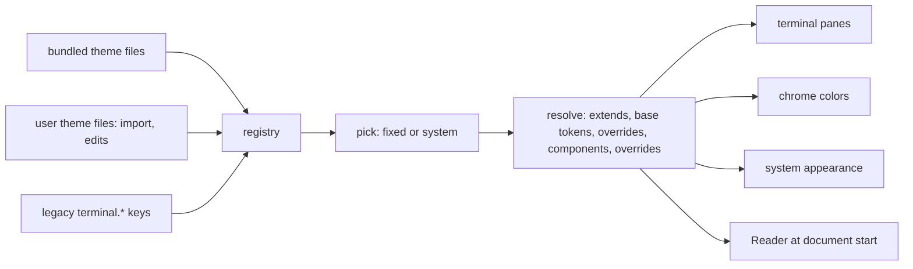

# 0091: One theme colors the whole app, and a theme is a file anyone can add

Status: accepted (2026-11-24). Supersedes the colors part of [ADR 0080](0080-terminal-look-per-device.md) decision 1. The font choice of ADR 0080 stays.

## Context

ADR 0080 lets each device pick the terminal's colors. The rest of the app keeps the design mocks' fixed dark palette. With Dracula or Solarized picked, the terminal does not match the chrome around it and stands out. The developer: "Themeは全部のThemeをかえるべき". Picking a theme must change the whole app. Themes must also be easy to add and to customize later.

Today:

- **Apple chrome:** `apple/Muxa/Muxa/Theme.swift` holds `Palette` (fixed `static let` colors), `Theme` by meaning, and fixed hex in `TaskState.color` and `ItemKind.chipColors`. Dark appearance is forced in five places.
- **Apple terminal:** `MuxaSession.TerminalTheme` holds the background, foreground, cursor, selection and 16 ANSI colors. It has four built-ins and iTerm2 and Ghostty import. `Next/TerminalSettings.swift` keeps the choice in UserDefaults.
- **Reader:** `reader.css` and `reader.js` copy the dark palette as fixed values. Android loads the same files.
- **Android:** `app/ui/Theme.kt` holds its own `Palette` with partly different names and values. `app/pane/Palette.kt` holds fixed terminal colors. Android has no terminal settings.

## Decision

1. **One theme per device colors everything.**
   - It colors the terminal, the chrome, the Reader and its diagrams, and the appearance of system controls: menus, sheets, alerts, pickers and Android's system bars.
   - Settings › Terminal becomes Settings › Appearance: Theme first, then Font and (Mac) Size.
   - There are no terminal-only colors.
   - The choice stays in the device's UserDefaults, as in ADR 0080.

2. **A theme is a small JSON file, and it may be partial.**

   ```json
   { "schema": 1, "id": "dracula", "name": "Dracula", "appearance": "dark",
     "terminal": { "background": "#282a36", "foreground": "#f8f8f2",
                   "cursor": "#f8f8f2", "selection": "#44475a", "ansi": ["#21222c", "…"] },
     "tokens": { "accent": "#bd93f9" } }
   ```

   Editing one color of Dracula is a file with only that color:

   ```json
   { "schema": 1, "id": "dracula-pink", "name": "Dracula Pink", "extends": "dracula",
     "tokens": { "accent": "#ff79c6" } }
   ```

   - Required: `schema`, `id` and `name`, and a `terminal` with `background` and `foreground` unless the file has `extends`. Everything else is optional.
   - Unknown keys, unknown token names and an unknown `appearance` are ignored. Missing tokens are derived. A file written today still loads after tokens are added, and an older app loads a newer file.
   - `schema` is raised only for a change older apps must not read. They refuse such a file and say a newer muxa is needed.
   - A known token with a value that is not `#rrggbb` makes the file fail to load, with the token's name in the error.
   - An `id` uses only letters, digits, `.`, `_` and `-`, because it names the file.
   - The app stores a theme file as written. It never stores resolved colors.

3. **Resolving a theme** is one pure function on each platform (`ThemeRegistry` in `MuxaSession` and in Android's `:session`):
   1. Follow `extends` to the root. A cycle or an unknown parent ends the chain there. A chain with no terminal colors starts from `muxa-dark`.
   2. Take the last terminal palette in the chain.
   3. Collect the `tokens` overrides, the root's first. A later file wins.
   4. Compute each token in the appendix's order. An override replaces a token before later tokens read it.

   Later tokens are built on earlier ones, so a change to `accent` alone also changes the done, info and read colors.
   Inheriting from `muxa-dark` keeps all of its colors, because it pins every token. A theme with its own palette has no `extends`.

4. **Two tiers of tokens with stable string keys.**
   - The appendix lists every key, its tier, its rule and its muxa Dark value. It is the contract for Apple, Android and the Reader.
   - It settles today's differences between Apple and Android. There is one key per meaning, and Apple's value wins. The Android changes are listed.
   - A new token gets a key, a rule and a muxa Dark value in the appendix. Old theme files derive it.

5. **Derivation rules.** All the math is integer math on sRGB bytes, so Swift and Kotlin produce the same bytes.
   - `mix(a, b, p)` moves each channel of `a` toward `b` by `p` whole percent, rounded half up.
   - `ground` is the terminal background. Surfaces and borders mix the background toward the foreground.
   - `text` is the foreground. `textSecondary` and `textTertiary` mix the foreground toward the background. Each step is 1%, and the mix stops while the contrast on `ground` is still at least WCAG 4.5:1 and 3:1.
   - Status colors come from ANSI 1–5 only. Each is mixed toward `text` 1% at a time until it has 3:1 contrast on `ground` (4.5:1 for `failure`, which is text):

     | ANSI | Tokens |
     |---|---|
     | 1 red | `failure` |
     | 2 green | `working` |
     | 3 yellow | `needsYou` |
     | 4 blue | `accent`, `done` |
     | 5 magenta | `decide` |

     Bright slots 8–15 are not used, because Solarized's are greys.
   - A palette without ANSI colors uses a fixed derivation fallback set: muxa Dark's status colors. The terminal itself still uses the platform's own ANSI colors, as today.
   - Contrast uses WCAG 2 relative luminance in doubles. Swift and Kotlin compute it the same way. The shared fixture `apple/MuxaKit/Tests/MuxaSessionTests/Fixtures/themes.json` checks that both give the same bytes.
   - When the file has no `appearance`, a theme is dark if the background's relative luminance is below the foreground's.
   - When the rules give a poor result, the theme file fixes it with overrides, not with a new rule. Solarized's foreground has only 4.75:1 contrast and its red only 3.25:1. The derived text levels collapse and the red turns grey. `solarized-dark.json` therefore sets `text`, `textSecondary` and `textTertiary` to Solarized's base1, base0 and base00, and `failure` to its red lifted to 4.5:1.

6. **Where themes come from.**
   - **Bundled theme files** in `apple/MuxaKit/Sources/MuxaSession/Resources/themes/`, listed in order by `index.json`. Android's `:session` reads the same folder.
     - `muxa-dark`, the default, with every token pinned to today's values.
     - `ghostty`, `solarized-dark` and `dracula`.
   - **User theme files** in the app's own storage.
   - iTerm2 and Ghostty import convert the imported file into a user theme file.
   - A later "edit one color" screen writes a user theme file with `extends` and one token.
   - Old `terminal.imported` entries load as themes with only a terminal palette.
   - The old id `muxa` is an alias of `muxa-dark`, so a saved `terminal.theme` keeps working. The other built-in ids keep their names.

7. **The pick is a mode, not a theme.**
   - `{ "fixed": "<id>" }` ships now.
   - `{ "system": { "light": "<id>", "dark": "<id>" } }` is reserved for Automatic. Automatic arrives with the light themes in a later amendment.

8. **The Reader is themed before it is shown.**
   - The app injects the resolved tokens at document start: a `WKUserScript` on Apple, `addDocumentStartJavaScript` on Android.
   - `reader.js` maps tokens to CSS variables and mermaid variables, so both platforms share one map.
   - When the theme changes, the page sets the variables and draws its diagrams again.
   - The diff tints become `color-mix()` over variables.
   - `HtmlWebView` stays white, as before.

## Phases

| Phase | What | Verified by |
|---|---|---|
| T1 | The theme file format, the resolver, the derivation and the registry in `MuxaSession` and Android `:session`. The bundled theme files and one shared fixture folder (inputs → expected tokens). A Swift 6 spike: resolved tokens as a `Sendable` value readable outside the main actor. No UI change. | Fixture tests on both platforms, byte-equal: muxa Dark equals today's Apple values, every built-in meets the contrast limits, and cases with no ANSI, a light background, a partial override, `extends` chains and cycles, unknown keys, legacy entries and import. `make check`, `make test-apple`, `make test-android`. |
| T2 | The Apple apps follow the theme: `Palette` and `Theme` members become getters over the resolved tokens; the colors captured once (the `UISegmentedControl` proxy, an `EnvironmentKey` default, web view backgrounds, the iOS pane background, stray hex) and the forced dark appearance follow the theme; terminal panes use its palette (the Mac look key hashes the theme); the Reader is injected; Settings › Appearance with swatches and import; `MUXA_THEME` for snapshots. | `make test-apple`, `make build-app`, `make test-app`, `make test-app-iphone`, `make build-mac-app`, `make test-mac-app`. A UI test picks Dracula, relaunches, and finds it still picked. Snapshots of the home, focus, Reader and settings screens for each built-in. |
| T3 | Android follows the theme: Compose state behind `Palette`, `StateColors`, `KindPalette` and `Theme`; `MaterialTheme` from the tokens; the colors Compose does not track (top-level vals, `TerminalPaneView`'s color table, `windowBackground`, `SystemBarStyle`); the terminal palette; the Reader; an Appearance picker. | `make test-android`, `make test-android-v2`, `make build-android`, `make lint-android`, `make test-android-app` with a picker test, and screenshots for each theme. |
| T4 | Amendment 1 below: muxa Light and Solarized Light, the `system` pick (Automatic), import on Android, and an "edit one color" screen. | The default stays muxa Dark until the developer approves the light snapshots. |



## Consequences

- On Apple, muxa Dark looks the same as before.
- Android changes where it differed from Apple. The appendix lists each change.
- A device on Ghostty, Solarized or Dracula sees the whole app change at the first launch after the update.
- New built-ins, user files, one-color edits and new tokens need no change to the format.
- Android gets themes and themed terminals for the first time. Import on Android comes later.
- Swift and Kotlin each implement the resolver. The shared fixture keeps them byte-equal.
- Derived chrome is plainer than a hand-made theme. A built-in may override any token.
- Alternatives not taken:
  - **An app theme beside the terminal theme:** two choices bring the mismatch back.
  - **Hand-made chrome for every theme:** imported themes would color only the terminal.
  - **Storing resolved tokens:** every new token would break the saved themes.
  - **Keeping the theme on the host:** ADR 0080 keeps display settings off the wire.
  - **One `themes.json` for all built-ins:** a user theme and a built-in should use the same unit, one file each.

## Amendment 1: light themes, Automatic, import on Android, editing colors (T4, 2026-11-24)

1. **Two light built-ins.** `muxa-light` pins the base tokens by hand: a white terminal with GitHub's light ANSI colors, on a `#f6f7f9` ground. It also pins `onNeedsYou`, `swipeDone` and `swipeLater`, because the dark rules for them give low contrast on a light ground. `solarized-light` pins only its three text levels. Both pass the same contrast limits as the dark built-ins.
2. **Automatic** is the pick `{ "system": { "light": "muxa-light", "dark": "muxa-dark" } }`. It is the first row of Settings › Appearance.
   - With it, the apps do not set the appearance. The system's light or dark mode picks the theme, and the apps follow a change while they run.
   - The default stays `muxa-dark` until the developer approves the light snapshots.
3. **Import on Android**, as on Apple: a muxa theme file, an iTerm2 `.itermcolors` preset, or a Ghostty theme.
   - `:session` reads iTerm2 and Ghostty files with the rules of `MuxaSession.TerminalTheme`.
   - The shared files in `apple/MuxaKit/Tests/MuxaSessionTests/Fixtures/import/` must give the same palette on both platforms.
4. **Editing colors.** Settings › Appearance has "Edit Colors…" for the picked theme. It edits the base tokens only; the component tokens follow them.
   - An edit goes into the user theme `ThemeRegistry.editable(id)` names: a user theme that already extends another is edited in place, and any other theme gets a `<id>-custom` file that extends it.
   - The edited theme becomes the pick. Resetting a token removes its override, so it follows the parent again.
   - The Apple apps use the system color picker. Android uses a `#rrggbb` field with a swatch.

## Appendix: tokens

How to read the table:
- `mix(a, b, p)` follows decision 5.
- The rules are the ones `ThemeToken` implements, in this order. muxa Dark pins every value, so its look does not depend on them.
- "Lifted" means mixed toward `text` 1% at a time until the contrast on `ground` is reached.
- "Apple" and "Android" give today's names: `Palette.x` unless another type is named. A dash means that platform has no such color today.

### Base tokens

| Key | Rule | muxa Dark | Apple | Android |
|---|---|---|---|---|
| `terminalBackground` | terminal background | `#0A0C0F` | `terminal` | `terminal`, pane `BACKGROUND` |
| `terminalForeground` | terminal foreground | `#D5D9DF` | `terminalText` | pane `FOREGROUND` |
| `ground` | terminal background | `#0E1014` | `ground` | `ground` |
| `surface` | mix(ground, text, 3) | `#14171C` | `surface` | `surface` |
| `card` | mix(ground, text, 4) | `#161A20` | `card` | `raised` |
| `raised` | mix(ground, text, 8) | `#1E232B` | `raised` | `control` |
| `border` | mix(ground, text, 11) | `#262B33` | `border` | `border` |
| `text` | terminal foreground | `#E7E9EC` | `text` | `text` |
| `textSecondary` | mix(text, ground, 31), backed off to 4.5:1 | `#A3ABB6` | `textSecondary` | `textSecondary` |
| `textTertiary` | mix(text, ground, 42), backed off to 3:1 | `#8B94A0` | `textTertiary` | `textTertiary` |
| `accent` | ANSI 4, lifted to 3:1 | `#6AA6FF` | `accent` | `accent` |
| `working` | ANSI 2, lifted to 3:1 | `#3FC79A` | `TaskState.working` | `StateColors.working` |
| `needsYou` | ANSI 3, lifted to 3:1 | `#F5A524` | `TaskState.needsYou` | `StateColors.needsYou` |
| `done` | `accent` | `#6AA6FF` | `TaskState.done` | `StateColors.done` |
| `idle` | `textTertiary` | `#8B94A0` | `TaskState.idle` | `StateColors.idle` |
| `failure` | ANSI 1, lifted to 4.5:1 | `#FF9B9B` | `late` | `Theme.failure`, `destructive` |
| `decide` | ANSI 5, lifted to 3:1 | `#CDB6FF` | `ItemKind.decide` text | `KindPalette.decide` content |

### Component tokens

| Key | Rule | muxa Dark | Apple | Android |
|---|---|---|---|---|
| `pane` | mix(ground, text, 2) | `#12151A` | `pane` | — |
| `cardRaised` | mix(ground, text, 5) | `#1A1E25` | `cardRaised` | — |
| `pill` | mix(ground, text, 7) | `#1F242C` | `pill` | — |
| `selected` | mix(ground, text, 13) | `#2A2F38` | `selected` | `picked` |
| `rowSelected` | mix(ground, text, 9) | `#232831` | `rowSelected` | `secondaryFill` |
| `borderStrong` | mix(ground, text, 13) | `#2C323C` | `borderStrong` | `borderStrong` |
| `rowBorder` | mix(ground, text, 18) | `#3A414D` | `rowBorder` | — |
| `buttonBorder` | mix(ground, text, 15) | `#323843` | `buttonBorder` | `secondaryBorder` |
| `divider` | mix(ground, text, 8) | `#20252D` | `divider` | `divider` |
| `rowDivider` | mix(ground, text, 6) | `#1C2027` | `rowDivider` | — |
| `cardDivider` | mix(ground, text, 9) | `#22272F` | `cardDivider` | — |
| `textMid` | mix(text, ground, 12) | `#C9CED6` | `textMid` | — |
| `textDim` | mix(text, ground, 60) | `#5A626E` | `textDim` | — |
| `onAccent` | `ground` | `#0E1014` | — | `onPrimary` |
| `onNeedsYou` | mix(needsYou, black, 90) | `#1A1203` | `onAmber` | `StateColors.onNeedsYou` |
| `bannerBack` | mix(ground, needsYou, 6) | `#1E1A12` | `bannerBack` | — |
| `bannerBorder` | mix(ground, needsYou, 22) | `#4A3A18` | `bannerBorder` | — |
| `promptBack` | mix(ground, needsYou, 12) | `#2A2110` | `promptBack` | `StateColors.needsYouBackground` |
| `promptBorder` | mix(ground, needsYou, 28) | `#5A4416` | `promptBorder` | `StateColors.needsYouBorder` |
| `destructiveSolid` | mix(failure, black, 20) | `#D14B4B` | `destructive` | — |
| `destructiveBack` | mix(ground, failure, 12) | `#3A1717` | `ItemKind.failed` back | `destructiveFill` |
| `destructiveBorder` | mix(ground, failure, 22) | `#5A2626` | — | `destructiveBorder` |
| `warnBack` | mix(ground, failure, 9) | `#2A1414` | `warnBack` | — |
| `warnBorder` | mix(ground, failure, 18) | `#4A1F1F` | `warnBorder` | — |
| `warnText` | mix(failure, text, 40) | `#FFB4B4` | `warnText` | — |
| `infoBack` | mix(ground, accent, 6) | `#16202E` | `infoBack` | `infoBackground` |
| `infoBorder` | mix(ground, accent, 14) | `#24344A` | `infoBorder` | `infoBorder` |
| `infoText` | mix(accent, text, 70) | `#C9D8EE` | `infoText` | `infoText` |
| `readText` | mix(accent, text, 30) | `#9CC4FF` | `readText`, `ItemKind.read` text | `KindPalette.read` content, `onPrimaryContainer` |
| `readBack` | mix(ground, accent, 12) | `#14263F` | `readBack`, `ItemKind.read` back | `KindPalette.read` back, `primaryContainer` |
| `writeText` | mix(needsYou, text, 30) | `#F5C26B` | `writeText`, `ItemKind.reply` text | `KindPalette.reply` content |
| `writeBack` | `promptBack` | `#2A2110` | `writeBack`, `ItemKind.reply` back | `KindPalette.reply` back |
| `okText` | mix(working, text, 35) | `#7FE0B8` | `okText`, `ItemKind.review` text | `KindPalette.review` content |
| `okBack` | mix(ground, working, 12) | `#123326` | `okBack`, `ItemKind.review` back | `KindPalette.review` back |
| `failedText` | `failure` | `#FF9B9B` | `ItemKind.failed` text | `KindPalette.failed` content |
| `decideBack` | mix(ground, decide, 12) | `#251D38` | `ItemKind.decide` back | `KindPalette.decide` back |
| `todoText` | `textMid` | `#C9CED6` | `ItemKind.todo` text | `KindPalette.todo` content |
| `todoBack` | `rowSelected` | `#232831` | `ItemKind.todo` back | `KindPalette.todo` back |
| `userBubble` | `raised` | `#1E232B` | `Theme.userBubble` | `Theme.userBubble` (was `picked`) |
| `swipeDone` | mix(working, ground, 30) | `#2E8B6A` | `swipeDone` | `Theme.done` |
| `swipeLater` | mix(decide, ground, 45) | `#5B4BB8` | `swipeLater` | `Theme.later` |
| `diffAdded` | `working` | `#3FC79A` | `Theme.added` | `Theme.added` |
| `diffRemoved` | `failure` | `#FF9B9B` | `Theme.removed` | `Theme.removed` (was `#FF6B6B`) |

The Reader's variables map as follows:

| Reader | Tokens |
|---|---|
| `--bg`, `--fg`, `--muted`, `--faint` | `ground`, `text`, `textSecondary`, `textTertiary` |
| `--surface`, `--raised` | `surface`, `card` |
| `--border`, `--border-strong` | `border`, `borderStrong` |
| `--link`, `--code-fg`, `--error` | `accent`, `terminalForeground`, `failure` |
| `--add-*`, `--del-*`, `--hunk-bg` | `diffAdded`, `diffRemoved` and `accent`, through `color-mix()` |

The diff deletion tint moves from `#FF6B6B` to `diffRemoved`.

The app mark's gradient in `MuxaMac/Design/HeaderBar.swift` is not a token. It is the brand, and it does not follow the theme.

### Android changes

These Android colors change to Apple's values:

- `Theme.userBubble`: `#2A2F38` → `#1E232B`.
- `Theme.removed`: `#FF6B6B` → `#FF9B9B`.

Android's `destructive` was already `#FF9B9B`. It becomes `failure`, so its color does not change.
