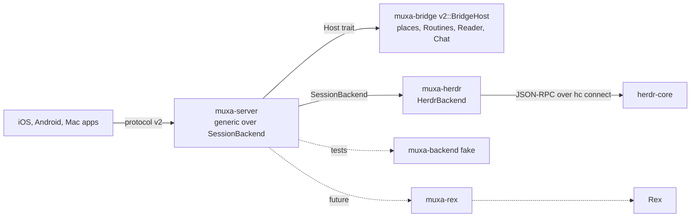

# Session backends

muxa does not own terminals. A terminal server does, behind one Rust trait, `SessionBackend` (ADR 0067). Today that server is herdr-core. Rex, or another multiplexer, can replace it by implementing the same trait. The apps, the wire protocol, the Inbox, Routines, the Reader and Chat do not change.

One backend runs at a time. The trait is for replacing herdr-core, not for running two backends side by side (ADR 0067, decision 5).

## Where the backend sits

| Layer | Knows about herdr-core |
|---|---|
| The apps and `protocol/PROTOCOL-v2.md` | No. The wire carries raw bytes, sizes, states and labels, never a backend's own types. |
| `crates/muxa-server` | No. Every session, attachment, resume buffer and watch is generic over `SessionBackend`. |
| `crates/muxa-bridge/src/v2/` (the host) | Only in `v2/mod.rs`: the `Herdr` struct makes the connection (`hc connect`, or `MUXA_HC`) and hands out a `HerdrBackend`. |
| `crates/muxa-herdr` | Yes. It is the only code that talks to herdr-core. |
| Chat's agent adapters (`docs/agents.md`) | No. They find an agent by its working folder and `ps`, not through the backend. |

## What a backend must do

The trait is in `crates/muxa-backend/src/lib.rs`. It works on one terminal at a time:

| Need | Methods | Why muxa needs it |
|---|---|---|
| Start a program with argv, cwd, name, env and **labels** | `run` | A Task's agent and shells, a Routine run. muxa keeps the Workspace, Task and folder in `muxa.*` labels (invariant 2). |
| Store labels and filter by them | `list`, `get`, `subscribe` | muxa has no Task records: a Task is its terminals' labels plus its files. |
| A raw output stream: a first paint with scrollback, then bytes | `attach`, `TerminalStream::next` | Native terminal views in the apps; resume after a lost connection. |
| Input, resize, detach | `TerminalStream::input`, `resize`, `detach` | Typing and approvals; the size of the device in use (the last active viewer). |
| The program's own status | `TerminalInfo::status`, `Change::Status` | Needs you and Done come from OSC 7501. muxa never guesses a state (invariant 6). |
| Changes in order, with a resync when the subscriber falls behind | `subscribe`, `ChangeStream::next` | `watch`, Failed items, Routine runs and Task Loops follow them. |
| End and remove | `kill`, `remove` | Closing a Task or a shell. |

Workspaces, Tasks, places and pane layout stay in muxa. A backend has no splits or windows to offer.

## Proof that it is replaceable

1. `crates/muxa-backend`'s `contract` feature is a suite every backend must pass: run, attach, the input round trip, a resize the program sees, OSC 7501 status, kill with a reason, and changes in order.
2. `crates/muxa-backend`'s `fake` feature is a second, in-memory backend. Every server test, `make test-apple-v2` and `make test-android-v2` run the real server on it.
3. `make test-herdr` runs the same contract against herdr-core.

## Adding a backend, such as Rex

1. Add a crate beside `muxa-herdr`, for example `crates/muxa-rex`, that implements `SessionBackend`, `TerminalStream` and `ChangeStream`. Map its errors to `BackendError` (`NotFound`, `Closed`, `Invalid`, `Failed`).
2. Store labels with each terminal. If the multiplexer cannot, the adapter keeps them itself, by terminal id.
3. Pass the contract suite against it, the way `make test-herdr` does for herdr-core.
4. Pick the backend in `crates/muxa-bridge/src/v2/mod.rs`: the struct that makes the connection on first use and again after it is lost. Nothing else in the daemon names herdr-core.
5. Record the multiplexer's facts in `docs/findings/session-backends.md`, with a step in `scripts/repro/` where it can be checked, and the switch in an ADR.

What Rex has and lacks today is in `docs/findings/session-backends.md`. In short:

- It has: a broad documented control API (`rex api list`), sessions started with a cwd, per-terminal `write`, `resize` and `program_status`, and the same OSC 7501 format.
- Not checked: whether it stores `key=value` labels. `rex new <label>` takes one name, so the adapter may need to keep muxa's labels itself (step 2).
- It lacks a documented output stream: `data.connect`'s subprotocol is not documented, and `rex block stream` is not implemented. `attach` cannot be built on it until that changes.
- Its size rule differs: a size applies when the caller owns the block or no client does. The contract's resize step will show whether muxa's viewer can own it.
