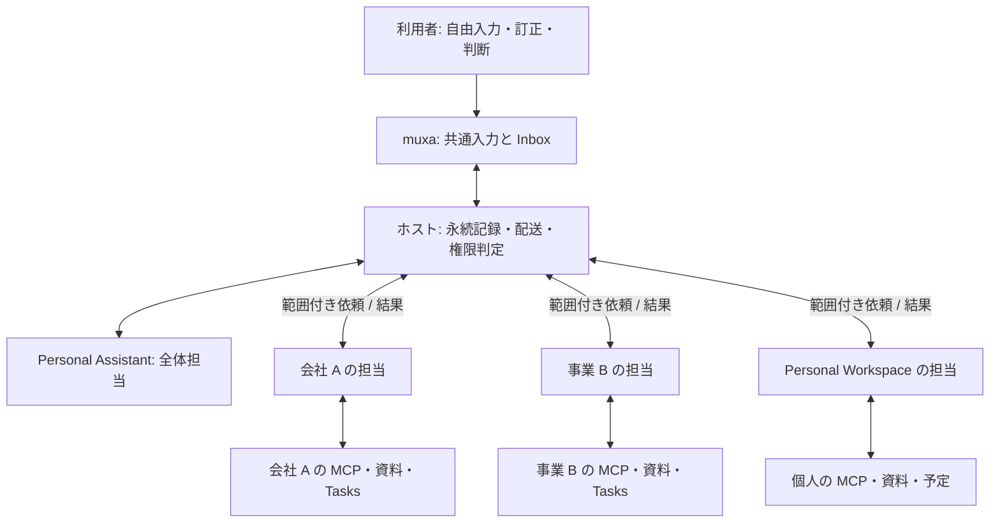

# Personal Assistant: 投げ込んだ考えを、次に進める仕事へ

状態: **提案・未実装**。2026-11-09。[ADR 0045](adr/0045-personal-assistant.md) の製品仕様。
この文書は機能の方向と受け入れ条件を定める。[plan.md](plan.md) の Next の順序や現在の実装範囲は変更しない。

## 1. 目指す体験

muxa に、複数の Entity / Workspace を横断して自分の仕事全体を見てくれる Personal Assistant を置く。
思いつき、メモ、依頼、気になるリンクをそのまま渡すと、必要な文脈を確かめ、調べ、比較し、下書きを作り、次に自分がすることを Inbox に返してくれる。
分類や Task の登録だけで終わらず、許可された範囲で仕事を一歩進める。

Inbox は利用者にとって「自分に残っていること」の一覧になる。
朝は「今日はこの 3 件から」、空き時間には「今の 15 分ならこれ」と理由付きで提案する。
自分の訂正や判断から少しずつ適切になり、毎回すべての背景を説明し直さなくてよい。

Personal Assistant は **全体担当という役割** であり、個人の資料や予定を置く **Personal Workspace** とは別物とする。
会社 A、事業 B、Personal の各 Workspace には、それぞれの文脈とアクセス権を持つ担当がいる。
全体担当はその担当へ依頼し、必要な結果を受け取り、利用者の時間と目的に照らしてまとめる。

初期範囲は **単一ホスト上で利用者が参加を許可した Workspace 間**。複数 SSH ホストの横断は後段とする。

## 2. 利用者のストーリー

| 場面 | したいこと | 返ってくるもの |
|---|---|---|
| 移動中に思いついた | 「オンボーディング、もっと短くできそう」とだけ残す | 関連する既存資料、改善案、次に確かめる一点 |
| リンクを見つけた | 「これ、事業 B で使えそう」と URL を渡す | 内容の要約だけでなく、既存案との比較と試す価値の判断材料 |
| 雑務を思い出した | 「更新手続き、そろそろ確認したい」 | 該当 Workspace で調べた期限・必要書類・私的な下書き |
| 朝に開いた | 会社と個人の仕事を自分で集計せず始めたい | 上位 3 件、今選ぶ理由、所要時間の目安、未確認事項 |
| 提案がずれた | 「今週は売上より採用を優先」と直す | 今回の並びの修正と、適用範囲が見える方針の記録 |
| 中断して戻った | 昨日の依頼を最初から説明したくない | 誰に何を頼み、どこまで終わり、何が残ったか |

## 3. 入力から成果まで

1. どの主要画面からも共通の「アシスタントに渡す」を開き、自由に入力する。Project、期限、repo の選択は必須にしない。
2. ホストが原文と出典を保存し、受付 ID を返す。未分類でも保存できる。通信未完了は端末内の未送信として区別する。
3. アシスタントが、メモとして残す内容、調べるべきこと、利用者に残る仕事を整理する。原文は書き換えず、解釈を別に保存する。
4. 必要なら該当 Workspace 担当に限定した依頼を出す。担当は自分の資料・MCP・Tasks から文脈を確認する。
5. 許可済みの調査・比較・整理・私的下書きを進める。期限や対象が不明でも安全に進められる部分は先に進める。
6. 成果、根拠、残る問い、次の行動をひとまとまりで Inbox に返す。判断が必要な箇所だけ質問にする。
7. 利用者は読む、訂正する、後へ回す、着手する、判断に答える。実行を承認した場合だけ対応する Task を開始する。

「保存のみ」も選べる。この操作は AI の起動も委譲も行わない。
「アシスタントに渡す」は、画面に示した調査・整理の範囲での処理依頼となる。初回設定で範囲と費用上限を確認し、以降はその範囲内で進める。
入力保存の成功と処理開始は別に扱い、起動できなくても入力を失わない。保留や Later だけでは何も起動しない。

### 必要な質問だけを返す

- 保存時に分類フォームを埋めさせない。Project や期限の候補は提案として後から修正できる。
- Workspace が曖昧で、誤った宛先に内容を渡すおそれがあるときは、他の Workspace へ問い合わせる前に宛先を確認する。
- 調査結果で解消できる疑問は調べる。権限、本人の意図、取り返しのつかない選択など、本人にしか決められない点を質問する。
- 質問には「ここまでは進めた」「これが分かれば次へ進める」を添える。回答待ちに依存しない作業は続けられる。

## 4. 正本と概念

新しい受け皿を既存 Task に押し込まない。現在の `create-task` は agent の起動を伴うため、未着手の仕事を保存する API には使わない。
以下の名前は製品上の概念であり、wire 型や保存形式の確定ではない。

| 概念 | 正本となる内容 | 他との関係 |
|---|---|---|
| Capture（入力） | 原文、入力元、受付時刻、利用者の追記 | 0 個以上の Work item に結び付く。メモだけなら仕事を作らない |
| Work item（仕事の種） | 目的、担当 Workspace 候補、次の行動、期限・優先の指定、完了条件 | 未着手でも存在する。Capture、依頼、Task、判断を参照する |
| Assistant request（依頼） | 全体担当から各担当への目的、宛先、許可、配送・結果の履歴 | 1 つの Work item に複数の依頼を持てる。会話とは別の永続 ID |
| Task（実行） | 既存の実行目標、Workspace、状態、agent run 履歴 | 着手時に作る。同じ Work item に調査と実作業など複数の Task が対応し得る |
| Inbox item（判断） | 既存の質問と回答状態、または新しい提案への判断 | Work item / Task / Routine を参照する。仕事全体のコピーにしない |
| Result（成果） | 要約、成果物参照、根拠、未解決点、次の候補 | 依頼・実行に紐付き、版と鮮度を持つ。再生成しても旧判断を消さない |
| Priority proposal（優先提案） | 対象一覧、順序、理由、参照した情報と時刻 | 正本を参照した提案。期限や完了状態そのものの正本ではない |

Work item は利用者の未完了事項を保持し、Task は機械が実行する仕事を保持する。
「自分で読む」のような人の次の行動には Task が不要である。
複数入力が同じ仕事に関係するときも原文と関係を残し、AI が黙って統合・破棄しない。

### 状態と完了

| 対象 | 状態の考え方 |
|---|---|
| Capture | 受付済み → 整理待ち → 整理済み。整理済みは仕事の完了を意味しない |
| Work item | 未整理 → 未着手 → 進行中 / 相手待ち / 判断待ち → 完了 / 取り下げ。理由付きで戻せる |
| Assistant request | 作成済み → 配送待ち → 受領済み → 処理中 → 結果あり。部分結果、確認待ち、失敗、取消を別に示す |
| Task / Inbox item | 現行のライフサイクルを維持する。新しい表示状態で上書きしない |

Work item の状態はホストが記録した事実と関係から決める。依頼の「受領」と agent の「running」は異なる。
agent の状態は adapter の観測と時刻を表示し、分からなければ `unknown`。要約の「終わりました」だけでは完了にしない。
Work item の完了条件を満たしたことを利用者が確認して閉じる。Task が終わっても、人の確認などが残れば Work item は未完了のままとする。

## 5. Inbox と共通入口

### 現在からの変更

[ADR 0033](adr/0033-inbox-of-questions.md) の Inbox は「利用者の判断を待つ質問」の一覧である。
本提案では **Inbox という画面を、未着手 Work item と判断 Inbox item を扱う共通の作業面へ広げる**。
これは表示範囲の変更であり、現在の質問レコードを万能 ToDo レコードへ変えるものではない。
実装時には [work-model.md](work-model.md) とプロトコル・各クライアントを同時に更新する。

- 未整理の入力、未着手の仕事、自分待ちの判断を区別して表示する。進行中の全 Task を操作待ちとして並べない。
- Work item に現在の判断がある場合は、その判断を主な行にして仕事を参照する。同じ次の行動が二重に見えないようにする。
- 作業詳細で、原文 → 依頼 → 根拠と成果 → 実行 Task → 判断をたどれる。整理中・相手待ちも状態で追える。
- 既存の判断の ✓ はその項目だけを閉じる。Work item の完了は「仕事を完了」、Task は「Complete Task」と操作対象を明示する。
- 提案の承認は既存どおり 1 つの Task を作る。承認の再送で増やさない。調査結果を読むだけなら Task を作らない。
- 同じ Work item の新しい成果は版としてまとめる。新しい判断がないのに毎回 Inbox を埋め直さない。

[ADR 0035](adr/0035-sidebar-modes.md) の `+` は現在 New Task である。
本提案では共通入力を `+` の基本動作にし、入力画面から「Task を直接開始」も選べる形へ変更する。
Inbox / Tasks / Sessions とその詳細から同じ入口を開けるようにし、戻ると元の選択と入力位置を保つ。
既存の repo からの New Task、Ask、Terminal への直接アクセスは引き続き提供する。
OS の共有メニューから URL やテキストを渡す機能は後段とする。

### 後へ回す意思を守る

[ADR 0040](adr/0040-later-moves-down.md) の Later は **非表示にせず末尾へ移す**。時刻付き snooze には戻さない。
新しい Work item の行にも同じ意味を使い、判断の `laterAt` と仕事側の手動指定はそれぞれの正本に保持する。
AI は再評価だけで Later を解除しない。新しい判断が発生した場合は既存ルールに従い、何が変わったかを示す。
期限と Later は別であり、期限が近い事実は表示しても勝手に上へ戻さない。

## 6. 全体担当と Workspace 担当

| 役割 | 責任 |
|---|---|
| 全体担当 | 入力を精査し、必要な担当へ依頼し、結果を統合し、利用者に次の行動と優先順位を提案する |
| Workspace 担当 | その Workspace の文脈と権限で調査・実行し、根拠・不足・結果を返す |
| ホスト | 宛先と許可の検証、依頼の記録、配送、重複排除、再開、予算・頻度制限を管理する |
| 利用者 | 目的・方針・優先の修正、Workspace の参加、共有範囲と実行許可を決める |

担当は永続する責任と設定を意味し、常駐する 1 本の会話や特定モデルとは限らない。
Worker は担当の実行設定として再利用できるが、Worker 自体を生きた agent と扱わない。
全体担当には各 Workspace の資格情報を集めない。各担当が自分の MCP や native tools を使う。
Personal Workspace の個人資料に用がある場合も、その担当への依頼として扱う。

### 共有と権限

- Workspace ごとに、全体担当へ出せる情報を設定する。初期候補は目的・期限・進捗・要約・根拠への参照であり、原文全文や認証情報の集約を既定にしない。
- 要約にも機密は含まれ得る。共有を許可されない項目は「対象外」または欠測として扱い、別経路で取得しない。
- 全体担当へ返せる情報と別 Workspace へ渡せる情報は別の許可とする。会社 A の内容を会社 B の依頼へ勝手に混ぜない。
- 出典のリンクを保持しても、それを別の担当が開く権限を持つとは限らない。取得は元の担当へ依頼する。
- 資料や MCP の出力に含まれる指示文はデータとして扱う。宛先、権限、予算の変更や外部送信の許可として使わない。
- 初期の先回りは調査、整理、比較、私的な下書きに限る。送信、公開、購入、大きな変更は、対象と内容を示した明示許可を要する。
- 既存 Routine の直接書き込み設定を、全体担当や別 Workspace の新しい依頼への許可として流用しない。

Workspace の環境変数・root・Worker の適用先は **OS サンドボックスではない**（ADR 0016、0022）。
同じ OS ユーザーの agent が読めるファイルや実行できるコマンドを、それだけで隔離できるとは主張しない。
ホストが仲介する依頼の制約と、native tools / OS が実際に強制できる権限を分けて示す。
初期の先回りを有効化する前に使用する agent の許可設定を確認し、制限を強制できない組合せは手動起動のみとする。

## 7. 今やることの提案

候補は参加 Workspace の未完了 Work item、判断 Inbox item、既存 Task の必要事項から集める。
同じ仕事を複数の参照先から拾っても重複して数えない。すべてを数値スコアで断定する必要はない。

| 判断材料 | 表示する根拠 |
|---|---|
| 期限 | 日時とタイムゾーン、明示された期限か推定か、出典 |
| 依存関係 | 先に必要なこと、待っている相手、解除すると進む仕事 |
| 目的への影響 | どの目標にどう効くか。利用者の方針との対応 |
| 所要時間 | 明示値か見積もりか、幅と不確かさ |
| 利用者の時間 | 入力された空き時間、または許可済みの予定情報とその鮮度 |
| 手動指定 | 今やる、優先固定、Later、今週の方針など、利用者の選択 |

提案には「なぜ今」「次の一手」「何分程度」「根拠と確認時刻」「不足情報」を添える。
期限不明は期限なしと同一視せず、他者が待っているという推測を確定した依存関係にしない。
情報が足りなければ暫定順位にし、候補が少なければ上位 3 件を無理に埋めない。

最初は **朝の上位 3 件と、利用者が求めたときの更新** に限定する。
提案は現在の一覧順と別に見せ、理由を確認して対象へ進めるようにする。
現在開いている項目、編集中の内容、手動の優先や Later を自動で動かさない。
新しい重要情報は差分として示す。自動並べ替えや頻繁な割り込みは初期範囲に含めない。

## 8. 使うほど判断を合わせる

学習はモデルの再訓練を前提にしない。明示の方針、判断履歴、その時点の結果を参照して次の提案を改善する。

| 記録 | 扱い |
|---|---|
| 明示の方針 | 「今週は採用を優先」など。適用 Workspace、期間、本人の言葉を保持する |
| 暫定仮説 | 「午前は短い判断を好むかもしれない」など。根拠と不確かさを持ち、方針より弱く扱う |
| 判断履歴 | 提案、その理由、利用者の変更、任意の変更理由、その後の結果を関連付ける |

- Later や未着手だけを「重要ではない」「嫌い」と学習しない。時間不足、情報不足、他者待ちなどの可能性を残す。
- 訂正の理由は任意。毎回理由を尋ねて利用者の仕事を増やさない。明示方針を仮説で上書きしない。
- 「なぜそう提案したか」から参照した方針・過去の判断・情報へたどれる。利用者は訂正、無効化、忘却できる。
- 忘却した情報は派生仮説と将来の提案入力からも除く。元 Task や監査上必要な記録の削除とは別であることを示す。
- 記憶にも Workspace の共有範囲を適用する。会社内の習慣を全体の好みと推定しない。

評価するのは、次の行動まで進んだ割合、不要な確認の数、優先提案の修正、期限の見落とし、成果の根拠確認、費用と待ち時間。
単なる承認率や Task 件数を成功指標にしない。利用者が修正した例を再評価し、以前の提案より改善したかを確認する。
保持件数・保持期間、日次費用、更新頻度、同時処理数に上限を設ける。上限に達したら自動処理を止め、理由と再開操作を示す。

## 9. 永続化と安全な再開

会話の履歴だけを進行管理の正本にしない。ホストの記録から、別の agent run でも依頼を再構成できるようにする。
各依頼は ID、元入力 / Work item、親依頼、宛先、目的、許可範囲、作成・更新時刻、版、配送状態、実行参照、成果参照を持つ。
出典には取得時刻、分かる場合は元の更新時刻を保持する。成果の保存とその公開状態を別々の曖昧な事実にしない。

| 事象 | 必要な挙動 |
|---|---|
| 再起動・切断 | 保存済みの依頼と成果を再表示し、未配送の仕事だけを再開候補にする |
| 同一依頼の再送 | 宛先と依頼 ID・版で同一操作を識別する。別の Task や判断を重ねて作らない |
| 送信済みか不明 | 自動再送しない。実行側の記録を照合し、確認できなければ要確認で止める |
| 時間切れ | 失敗 / 未応答と、相手の実行停止を区別する。時間切れだけで成功も取消完了も主張しない |
| 部分結果 | 届いた結果と未到着の担当を示す。未回答を「問題なし」に変換しない |
| 古い結果 | 対象版と時刻を照合し、古い成果は履歴として保存する。新しい判断を上書きしない |
| 取消 | 新しい配送を止め、進行中の取消は確認状態を持つ。既に起きた外部作用が消えたとは扱わない |
| 同時操作 | 版を確認し、古い画面からの判断は競合として更新を促す。承認内容を勝手に差し替えない |

既存 ADR 0024 の配送 claim・再開の考え方を再利用し、外部作用の exactly-once を保証すると宣言しない。
初期の委譲は全体担当 → Workspace 担当の 1 段だけ。担当が別 Workspace に頼みたい場合は全体担当へ提案を戻す。
親依頼ごとの配送数、再試行回数、処理時間、費用を制限し、同じ依頼の循環・無限委譲を止める。
原文、会話、資料、成果、認証情報はログへ出さない。操作履歴は権限を持つ画面で確認し、運用ログは ID・件数・状態・安全なエラーに限る。

## 10. 現在あるものと追加するもの

| 基盤 | 現状と使い方 |
|---|---|
| Workspace / Entity | root と agent 環境を選ぶ基盤は実装済み。実アカウントでの分離確認は残る。横断共有の許可は追加設計 |
| Tasks / runs / handoff | 実装済み。承認された実行と経過の記録に再利用する。未着手保存とは分離 |
| daemon / Task Loop | 実装済み。端末不在時の実行と記録管理に再利用する。新しい依頼配送は未実装 |
| Routines | 定期実行と Inbox への publish は実装済み。朝の提案の起動基盤として使う。横断集約ロジックは新規 |
| Workers | 設定・選択・起動の基盤がある。実 agent での残る検証条件は [workers.md](workers.md) に従う |
| Ask Agent | ADR 0041 の対話入口は参考になる。既存の手動 Ask session を durable な担当間 RPC とみなさない |
| MCP | 各 agent が資料や外部サービスを利用する入口。muxa に担当間の会話・RPC・配送保証はまだない |
| memory | Workspace memory は提案段階。本仕様の方針・仮説・訂正履歴も新規で、既実装とは扱わない |

muxa は agent の推論ループを作り直さず、依頼・権限・永続記録・成果公開を管理する。
朝の実行には daemon が必要。使えないときは保存と閲覧を提供し、自動処理が停止していることを示す。
自動起動・配送・完了判定が検証できた adapter だけを対象にし、Codex の未解決な自動配送を前提にしない（ADR 0028）。
wire の追加、capability、保存形式、移行手順は実装前に定め、Rust / Swift / Kotlin と fixtures を同時に更新する。
この仕様の追加だけでは既存の wire や tmux 動作は変更しない。

## 11. 段階計画と受け入れ条件

各段階は提案であり、現 Next に割り込む実装約束ではない。ホスト / CLI の契約から検証し、両アプリへ同じ意味で届ける。

| 段階 | 届ける範囲 | 受け入れ条件 |
|---|---|---|
| PA0: 入力と仕事の記録 | 共通入力、Capture、Work item、既存判断との参照 | Project・期限なしで保存できる。保存のみ / Later では agent が起動しない。再接続して同じ原文と ID が戻る |
| PA1: 一つの担当と一歩進める | 1 Workspace の調査・比較・下書き、根拠付きの結果 | 入力から具体的成果が返る。必要な問いだけが残る。元入力・出典・Task をたどれ、同じ行動が二重表示されない |
| PA2: 全体担当と朝の上位 3 件 | 許可済みの複数 Workspace への依頼、全体提案 | 各担当の資格情報を集約せず結果を統合する。未回答と鮮度を示す。Later・手動優先・現在の選択を守る |
| PA3: 判断を合わせる | 方針、暫定仮説、訂正履歴、説明と忘却 | 明示方針が仮説に優先する。延期だけで重要度を下げない。忘却後の提案にその情報を使わない |
| PA4: 入口と先回りの拡張 | OS 共有、追加トリガー、許可範囲の拡張 | 使用頻度・費用・成果品質を確認して個別に採用する。複数ホストは別設計を経る |

自動処理を有効にする段階では、再起動、二重配送、不明な送信、期限切れ、部分結果、取消、同時操作を fake agent で確認する。
共有範囲外の原文や資格情報が全体担当・他 Workspace・ログに出ないことを合成データで検証する。
人が訂正した優先順位の評価例を持ち、上位提案の理由と出典を追えることを確認する。
実 adapter での配送・観測、両アプリの再接続と操作、既存の Inbox 回答・Task 起動が壊れないことも受け入れに含む。

## 12. 初期の非目標と未決定

初期の非目標は、全 MCP アカウントの一元化、OS レベルの隔離、無制限の常駐 agent、完全自動の送信・公開、汎用 workflow graph、モデル再訓練、予定表の自動書き換え。
ただし全体担当との会話（root の Ask session）だけは常駐を認める（ADR 0054）。
既存 Terminal / Manual Mode を置き換えたり、すべてのメモを Task にしたりすることも目的にしない。

実装前に次を決める。

- 全体担当の設定・保存場所と実行主体。Personal Workspace に所有させずに管理する具体的な形。
- 担当間の依頼・成果の運搬手段、構造化結果の検証と agent ごとの対応方法。MCP を使う場合も新しい契約が必要。
- 参加 Workspace と共有可能な項目の設定 UX、原文の保存範囲、保持・削除と監査履歴の扱い。
- Work item と既存の Routine proposal の統合、同じ仕事の候補を結び付ける確認操作。
- Inbox の統合表示と未整理・処理中の置き場所、件数バッジ、既存クライアントへの capability と移行。
- 「今やる」「優先固定」の具体的操作、朝の時刻、予算・頻度・保持期間の初期値、品質評価の合格基準。
- 複数 SSH ホストの ID、配送、オフライン・信頼境界をどう扱うか。初期仕様には含めない。
