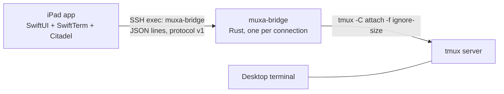

# muxa roadmap

## Status

Pre-alpha. The bridge, the terminal client and the iPad and iPhone app work, and the app runs on a real iPad. The app is not on the App Store yet.

What works today:
- **Bridge** (`muxa-bridge`, macOS and Linux, tmux ≥ 3.2): runs as an SSH exec command, attaches to tmux in control mode without taking part in window sizing, and speaks protocol v1 (`protocol/PROTOCOL.md`).
- **Terminal client** (`muxa-cli`): a reference client and end-to-end harness.
- **iPad app:**
  - one pane at its real size, scaled to fit; wide panes fit the width and scroll with the cursor (ADR 0004);
  - saved hosts, one-time password setup of a restricted key, and host keys pinned on first use;
  - sessions grouped by repo, with each agent's state and its age;
  - the Agent / Terminal switch, and every keyboard shortcut in the README;
  - Chat: a Claude Code or Codex conversation as messages, with a composer and quick keys (ADR 0005, `docs/agents.md`);
  - approval cards in Chat when Claude Code waits on a permission, a question or a plan (ADR 0009);
  - the Reader, in tabs: the pane's plan and the repo's Markdown files, rendered offline (ADR 0006); its uncommitted changes and its branch's commits as diffs (ADR 0007, 0011); its images, ignored folders included (ADR 0010);
  - starting and closing tasks, with or without tmux-agents (ADR 0007);
  - a banner when an agent in another session waits, finishes or fails (ADR 0008);
  - Japanese input in the pane;
  - a bar with Esc, Tab, Ctrl and the arrows above the on-screen keyboard.
- **iPhone app** (the same app, ADR 0012): the layout follows the size classes, so a folded iPhone Duo gets the phone layout and an unfolded one the iPad layout, without losing the pane, its screen or the keyboard. On a phone, a pane whose font would go below 9 pt keeps 9 pt and scrolls on both axes.

## Next

- Check the iPhone app on a real iPhone: the 9 pt floor, and the key bar (the iPhone simulator reports a hardware keyboard, so its UI test skips there).
- The Android client: phones, tablets and foldables, designed in ADR 0013.

## Later

muxa's own push notifications while the app is closed (APNs needs a relay server, ADR 0008), `pause-after` for slow links, scrollback, watching several panes, mouse, input leases for two typing devices, and a shared Rust client core (UniFFI).

## Design

The decisions and their reasons are in `docs/adr/`. The tmux facts they rely on are in `docs/findings/tmux-control-mode.md`. In short:

- **Bridge:** a Rust binary started as the SSH exec command. No daemon and no port. SSH handles authentication and host-key pinning (ADR 0003).
- **Protocol contract:** `protocol/PROTOCOL.md` plus `protocol/fixtures/`. The Rust and Swift tests decode the same fixtures, so a third-party client can rely on them.
- **Never resize.** The bridge attaches with `-f ignore-size` and never sends `refresh-client -C`, `resize-*`, `select-window`, `select-pane` or `refresh-client -A %p:off`. A lone control client with a size set resizes every window (`scripts/repro/ignore-size.sh`). Plugins that read `client_width` must skip control-mode clients (README).
- **Rendering:** at the pane's real cols × rows, with the largest font that fits (ADR 0004).
- **Input:**
  - text → `send-keys -l`;
  - named keys → `send-keys`, so tmux encodes them for the pane's modes and extended keys;
  - paste → `paste-buffer -p`.
- **Pane roles and agent state** come from tags or adapters, never from guesses. The order is in the README.
- **Minimum tmux is 3.2:** `-f ignore-size` and `list-* -f` need 3.2, `capture-pane -N` needs 3.1, `send-keys -H` needs 3.0. Never parse layout strings; their format changes in 3.8.

### Bridge internals

Reading tmux:
- Read output as bytes (`read_until(b'\n')`) with a line-length cap. `%output` carries raw non-UTF-8 bytes. Payloads stay bytes; only format fields go through `from_utf8_lossy`.
- End a reply block only on the `%end`/`%error` whose number matches its `%begin`. After an error, mark the rest of the command line skipped.
- The tmux process runs with `TMUX` removed and `kill_on_drop(true)`. The bridge exits on stdin EOF and on `BrokenPipe` from stdout (Rust ignores SIGPIPE).

The server:
- One event loop owns the watch. Requests run in order.
- A writer task has a bounded queue. On overflow, it drops output and resyncs.
- Snapshot results are always delivered. A timeout retries once. Held output is capped at 1 MiB.
- A layout change during a sync is replayed after the sync.
- The bridge exits after 60 s with no request. A `ping` counts, so a quiet watched pane keeps it alive.

### Rejected

- Attaching a normal tmux client, as Multiplex and Remux do: it resizes the window (ADR 0001).
- A shared Rust client core through UniFFI, for now. It would replace the Citadel and SwiftTerm glue and add a build pipeline. ADR 0013 proposes sharing only the session core when the Android client starts; the fixtures make that switch safe.

## Verification

| Part | Check |
|---|---|
| Everything | `make check` |
| tmux behavior, the bridge | `make test-tmux`, `make repro`. CI runs them on tmux 3.2a, 3.4 and the latest release, on Linux and macOS. |
| MuxaKit | `make test-apple`; `make test-apple-tmux` against the real bridge |
| The iPad and iPhone app | `make test-app` (iPad mini, with the fold test) and `make test-app-iphone`, in the simulator against the in-app demo bridge |
| No layout change on a real server | `scripts/layout-snapshot.sh` before and after an attach; the diff is empty |

## Risks

- **Slow links.** The bridge has a bounded writer and resyncs on overflow. `pause-after` comes later.
- **SwiftTerm vs vt100.** The MuxaKit replay tests compare SwiftTerm with the recorded screens.
- **Half-open links after iOS suspends the app.** The bridge's idle timeout ends them.
- **The SSH key can run a shell** unless it is restricted. `SECURITY.md` shows the `authorized_keys` restriction, and the app sets it up.
