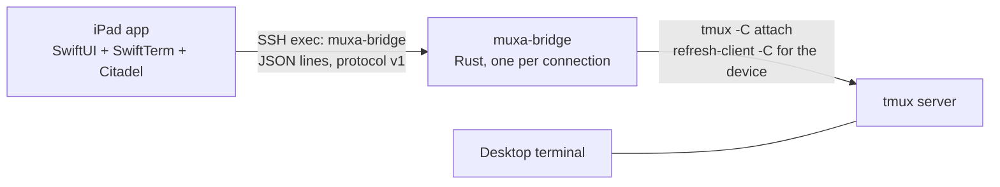

# muxa roadmap

## Status

Pre-alpha. The bridge, the terminal client, the iPad and iPhone app and the Android app work. The iOS app runs on a real iPad and iPhone; the Android app on phones and tablets. The store listings, screenshots, privacy policy and release settings are ready (`store/RELEASE.md`); neither app is published yet.

What works today:
- **Bridge** (`muxa-bridge`, macOS and Linux, tmux ≥ 3.2): runs as an SSH exec command, attaches to tmux in control mode, and speaks protocol v1 (`protocol/PROTOCOL.md`). For a client that sends `viewport`, the watched pane's window follows the device in use, as tmux's `window-size latest` does for terminals (ADR 0020, proposed); for other clients it never takes part in window sizing.
- **Host daemon** (`muxa-bridge daemon`, optional, ADR 0019): installed by hand as a LaunchAgent or a systemd user unit. It serves Task records on a private Unix socket, and runs the Task Loop while no client is connected. Without it, the bridge serves Task records itself, and loops are off.
- **Terminal client** (`muxa-cli`): a reference client and end-to-end harness. It also lists, creates, finishes and restarts Tasks and starts and stops their loops, with `--json` for desktop tools (`docs/agents.md`).
- **iPad app:**
  - one pane, sized for the iPad while it is in use (ADR 0020) and rendered at its real size, scaled to fit; wide panes fit the width and scroll with the cursor (ADR 0004);
  - saved hosts, one-time password setup of a restricted key, and host keys pinned on first use;
  - sessions grouped by repo, with each agent's state and its age;
  - the Agent / Terminal switch, and every keyboard shortcut in the README;
  - Chat: a Claude Code or Codex conversation as messages, with a composer and quick keys (ADR 0005, `docs/agents.md`);
  - approval cards in Chat when Claude Code waits on a permission, a question or a plan (ADR 0009);
  - the Reader, in tabs: the pane's plan and the repo's Markdown files, rendered offline (ADR 0006); its uncommitted changes and its branch's commits as diffs (ADR 0007, 0011); its images, ignored folders included (ADR 0010);
  - starting and closing tasks, with or without tmux-agents (ADR 0007);
  - Inbox: Triage navigation with local Snooze and the grouped List, a Task detail, New Task with or without a repo, status changes, and per-workspace agent environments (ADR 0015, 0016);
  - Restart agent with a handoff in `.muxa/HANDOFF.md`, and the Task's runs (ADR 0018);
  - the Task Loop: a check after each turn, a Loop section with its state, Start loop, Stop loop and the check log, when the host runs the daemon (ADR 0019);
  - a banner when an agent in another session waits, finishes or fails (ADR 0008);
  - Japanese input in the pane;
  - a bar with Esc, Tab, Ctrl and the arrows above the on-screen keyboard.
- **iPhone app** (the same app, ADR 0012): the layout follows the size classes, so a folded iPhone Duo gets the phone layout and an unfolded one the iPad layout, without losing the pane, its screen or the keyboard. On a phone, a pane whose font would go below 9 pt keeps 9 pt and scrolls on both axes.

- **Android app** (ADR 0013): the same features as the iOS app, for phones, tablets and foldables. The layout follows the window and the hinge: a stack when compact, the list beside the pane when wide, the list and the pane on either side of a half-open book fold, and the keys below the hinge on a table. A fold, a rotation or a window resize keeps the connection, the pane, its screen and the keyboard. The pane is drawn from JediTerm at its real size; shortcuts are Ctrl+Shift chords.
- **Try the Demo** (both apps, every build): sample sessions from the in-app demo bridge, with no host and nothing saved. App Review and Play review use it.

## Next

Order (ADR 0026, 0027). Each phase lists parallel lanes; the details follow below.

1. **Phase 0, clean up:** done. The open work is committed and merged agent worktrees are removed. Work continues on `plan/workspace-vision`; it is not merged into `main` yet.
2. **Phase 1, ship 1.0:** real-device checks, the daemon on a Mac, the developer's decisions on ADR 0015–0021 and 0023, then publish. Agent lane: the supported tmux CI matrix.
3. **Phase 2, Workers:** simplify the selection contract (ADR 0027 section 1), named create and restart, the pickers, then advertise `workers`. Codex continues restarted runs by hand. Parallel lanes: the Sessions filter (UI only); the Codex session-ownership ADR (proposed ADR 0028: muxa creates the thread and sends turns by id; waits for the developer's checks with a real login).
4. **Phase 3, Routines and Inbox:** `[[routine]]`, the trigger on the daemon tick, `routine-run` records, the output publish, Move down and Later on the Task record, and the Inbox list with approve → Task (ADR 0026 S0–S3). CLI first, then one app, then the other.
5. **Phase 4:** workspace memory as a Routine (ADR 0027 section 6). Then, as needed, the Linux daemon and tmux-agents (ADR 0017).
6. **Phase 5:** workflow graph, then autonomous work.
7. **Any time:** Android full R8, Android multi-window, scrollback, mouse, `pause-after`, watching several panes.

- **Inbox visibility and navigation** (ADR 0023, slice 1 accepted; `docs/inbox.md`): identify Task sessions by title, group, reported age and loop; retain List/detail and add Triage navigation, Next and local Snooze. Phones open Triage once per connection for Needs attention only. Existing Chat keeps approvals and composition.
  - P0 done: shared needs and deterministic queue order, CLI `need`, 26 cross-client fixture cases. Verified with `make check`, `make test-apple` and `make test-android`.
  - P1 done: iOS and Android Task titles, group/age and loop badges in session rows; switcher search includes titles.
  - P2 done: Triage navigation, snooze invalidation, shortcuts and initial phone routing. Verified with iPad Task/Inbox UI tests (including targeted reruns), iPhone routing/Triage/demo tests, Android app tests and the fold/resize rerun; package/JVM tests and Android lint pass.
  - P3 done on tmux-agents' existing `muxa-task-records` branch: the popup displays CLI need labels, keeps older CLI compatibility and never answers menus. Its 13 Inbox tests and ShellCheck pass; it is not merged. Inline Triage actions and daemon sidebar/status summaries remain proposed slice 2; their approval identity, chat ownership and metadata lifecycle contracts must be resolved first.

- **Workers and restart recovery, in progress** (ADR 0022 remains proposed; `docs/workers.md`): W0 component probes and `make check`, `make test-tmux`, `make repro` now pass locally (explicit-command respawn, argv/env/layout preservation, retained state tags, fixture registry rematching and the external-effect/record-CAS counterexample). `docs/findings/workers-w0.md` records pending native probes, supported-tmux matrix and restart claim/recovery acceptance cases. Proposed ADR 0024 now specifies restart serialization and explicit recovery; its cross-process OS-lock probe passes locally, including holding beyond ten seconds and release after owner death. Production restart/recovery acceptance remains pending, so W0 remains incomplete. W1 contract preparation was explicitly authorized: protocol/types/fixtures for worker metadata, Keep/default/named selection, Task/run assignment and restart revision are now implemented; the workers capability stays off. W2 now includes worker config/resolution, internal create/restart preparation from one validated command/instruction snapshot, direct native argv launch, explicit initial run assignment, persistent OS record locks, scoped Task claims for legacy restart/senders/loop dispatch/close and phase-persistence probes. Managed header refresh preserves the selected instructions and agent notes. W3 CLI/iOS/Android selection and assignment display are prepared behind the capability. Staged-file restart recovery, durable input-delivery claims and explicit recovery API/CLI/iOS/Android actions are now implemented for workspace-default Tasks under independent `task-restart-recovery`; local kill-boundary and bridge/daemon tests exercise uncertainty without automatic retry. Active Chat now rebinds on pane process/session replacement, and state notifications detect PID and report-time changes; bridge/daemon recovery tests also reject unknown operations and modified/symlinked stages. New runs now retain process/start and earlier-session observation baselines; managed state/Chat/Loop input and subsequent restarts reject stale tags and unbound sessions. Internal concurrency/source-change/invalid-instruction/tmux-error tests and prepared/finalized real-kill tests extend acceptance coverage. Codex’s current time-based session match and hook-only agents cannot authorize automatic continuation after a managed restart. Named-worker startup/delivery, authenticated native readiness and remaining R01–R16/native/CI verification still gate workers. Memory M0 source/fixture findings and M01–M17 acceptance cases are in `docs/findings/memory-m0.md`; ordered completion is not yet established. This is not a commitment to ship unverified workers. Workers and handoff (W) ship independently of workspace memory/close-out (M); neither adds per-worker environment overrides. Production implementation follows acceptance of the W contract.
- **Workspace and Task foundation, first slice** (ADR 0015, `docs/vision.md`): create a Task, launch an agent on it, watch its state, review the result, and step into the terminal. Manual Mode stays as it is.
  1. Done: protocol: `list-tasks`, `create-task`, `update-task`, the session field `taskId`, the error `conflict`, the capability `task-records`.
  2. Done: bridge: task records in `$XDG_STATE_HOME/muxa/tasks/` (`--state-dir`), workspaces from `~/.config/muxa/workspaces.toml` (`--workspaces`), the `@muxa_task` link and its fallback by directory, `TASK.md` and the first prompt once the agent is idle.
  3. Done: CLI: `muxa-cli tasks`, `task new`, `task done`.
  4. Done: apps (iOS and Android): a Tasks list with the Inbox groups (Needs attention, Ready for review, Running, No agent, Closed), a Task detail that opens its pane, Chat, `TASK.md` or its changes, a New Task sheet and status changes. The store screenshots predate it.
  5. Done in code: per-workspace agent environment (ADR 0016, proposed). `[workspace.agent]` with `command` and `env`, passed with `new-session -e`; the Claude Code and Codex adapters search every workspace's `CLAUDE_CONFIG_DIR` and `CODEX_HOME`. tmux-agents' side waits for ADR 0017's `agent-env`; until then such Tasks use the built-in launcher. Still to check by hand: two real logins (item 9).
  6. Desktop client (ADR 0017, proposed): tmux-agents shows the same Tasks inside tmux.
     - Done in muxa: `muxa-cli tasks --json` and `task new --json`, the bridge waiting for a start prompt after its client leaves, `--muxa-task` for tmux-agents that announce it, and the contract test against a real tmux-agents (`MUXA_TMUX_AGENTS`).
     - Done in tmux-agents, on its branch `muxa-task-records`, not merged yet: `prefix + N` creates a muxa Task, `prefix + T` shows the Inbox, and `new.sh --muxa-task`.
  7. Done in code: handoff and agent runs (ADR 0018, proposed). The record keeps `runs`; `TASK.md` gets Progress, Decisions and Next actions, which the agent keeps and the bridge never rewrites; `restart-agent` writes `.muxa/HANDOFF.md` from facts and restarts the agent in the same pane with `respawn-pane -k`; `muxa-cli task restart`. The Android, iPad and iPhone apps show a Task's runs, open `HANDOFF.md` in the Reader, and restart the agent after a confirmation that asks to stop a running one.
  8. Done in code: the Task Loop in a host daemon (ADR 0019, proposed). A `check` command runs after each agent turn; a failure types a fixed prompt, a pass moves the Task from `open` to `review`, an agent waiting on the user pauses the loop, and every other gate stops it.
     - P0 to P5 are done: a fresh `done` is a finished turn; `muxa-bridge daemon run`, `install`, `stop`, `restart`, `uninstall` and `status`; every record request through the daemon with a local fallback; durable prompt waits (`pendingPrompt`); `tasks-changed`; the quiet tmux client (`ignore-size,no-output`); the loop engine and `[workspace.loop]`; the wire types, `protocol/fixtures/inbox/` and the CLI loop commands; the iOS and Android Loop section, New Task check and Inbox row.
     - P6, the docs: README, `SECURITY.md`, `docs/agents.md` and this plan.
     - Still to do by hand: load the daemon once with `muxa-bridge daemon install` on a Mac (launchd) and, if used, on Linux (`systemd --user`); tests use a fake service manager. Then run one loop on real devices.
  9. Real work by the developer: one coding Task, and a product and an admin Task without a repo. With two real logins, check that the workspaces' accounts stay apart (ADR 0016, Consequences).
  10. The developer accepts or changes ADR 0015 to 0019. All five are still proposed.
- Check the iPhone app on a real iPhone: the 9 pt floor, and the key bar (the iPhone simulator reports a hardware keyboard, so its UI test skips there).
- Check the Android app on a real phone and tablet: the 9 sp floor, the key bar, Gboard Japanese input, and a hardware keyboard.
- ADR 0020 and 0021 (window size follows the device, from a device session): the developer accepts or changes them, then checks them on the real server with a real iPad and laptop, and with tmux-agents. tmux-agents skips device sessions from its `muxa-task-records` branch on. The store listings still say the desktop layout never changes.
- Publish 1.0: the account steps, uploads and console answers in `store/RELEASE.md` (by the developer).
- Android: two windows on two panes (multi-window).
- Android: full R8 (renaming and optimization) for release builds, with a release-build test that connects over SSH. 1.0 only removes unused code (ADR 0014): BouncyCastle, sshj and JediTerm load classes by name.

## Requested follow-on design

- **Inbox queue** (proposed ADR 0025, simplified by ADR 0027): an ordered list with Act, Done, Move down and Later, a separate manual Sessions destination and an All Tasks destination. Move down and Later are optional fields on the Task record. Nothing is implemented.
- **Routines** (proposed ADR 0026): a Routine runs an agent on a trigger, for example every morning. The agent reads its sources (Slack, Linear, Notion and others) through its own native tools and publishes briefings and proposals to Inbox. An approved proposal becomes one new Task that performs the action. A run is a record of kind `routine-run`, not a Task in the UI. Nothing is implemented. Phase 3 of the order above.

Milestones and dependencies are in `docs/workers.md`; the domain definitions are in `docs/work-model.md`.

## Later

Direction from `docs/vision.md`, not commitments:
- **Workspace memory** (ADR 0022 release M, proposed): reviewed WORKSPACE.md close-out. ADR 0027 builds it as a Routine instead of its own transaction model. Per-worker environment/account overrides and exact reset are deferred. See `docs/findings/workers-design-review.md`.
- **Workspace and Task foundation** (vision phase 2): after the first slice, Resources beyond one repo (documents, issue trackers), a Project entity if needed, and repos limited to workspace roots.
- **Managed agent execution** (phase 3): muxa starts and follows agent runs for a Task and keeps their history while no client is connected; context handoff between runs. The first part, recorded only while a bridge or the daemon handles a request, is in the first slice (ADR 0018, 0019).
- **Workflow orchestration** (phase 4): Tasks in a graph, where one step's result starts the next. The host daemon (ADR 0019) can run it.
- **Autonomous work** (phase 5): agents take and finish Tasks within approval gates and workspace isolation.

Also: `pause-after` for slow links, scrollback, watching several panes, mouse. Deferred with no date (ADR 0027): muxa's own push notifications while the app is closed (APNs needs a relay server, ADR 0008). Cut: input leases for two typing devices.

## Design

The decisions and their reasons are in `docs/adr/`. The tmux facts they rely on are in `docs/findings/tmux-control-mode.md`. In short:

- **Bridge:** a Rust binary started as the SSH exec command. No network port. SSH handles authentication and host-key pinning (ADR 0003).
- **Host daemon** (optional, ADR 0019): `muxa-bridge daemon run`, one per user, started by launchd or `systemd --user`. It listens only on `daemon.sock` (directory 0700, socket 0600, peer uid checked). A bridge sends each Task request to it, one connection per request, when it runs the bridge's version; otherwise the bridge serves the request itself. It runs the Task Loop, and attaches its own tmux client with `-f ignore-size,no-output` only while it has work.
- **Protocol contract:** `protocol/PROTOCOL.md` plus `protocol/fixtures/`. The Rust and Swift tests decode the same fixtures, so a third-party client can rely on them.
- **The window follows the device in use** (ADR 0020, 0021, proposed). The client sends `viewport`, the grid its pane area shows at its default font. The bridge then takes part in window sizing like a desktop terminal under `window-size latest`: it sizes a second control client so that the watched pane gets that grid. That client sits in a device session of its own, which holds only the watched window (`link-window`), so any window follows, with `aggressive-resize` off or on, and the laptop stays on its window. Lists skip device sessions (`@muxa_device`); closing a task kills them first; a bridge removes leftovers of a crashed one when it starts. Typing on the laptop in that window takes it back; typing on the device takes it again. Only windows whose `window-size` is `latest` follow. Without `viewport`, the bridge attaches with `-f ignore-size` and sends no size, as before. Nothing sends `resize-*`, `select-window`, `select-pane` or `refresh-client -A %p:off`. Plugins that read `client_width` must skip control-mode clients (README).
- **Rendering:** at the pane's real cols × rows, with the largest font that fits (ADR 0004). With `viewport`, the pane usually is the device's grid.
- **Input:**
  - text → `send-keys -l`;
  - named keys → `send-keys`, so tmux encodes them for the pane's modes and extended keys;
  - paste → `paste-buffer -p`.
- **Pane roles and agent state** come from tags or adapters, never from guesses. The order is in the README.
- **Minimum tmux is 3.2:** `-f ignore-size` and `list-* -f` need 3.2, `capture-pane -N` needs 3.1, `send-keys -H` needs 3.0. Never parse layout strings; their format changes in 3.8.

### Bridge internals

Reading tmux:
- Read output as bytes (`read_until(b'\n')`) with a line-length cap. `%output` carries raw non-UTF-8 bytes. Payloads stay bytes; only format fields go through `from_utf8_lossy`.
- End a reply block only on the `%end`/`%error` whose number matches its `%begin`. After an error, mark the rest of the command line skipped.
- The tmux process runs with `TMUX` removed and `kill_on_drop(true)`. The bridge exits on stdin EOF and on `BrokenPipe` from stdout (Rust ignores SIGPIPE).

The server:
- One event loop owns the watch. Requests run in order.
- A writer task has a bounded queue. On overflow, it drops output and resyncs.
- Snapshot results are always delivered. A timeout retries once. Held output is capped at 1 MiB.
- A layout change during a sync is replayed after the sync.
- The bridge exits after 60 s with no request. A `ping` counts, so a quiet watched pane keeps it alive.

### Rejected

- Attaching a normal tmux client, as Multiplex and Remux do: it needs a PTY, and it sizes the window to the whole device, not to the pane the device shows (ADR 0001, 0020).
- A shared Rust client core through UniFFI (ADR 0013). Swift and Kotlin each keep their own session core; `protocol/fixtures` keeps them to one contract.

## Verification

| Part | Check |
|---|---|
| Everything | `make check` |
| tmux behavior, the bridge | `make test-tmux`, `make repro`. CI runs them on tmux 3.2a, 3.4 and the latest release, on Linux and macOS. |
| The host daemon and the Task Loop | `make check` (the loop's `step`, the check runner, the `install --print` golden files); `make test-tmux` (`tests/daemon.rs`, `tests/loops.rs`: a real daemon, a fake agent, the layout snapshot and the log grep); `make repro` (`daemon-client.sh`, `client-activity.sh`); loading the real LaunchAgent or systemd unit by hand |
| The contract with tmux-agents | `MUXA_TMUX_AGENTS=<tmux-agents checkout> make test-tmux` (ADR 0017); tmux-agents' own `bats tests` |
| MuxaKit | `make test-apple`; `make test-apple-tmux` against the real bridge |
| The iPad and iPhone app | `make test-app` (iPad mini, with the fold test) and `make test-app-iphone`, in the simulator against the in-app demo bridge |
| The Android client | `make test-android`, `make test-android-tmux`, `make lint-android`; `make test-android-app` on a phone, Pixel Tablet and Pixel Fold emulator, against the in-app demo bridge |
| The store listings | `make lint-store` (in `make check`); `make screenshots` and `make screenshots-android` check every image's size |
| Try the Demo, in a release build | `TryDemoTests` (iOS) and `TryDemoTest` (Android) on the debug build; the release APK and a Release iOS build by hand |
| No layout change on a real server | `scripts/layout-snapshot.sh` before and after an attach; the diff is empty |

## Risks

- **Slow links.** The bridge has a bounded writer and resyncs on overflow. `pause-after` comes later.
- **SwiftTerm vs vt100.** The MuxaKit replay tests compare SwiftTerm with the recorded screens.
- **Half-open links after iOS suspends the app.** The bridge's idle timeout ends them.
- **The SSH key can run a shell** unless it is restricted. `SECURITY.md` shows the `authorized_keys` restriction, and the app sets it up.
- **A check runs a command with no pane to show it.** `[workspace.loop]` in `workspaces.toml` decides per workspace which commands may run (`SECURITY.md`).
- **After an upgrade, loops are off until `muxa-bridge daemon restart`.** The bridge uses only a daemon of its own version.
