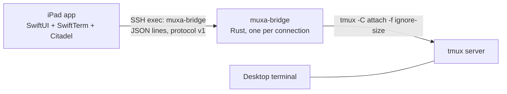

# muxa — plan to the iPad MVP (Phase A)

## Context

People run AI coding agents in tmux on an always-on Mac. muxa lets them work on the **same** running panes from an iPad with an external keyboard. It shows one pane full-screen, switches natively, and never changes the desktop layout. muxa is **open source**, in **one monorepo**, and the bridge is in **Rust**.

Milestone 0 findings, each verified on isolated `-L` tmux servers:
- A control-mode client with `-f ignore-size` never resizes windows. This holds even when it is the only client.
- `%output` can be cut exactly at a snapshot. Each notification is tagged with the number of reply blocks seen before it.
- `%output` only covers the control client's current session. After a failed command in a `;` list, the rest of the list is skipped and sends no reply. Targets must be ids, never names.
- The author's own setup uses the tmux-agents plugin. It tags pane roles and agent state, and it has a bug: when a control client attaches, every sidebar is removed. The fix belongs in tmux-agents (approved): skip control-mode clients. A bridge-side workaround (`refresh-client -C` at attach) was rejected in Phase 1. A lone control client with a size set resizes every window (`scripts/repro/ignore-size.sh`).

User decisions: Rust for the bridge. Open source. Monorepo. Xcode will be installed on this Mac mini. tmux-agents gets the control-client fix. This plan runs through the iPad MVP. The repo starts empty; the earlier prototype code is discarded.

## Approach



- **Bridge:** a Rust binary started as the SSH exec command. No daemon and no port. SSH handles auth and host-key pinning.
- **Protocol contract:** `protocol/PROTOCOL.md` plus `protocol/fixtures/*.jsonl`. Both the Rust and the Swift tests decode the same fixtures. Third-party clients can implement it.
- **Pane roles are generic.** Sources, in order:
  1. a muxa pane option `@muxa_role` that any user can set;
  2. the tmux-agents adapter (`@agents_role`, `@agent_state`, ...);
  3. otherwise `unknown`, with the foreground command shown.

  Agent state is reported only when an adapter supplies it, with its age.
- **Rendering:** at the pane's real cols × rows, using the largest font that fits. Never resize.
- **Input:**
  - text → `send-keys -l`;
  - named keys → `send-keys`, so tmux encodes them for the pane's modes and extended keys;
  - paste → `paste-buffer -p`.
- **Agent/Terminal toggle** when roles are `unknown`: the other pane in the same window whose foreground command is a shell. If there is none, the toggle is disabled.
- **Minimum tmux is 3.2.** Bridge features by version: `-f ignore-size` and `list-* -f` need 3.2, `capture-pane -N` needs 3.1, `send-keys -H` needs 3.0. Never parse layout strings; their format changes in 3.8.
- **Never send `refresh-client -C`.** A lone control client with a size set resizes every window. Plugins that read `client_width` must skip control-mode clients; README documents this.
- **Never send** `select-window`, `resize-*` or `refresh-client -A %p:off`.
- **Rejected:**
  - A shared Rust client core through UniFFI now. It would replace Citadel and SwiftTerm glue and add a build pipeline before the first app works. Revisit it when the Android client starts; the fixtures make that switch safe.
  - Attaching a normal tmux client, as Multiplex and Remux do: it resizes the window.

### Repo layout

```
Cargo.toml            # Rust workspace
crates/muxa-protocol  # message types (serde), version, fixture tests
crates/muxa-tmux      # control client, escape/quote, discover, snapshot, input
crates/muxa-bridge    # bin: stdio server
crates/muxa-cli       # bin: terminal client over ssh (reference client, test harness)
protocol/             # PROTOCOL.md + fixtures/ (messages) + fixtures/scenarios/ (recorded streams + expected screens)
apple/MuxaKit         # Swift package: protocol, transport, pane session
apple/Muxa            # iPad app (Xcode project)
docs/plan.md          # this plan, kept current as the roadmap
docs/product-brief.md # the original handoff, verbatim
docs/findings/        # verified tmux facts, each with its repro script
docs/adr/             # 0001 control mode + ignore-size, 0002 Rust + monorepo, 0003 SSH exec transport
scripts/              # harness: tmux sandbox, layout snapshot/diff, repro scripts, agent guard hook
AGENTS.md CLAUDE.md   # agent instructions (CLAUDE.md imports AGENTS.md)
Makefile              # one entry point: make check / test / test-tmux / sandbox
.claude/settings.json # project hook: blocks tmux commands that target the default server
README.md LICENSE-MIT LICENSE-APACHE CONTRIBUTING.md SECURITY.md
.github/workflows/    # cargo fmt/clippy/test on macOS + Linux with tmux; swift test on macOS
```

Crates: `tokio` (process, io), `serde`/`serde_json`, `base64`, `bytes`, `thiserror`, `tracing`, `lexopt` (small flag surface); `crossterm` for the CLI. Dev: `vt100` (MIT), `rand`, `tempfile`. All dependency licenses are permissive. iTerm2 is GPL: use it as a reference only and copy none of its code.

## Phases

Status:
- Phases 1–3 done: harness; `muxa-tmux` and `muxa-protocol`; the bridge with integration and stress tests.
- Phase 4 done as a draft PR in tmux-agents. The author's checkout runs it. `crates/muxa-bridge/tests/plugin.rs` fails against tmux-agents `main` and passes with the fix.
- Next: Phase 5.

1. **Harness first.** Everything an agent or contributor needs to work safely, before any feature code:
   - Docs:
     - `docs/plan.md` (this plan);
     - `docs/product-brief.md` (the handoff, verbatim);
     - `docs/findings/tmux-control-mode.md`: each Milestone 0 fact with the command that proves it;
     - ADRs 0001–0003. ADR 0003 notes that Citadel pins a fork of swift-nio-ssh.
   - `AGENTS.md`, the single source of agent instructions:
     - the project map;
     - the commands (`make check`, `make test-tmux`, `make sandbox`);
     - the invariants: never resize, ids not names, never touch the default tmux server, never send `select-window`/`resize-*`/`%p:off`, never log pane bytes;
     - the definition of done per phase, and the commit/PR rules (draft PRs only).
   - `CLAUDE.md` imports `@AGENTS.md` and adds only Claude-specific notes.
   - `README.md` for humans: what muxa is, status (pre-alpha), the "never changes your layout" promise, the diagram, requirements (tmux ≥ 3.2), and links.
   - Harness scripts, generic, with no personal paths:
     - `scripts/tmux-sandbox.sh`: an isolated `-L` server with a fake agent | shell layout and optional tmux-agents loading via env var. It has `up`, `down` and `attach`.
     - `scripts/layout-snapshot.sh`: before/after layout record plus diff, for any server.
     - `scripts/repro/*.sh`: the Milestone 0 probes.
   - `Makefile`: `check` (fmt + clippy + test), `test-tmux`, `sandbox`.
   - Agent guard: `.claude/settings.json` with a PreToolUse hook, `scripts/hooks/guard-tmux.sh`. It blocks Bash `tmux` calls without `-L`/`-S` in this repo, so no agent touches live sessions by mistake.
   - Repo skeleton: Cargo workspace with empty crates, licenses, `CONTRIBUTING.md`, `SECURITY.md`.
   - CI matrix: ubuntu-22.04 (tmux 3.2a), ubuntu-24.04 (3.4), macOS with Homebrew tmux. Set `TMUX_TMPDIR` and `TERM`.
   - You install Xcode now, so the Phase 7 spike can run alongside Phase 3.

   Verifiable by:
   - `make check` is green;
   - `make sandbox` comes up and tears down, and `scripts/layout-snapshot.sh` diffs to empty on it;
   - the guard hook blocks `tmux list-sessions` and allows `tmux -L muxa-test list-sessions` (a script test);
   - CI is green.

2. **`muxa-tmux` + `muxa-protocol`.** These are the design points from both reviews:
   - Read tmux output as bytes (`read_until(b'\n')`), with a line-length cap. `%output` carries raw non-UTF-8 bytes; only bytes below 0x20 and `\` are escaped. Payloads stay bytes. Only format fields go through `from_utf8_lossy`.
   - Process: `env_remove("TMUX")`, `kill_on_drop(true)`. Exit on stdin EOF, and on `BrokenPipe` from stdout (Rust ignores SIGPIPE).
   - End a block only on the `%end`/`%error` whose number matches its `%begin`.
   - Remove pending slots when a write fails.
   - Group pending replies per line; after an error, mark the rest of the line skipped.
   - Map `can't find pane` to `NoPane`.
   - Role sources as described above.
   - Protocol v1:
     - the bridge sends `hello` first, with the tmux version and capability flags;
     - `watch` (the id of the watch request) on `screen`/`output`/`pane-gone`, so a client drops messages from an older watch;
     - `id` echoed on errors;
     - a `bye` request, because Citadel's exec stdin cannot signal EOF.
     - Ships with fixtures.

   Verifiable by: `cargo test` unit tests for quote/decode round-trip, session parsing, replay bytes, the key whitelist and the fixtures.

3. **Bridge server, plus integration tests on throwaway servers** (`tmux -L muxa-test-<pid> -f /dev/null`, behind a cargo feature):
   - Server design:
     - one event loop that owns the watch;
     - requests run in order;
     - a writer task with a bounded queue (on overflow, drop output and resync);
     - snapshot results always delivered, and a timeout retries once;
     - held output capped at 1 MiB;
     - a layout change during a sync is replayed after the sync;
     - the bridge exits after 60 s with no request (a `ping` counts, so a quiet watched pane keeps it alive);
     - after a failed paste, clean up the named paste buffer.
   - Tests:
     - reply-queue alignment, including with hooks firing on `switch-client`;
     - stream cut against `vt100` (noisy generator, alt screen, Unicode; 50 runs at random moments; text and cursor match `capture-pane`);
     - input round-trips;
     - notifications inside a reply block: snapshot a noisy pane and check whether any `%output` or `%layout-change` lands between `%begin` and `%end` on tmux 3.2, 3.4 and 3.7. Add defensive parsing only if a test reproduces it. The man page says it never happens, and such parsing could misread a captured row that starts with `%output `;
     - record the streams and expected screens into `protocol/fixtures/scenarios/`;
     - layout unchanged with the real tmux-agents plugin loaded (skipped when the plugin is absent).

   Verifiable by: `cargo test --features tmux-integration`, also in CI on Linux and macOS.

4. **tmux-agents control-client fix**, made by the tmux-agents session. **It must land before any live attach in Phase 5.** Skip control-mode clients in `sync`, `too_narrow` and `watched_windows`, plus a bats test.
   Verifiable by: `bats tests` there.

5. **CLI, install and live checks:**
   - `muxa-bridge` finds tmux itself: the `--tmux` flag first, then `/opt/homebrew/bin`, `/usr/local/bin`, then `PATH`. Non-interactive SSH has no Homebrew `PATH`.
   - `muxa-cli` runs `ssh host ~/.local/bin/muxa-bridge`.
   - `cargo install --path crates/muxa-bridge --root ~/.local` installs the bridge.
   - Live check 1, read-only: a plain `tmux list-panes -a -F …` to check role classification.
   - Live check 2: one `muxa-cli` attach, with no typing, on a session you name. Record before and after with:
     - `list-panes -a -F '#{window_id} #{window_layout} #{window_active} #{pane_id} #{pane_active} #{pane_left},#{pane_top} #{pane_width}x#{pane_height} #{pane_pid} #{pane_current_command}'`;
     - `list-buffers`.

   Verifiable by: the diff is empty. Then open the first draft PR (bridge).

6. **`apple/MuxaKit`** (works with Command Line Tools, so it does not wait for Xcode). The platforms are `.iOS(.v17), .macOS(.v15)`, because Citadel's `withExec` needs macOS 15 for `swift test`:
   - `MuxaProtocol`: Codable, tested against `protocol/fixtures`.
   - `MuxaTransport`: Citadel `withExec`, line framing, a 15 s ping, `bye` on close, a pinned host key, and an ed25519 key in the Keychain. `WhenUnlockedThisDeviceOnly` works because reconnect only happens in the foreground.
   - `PaneSession`: connecting → listing → watching. On `screen`, it resizes the terminal, then feeds the data.

   Verifiable by: `swift test`, which replays bridge streams recorded in Phase 3 into SwiftTerm's headless `Terminal`.

7. **iPad app** (needs Xcode). It starts with a **spike**: a SwiftTerm `TerminalView` subclass with a fixed grid. SwiftTerm has no fixed-grid API, and `processSizeChange` recomputes cols × rows from the frame. The spike:
   - computes the font size from the pane grid and the view size;
   - ignores `sizeChanged`;
   - drops **all** bytes from `TerminalDelegate.send`, including DA/CPR replies, because tmux answers those itself;
   - takes keys from the app's own `pressesBegan`/`insertText`.

   This is the one acceptance step that cannot be checked before Xcode, so it runs first. Then:
   - Screens: `ConnectView` (trust-on-first-use fingerprint sheet, public key to copy), session list (role, state and age when known), `PaneView` with an Agent/Terminal toggle.
   - Shortcuts: Cmd+K, Cmd+J, Cmd+Shift+[ ], Cmd+1…9. Only Cmd chords are taken.
   - On return to foreground: reconnect → `hello` → `list` → `watch(last pane)`.

   Verifiable by: an `xcodebuild` simulator build, then the Phase A acceptance run on the iPad mini plus the Phase 5 diff. Then open the second draft PR (app).

Commits on a feature branch, one or more per phase. PRs are always drafts.

## Risks

- **Hook blocks may arrive flagged as ours.** Phase 3 tests this. Fallback: match `%begin` numbers.
- **Slow link.** The MVP mitigation is a bounded writer plus resync. `pause-after` comes in M3.
- **SwiftTerm vs vt100 fidelity.** Phase 6 replay tests compare the two.
- **Half-open links after iOS suspends the app.** The bridge's idle timeout handles it.
- **The SSH key is shell-equivalent.** `SECURITY.md` documents:
  - restricting the iPad's key in `authorized_keys` to `command="~/.local/bin/muxa-bridge",no-pty,no-port-forwarding,no-agent-forwarding,no-X11-forwarding`;
  - that stdin is untrusted (id validation, quoting as the boundary, a request size cap);
  - that logs never contain pane bytes.
- **Open-source hygiene.** The repo must contain no host names, user paths or personal setup. Tests use generic sessions. The tmux-agents tests are opt-in.
- **Needed from you:**
  - approval of the tmux-agents change (Phase 4);
  - a session name (Phase 5);
  - Xcode now (Phase 1) and a signing team (Phase 7);
  - the iPad acceptance run.

## Deferred (M3 / Phase C)

`pause-after`, scrollback, watching several panes, full status UI, approvals, git diff, mouse, iPhone and Android, input leases, a shared Rust client core (UniFFI).

## Reviews

Fable reviewed the earlier design (defects folded into Phases 2–3) and this Rust/monorepo plan: **approve with changes**. All required changes are merged. The one exception, notifications inside reply blocks, is a Phase 3 test first.

## Decided (confirmed by the user)

- License: dual MIT OR Apache-2.0.
- The bridge supports macOS and Linux (CI covers both). The MVP is tested on this Mac mini.
- Both devices typing at once is allowed in the MVP, with no lock.

## Assumptions

- iPadOS 17+.
