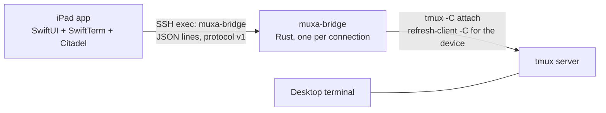

# muxa roadmap

## Status

Pre-alpha. The bridge, the terminal client, the iPad and iPhone app and the Android app work. The iOS app runs on a real iPad and iPhone; the Android app on phones and tablets. The store listings, screenshots, privacy policy and release settings are ready (`store/RELEASE.md`); neither app is published yet.

What works today:
- **Bridge** (`muxa-bridge`, macOS and Linux, tmux ≥ 3.2): runs as an SSH exec command, attaches to tmux in control mode, and speaks protocol v1 (`protocol/PROTOCOL.md`). For a client that sends `viewport`, the watched pane's window follows the device in use, as tmux's `window-size latest` does for terminals (ADR 0020, proposed); for other clients it never takes part in window sizing.
- **Host daemon** (`muxa-bridge daemon`, optional, ADR 0019): installed by hand as a LaunchAgent or a systemd user unit. It serves Task records on a private Unix socket, and runs the Task Loop while no client is connected. Without it, the bridge serves Task records itself, and loops are off.
- **Terminal client** (`muxa-cli`): a reference client and end-to-end harness. It also lists, creates, finishes and restarts Tasks and starts and stops their loops, with `--json` for desktop tools (`docs/agents.md`).
- **iPad app:**
  - one pane, sized for the iPad while it is in use (ADR 0020) and rendered at its real size, scaled to fit; wide panes fit the width and scroll with the cursor (ADR 0004);
  - saved hosts, one-time password setup of a restricted key, and host keys pinned on first use;
  - sessions grouped by repo, with each agent's state and its age; the list shows manual sessions only, and Task sessions open from Inbox and Tasks; the switcher searches every session (ADR 0025, 0027);
  - the Agent / Terminal switch, and every keyboard shortcut in the README;
  - Chat: a Claude Code or Codex conversation as messages, with a composer and quick keys (ADR 0005, `docs/agents.md`);
  - approval cards in Chat when Claude Code waits on a permission, a question or a plan (ADR 0009);
  - the Reader, in tabs: the pane's plan and the repo's Markdown files, rendered offline (ADR 0006); its uncommitted changes and its branch's commits as diffs (ADR 0007, 0011); its images, ignored folders included (ADR 0010);
  - starting and closing tasks, with or without muxa for tmux (ADR 0007);
  - Inbox: a list of questions, one item per decision, answered once and shared by every device; Later moves an item to the bottom (ADR 0033, 0040); Approve on a proposal creates one Task and opens it. The sidebar shows Inbox, Tasks or Sessions (ADR 0035);
  - All Tasks grouped by need, a Task detail, New Task with or without a repo, status changes, and per-workspace agent environments (ADR 0015, 0016);
  - New Task picks from the workspace's repos, by their name under its root, and names an empty branch after the title; Ask about this repo starts the workspace's agent in the main checkout as a manual session (ADR 0031, both apps);
  - Routines: a list and a detail with the trigger, the last success and failure, the next run, Open Terminal for a running run, and Run now (ADR 0026);
  - Restart agent with a handoff in `.muxa/HANDOFF.md`, and the Task's runs (ADR 0018);
  - the Task Loop: a check after each turn, a Loop section with its state, Start loop, Stop loop and the check log, when the host runs the daemon (ADR 0019);
  - a banner when an agent in another session waits, finishes or fails (ADR 0008);
  - Japanese input in the pane; Control+Space switches the keyboard language when there are two;
  - the pane's scrollback, read once from the host (`history`): a pull down past the top, or More → Scrollback;
  - a bar with Esc, Tab, Ctrl and the arrows above the on-screen keyboard.
- **iPhone app** (the same app, ADR 0012): the layout follows the size classes, so a folded iPhone Duo gets the phone layout and an unfolded one the iPad layout, without losing the pane, its screen or the keyboard. On a phone, a pane whose font would go below 9 pt keeps 9 pt and scrolls on both axes.

- **Android app** (ADR 0013): the same features as the iOS app, for phones, tablets and foldables. The layout follows the window and the hinge: a stack when compact, the list beside the pane when wide, the list and the pane on either side of a half-open book fold, and the keys below the hinge on a table. A fold, a rotation or a window resize keeps the connection, the pane, its screen and the keyboard. The pane is drawn from JediTerm at its real size; shortcuts are Ctrl+Shift chords. Two windows show two panes (split screen, desktop windows, or the system's "new window" action), each with its own connection, viewport and keyboard; Open in New Window is in the pane's More menu (ADR 0029, proposed). Not yet checked on a real tablet.
- **Try the Demo** (both apps, every build): sample sessions from the in-app demo bridge, with no host and nothing saved. App Review and Play review use it.

## Next

Order (ADR 0026, 0027). Each phase lists parallel lanes; the details follow below.

1. **Phase 0, clean up:** done. The open work is committed and merged agent worktrees are removed. Work continues on `plan/workspace-vision`; it is not merged into `main` yet.
2. **Phase 1, ship 1.0:** real-device checks, the daemon on a Mac, the developer's decisions on ADR 0015–0021 and 0023, then publish. Agent lane: the supported tmux CI matrix.
3. **Phase 2, Workers:** simplify the selection contract (ADR 0027 section 1), named create and restart, the pickers, then advertise `workers`. Codex continues restarted runs by hand. Parallel lanes: manual-only Sessions (UI only, done in both apps; no All Sessions filter); the Codex session-ownership ADR (proposed ADR 0028: muxa creates the thread and sends turns by id; waits for the developer's checks with a real login).
4. **Phase 3, Routines and Inbox:** `[[routine]]`, the trigger on the daemon tick, `routine-run` records, the output publish, Move down and Later on the Task record, and the Inbox list with approve → Task (ADR 0026 S0–S3). CLI first, then one app, then the other. Move down and Later on the Task record are done on the host and in the CLI (`task-inbox`, `task down`, `task later`, `task requeue`); the shared queue code in both apps follows them. S3 is done in the CLI, the iOS app and the Android app: the Inbox list, Move down and Later, approve, dismiss and later of stored entries, and the Routines list and detail with Run now. Workspaces as Entities (ADR 0031, proposed) are done on the host and in the CLI behind `work:2`: repos under the root with relative names, a branch from the title, and ask sessions (`start-session`, `muxa-cli ask`). Both apps have the UI: the workspace's repos in New Task, the optional branch, and Ask in the sheet and on a repo header. Next in this phase: the Inbox as a list of questions (ADR 0033, below), which replaces Move down and the queue.
5. **Phase 4:** workspace memory as a Routine (ADR 0027 section 6). Then, as needed, the Linux daemon.
6. **Phase 5:** workflow graph, then autonomous work.
7. **Any time:** mouse, `pause-after`, watching several panes.

- **Inbox visibility and navigation** (ADR 0023, slice 1 accepted; `docs/inbox.md`): identify Task sessions by title, group, reported age and loop; retain List/detail and add Triage navigation, Next and local Snooze. Phones open Triage once per connection for Needs attention only. Existing Chat keeps approvals and composition. In both apps the Inbox list of ADR 0025 replaced Triage.
  - P0 done: shared needs and deterministic queue order, CLI `need`, 26 cross-client fixture cases. Verified with `make check`, `make test-apple` and `make test-android`.
  - P1 done: iOS and Android Task titles, group/age and loop badges in session rows; switcher search includes titles.
  - P2 done: Triage navigation, snooze invalidation, shortcuts and initial phone routing. Verified with iPad Task/Inbox UI tests (including targeted reruns), iPhone routing/Triage/demo tests, Android app tests and the fold/resize rerun; package/JVM tests and Android lint pass.
  - P3 done in muxa for tmux (`tmux/`): the popup displays CLI need labels, keeps older CLI compatibility and never answers menus. Inline Triage actions and daemon sidebar/status summaries remain proposed slice 2; their approval identity, chat ownership and metadata lifecycle contracts must be resolved first.

- **Workers and restart recovery, in progress** (ADR 0022 and 0027 proposed; `docs/workers.md`): host worker config, named create and Keep/default/named restart work through the wire in the bridge and the daemon. A worker-aware client sends a worker name or `default`; `rev` is optional (ADR 0027 section 1). The CLI (`--worker NAME`), both app pickers and muxa for tmux's New Task form (only workers the workspace may use; `default` first) work behind the `workers` capability. The bridge advertises it since 2026-11-06: the developer chose to take the native check with real Claude and Codex logins by using it. Restart recovery ships separately under `task-restart-recovery`. Codex continues restarted runs by hand. Workers ship independently of workspace memory; no per-worker environment overrides. Evidence and open gates: `docs/workers.md`, `docs/findings/workers-w0.md`; restart serialization: ADR 0024.
- **Workspace and Task foundation, first slice** (ADR 0015, `docs/vision.md`): create a Task, launch an agent on it, watch its state, review the result, and step into the terminal. Manual Mode stays as it is.
  1. Done: protocol: `list-tasks`, `create-task`, `update-task`, the session field `taskId`, the error `conflict`, the capability `task-records`.
  2. Done: bridge: task records in `$XDG_STATE_HOME/muxa/tasks/` (`--state-dir`), workspaces from `~/.config/muxa/workspaces.toml` (`--workspaces`), the `@muxa_task` link and its fallback by directory, `TASK.md` and the first prompt once the agent is idle.
  3. Done: CLI: `muxa-cli tasks`, `task new`, `task done`.
  4. Done: apps (iOS and Android): a Tasks list with the Inbox groups (Needs attention, Ready for review, Running, No agent, Closed), a Task detail that opens its pane, Chat, `TASK.md` or its changes, a New Task sheet and status changes. The store screenshots predate it.
  5. Done in code: per-workspace agent environment (ADR 0016, proposed). `[workspace.agent]` with `command` and `env`, passed with `new-session -e`; the Claude Code and Codex adapters search every workspace's `CLAUDE_CONFIG_DIR` and `CODEX_HOME`. tmux-agents' side waits for ADR 0017's `agent-env`; until then such Tasks use the built-in launcher. Still to check by hand: two real logins (item 9).
  6. Desktop client (ADR 0017 and 0032, proposed): muxa for tmux shows the same Tasks inside tmux.
     - Done in muxa: `muxa-cli tasks --json` and `task new --json`, the bridge waiting for a start prompt after its client leaves, `--muxa-task` for tmux-agents that announce it, and the contract test against the plugin (`make test-tmux-plugin`).
     - Done in the plugin, now muxa for tmux in `tmux/` (ADR 0032, proposed): `prefix + N` creates a muxa Task with the workspace's repos, `prefix + T` shows the Inbox, `prefix + A` starts an ask session, `new.sh --muxa-task`, and tmux-resurrect keeps repo and Task tags.
     - Still to do by the developer: point `~/.tmux.conf` at `<muxa>/tmux/agents.tmux`, then archive `xdgetech/tmux-agents` with a pointer here.
  7. Done in code: handoff and agent runs (ADR 0018, proposed). The record keeps `runs`; `TASK.md` gets Progress, Decisions and Next actions, which the agent keeps and the bridge never rewrites; `restart-agent` writes `.muxa/HANDOFF.md` from facts and restarts the agent in the same pane with `respawn-pane -k`; `muxa-cli task restart`. The Android, iPad and iPhone apps show a Task's runs, open `HANDOFF.md` in the Reader, and restart the agent after a confirmation that asks to stop a running one.
  8. Done in code: the Task Loop in a host daemon (ADR 0019, proposed). A `check` command runs after each agent turn; a failure types a fixed prompt, a pass moves the Task from `open` to `review`, an agent waiting on the user pauses the loop, and every other gate stops it.
     - P0 to P5 are done: a fresh `done` is a finished turn; `muxa-bridge daemon run`, `install`, `stop`, `restart`, `uninstall` and `status`; every record request through the daemon with a local fallback; durable prompt waits (`pendingPrompt`); `tasks-changed`; the quiet tmux client (`ignore-size,no-output`); the loop engine and `[workspace.loop]`; the wire types, `protocol/fixtures/inbox/` and the CLI loop commands; the iOS and Android Loop section, New Task check and Inbox row.
     - P6, the docs: README, `SECURITY.md`, `docs/agents.md` and this plan.
     - Still to do by hand: load the daemon once with `muxa-bridge daemon install` on a Mac (launchd) and, if used, on Linux (`systemd --user`); tests use a fake service manager. Then run one loop on real devices.
  9. Real work by the developer: one coding Task, and a product and an admin Task without a repo. With two real logins, check that the workspaces' accounts stay apart (ADR 0016, Consequences).
  10. The developer accepts or changes ADR 0015 to 0019. All five are still proposed.
- Check the iPhone app on a real iPhone: the 9 pt floor, and the key bar (the iPhone simulator reports a hardware keyboard, so its UI test skips there).
- Check the Android app on a real phone and tablet: the 9 sp floor, the key bar, Gboard Japanese input, a hardware keyboard, and two windows in split screen and desktop windows.
- ADR 0020 and 0021 (window size follows the device, from a device session): the developer accepts or changes them, then checks them on the real server with a real iPad and laptop, and with muxa for tmux. muxa for tmux skips device sessions. The store listings still say the desktop layout never changes.
- Publish 1.0: the account steps, uploads and console answers in `store/RELEASE.md` (by the developer).

## Requested follow-on design

- **Personal Assistant across Workspaces** (proposed [ADR 0045](adr/0045-personal-assistant.md), [product specification](personal-assistant.md), PA0 to PA3 built: Captures, Work items, one workspace's assistant runs, delegate notes, the overall assistant's plans, and policies, corrections and hypotheses on the bridge and daemon, the CLI, muxa for tmux, iOS and Android): free-form capture, durable unstarted work, scoped requests to each workspace's agent, concrete results in a shared Inbox surface, and reasoned priority proposals that improve from explicit policies and corrections. Reuses Tasks, Workers, Routines and the daemon; cross-workspace messaging, sharing policy and prioritization are new work. Initial scope is one host. This proposal does not change the Next order above. Stages PA0 and PA1 (captures, Work items, one workspace's assistant run) are designed in proposed [ADR 0048](adr/0048-captures-work-items-and-assistant-runs.md), slices A0–A12, all done. PA2, the overall assistant and delegate notes, is designed in proposed [ADR 0049](adr/0049-overall-assistant-and-delegate-notes.md), slices B0–B10, all done: delegate notes, the overall workspace with `share`, plans on a schedule and on demand, `sort` and `delegate` proposals as Inbox items, pins and due dates, at `work:10` on the bridge, the CLI, muxa for tmux, iOS and Android. PA3, policies, corrections and hypotheses, is designed in proposed [ADR 0050](adr/0050-policies-corrections-and-hypotheses.md), slices C0–C10, all done: the user's policies, corrections recorded on the newest plan, the brief's "What the user told you" section, hypotheses checked against what the brief carried and answered as Inbox items, and `forget` with its cascade, at `work:11` on the bridge, the CLI, muxa for tmux, iOS and Android.
- **Staff and hand-offs inside a workspace** (proposed [ADR 0051](adr/0051-staff-and-handoffs-in-a-workspace.md), PA4, slices D0–D10, in progress): each workspace's staff are workers with their own notes; a run may hand its work to another staff member, with the user's review by default.
- **External writes only when asked** (proposed [ADR 0052](adr/0052-external-writes-only-when-asked.md), PA4, slices E0–E7, none built): a staff member's Result proposes a write, the user approves its exact text in the Inbox, and one writer worker performs it as a Task.
- **Inbox queue** (proposed ADR 0025, simplified by ADR 0027): superseded by ADR 0033. Its Move down and Later on the Task record were removed in slice I4; the manual Sessions list stays, as Sessions mode (ADR 0035).
- **Routines** (proposed ADR 0026): a Routine runs an agent on a trigger, for example every morning. The agent reads its sources (Slack, Linear, Notion and others) through its own native tools and publishes briefings and proposals to Inbox. An approved proposal becomes one new Task that performs the action. A run is a record of kind `routine-run`, not a Task in the UI. Phase 3 of the order above.
  - Done on the host (S0–S2): `[[routine]]`, the schedule on the daemon tick with DST and one catch-up, run-now, `routine-run` records with the output check and publish, stored Inbox entries with approve, dismiss and later, behind the capability `work:1`. CLI: `muxa-cli routines`, `routine run`, `inbox`. Verified with a fake agent on real tmux, in the daemon and the bridge.
  - Done in the iOS app (S3): stored entries in the Inbox list with approve, dismiss and Later; a Routine run waiting on the user as an Inbox row; the Routines list and detail with Run now. Verified with MuxaKit tests and UI tests against the demo bridge.
  - Done in the Android app (S3): the same, with a swipe right for Later and a swipe left for Move down. Verified with the `:session` JVM tests (`WorkTest`), the demo bridge tests and `InboxListTest` against the demo bridge.
  - Done on the host and in the CLI (proposed ADR 0036): Routines live in `<root>/.muxa/routines.toml`, allowed per workspace by `[workspace.routines]` in `workspaces.toml`; a `schedule` in cron form picks the days; a broken workspace file is reported in `routine-list` `problems`. The apps decode `schedule` and `problems` but do not show them yet.
  - Next: migrate orch's Lisk Routines to the Lisk workspace (ADR 0036); one real source with a real login; Codex after ADR 0028.
- **muxa for tmux catches up with the apps** (ADR 0017, 0032): today `prefix + T` only lists Tasks and goes to a session, and closing a session from the tree leaves its Task `open` with no session. The plugin keeps calling `muxa-cli --json` and never writes records. In order:
  1. Done: close Tasks. `muxa-cli task drop ID`, and `--json` on `task done` and `task drop`; `ctrl-d` Done and `ctrl-x` Drop in `prefix + T` after a y/n question, and both on `Enter` for a Task without a session; `x`, `X` and `ctrl-x` in the tree ask whether to mark the session's Task done or dropped. Verified with `make test-tmux-plugin` and the CLI tests.
  2. Done as ADR 0033's slice I1: the tree's Inbox section above the sessions, and `prefix + T` as the list of questions with the selected item (`docs/inbox.md`, The Inbox). Task sessions stay in the tree, so the jump keys keep working; this is where tmux differs from the apps' manual-only Sessions (ADR 0025). The section reads a cache that one sidebar refreshes every 5 s (`@agents_inbox_refresh`): muxa-cli has no watch command, and each call starts a bridge.
  3. A Task detail popup: status, runs, `TASK.md` and `HANDOFF.md`, Restart agent, Start and Stop loop.
  4. A Routines popup: the list, the last runs and Run now.
- **The Inbox is a list of questions** (ADR 0033, proposed; `docs/inbox.md`, The Inbox): one stored item per question (`ask`, `review`, `failure`, and the Routines' `proposal` and `briefing`), with the agent's summary, the turn's diff, docs and images as attachments, and answers: Approve, Reject, Accept (Task done), Redo, Change course, Retry, Drop, Later. It replaces the queue, Move down, need labels and groups in the Inbox. In order:
  1. Done: I0, host and CLI, behind `work:3`. A bridge and the daemon make one item per need from adapter states and resolve it when the agent runs again or the Task closes; answers go through `update-inbox` (`muxa-cli inbox`, `inbox answer`, `inbox read`); MuxaKit and the Android `:protocol` decode the new shapes. Verified with `make check`, `make test-tmux` (`tests/items.rs`: a bridge and the daemon make and resolve items), `make repro` (`paste-bracketed.sh` for multi-line replies), `make test-apple` and `make test-android`. Open: the PR link in `attachments.links` (`@agent_pr` holds only a number); a daemon with no linked session looks again only every 5 minutes; an `ask` keeps the prompt read when it was made; Swift's `MuxaSession.InboxItem` (the old Task row) clashes with the new type and is renamed in I2.
  2. Done: I1, muxa for tmux (item 2 above). The tree's Inbox section and `prefix + T` with the selected item, its evidence and single-key answers; `tmux/tests/inbox.bats` runs them against `protocol/fixtures/items/`.
  3. Done: I2 and I3, the iOS and Android list and item screen behind `work:3`. A phone pushes the item; a tablet shows the list beside it and opens the next item after an answer. Evidence opens in the Reader. The demo bridges play `work:3`; `-work2` (iOS) and `--ez work2 true` (Android) play an older host, which keeps the old list. `MuxaSession.InboxItem` and the Android Task row are now `TaskItem`. Verified with `make check`, `make test-apple`, `make test-android`, `make test-app`, `make test-app-iphone` and `make test-android-app`.
  4. Done: I4. Move down, the Task's `inbox` field, `task-inbox`, `task down/later/requeue`, the queue code and fixtures, and the local Snooze are gone on the host, in the CLI and in both apps. An old record's `inbox` stays on disk and is never sent; `update-task` needs `status`. A host below `work:3` asks the apps to update muxa-bridge.
  5. I5 done (ADR 0033 §4a): the `reply` answer is sent as written. On a permission ask it denies first, waits until the adapter reports the turn idle, then sends. Outside git, the item attaches the docs and images changed since the turn started. Files and links that the summary names are attached too. Task folders are served whole to the Reader. In tmux, `s` sends a reply, and the labels name the result.
  6. I6 done: both apps name answers by their result: Done, Send, Allow, Deny and Deny & Send. Redo, Change course and Keep open are under More. While the reply box has text, `reply` is the main answer. The summary is Markdown: web links open in the browser, and links to attachments open the Reader. Attachments are listed by file name. The reply fixtures are in the main files of `protocol/fixtures/items/`.
- **The sidebar shows one mode** (ADR 0035, proposed): Inbox, Tasks or Sessions in the sidebar, and the detail column shows the selection: an item, a Task, or a session's pane with its Chat / Agent / Shell switch. Hosts move into Settings, `+` is New Task, Routines are the first row of Tasks, and the Inbox sheet goes away. Both apps. In order, after I4:
  1. Done in both apps: N0 to N3. Try the Demo and the showcase play `work:3`; the sidebar's modes, the status row and Settings with the hosts; the detail follows the selection, with the item's Chat and Terminal; the phone's push navigation, the connect rule by mode and the keys. UI tests pick the mode with `-mode` (iOS) or `--es mode` (Android). Verified with `make test-app`, `make test-app-iphone` and `make test-android-app`; on iPad `DemoTests.testKeyBarSendsKeysTheKeyboardLacks` fails, as it did before this change (the simulator reports a hardware keyboard).
  2. Done: an Inbox item's summary is block Markdown in both apps; iOS renders it with MarkdownUI, links made by `ItemSummary.markdown` as Android's `SummaryLinks.linkify` does. Verified with `make test-apple` and `InboxItemTests` on iPad and iPhone.
  3. N4: the store screenshots and captions with the Inbox mode. README and `docs/inbox.md` are done.
- **A Task's end closes its session** (ADR 0037, proposed): done or dropped, through `update-task` or an Inbox answer, closes the Task's session and keeps its worktree or folder (since ADR 0043 the worktree goes, see below). A published Routine run's session closes; its folder stays until the next run publishes. muxa for tmux's tree lists Tasks and Routine runs apart from manual sessions (now sections, ADR 0038). A failed Task start makes a `failure` item. A start or restart prompt not typed within 30 s stops the Task's loop (`not-sent`); a Routine run then fails with "the start prompt was not typed" instead of getting the fail prompt later. Done on the host and in muxa for tmux; verified with `make check`, `make test-tmux` (`tests/task_records.rs`, `tests/routines.rs`) and the tree's bats tests.
- **Later moves an item down; the item screen separates triage from answers** (ADR 0040, proposed): `later` keeps the item open with `laterAt`, listed below the others; `until` is ignored. The top bar holds Later (gray, Music's Play Last), ✓ (green, closes only the item) and … (Complete Task, Drop Task, Open Session); the bottom holds the agent's decisions and one reply box (Send, or Ask Agent without a session). The source line opens the session. A swipe right is ✓, left is Later. Redo and Change course are gone from the host, the CLI, muxa for tmux and both apps. A Routine's entry takes `read`. Done everywhere; verified with `make check`, `make test-tmux`, `make test-tmux-plugin`, `make test-apple`, `make test-android`, `make lint-android`, `make test-app` (only the known `testKeyBarSendsKeysTheKeyboardLacks` fails) and `make test-app-iphone`. Android's UI tests compile but have not run on a device. muxa for tmux's `prefix + T` follows the same layout: triage keys (`l`, `d`, `c`, `x`, `o`) on one line, answers (`a`, `r`, `s`) on the next, with the apps' labels; `a` is never Complete Task.
- **Ask the workspace's agent from an Inbox item** (ADR 0041, proposed): `ask-agent` with a text on any open item types the item and the text into the workspace's one Ask session at its root (`ask-<workspace>`, `@muxa_ask_root`), starting it when none is open. The item stays open. `work` level 6. Done on the host, in the CLI (`inbox answer ITEM ask-agent --text T`), in muxa for tmux (`g`) and in both apps (Ask Agent opens the session's Chat). Verified with `make check`, `make test-tmux` (`tests/workspace_roots.rs`), `make test-tmux-plugin`, `make test-apple`, `make test-android` and the iPad and iPhone UI tests. Android's UI test has not run on a device yet. The Ask session uses the workspace's default agent, not a Routine's worker.
- **Delete old Inbox items; protect the ones to keep** (ADR 0046, proposed): `delete-inbox {olderThanDays}` removes every item made more than that many days ago, open or closed, a Task's item or a Routine's entry, except protected ones. The host keeps each removed item's key, so the same need does not make it again. `protect` and `unprotect` set `protectedAt` on any item; a protected item still takes ✓, Later and every answer. `work` level 8. Done on the host, in the CLI (`inbox delete --older-than DAYS`, `inbox answer ITEM protect`) and in muxa for tmux (`p`, `D`). Both apps show Delete Old in the Inbox list's menu and Protect in the item's …; the demos take `-old-items` (iOS) and `--ez old-items true` (Android). Verified with `make check`, `make test-tmux` (`tests/items.rs`), `make test-tmux-plugin`, `make test-apple`, `make build-app`, the iPad `InboxItemTests`, `make test-android`, `make build-android` and `make lint-android`. Not run: Android's `InboxDeleteTest` on a device.
- **muxa for tmux's tree sections** (ADR 0038, proposed): Tasks, Routines, Ask and Sessions, each with a heading that folds with `Enter` or `space` in every sidebar (`@agents_folded`); a folded section's sessions get no jump label, and `prefix + a` still finds them. `?` shows every key in a popup. `x` on a session with no worktree only closes it. Done; verified with `make test-tmux-plugin`.
- **Reading Tasks and parking** (ADR 0034, proposed): a Task that only reads code works in its own folder under the workspace root, as a repo-less Task does, and reads the repo's main checkout. No worktree. Its output (a design, a report) stays in that folder. Branch makes the worktree when the work needs one. Park closes an idle Task's session and keeps the Task. Behind `work:4`. In order, after I4:
  1. Done: R0, host and CLI, behind `work:4`: `create-task {read}`, the Task folder with `TASK.md` rules and Claude Code's `.claude/settings.local.json` (checked against the docs and a real run), the changed-checkout `proposal` with Branch and Keep, `branch-task`, `park-task`, Resume through `restart-agent`, `[[workspace]] park_after`, and `muxa-cli task new --read`, `task branch`, `task park`. Verified with `make check`, `make test-tmux` (`tests/reading.rs`) and `make repro`. A Task that waits on its review does not park (decided 2026-11-05).
  2. R1, muxa for tmux: Read in `prefix + N`, Branch and Park in the Task's menu.
  3. R2, iOS; R3, Android: Read in New Task, Branch and Park in the Task detail, Resume on a parked Task.
- **Close an ask session from the apps** (ADR 0039, proposed): `close-task` closes a session tagged `@muxa_ask` with no worktree and no `@muxa_task`, at `work:5`; any other session without a worktree stays `bad-request`. A listed session carries `ask`. Both apps show Close Session on an ask session's row and in the pane's More menu; `muxa-cli ask close SESSION` closes one. Verified with `make check`, `make test-tmux` (`tests/workspace_roots.rs`), `make repro`, `make test-apple`, `make test-android`, `make test-android-app` and the iPad `AskTests`.
- **The daemon closes the sessions of ended Tasks** (ADR 0047, proposed): at start and with each worktree sweep, it closes every session whose `@muxa_task` names a done or dropped Task, keeping its files. This covers a tmux-resurrect restore and a close that failed. Done on the host; verified with `make check` and `make test-tmux` (`tests/daemon.rs`).
- **A worktree goes when nothing holds it** (ADR 0043, proposed): a Task's worktree and branch stay while an open Task (parked too) or a session holds them, then go. When that could lose work (uncommitted changes, an unmerged branch), muxa asks first, and No changes nothing. In order:
  1. Done: the list of worktrees muxa made (`$XDG_STATE_HOME/muxa/worktrees/`), written by `new.sh` and the built-in launcher; `close.sh` and the built-in launcher remove the branch with the worktree, `--force` also removes changes, and `close.sh --check` says why removing could lose work. In tmux, `x` asks with that reason and `X` parks the Task. Verified with `make test-tmux-plugin` (lifecycle, keys, muxa) and the contract test `both_launchers_remove_a_worktree_alike`.
  2. Done on the host, in the CLI and in muxa for tmux: `work:7`, `update-task` and `update-inbox` with `worktree: remove|force` and the error `would-lose-work` (`protocol/fixtures/worktree-end/`); `muxa-cli task done|drop` and `inbox answer` remove by default and take `--force`. Verified with `make test-tmux` (`tests/task_records.rs`). Both apps send `remove` on Done, Drop, Complete Task and Drop Task, and on `would-lose-work` ask "Remove the Worktree?" before `force`; the demos refuse `t-perf01`. Verified with `make test-apple`, `make build-app`, the iPad `TasksTests` and `InboxItemTests`, `make test-android`, `make build-android` and `make lint-android`. Not run: the full `make test-app` (it hung on the known `testKeyBarSendsKeysTheKeyboardLacks`) and Android's `TasksTest` on a device.
  3. Done on the host: the daemon sweeps listed worktrees at start and every 10 minutes; one that no open Task, pane or process holds goes when clean and merged. Task records' worktrees are listed once. Verified with `tests/daemon.rs`. Open: asking about the ones that could lose work (a tmux tree row, an Inbox item).

Milestones and dependencies are in `docs/workers.md`; the domain definitions are in `docs/work-model.md`.

## Later

Direction from `docs/vision.md`, not commitments:
- **Workspace memory** (ADR 0022 release M, proposed): reviewed WORKSPACE.md close-out. ADR 0027 builds it as a Routine instead of its own transaction model. Per-worker environment/account overrides and exact reset are deferred. See `docs/findings/workers-design-review.md`.
- **Workspace and Task foundation** (vision phase 2): after the first slice, Resources beyond one repo (documents, issue trackers), a Project entity if needed. Repos under workspace roots are ADR 0031.
- **Managed agent execution** (phase 3): muxa starts and follows agent runs for a Task and keeps their history while no client is connected; context handoff between runs. The first part, recorded only while a bridge or the daemon handles a request, is in the first slice (ADR 0018, 0019).
- **Workflow orchestration** (phase 4): Tasks in a graph, where one step's result starts the next. The host daemon (ADR 0019) can run it.
- **Autonomous work** (phase 5): agents take and finish Tasks within approval gates and workspace isolation.

Scheduled: find why the snapshot/stream stress test (`crates/muxa-bridge/tests/stream.rs`) sees an 11-row shift in about 1 of 1000 runs under heavy load. It may be a snapshot/stream ordering bug.

Also: `pause-after` for slow links, watching several panes, mouse. Deferred with no date (ADR 0027): muxa's own push notifications while the app is closed (APNs needs a relay server, ADR 0008). Cut: input leases for two typing devices.

## Design

The decisions and their reasons are in `docs/adr/`. The tmux facts they rely on are in `docs/findings/tmux-control-mode.md`. In short:

- **Bridge:** a Rust binary started as the SSH exec command. No network port. SSH handles authentication and host-key pinning (ADR 0003).
- **Host daemon** (optional, ADR 0019): `muxa-bridge daemon run`, one per user, started by launchd or `systemd --user`. It listens only on `daemon.sock` (directory 0700, socket 0600, peer uid checked). A bridge sends each Task request to it, one connection per request, when it runs the bridge's version; otherwise the bridge serves the request itself. It runs the Task Loop, and attaches its own tmux client with `-f ignore-size,no-output` only while it has work: a loop, a launch, a prompt wait, or an open Task with a session to make Inbox items for (ADR 0033).
- **Protocol contract:** `protocol/PROTOCOL.md` plus `protocol/fixtures/`. The Rust and Swift tests decode the same fixtures, so a third-party client can rely on them.
- **The window follows the device in use** (ADR 0020, 0021, proposed). The client sends `viewport`, the grid its pane area shows at its default font. The bridge then takes part in window sizing like a desktop terminal under `window-size latest`: it sizes a second control client so that the watched pane gets that grid. That client sits in a device session of its own, which holds only the watched window (`link-window`), so any window follows, with `aggressive-resize` off or on, and the laptop stays on its window. Lists skip device sessions (`@muxa_device`); closing a task kills them first; a bridge removes leftovers of a crashed one when it starts. Typing on the laptop in that window takes it back; typing on the device takes it again. Only windows whose `window-size` is `latest` follow. Without `viewport`, the bridge attaches with `-f ignore-size` and sends no size, as before. Nothing sends `resize-*`, `select-window`, `select-pane` or `refresh-client -A %p:off`. Plugins that read `client_width` must skip control-mode clients (README).
- **Rendering:** at the pane's real cols × rows, with the largest font that fits (ADR 0004). With `viewport`, the pane usually is the device's grid.
- **Input:**
  - text → `send-keys -l`;
  - named keys → `send-keys`, so tmux encodes them for the pane's modes and extended keys;
  - paste → `paste-buffer -p`.
- **Pane roles and agent state** come from tags or adapters, never from guesses. The order is in the README.
- **Minimum tmux is 3.2:** `-f ignore-size` and `list-* -f` need 3.2, `capture-pane -N` needs 3.1, `send-keys -H` needs 3.0. Never parse layout strings; their format changes in 3.8.

### Bridge internals

Reading tmux:
- Read output as bytes (`read_until(b'\n')`) with a line-length cap. `%output` carries raw non-UTF-8 bytes. Payloads stay bytes; only format fields go through `from_utf8_lossy`.
- End a reply block only on the `%end`/`%error` whose number matches its `%begin`. After an error, mark the rest of the command line skipped.
- The tmux process runs with `TMUX` removed and `kill_on_drop(true)`. The bridge exits on stdin EOF and on `BrokenPipe` from stdout (Rust ignores SIGPIPE).

The server:
- One event loop owns the watch. Requests run in order.
- A writer task has a bounded queue. On overflow, it drops output and resyncs.
- Snapshot results are always delivered. A timeout retries once. Held output is capped at 1 MiB.
- A layout change during a sync is replayed after the sync.
- The bridge exits after 60 s with no request. A `ping` counts, so a quiet watched pane keeps it alive.

### Rejected

- Attaching a normal tmux client, as Multiplex and Remux do: it needs a PTY, and it sizes the window to the whole device, not to the pane the device shows (ADR 0001, 0020).
- A shared Rust client core through UniFFI (ADR 0013). Swift and Kotlin each keep their own session core; `protocol/fixtures` keeps them to one contract.

## Verification

| Part | Check |
|---|---|
| Everything | `make check` |
| tmux behavior, the bridge | `make test-tmux`, `make repro`. CI runs them on tmux 3.2a, 3.4 and the latest release, on Linux and macOS. |
| The host daemon and the Task Loop | `make check` (the loop's `step`, the check runner, the `install --print` golden files); `make test-tmux` (`tests/daemon.rs`, `tests/loops.rs`: a real daemon, a fake agent, the layout snapshot and the log grep); `make repro` (`daemon-client.sh`, `client-activity.sh`); loading the real LaunchAgent or systemd unit by hand |
| Routines | `make check` (config, schedule with DST and catch-up, output validation, publish); `make test-tmux` (`tests/routines.rs`: a real daemon and a fake agent run, publish, retry and approve; a scheduled run; the bridge without a daemon) |
| Assistant requests (ADR 0048) | `make check` (budgets, agent refusal, one version per rev, delivery derivation, folder cleanup); `make test-tmux` (`tests/assistant_runs.rs`: a real daemon and a fake agent; crash and restart, duplicate request, interrupted send, timeout, invalid result, cancel with a late result, a new version while one runs, the log grep, the layout snapshot; alone: `cargo test -p muxa-bridge --features tmux-integration --test assistant_runs`); the clients' Ask Assistant and Result views in `make test-app` and `make test-android-app` on the demo |
| Plans of the overall assistant (ADR 0049 B3, B4, B5) | `make check` (the plan file's rules and their counterexamples, the store rules: pinned first, no Later item, open items only; derived `unanswered`, `stale`, `changed`, `dueSoon`; keep 7; `plans` config; the schedule's first look, one catch-up and DST fold; proposals as items once, approve twice makes one sort or one request, reject, `none` refuses, `auto` within budget once per workspace, past a budget or `max_auto_requests_per_day` held for review with the reason); `make test-tmux` (`tests/assistant_plans.rs`: a real daemon and a fake agent; one catch-up and one occurrence, the fail prompt, an open plan conflicts, a budget stops a scheduled plan with its reason, `plan-now` with and without an overall workspace, an `auto` delegate sent once, the log grep, the layout snapshot; alone: `cargo test -p muxa-bridge --features tmux-integration --test assistant_plans`) |
| muxa for tmux and its contract | `make test-tmux-plugin` (ADR 0017, 0032): the plugin's bats tests and `tests/tmux_agents.rs` against `tmux/`; `make lint-sh` |
| MuxaKit | `make test-apple`; `make test-apple-tmux` against the real bridge |
| The iPad and iPhone app | `make test-app` (iPad mini, with the fold test) and `make test-app-iphone`, against the in-app demo bridge on existing shared simulators under one host lock; host setup: `docs/ios-qa.md` (ADR 0042) |
| The Android client | `make test-android`, `make test-android-tmux`, `make lint-android`; `make test-android-app` on a phone, Pixel Tablet and Pixel Fold emulator, against the in-app demo bridge |
| The store listings | `make lint-store` (in `make check`); `make screenshots` and `make screenshots-android` check every image's size |
| Android release build (full R8, ADR 0030) | `make test-android-release`: the minified app connects over SSH to a throwaway host and shows a pane, on an emulator |
| Try the Demo, in a release build | `TryDemoTests` (iOS) and `TryDemoTest` (Android) on the debug build; the release APK and a Release iOS build by hand |
| No layout change on a real server | `scripts/layout-snapshot.sh` before and after an attach; the diff is empty |

## Risks

- **Slow links.** The bridge has a bounded writer and resyncs on overflow. `pause-after` comes later.
- **SwiftTerm vs vt100.** The MuxaKit replay tests compare SwiftTerm with the recorded screens.
- **Half-open links after iOS suspends the app.** The bridge's idle timeout ends them.
- **The SSH key can run a shell** unless it is restricted. `SECURITY.md` shows the `authorized_keys` restriction, and the app sets it up.
- **A check runs a command with no pane to show it.** `[workspace.loop]` in `workspaces.toml` decides per workspace which commands may run (`SECURITY.md`).
- **After an upgrade, loops are off until `muxa-bridge daemon restart`.** The bridge uses only a daemon of its own version.
