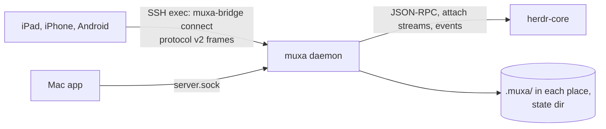

# muxa roadmap

## Status

Pre-alpha. The daemon, the terminal client, the iPad and iPhone app, the Android app and the Mac app work; the iOS app runs on a real iPad and iPhone, the Android app on phones and tablets. The privacy policy, release settings and the store listings' text are ready (`store/RELEASE.md`). The screenshots of Home and Focus are not taken yet; a human takes them by hand. The app name on both stores, "Muxa: AI agents in tmux", still names tmux. No app is published yet.

Since F5 (2026-11-22), muxa runs on herdr-core only: protocol v1, tmux, muxa for tmux, the v1 Task records, restart and handoff, park and workers' v1 launch paths are gone (ADR 0071).

What works today:
- **Daemon** (`muxa-bridge daemon`, macOS and Linux): a LaunchAgent or a systemd user unit that serves protocol v2 (`protocol/PROTOCOL-v2.md`) on `server.sock` and runs every agent as a herdr-core terminal. `muxa-bridge connect` relays a device's SSH exec to it.
  - Tasks with places: a new folder, branch worktrees and read-only repos, `.muxa/TASK.md`, Claude Code's settings for the other places, plan mode (ADR 0068); connections from the Keychain (ADR 0069).
  - The Inbox of ADR 0066: Capture, the user's order, Later, Done; Review and Failed items from Tasks; Read and Decide items from Routines.
  - Routines on a schedule, each run checked and published (F1, ADR 0026).
  - The Reader of a Task's folder (F2), Task Loops (F3, ADR 0019) and Chat from the agent's own records (F4).
- **Terminal client** (`muxa-cli`): every protocol v2 request, with resume; the reference client and end-to-end harness.
- **iPad and iPhone app** (ADR 0012, 0067): Home (Inbox, Capture, Routines, Needs you) and Focus (the terminals, a terminal at the size of the view, and the Inbox, Reader or Chat as a panel, and the Task Loop), saved hosts with a restricted key and pinned host keys, every shortcut in the README.
- **Mac app** (ADR 0070): the same Home and Focus, "This Mac" over the local socket, menus, a Task's agent with up to three shells as panes in Focus (ADR 0079; the other apps list the shells with the Task), Close Task from a tab, the Reader over the window, keys the user can change and optional Vim window keys (ADR 0078), and a global Capture window. On iOS and the Mac, Settings › Terminal picks the terminal's colors (built in, or imported from iTerm2 or Ghostty) and font; JetBrains Mono and the Nerd Font symbols are bundled, so prompts' icons show (ADR 0080). Not yet on Android. Every app uploads an image or a log into a Task's `.muxa/uploads/` and types its path into the agent (ADR 0081; the Mac also takes a file dropped on a pane).
- **Android app** (ADR 0013, 0029): the same Home and Focus for phones, tablets and foldables, one model per window.
- **Try the Demo** (every app, every build): a built-in v2 server with sample Tasks, Inbox items, Routines, files and conversations; no host and nothing saved. App Review and Play review use it.

## Next

Order (ADR 0026, 0027). Each phase lists parallel lanes; the details follow below.

**muxa next comes first** (ordered 2026-11-21; ADR 0066–0070, `docs/next.md`). Its phases replace the phases below where they overlap:
- **A. herdr backend:** A1 the `muxa-herdr` client (done: calls, attach streams with credit, events; `cargo test -p muxa-herdr`, `make test-herdr`); A2 the session backend trait and its contract tests (done: `crates/muxa-backend`, `HerdrBackend`; the contract passes on herdr-core 0.1.21 in `make test-herdr`).
- **B. muxa server:** B1 the v2 session core (done: `crates/muxa-server` on protocol v2, `protocol/PROTOCOL-v2.md`; fake-backend tests, and live on herdr-core in `make test-herdr`); B2 the daemon serves v2 and `muxa-bridge connect` relays (done: `server.sock` beside `daemon.sock`, herdr-core connected on first use; `MUXA_HC` picks the `hc` binary); B3 resume (done: parked attachments with a 256 KiB buffer for 10 minutes, input applied once across reconnects, a paint when the buffer cannot cover the gap, takeover of a connection still open; fake-backend tests); B4 Task start and agent state on herdr-core (done: `start-task` makes the worktree and runs the Workspace agent with `muxa.*` labels, or finds it running; `watch` sends each change with the OSC 7501 status; fake-backend tests and a live state test. Not yet: the state's age (invariant 6), and matching the Chat adapters to a terminal by `HC_TERMINAL_ID`, which moves to D with Chat); B5 `muxa-cli` on v2 (done: `muxa-cli v2 terminals|start-task|watch|attach` through `muxa-bridge connect`; `attach` resumes a lost connection, resends unacknowledged input, and drops it when the server cannot tell what it applied; client tests against the real server on the fake backend, and end-to-end tests of the binary through a relay). The switch to v2 is hard (ADR 0067).
- **C. Inbox:** C1 the ADR 0066 model (done: `crates/muxa-inbox` with manual order, Later that returns on top, Done and Reopen, the Capture parser and `<state dir>/inbox.json`; served on protocol v2 with `inbox` notifications; `muxa-cli v2 capture` and `muxa-cli v2 inbox`); C2 Review and Failed items from Tasks, and Read and Decide items from Routines (done: `task-review` and `muxa-cli v2 review`; a Failed item once per failing agent terminal, also one that failed while the server was away; Routine entries and failures copied from the Routine store every 15 s, from the first run on. items link the Task terminal or Routine that made them, and `inbox-approve` closes the Task: its agent ends and its clean, merged branch worktrees go, or all with `force`, else `would-lose-work`; `inbox-request-changes` types the comment into the agent; `inbox-retry` runs the Routine, the Task Loop or the agent again (ADR 0072; `muxa-cli v2 approve|request-changes|retry`, and `MuxaV2` and `:v2` with their demo servers). In the iOS, Mac and Android apps since 2026-11-22 (D4–D6). The apps show an item's note and the agent's Chat replies as block Markdown (MarkdownUI on iOS and the Mac, `multiplatform-markdown-renderer` on Android): web links open in the browser; other links and images do nothing. Not yet: Review from a draft PR); C3 the removal of the assistant layer (done: the host, `muxa-cli`, the v1 wire and fixtures, and the v1 client code in MuxaKit and Android no longer have Captures, Work items, assistant requests, plans and Today, policies, staff, writes, workspace memory, result review, Task proposals, `ask-agent` or the secretary; the daemon no longer runs them; `work` level 19 says so. An older `workspaces.toml` still loads: `[assistant]`, `[workspace.assistant]` and `memory` are read, logged and ignored. muxa for tmux (`tmux/`) is removed with it, ahead of F, decided 2026-11-21; the bridge launches Tasks with its built-in launcher).
- **D. Apps:** Home and Focus on iOS and Android, then the Mac app (ADR 0070). D1 the v2 client in MuxaKit (done: `MuxaV2` with resume, the Inbox and Capture; `SSHExec` carries raw bytes and `SSHBridge` is built on it; `make test-apple-v2` runs it against the real server on the fake backend). D2 the same client on Android (done: the `:v2` module over `ByteChannel`; `make test-android-v2`). D3 Routines on v2 (done: `routines` and `run-routine`, the list from the v1 engine's store and Run now through it; `muxa-cli v2 routines|run-routine`). The apps replace v1 at once (ADR 0067, decided 2026-11-21): D4 the iOS app becomes Home (Inbox with detail, Capture, Routines, Needs you) and Focus (a Task's terminal) on v2, its v1 screens go, and Try the Demo runs an in-app v2 server (step 1 done: `Muxa/Next/NextModel` connects over SSH to `muxa-bridge connect` or to the in-app v2 demo server, resumes after a lost connection or the background, and keeps the Inbox, terminals and Routines current; `-next`; `NextTests` UI test. A key forced to `muxa-bridge` reaches v2 through `SSH_ORIGINAL_COMMAND`; step 2 done: Home in `Muxa/Next/`: the Capture field with chips, Needs you, the Inbox in the user's order (drag, `⌥↑⌥↓`) with filters and Later, the item detail with Done/Approve, Later and Delete (`⌘⏎`, `⌘L`, `⌘⌫`, `⌘N`), and Routines with Run now; `NextTests` on iPad and iPhone. Since 2026-11-22 the detail also acts on what made the item (ADR 0072): Approve closes a Task's Review and offers Remove Anyway with the server's message after `would-lose-work`, Request changes (`⌘R`) sends a one-line comment, Retry (`⌘R`) runs a Failed item's Routine or agent again, Open in Focus shows the item's live agent, and Start Task takes a Reply, Decide or To do item as its title; Start Task (`⌘⇧N`, a sheet from Home and Focus) has the Workspace, title, goal, places (a new folder, branch worktrees, read-only repos), plan mode and a Task Loop where the Workspace allows one, a line with the connections and MCP servers every agent of the Workspace gets (ADR 0075), shows the server's refusals inline, and opens the new agent in Focus; `NextTests` approve, request changes, retry, start a Task with a loop and follow a Reader link on iPad and iPhone; step 3 done: Focus with Needs you, the Tasks and other terminals on the left, a terminal on v2 at the grid the view fits (`PaneTerminalView` and `KeyInputView`, keys as bytes through `MuxaV2.KeyBytes`), attached again when a resume ended its channel, the Inbox as a panel, and `⌘⇧H`/`⌘⇧F`; Needs you opens its agent in Focus; step 4a done: hosts in Next: add, edit, set up this device's key with the password, trust a host key, disconnect; step 4b done: the app speaks v2 only and starts in Home; the v1 screens, their UI tests, `make test-app-tmux` and `make screenshots` (ShowcaseTests) are removed. Not yet: the store screenshots on v2, Chat, the Reader tabs); D5 the same on Android (step 5a done: `:v2` has Routines, `DemoChannel`, the in-memory v2 server of Try the Demo, and `KeyBytes`; step 5b done: the app speaks v2 only, in `app/next/`: Home with the Capture field and chips, Needs you, the Inbox in the user's order (Reorder, `Alt+↑↓`) with filters, swipe Done and Later, the item detail (`Ctrl+Enter`, `Ctrl+L`, `Ctrl+N`), Routines with Run now; Focus with the terminals and a terminal on v2 at the grid the view fits, attached again on a new grid or a lost resume, and the Inbox as a panel; `Ctrl+Shift+H`/`F`; hosts with key setup and trust; one `NextModel` per window. The v1 screens, their UI tests, the `:demo` bridge and `make screenshots-android` are removed; `NextTest` passes on a phone and a tablet emulator, and `make test-android-release` reaches the v2 server over SSH; step 5c done: the Task actions of ADR 0072 in the item detail: Approve (`Ctrl+Enter`) closes the Task and asks before Remove anyway on `would-lose-work`, Request changes (`Ctrl+R`) sends a one-line comment, Retry (`Ctrl+R` on a Failed item) runs a Failed item's Routine or Task again, Open in Focus, and Start Task on Reply, Decide and To do items, and Make it a Task on Read items (the title, Workspace and note go into the sheet); the Start Task sheet from Home and Focus (`Ctrl+Shift+N`; `Ctrl+Enter` starts) with the Workspace, places (a new folder or branch worktrees, read-only repos), a line naming the connections and MCP servers every agent of the Workspace gets (ADR 0075), plan mode and a Task Loop, opening the new terminal in Focus; a relative link in a Reader document opens another listed document. `NextTest` covers them on a phone and a tablet emulator; step 5d done: the design mocks' look, dark only (`ui/Theme.kt` holds the palette, the kind and the state colors): a phone has a bar with Inbox, Workspaces, Routines and Settings, the Inbox a large title with the host, the amber Needs-you banner, Capture with + and cards with kind chips; Workspaces groups the Tasks by Workspace with state dots and New Task; a tablet has a sidebar with New Task, Inbox | Tasks | Routines, the Tasks by state, and the host in its footer; both lists leave out terminals that are not live and put live terminals without Task labels (Routine runs too) in an "Other terminals" section, closed by default; Focus shows Chat, Terminal or Reader over the attached terminal, the agent's prompt as the Needs-you bar, and a line typed into the terminal); D6 the Mac app, a native macOS target (decided 2026-11-21; step 6a done: `MuxaMac` compiles `Muxa/Next/` with a `TerminalPane` on SwiftTerm's AppKit view, so Home, Focus and the hosts work as on iOS; `make build-mac-app`; `MacNextTests` need macOS UI automation allowed once, by a human. The device key needs the keychain entitlement and so a provisioning profile, which a human creates in Xcode; the local build runs without it, so only the demo works there. step 6b done: "This Mac" reaches the daemon's `server.sock` without SSH (`MuxaTransport.UnixSocketBytes`, which `make test-apple-v2` now uses against the fake server), and the Go menu has Home `⌘⇧H`, Focus `⌘⇧F`, the Inbox panel `⌘⇧I` and the sidebar `⌘B` through `NextNavigation`; step 6c done: `⌃⌥Space` opens a one-line Capture window from any app (a Carbon hotkey, no Accessibility permission), `⌘P` goes to a Task (both apps), and Focus on the Mac shows up to four panes side by side (`⌘\` adds the next Task, `⌘1`…`⌘9` pick one, Close Pane). step 6d done: the item actions and Start Task of D4, with New Task… (`⌘⇧N`) in the File menu, and `⌘⏎` in the Capture window adds the item and opens Start Task from it in the main window; `MacNextTests` has their tests, not run yet). Since 2026-11-22 the iOS app follows the design mocks: the dark palette in `Muxa/Theme.swift`; on a phone the Inbox, Workspaces, Routines and Settings tabs and a Task screen with Chat, Terminal and Reader segments, the Needs-you bar with the agent's first option, keys and a line for the terminal; on a tablet a sidebar with Inbox, Tasks (by state) and Routines beside the picked item, Task or Routine, and a reply bar under the Task (`Muxa/Next/Touch/`). The Mac keeps Home and Focus with the same palette. In both apps the Task lists and Go to Task show muxa's Tasks only; Routine runs and live terminals muxa did not start sit in "Other terminals", closed by default, titled by their Routine, name or folder, else `Terminal t3`. A Read item has Make it a Task. The Mac app keeps running with its window closed, and Capture's `⌘⏎` opens the window again before Start Task. C3 waits until the apps have Capture, so the secretary is not removed before its replacement ships.
- **E. Places and connections** (ADR 0068, 0069, 0075). E1 places (done: v2 `start-task` takes a Workspace, a title, a goal and places: a folder, branch worktrees and read-only repos; the working place is the folder, else the first branch; `.muxa/TASK.md` lists every place, Claude Code gets the others through `--settings` with edits denied in read-only ones; the `muxa.places` label carries them to the apps; `muxa-cli v2 start-task --folder --branch REPO:BRANCH --read REPO`. Closing a Task is done on the wire: `inbox-approve` (ADR 0072), and `workspaces` lists each Workspace's repos, agent, loop checks and connections for Start Task (`muxa-cli v2 workspaces`). The iOS, Mac and Android apps close and start Tasks (D4–D6). Since 2026-11-22 (ADR 0077) `start-task` also takes `checkout {repo}`, the repo's own checkout as the working place (v1's ask session, one agent at a time, found again by `muxa.checkout`), and `all-read`, every repo of the Workspace read only beside the folder; `muxa-cli v2 start-task --checkout REPO --all-read`. The apps' Start Task asks for one repo (a branch, or read only) or none (`all-read`). Focus on the Mac lists each Workspace's repos on their branch, with "open" for the running checkout agent or "start" for a new one, and each Task under the repo it works in, else under "No repo" (`MacNextTests`, not run yet). Next: the same on iOS and Android. Not yet: adding a place to an open Task). E2 connections (ADR 0069): E2a done: `[[workspace.connection]]` (a name, the variable, an account and access as labels, `default`), the secret in the host's Keychain (`security add-generic-password -s muxa -a <workspace>/<name>`), given to an agent only when its Routine (`connections` in `routines.toml`) or its v2 Task (`start-task {connections}`, `muxa-cli v2 start-task --connection`) names it or it is on by default; `[workspace.agent] env` still goes to every agent (decided 2026-11-22). E2b done: `[[workspace.mcp]]` (a command with args and plain env, or a url with headers; the connections it needs; `default`), given only when a Routine (`mcp` in `routines.toml`) or a v2 Task (`start-task {mcp}`, `muxa-cli v2 start-task --mcp`) names it or it is on by default; once a workspace lists a server, Claude Code gets `.muxa/mcp.json` with `--strict-mcp-config`, also empty, and secrets as `${VAR}` from the connections; Codex gets none and a start that would give it one is refused. E2c done: `workspaces` says who uses each connection and MCP server (`used_by`: the Routines and the live Task agents, from the new `muxa.mcp` label and `muxa.connections`) and `last_used`, from `<state dir>/usage.json`, which each Task start, restart and Routine run updates. E2d done on Android: Settings (the phone's tab, a sheet from the tablet's host menu) lists each Workspace read only: its agent, its loop checks, and each connection and MCP server with Default, the Routines and Tasks that use it and when it was last used; it says secrets stay in the Keychain and that MCP servers are strict. Verified with `WorkspaceUsageTest` and `NextTest` on Pixel_10a and Pixel_Tablet. Since 2026-11-22 (ADR 0075) the Workspace is the unit: every agent of a Workspace (Tasks, restarts, Routine runs) gets all its connections and MCP servers. `default`, `connections` and `mcp` in `routines.toml`, and `start-task {connections, mcp}` are read, ignored and warned about once; `workspaces` keeps `default` always `true` and lists every Routine and live Task agent in `used_by`; `muxa-cli --connection` and `--mcp` print a deprecation note. Strict MCP and the refusal of Codex with servers stay. Android's Start Task has no pickers for them any more: a line names what the Workspace's agents get; iOS and the Mac removed theirs. Next: MCP servers for Codex. E3 Settings in the apps (ADR 0074, decided 2026-11-22): every setting is editable from each app. Done on the wire and the host: `settings` shows `workspaces.toml`, each `.muxa/routines.toml` and the instruction files as written, with env keys and secret states but never a value; `settings-update {revision, ops}` adds, changes and removes Workspaces, env, loop checks, the Routines gate, connections (the secret to the Keychain through `security -i`), MCP servers, Routines with their instructions, and workers, all or none, after the loading rules accept the result; a stale revision is `conflict`. The daemon edits with `toml_edit`, keeps comments, writes atomically with one `.bak`, and `--settings-read-only` locks it (`read-only`). `muxa-cli v2 settings` and `settings-set`; the MuxaV2 and `:v2` clients and both demo servers apply the ops; the fake server too. iOS and the Mac have the screens since 2026-11-22: the phone's Settings tab, a Settings place from the gear at the foot of the tablet's sidebar, and the Mac's Settings window (`⌘,`), in `Muxa/Next/Settings/`; the Mac lays it out as its mock in `MuxaMac/Settings/`: Workspaces and the host on the left, the tabs on the right. They keep the hosts and Disconnect, and edit the Workspaces (add, and remove with a confirmation that the folder stays), each Workspace's root and repos, agent command, env (keys only, values write-only), loop checks, Routines gate, connections (secret write-only, its state shown), MCP servers, and its Routines with their instructions, and the workers; each connection and MCP server shows who uses it and when it was last used. Each save sends the current `revision`; `conflict` reloads and says the settings changed on the host, `read-only` locks the screens, and `bad-request` shows inline. Start Task no longer has the connection and MCP pickers: it shows what every agent of the Workspace gets. `NextTests` add a Workspace, a connection with a secret, an MCP server, edit a Routine's instructions, check Start Task's line, and tap Remove Anyway on `d8`, on iPad and iPhone; `MacNextTests` has the same tests, not run yet. Android has them too: the phone's Settings tab and the tablet's Settings sheet (`app/next/Settings*`).
- **F6. Migration from v1** (ADR 0076; done 2026-11-22): `start-task` adopts an existing folder or worktree (`existing {path}`) inside the Workspace, keeps a worktree's branch for Approve, refuses when a `claude` or `codex` process works there, and gives Claude Code `--continue` when it kept a conversation for the folder. `migrate-v1` (`muxa-cli v2 migrate-v1 [--dry-run] [--json]`) adds one To do item "Resume: <title>" with `place` per open v1 Task whose place still exists, once by `v1:<id>`; it never changes a v1 record, worktree or branch. Resume Task on such an item in the iOS, Mac and Android apps and both demo servers. The developer runs the migration after `make install`.
- **F. tmux removal:** what still needs tmux moves to herdr-core first, then the v1 host goes (decided 2026-11-22: v1 Task records, restart, handoff, park and workers are not ported). F1 Routine runs on herdr-core (done: `src/v2/runner.rs` runs each run's agent as a terminal labelled `muxa.kind = routine` in the run's folder, with the start prompt as an argument; on `done` (OSC 7501) it runs the output check, then publishes, or types the fix prompt up to 3 times; the daemon starts due runs every 30 s and fails a run whose agent ended, is gone or ran past 2 h; a publish removes the previous published run's folder. v2 Run now goes through it, v1 `run-routine` is refused, and the v1 tmux run path is removed with its tests (`tests/codex_threads.rs` too: a Routine on an owned Codex thread is refused now, and the owned-thread code goes in F5). Not yet: a run in a folder Claude Code does not trust waits on the trust dialog until the 2 h limit). F2 the Reader on v2 (step 1 done: `reader-list`, `reader-open` and `reader-close` serve the documents, changed files and diffs, and images of a terminal's `muxa.dir` folder, a Task's working place or a Routine run's folder; the server reads each open file every 2 s and sends it again when it changed; the bridge serves it from `src/docs/` and `src/changes/` (`src/v2/reader.rs`); `muxa-cli v2 reader|read`. Agent plan files are not listed: v1 found them by pane. Step 2 done: `MuxaV2` and Android's `:v2` have the Reader requests and events, and both demo servers serve a fixed plan, diff and image; Focus on iOS, Android and the Mac has a Reader panel (Docs, Changes with the branch's commits, Images) in place of the Inbox panel, `⌘⇧R` or `Ctrl+Shift+R`, kept current while a file is open; the Reader's web views now build for the Mac too. `NextTests` and `NextTest` open the demo's plan, a diff and an image on an iPad, an iPhone, a tablet and a phone emulator; `MacNextTests` has the same test, not run yet: it needs UI automation allowed once. Step 3 done on iOS and the Mac: a relative link in a Markdown document to another document in the Docs list opens it in the Reader (`MuxaV2.ReaderLink` resolves it against the document's folder); web links open in the browser and other links do nothing, so the page never leaves its offline renderer (ADR 0065); the demo's plan links the Task's brief. The panel keeps its own list of open files: a NavigationStack nested in Focus's showed a phone's files behind the panel's sheet; on Android too (D5 step 5c). Step 4 done on iOS and the Mac: the list puts files under their parent folder, and a folder with several files collapses (`MuxaV2.ReaderFolder`); not yet on Android). F3 the Task Loop on herdr-core (step 1 done: `start-task` takes `loop`, and `loops`, `loop-start` and `loop-stop` follow the protocol v1 Task Loop's rules: after each `done` the check runs in the working place, a pass makes a Review item, a fail types the fixed prompt up to `max_attempts`, then a Failed item; `blocked` pauses it. The loop lives in `.muxa/loop.json` (`src/v2/task_loop.rs`), so the daemon goes on with it after a restart; `loops` notifications after `watch`; `muxa-cli v2 loops|loop-start|loop-stop` and `start-task --loop`. Step 2 done: `MuxaV2` and Android's `:v2` have the loop requests and the `loops` event, and both demo servers keep loops in memory; Focus on iOS, Android and the Mac has a Loop button that shows the failed checks, a sheet or dialog to start a loop with a check and a limit, start it again and stop it, and the loop's state under each Task. `NextTests` and `NextTest` start and stop a loop on an iPad, an iPhone, a tablet and a phone emulator; `MacNextTests` has the same test, not run yet. Step 3 done on iOS and the Mac: Start Task starts the loop with the new agent, with a check from the Workspace's list, or typed when it allows any, and a limit; `MuxaV2`'s demo server arms it; on Android too (D5 step 5c)). F4 Chat on v2 (step 1 done: `chat-open` and `chat-close` follow the conversation of a Task's agent from Claude Code's session whose working folder is the agent's `muxa.dir` (`Registry::open_folder`, `src/v2/chat.rs`); each update carries the current approval prompt with the bytes that pick each option, only for keys the adapter checked; `muxa-cli v2 chat`. Codex too (done: the newest rollout for the folder, while a `codex` process works there; the pane-based adapter methods of protocol v1 are gone. Codex Routines stay refused: a run acts on `done`, and whether Codex sends OSC 7501 by itself is unchecked). Step 2 done: `MuxaV2` and Android's `:v2` have `chat-open`, `chat-close` and the chat events, and both demo servers serve a fixed conversation, one waiting on a permission; Focus on iOS, Android and the Mac has a Chat panel (`⌘⇧C`, `Ctrl+Shift+C`) with the conversation, the approval card and a line to send, both typed into the terminal Focus shows. `NextTests` and `NextTest` answer the demo's permission on an iPad, an iPhone, a tablet and a phone emulator; `MacNextTests` has the same test, not run yet). F5 the removal (done, ADR 0071: the v1 host and wire, `muxa-tmux` and control mode, the launchers, `muxa-cli` v1, `protocol/PROTOCOL.md` and its fixtures, the tmux findings and repro scripts, and the v1 client code in MuxaKit and Android; `tmux/` went in C3. The daemon still reads an older service file's tmux flags and ignores them).
- **G. Bots** (ADR 0082, proposed 2026-11-23): a Bot owns Routines in one Workspace and carries its `soul.md` and `memory.md` from run to run; its runs put full items (Read, Decide, Reply, To do, with links and the proposal) into the Inbox within a daily limit. G1 Bots as named Routines (done on the host, iOS, the Mac and Android): a `schedule` runs several times a day (`*/30 9-18 * * 1-5`, at least 15 minutes apart; an occurrence is a local date and time, `routines/schedule.rs`); `[[bot]]` in `.muxa/routines.toml` with `routine.bot` and `read_only` (`records/bots.rs`); each run's `.muxa/TASK.md` starts with the Bot's `soul.md` and `memory.md`, and Claude Code settings deny edits to `.muxa/` and, read only, to the repos (`v2/bot_run.rs`); Routine output makes Reply and To do items with `due`, and returns the Bot's new memory, kept with the five before it; the feed copies links and the proposal, and a Bot adds at most `daily_items` a day, the rest in one "N more" item; the Inbox counts each Bot's items done and deleted (`bots` in `inbox`); `bot-add`, `bot-update`, `bot-remove` and `bot-memory-restore`; the iOS and Mac Settings' Bots tab, a Routine's Bot and Read only, and the item's links, proposal and Bot, with Start Task taking the proposal as its goal. Android has the same, and groups the Routines screen by Bot. `NextTests` cover them on an iPad and an iPhone, `NextTest` on a phone emulator; `MacNextTests` has the same tests, not run yet. G2 talk to a Bot (ADR 0083, done on the host): `start-task` with `bot` starts a folder Task from the Bot's Soul, Memory, settings and Routines, with edits to `.muxa/` denied (`v2/talk_check.rs`); each new `.muxa/bot.json` writes the memory and, when its ops pass (only this Bot and its Routines; added Routines off; a dry run of `settings-update`), makes one Decide item with `settings_proposal` that `inbox-apply` applies against its revision (`v2/talk.rs`, `muxa-server/src/item_actions.rs`). G3 the Capture assistant, Ask a Bot and review Routines (ADR 0084, done on the host): with `[assistant] enabled`, each captured item gets one Claude Code run with no connections or MCP servers that suggests kind, Workspace, due, note, a split, a Task goal or a Bot (`v2/assistant.rs`); `inbox-suggestion` accepts or dismisses it and the decision is kept for the next run; `assistant-update` edits it; Ask a Bot is a talk with the item as goal; `on = "review"` runs a Routine when a Task of its Workspace gets a Review item, reading the Task's places (`v2/review_runs.rs`). G4 teams (ADR 0085, done on the host; built before the usage gate at the developer's request): `members` and `handoffs_per_day` on a Bot; a lead's `handoffs` start member terminals, whose results start the lead's next step, at most 3 steps (`v2/team.rs`). The apps have G2 to G4 too (iOS, the Mac, Android): Talk to a Bot and Set up a Bot by talking, the proposal card with Apply, the suggestion card, Ask a Bot, the Team section, "On review" timing and the Capture assistant settings; `NextTests` and `NextTest` cover them, `MacNextTests` not run yet. G5 Bots as a main place beside Home and Focus (ADR 0086, in progress): Routine runs carry `muxa.bot` and members `muxa.lead`, settings send `memory_history`, and "A Bot's work" in `PROTOCOL-v2.md` says how clients group a Bot's items and terminals (done on the host); the Bots mode is built on the Mac, iPhone, iPad and Android phone and tablet. A Bot has its Workspace's access and `[workspace.bots]` rules (ADR 0087), its own `commands` with `dontAsk` runs (ADR 0088), talks that add items and `bot-rename` (ADR 0089), and read-only default rules when the Workspace sets no `allow` (ADR 0090).

1. **Phase 0, clean up:** done. The open work is committed and merged agent worktrees are removed. Work continues on `plan/workspace-vision`; it is not merged into `main` yet.
2. **Phase 1, ship 1.0:** real-device checks, the daemon on a Mac, the developer's decisions on ADR 0015–0021 and 0023, then publish. Agent lane: the supported tmux CI matrix.
3. **Phase 2, Workers:** simplify the selection contract (ADR 0027 section 1), named create and restart, the pickers, then advertise `workers`. Codex continues restarted runs by hand. Parallel lanes: manual-only Sessions (UI only, done in both apps; no All Sessions filter); the Codex session-ownership ADR (proposed ADR 0028: muxa creates the thread and sends turns by id; waits for the developer's checks with a real login).
4. **Phase 3, Routines and Inbox:** `[[routine]]`, the trigger on the daemon tick, `routine-run` records, the output publish, Move down and Later on the Task record, and the Inbox list with approve → Task (ADR 0026 S0–S3). CLI first, then one app, then the other. Move down and Later on the Task record are done on the host and in the CLI (`task-inbox`, `task down`, `task later`, `task requeue`); the shared queue code in both apps follows them. S3 is done in the CLI, the iOS app and the Android app: the Inbox list, Move down and Later, approve, dismiss and later of stored entries, and the Routines list and detail with Run now. Workspaces as Entities (ADR 0031, proposed) are done on the host and in the CLI behind `work:2`: repos under the root with relative names, a branch from the title, and ask sessions (`start-session`, `muxa-cli ask`). Both apps have the UI: the workspace's repos in New Task, the optional branch, and Ask in the sheet and on a repo header. Next in this phase: the Inbox as a list of questions (ADR 0033, below), which replaces Move down and the queue.
5. **Phase 4:** workspace memory as a Routine (ADR 0027 section 6). Then, as needed, the Linux daemon.
6. **Phase 5:** workflow graph, then autonomous work.
7. **Any time:** mouse, `pause-after`, watching several panes.

- **Inbox visibility and navigation** (ADR 0023, slice 1 accepted): identify Task sessions by title, group, reported age and loop; retain List/detail and add Triage navigation, Next and local Snooze. Phones open Triage once per connection for Needs attention only. Existing Chat keeps approvals and composition. In both apps the Inbox list of ADR 0025 replaced Triage.
  - P0 done: shared needs and deterministic queue order, CLI `need`, 26 cross-client fixture cases. Verified with `make check`, `make test-apple` and `make test-android`.
  - P1 done: iOS and Android Task titles, group/age and loop badges in session rows; switcher search includes titles.
  - P2 done: Triage navigation, snooze invalidation, shortcuts and initial phone routing. Verified with iPad Task/Inbox UI tests (including targeted reruns), iPhone routing/Triage/demo tests, Android app tests and the fold/resize rerun; package/JVM tests and Android lint pass.
  - P3 done in muxa for tmux (`tmux/`): the popup displays CLI need labels, keeps older CLI compatibility and never answers menus. Inline Triage actions and daemon sidebar/status summaries remain proposed slice 2; their approval identity, chat ownership and metadata lifecycle contracts must be resolved first.

- **Workers and restart recovery, in progress** (ADR 0022 and 0027 proposed): host worker config, named create and Keep/default/named restart work through the wire in the bridge and the daemon. A worker-aware client sends a worker name or `default`; `rev` is optional (ADR 0027 section 1). The CLI (`--worker NAME`), both app pickers and muxa for tmux's New Task form (only workers the workspace may use; `default` first) work behind the `workers` capability. The bridge advertises it since 2026-11-06: the developer chose to take the native check with real Claude and Codex logins by using it. Restart recovery ships separately under `task-restart-recovery`. Codex continues restarted runs by hand. Workers ship independently of workspace memory; no per-worker environment overrides. Evidence and open gates: `docs/findings/workers-w0.md`; restart serialization: ADR 0024.
- **Workspace and Task foundation, first slice** (ADR 0015, `docs/vision.md`): create a Task, launch an agent on it, watch its state, review the result, and step into the terminal. Manual Mode stays as it is.
  1. Done: protocol: `list-tasks`, `create-task`, `update-task`, the session field `taskId`, the error `conflict`, the capability `task-records`.
  2. Done: bridge: task records in `$XDG_STATE_HOME/muxa/tasks/` (`--state-dir`), workspaces from `~/.config/muxa/workspaces.toml` (`--workspaces`), the `@muxa_task` link and its fallback by directory, `TASK.md` and the first prompt once the agent is idle.
  3. Done: CLI: `muxa-cli tasks`, `task new`, `task done`.
  4. Done: apps (iOS and Android): a Tasks list with the Inbox groups (Needs attention, Ready for review, Running, No agent, Closed), a Task detail that opens its pane, Chat, `TASK.md` or its changes, a New Task sheet and status changes. The store screenshots predate it.
  5. Done in code: per-workspace agent environment (ADR 0016, proposed). `[workspace.agent]` with `command` and `env`, passed with `new-session -e`; the Claude Code and Codex adapters search every workspace's `CLAUDE_CONFIG_DIR` and `CODEX_HOME`. tmux-agents' side waits for ADR 0017's `agent-env`; until then such Tasks use the built-in launcher. Still to check by hand: two real logins (item 9).
  6. Desktop client (ADR 0017 and 0032, proposed): muxa for tmux shows the same Tasks inside tmux.
     - Done in muxa: `muxa-cli tasks --json` and `task new --json`, the bridge waiting for a start prompt after its client leaves, `--muxa-task` for tmux-agents that announce it, and the contract test against the plugin (`make test-tmux-plugin`).
     - Done in the plugin, now muxa for tmux in `tmux/` (ADR 0032, proposed): `prefix + N` creates a muxa Task with the workspace's repos, `prefix + T` shows the Inbox, `prefix + A` starts an ask session, `new.sh --muxa-task`, and tmux-resurrect keeps repo and Task tags.
     - Still to do by the developer: point `~/.tmux.conf` at `<muxa>/tmux/agents.tmux`, then archive `xdgetech/tmux-agents` with a pointer here.
  7. Done in code: handoff and agent runs (ADR 0018, proposed). The record keeps `runs`; `TASK.md` gets Progress, Decisions and Next actions, which the agent keeps and the bridge never rewrites; `restart-agent` writes `.muxa/HANDOFF.md` from facts and restarts the agent in the same pane with `respawn-pane -k`; `muxa-cli task restart`. The Android, iPad and iPhone apps show a Task's runs, open `HANDOFF.md` in the Reader, and restart the agent after a confirmation that asks to stop a running one.
  8. Done in code: the Task Loop in a host daemon (ADR 0019, proposed). A `check` command runs after each agent turn; a failure types a fixed prompt, a pass moves the Task from `open` to `review`, an agent waiting on the user pauses the loop, and every other gate stops it.
     - P0 to P5 are done: a fresh `done` is a finished turn; `muxa-bridge daemon run`, `install`, `stop`, `restart`, `uninstall` and `status`; every record request through the daemon with a local fallback; durable prompt waits (`pendingPrompt`); `tasks-changed`; the quiet tmux client (`ignore-size,no-output`); the loop engine and `[workspace.loop]`; the wire types, `protocol/fixtures/inbox/` and the CLI loop commands; the iOS and Android Loop section, New Task check and Inbox row.
     - P6, the docs: README, `SECURITY.md`, `docs/agents.md` and this plan.
     - Still to do by hand: load the daemon once with `muxa-bridge daemon install` on a Mac (launchd) and, if used, on Linux (`systemd --user`); tests use a fake service manager. Then run one loop on real devices.
  9. Real work by the developer: one coding Task, and a product and an admin Task without a repo. With two real logins, check that the workspaces' accounts stay apart (ADR 0016, Consequences).
  10. The developer accepts or changes ADR 0015 to 0019. All five are still proposed.
- Check the iPhone app on a real iPhone: the 9 pt floor, and the key bar (the iPhone simulator reports a hardware keyboard, so its UI test skips there).
- Check the Android app on a real phone and tablet: the 9 sp floor, the key bar, Gboard Japanese input, a hardware keyboard, and two windows in split screen and desktop windows.
- ADR 0020 and 0021 (window size follows the device, from a device session): the developer accepts or changes them, then checks them on the real server with a real iPad and laptop, and with muxa for tmux. muxa for tmux skips device sessions. The store listings still say the desktop layout never changes.
- Publish 1.0: the account steps, uploads and console answers in `store/RELEASE.md` (by the developer).

## Requested follow-on design

Removed in C3 (ADR 0066, 0070): the entries below on the Personal Assistant, staff, writes, results, Today, Retry, Task proposals, workspace memory, the secretary and `ask-agent`, and on muxa for tmux, describe what was built before. That code is gone.

- **muxa next: Home and Focus** (proposed [ADR 0066](adr/0066-home-inbox-and-capture.md), [0067](adr/0067-muxa-server-and-session-backends.md), [0068](adr/0068-tasks-have-places.md), [0069](adr/0069-connections-per-task-and-routine.md), [0070](adr/0070-a-desktop-app.md); [product description](next.md)): Home is an Inbox of things to do, fed by Capture, Tasks and Routines; Focus is one Task's panes. Waiting sessions show as Needs you, not items. The assistant layer (secretary, staff, plans, Today) is removed. A required muxa server owns terminals through a session backend; herdr-core replaces tmux, and Rex may replace herdr-core later (`docs/findings/session-backends.md`). The desktop gets a muxa app with VS Code style keys; muxa for tmux goes. Tasks have several places; every agent of a Workspace gets all its connections (ADR 0075). Nothing is built. Not in Next until the developer orders it.
- **Personal Assistant across Workspaces** (proposed [ADR 0045](adr/0045-personal-assistant.md), [product specification](personal-assistant.md), PA0 to PA4 built: Captures, Work items, one workspace's assistant runs, delegate notes, the overall assistant's plans, policies, corrections and hypotheses, and staff, hand-offs and approved writes on the bridge and daemon, the CLI, muxa for tmux, iOS and Android): free-form capture, durable unstarted work, scoped requests to each workspace's agent, concrete results in a shared Inbox surface, and reasoned priority proposals that improve from explicit policies and corrections. Reuses Tasks, Workers, Routines and the daemon; cross-workspace messaging, sharing policy and prioritization are new work. Initial scope is one host. This proposal does not change the Next order above. Stages PA0 and PA1 (captures, Work items, one workspace's assistant run) are designed in proposed [ADR 0048](adr/0048-captures-work-items-and-assistant-runs.md), slices A0–A12, all done. PA2, the overall assistant and delegate notes, is designed in proposed [ADR 0049](adr/0049-overall-assistant-and-delegate-notes.md), slices B0–B10, all done: delegate notes, the overall workspace with `share`, plans on a schedule and on demand, `sort` and `delegate` proposals as Inbox items, pins and due dates, at `work:10` on the bridge, the CLI, muxa for tmux, iOS and Android. PA3, policies, corrections and hypotheses, is designed in proposed [ADR 0050](adr/0050-policies-corrections-and-hypotheses.md), slices C0–C10, all done: the user's policies, corrections recorded on the newest plan, the brief's "What the user told you" section, hypotheses checked against what the brief carried and answered as Inbox items, and `forget` with its cascade, at `work:11` on the bridge, the CLI, muxa for tmux, iOS and Android. A failed request step or plan makes one `failure` item with its reason; a run stuck on Claude Code's trust dialog says which root to trust (ADR 0048 addendum 2026-11-11; on the host; verified with `make check` and `make test-tmux`). Today is a ranked queue ([ADR 0057](adr/0057-today-is-a-ranked-queue.md), built): a plan ranks up to 10 rows, clients hide closed rows and mark the first open one Next, and the daemon plans once more when every row is closed or Not today, within the budgets, on the bridge, the CLI, muxa for tmux, iOS and Android.
- **Staff and hand-offs inside a workspace** (proposed [ADR 0051](adr/0051-staff-and-handoffs-in-a-workspace.md), PA4, slices D0–D10, all done): a workspace's assistant is a staff of host workers with a lead, and a request runs as a chain of steps passed on by hand-offs the user approves. Built: the staff configuration with its refusals and the 1 KiB worker description, requests to a named member or the lead with each member's own notes, the checked `handoff` kept on its step, `handoff` Inbox items under `review`, `auto` steps within `max_auto_handoffs_per_day`, the staff in the overall assistant's brief and `worker` on its `delegate` proposals, and the earlier steps in full in the run folder, at `work:12` on the bridge, the CLI, muxa for tmux, iOS and Android. Docs: `docs/agents.md`, `docs/work-model.md`.
- **External writes only when asked** (proposed [ADR 0052](adr/0052-external-writes-only-when-asked.md), PA4, slices E0–E7, all done): a staff member's Result proposes a write, the user approves its exact text in the Inbox, and one writer worker performs it as a Task. Built: `writer` and `writes` in `[workspace.assistant]`, `writes` in the result check with their hash, `write` Inbox items whose approve carries the displayed hash and makes one Task of the writer within `max_writes_per_day`, at `work:13` on the bridge, the CLI (`inbox show`, `assist writes`), muxa for tmux, iOS and Android. Docs: `docs/agents.md`, `docs/work-model.md`, `SECURITY.md`.
- **A request's result is reviewed like a Task** ([ADR 0058](adr/0058-a-result-is-reviewed-like-a-task.md), built): every stored Result of a request's newest step is one Inbox item of kind `result`, with its summary, findings, open questions, next steps, files and links. Hand off starts the step it proposes (it replaces the `handoff` item), Send asks the member who wrote it to go on as a new request version that continues the Result, Done ends the chain, Later moves it down. A `write` item gains Revise. The item's unread state replaces the "new result" marks (tmux's Work rows; the apps' Result ready stays for older hosts). At `work:16` on the bridge, the CLI (`inbox answer ITEM handoff | send | done | revise`), muxa for tmux (`a`, `s`, `d`), iOS and Android.
- **Today rows say what to do** ([ADR 0059](adr/0059-today-rows-say-what-to-do.md), built on the host, the CLI, muxa for tmux, Android and iOS): each Today row names its action from its target's kind (Review changes, Allow or deny, Read result, Check text to send, Decide, Fix, Start), and its preview leads with Do (the plan's next step), Enter (open a Task's review or menu, else go to the item), `s` (send, naming the agent, staff member, Ask session or secretary) and the plan keys. Plan Now is Re-rank, with the runs left today (`assistant.overallRuns`). A Work item's Send types it and the user's text into the secretary's session (`start-session` with `root`, `text` and `work`; `muxa-cli ask --root --text --work`). At `work:17`. In muxa for tmux, Enter on a Work row opens its menu: Open its Task, Read the result, `n` Start a Task from it (`muxa-cli task new --work`), and its keys; `a` asks for the question and the scope (addendum to ADR 0059). On Android a row's Details lead with Do, the primary action and Send, and Work detail has Send to the Secretary. On iOS each row has its main button and Send…, and Work detail has Send to the Secretary….
- **Retry an assistant run's failure** ([ADR 0061](adr/0061-retry-an-assistant-failure.md), built on the host, the CLI and muxa for tmux; the apps show the host's `retry` already): `retry` on a failed request asks it again as a new version, on a failed plan runs a new plan now, and on the secretary's give-up resets its restart cap. Budgets apply, and a second Retry starts nothing. No new wire value.
- **The assistant proposes Tasks** ([ADR 0060](adr/0060-the-assistant-proposes-tasks.md), built on the host, the CLI, muxa for tmux, Android and iOS): a staff Result may propose one Task (`task {repo?, title, goal}`), and the brief asks for one instead of "I cannot" when the work needs code. Its `result` item offers Start Task (`approve`, or `start-task` beside a hand-off; the lead's proposal wins). The secretary proposes with `muxa-cli task propose`, a `new-task` item whose Send goes back to the secretary. Start Task starts one Task, linked to the Work item, with Claude Code in plan mode (`--permission-mode plan`; `new.sh --plan`). The plan item's Approve presses "Yes, manually approve edits" only when the pane shows it (`docs/findings/claude-code-plan-menu.md`). At `work:18`.
- **Workspace memory** (proposed [ADR 0053](adr/0053-workspace-memory.md), slices M0–M7, all done): one `.muxa/WORKSPACE.md` per workspace, copied into every Task, assistant and Routine run; a Task's agent writes what the workspace should keep under "For the workspace" in `TASK.md`, and at the Task's end the host appends it (`auto`, the default since Revision 1) or the user approves it first in the Inbox (`review`). Built: the copy and its hash at Task start, restart and resume, `memory` Inbox items whose approve carries the displayed hash and appends once under the Task's heading within the 16 KiB cap, `[[workspace]] memory = review|auto|off`, the lead's and the plan's notes written to `.muxa/WORKSPACE.md`, and the old `.muxa/assistant/NOTES.md` reported in `problems`, at `work:14` on the bridge, the CLI (`inbox show`, `inbox answer`, `memory`), muxa for tmux, iOS and Android. It replaces ADR 0022's release M and the lead's `NOTES.md`.
- **Talk to the secretary** ([ADR 0054](adr/0054-talk-to-the-secretary.md), milestone S0 done): one long-lived conversation with the overall assistant, in the overall workspace's root Ask session. The stores stay the record. Built: `start-session {workspace, root: true}` at `work:15`, `muxa-cli ask --root`, Talk to Assistant in the `+` sheet and Today on iOS and Android, the root row in muxa for tmux's `prefix + A`, and the secretary's brief (`docs/examples/secretary-CLAUDE.md`, installed by hand as the overall root's `CLAUDE.md`). It stays open ([ADR 0056](adr/0056-the-secretary-stays-open.md), done): the daemon keeps the session running, respawns its agent in place with `claude --resume <id>` (`docs/findings/claude-code-resume.md`), at most 3 restarts in 10 minutes before one failure item, and muxa for tmux lists it first under Ask. `[workspace.assistant] resident = false` turns it off. Next milestones: a CLI read filter for `share` and a mark on the secretary's calls so the host can refuse `review` requests, then remove `sort` items.
- **Codex delegates and staff** (proposed [ADR 0028](adr/0028-codex-owned-threads.md), slices S1–S7, built behind `[codex] owned_threads`, off by default): muxa creates the Codex thread of a Routine run or an assistant run and saves it with `thread/name/set`, the pane runs `codex resume <id>`, and prompts go by `turn/start` on that id. The save is Revision 1 of the ADR: the developer's first real-login run showed that an empty thread cannot be resumed and is dropped soon after its connection closes. A Codex worker can then be a Routine's worker, a delegate, a staff member or the overall assistant; the writer stays Claude Code. Verified with a fake `codex` (unit tests; the end-to-end `tests/codex_threads.rs` drove v1 Routine runs and went in F1). The transport speaks WebSocket through `codex app-server proxy`, checked on Codex 0.167.0 without a login (`scripts/codex-app-server-probe.sh`, `docs/findings/codex-app-server.md`). Checked with a real Codex login on 2026-11-10: ADR 0028 checklist steps 1–5 and 10 passed (steps 6–9 not run). The switch stays off by default and may be turned on per host; owned runs need `sandbox_mode = "workspace-write"` in the Codex home. First use: a read-only Codex `personal-assistant` in Personal with the personal Calendar and Drive. Not covered: restart of an owned run.
- **Inbox queue** (proposed ADR 0025, simplified by ADR 0027): superseded by ADR 0033. Its Move down and Later on the Task record were removed in slice I4; the manual Sessions list stays, as Sessions mode (ADR 0035).
- **Routines** (proposed ADR 0026): a Routine runs an agent on a trigger, for example every morning. The agent reads its sources (Slack, Linear, Notion and others) through its own native tools and publishes briefings and proposals to Inbox. An approved proposal becomes one new Task that performs the action. A run is a record of kind `routine-run`, not a Task in the UI. Phase 3 of the order above.
  - Done on the host (S0–S2): `[[routine]]`, the schedule on the daemon tick with DST and one catch-up, run-now, `routine-run` records with the output check and publish, stored Inbox entries with approve, dismiss and later, behind the capability `work:1`. CLI: `muxa-cli routines`, `routine run`, `inbox`. Verified with a fake agent on real tmux, in the daemon and the bridge.
  - Done in the iOS app (S3): stored entries in the Inbox list with approve, dismiss and Later; a Routine run waiting on the user as an Inbox row; the Routines list and detail with Run now. Verified with MuxaKit tests and UI tests against the demo bridge.
  - Done in the Android app (S3): the same, with a swipe right for Later and a swipe left for Move down. Verified with the `:session` JVM tests (`WorkTest`), the demo bridge tests and `InboxListTest` against the demo bridge.
  - Done on the host and in the CLI (proposed ADR 0036): Routines live in `<root>/.muxa/routines.toml`, allowed per workspace by `[workspace.routines]` in `workspaces.toml`; a `schedule` in cron form picks the days; a broken workspace file is reported in `routine-list` `problems`. The apps decode `schedule` and `problems` but do not show them yet.
  - Next: migrate orch's Lisk Routines to the Lisk workspace (ADR 0036); one real source with a real login; Codex Routines on hosts with `[codex] owned_threads` on (ADR 0028's checklist passed).
- **muxa for tmux catches up with the apps** (ADR 0017, 0032): today `prefix + T` only lists Tasks and goes to a session, and closing a session from the tree leaves its Task `open` with no session. The plugin keeps calling `muxa-cli --json` and never writes records. In order:
  1. Done: close Tasks. `muxa-cli task drop ID`, and `--json` on `task done` and `task drop`; `ctrl-d` Done and `ctrl-x` Drop in `prefix + T` after a y/n question, and both on `Enter` for a Task without a session; `x`, `X` and `ctrl-x` in the tree ask whether to mark the session's Task done or dropped. Verified with `make test-tmux-plugin` and the CLI tests.
  2. Done as ADR 0033's slice I1: the tree's Inbox section above the sessions, and `prefix + T` as the list of questions with the selected item. Task sessions stay in the tree, so the jump keys keep working; this is where tmux differs from the apps' manual-only Sessions (ADR 0025). The section reads a cache that one poller per tmux server refreshes every 5 s (`@agents_inbox_refresh`): muxa-cli has no watch command, and each call starts a bridge.
  3. A Task detail popup: status, runs, `TASK.md` and `HANDOFF.md`, Restart agent, Start and Stop loop.
  4. A Routines popup: the list, the last runs and Run now.
- **The Inbox is a list of questions** (ADR 0033, proposed): one stored item per question (`ask`, `review`, `failure`, and the Routines' `proposal` and `briefing`), with the agent's summary, the turn's diff, docs and images as attachments, and answers: Approve, Reject, Accept (Task done), Redo, Change course, Retry, Drop, Later. It replaces the queue, Move down, need labels and groups in the Inbox. In order:
  1. Done: I0, host and CLI, behind `work:3`. A bridge and the daemon make one item per need from adapter states and resolve it when the agent runs again or the Task closes; answers go through `update-inbox` (`muxa-cli inbox`, `inbox answer`, `inbox read`); MuxaKit and the Android `:protocol` decode the new shapes. Verified with `make check`, `make test-tmux` (`tests/items.rs`: a bridge and the daemon make and resolve items), `make repro` (`paste-bracketed.sh` for multi-line replies), `make test-apple` and `make test-android`. Open: the PR link in `attachments.links` (`@agent_pr` holds only a number); a daemon with no linked session looks again only every 5 minutes; an `ask` keeps the prompt read when it was made; Swift's `MuxaSession.InboxItem` (the old Task row) clashes with the new type and is renamed in I2.
  2. Done: I1, muxa for tmux (item 2 above). The tree's Inbox section and `prefix + T` with the selected item, its evidence and single-key answers; `tmux/tests/inbox.bats` runs them against `protocol/fixtures/items/`.
  3. Done: I2 and I3, the iOS and Android list and item screen behind `work:3`. A phone pushes the item; a tablet shows the list beside it and opens the next item after an answer. Evidence opens in the Reader. The demo bridges play `work:3`; `-work2` (iOS) and `--ez work2 true` (Android) play an older host, which keeps the old list. `MuxaSession.InboxItem` and the Android Task row are now `TaskItem`. Verified with `make check`, `make test-apple`, `make test-android`, `make test-app`, `make test-app-iphone` and `make test-android-app`.
  4. Done: I4. Move down, the Task's `inbox` field, `task-inbox`, `task down/later/requeue`, the queue code and fixtures, and the local Snooze are gone on the host, in the CLI and in both apps. An old record's `inbox` stays on disk and is never sent; `update-task` needs `status`. A host below `work:3` asks the apps to update muxa-bridge.
  5. I5 done (ADR 0033 §4a): the `reply` answer is sent as written. On a permission ask it denies first, waits until the adapter reports the turn idle, then sends. Outside git, the item attaches the docs and images changed since the turn started. Files and links that the summary names are attached too. Task folders are served whole to the Reader. In tmux, `s` sends a reply, and the labels name the result.
  6. I6 done: both apps name answers by their result: Done, Send, Allow, Deny and Deny & Send. Redo, Change course and Keep open are under More. While the reply box has text, `reply` is the main answer. The summary is Markdown: web links open in the browser, and links to attachments open the Reader. Attachments are listed by file name. The reply fixtures are in the main files of `protocol/fixtures/items/`.
- **The sidebar shows one mode** (ADR 0035, proposed): Inbox, Tasks or Sessions in the sidebar, and the detail column shows the selection: an item, a Task, or a session's pane with its Chat / Agent / Shell switch. Hosts move into Settings, `+` is New Task, Routines are the first row of Tasks, and the Inbox sheet goes away. Both apps. In order, after I4:
  1. Done in both apps: N0 to N3. Try the Demo and the showcase play `work:3`; the sidebar's modes, the status row and Settings with the hosts; the detail follows the selection, with the item's Chat and Terminal; the phone's push navigation, the connect rule by mode and the keys. UI tests pick the mode with `-mode` (iOS) or `--es mode` (Android). Verified with `make test-app`, `make test-app-iphone` and `make test-android-app`; on iPad `DemoTests.testKeyBarSendsKeysTheKeyboardLacks` fails, as it did before this change (the simulator reports a hardware keyboard).
  2. Done: an Inbox item's summary is block Markdown in both apps; iOS renders it with MarkdownUI, links made by `ItemSummary.markdown` as Android's `SummaryLinks.linkify` does. Verified with `make test-apple` and `InboxItemTests` on iPad and iPhone.
  3. N4: the store screenshots and captions with the Inbox mode. README is done.
- **A Task's end closes its session** (ADR 0037, proposed): done or dropped, through `update-task` or an Inbox answer, closes the Task's session and keeps its worktree or folder (since ADR 0043 the worktree goes, see below). A published Routine run's session closes; its folder stays until the next run publishes. muxa for tmux's tree lists Tasks and Routine runs apart from manual sessions (now sections, ADR 0038). A failed Task start makes a `failure` item. A start or restart prompt not typed within 30 s stops the Task's loop (`not-sent`); a Routine run then fails with "the start prompt was not typed" instead of getting the fail prompt later. Done on the host and in muxa for tmux; verified with `make check`, `make test-tmux` (`tests/task_records.rs`, `tests/routines.rs`) and the tree's bats tests.
- **Later moves an item down; the item screen separates triage from answers** (ADR 0040, proposed): `later` keeps the item open with `laterAt`, listed below the others; `until` is ignored. The top bar holds Later (gray, Music's Play Last), ✓ (green, closes only the item) and … (Complete Task, Drop Task, Open Session); the bottom holds the agent's decisions and one reply box (Send, or Ask Agent without a session). The source line opens the session. A swipe right is ✓, left is Later. Redo and Change course are gone from the host, the CLI, muxa for tmux and both apps. A Routine's entry takes `read`. Done everywhere; verified with `make check`, `make test-tmux`, `make test-tmux-plugin`, `make test-apple`, `make test-android`, `make lint-android`, `make test-app` (only the known `testKeyBarSendsKeysTheKeyboardLacks` fails) and `make test-app-iphone`. Android's UI tests compile but have not run on a device. muxa for tmux's `prefix + T` follows the same layout: triage keys (`l`, `d`, `c`, `x`, `o`) on one line, answers (`a`, `r`, `s`) on the next, with the apps' labels; `a` is never Complete Task.
- **Ask the workspace's agent from an Inbox item** (ADR 0041, proposed): `ask-agent` with a text on any open item types the item and the text into the workspace's one Ask session at its root (`ask-<workspace>`, `@muxa_ask_root`), starting it when none is open. The item stays open. `work` level 6. Done on the host, in the CLI (`inbox answer ITEM ask-agent --text T`), in muxa for tmux (`g`) and in both apps (Ask Agent opens the session's Chat). Verified with `make check`, `make test-tmux` (`tests/workspace_roots.rs`), `make test-tmux-plugin`, `make test-apple`, `make test-android` and the iPad and iPhone UI tests. Android's UI test has not run on a device yet. The Ask session uses the workspace's default agent, not a Routine's worker.
- **Delete old Inbox items; protect the ones to keep** (ADR 0046, proposed): `delete-inbox {olderThanDays}` removes every item made more than that many days ago, open or closed, a Task's item or a Routine's entry, except protected ones. The host keeps each removed item's key, so the same need does not make it again. `protect` and `unprotect` set `protectedAt` on any item; a protected item still takes ✓, Later and every answer. `work` level 8. Done on the host, in the CLI (`inbox delete --older-than DAYS`, `inbox answer ITEM protect`) and in muxa for tmux (`p`, `D`). Both apps show Delete Old in the Inbox list's menu and Protect in the item's …; the demos take `-old-items` (iOS) and `--ez old-items true` (Android). Verified with `make check`, `make test-tmux` (`tests/items.rs`), `make test-tmux-plugin`, `make test-apple`, `make build-app`, the iPad `InboxItemTests`, `make test-android`, `make build-android` and `make lint-android`. Not run: Android's `InboxDeleteTest` on a device.
- **muxa for tmux's tree sections** (ADR 0038, proposed): Tasks, Routines, Ask and Sessions, each with a heading that folds with `Enter` or `space` in every sidebar (`@agents_folded`); a folded section's sessions get no jump label, and `prefix + a` still finds them. `?` shows every key in a popup. `x` on a session with no worktree only closes it. Done; verified with `make test-tmux-plugin`.
- **Reading Tasks and parking** (ADR 0034, proposed): a Task that only reads code works in its own folder under the workspace root, as a repo-less Task does, and reads the repo's main checkout. No worktree. Its output (a design, a report) stays in that folder. Branch makes the worktree when the work needs one. Park closes an idle Task's session and keeps the Task. Behind `work:4`. In order, after I4:
  1. Done: R0, host and CLI, behind `work:4`: `create-task {read}`, the Task folder with `TASK.md` rules and Claude Code's `.claude/settings.local.json` (checked against the docs and a real run), the changed-checkout `proposal` with Branch and Keep, `branch-task`, `park-task`, Resume through `restart-agent`, `[[workspace]] park_after`, and `muxa-cli task new --read`, `task branch`, `task park`. Verified with `make check`, `make test-tmux` (`tests/reading.rs`) and `make repro`. A Task that waits on its review does not park (decided 2026-11-05).
  2. R1, muxa for tmux: Read in `prefix + N`, Branch and Park in the Task's menu.
  3. R2, iOS; R3, Android: Read in New Task, Branch and Park in the Task detail, Resume on a parked Task.
- **Close an ask session from the apps** (ADR 0039, proposed): `close-task` closes a session tagged `@muxa_ask` with no worktree and no `@muxa_task`, at `work:5`; any other session without a worktree stays `bad-request`. A listed session carries `ask`. Both apps show Close Session on an ask session's row and in the pane's More menu; `muxa-cli ask close SESSION` closes one. Verified with `make check`, `make test-tmux` (`tests/workspace_roots.rs`), `make repro`, `make test-apple`, `make test-android`, `make test-android-app` and the iPad `AskTests`.
- **The daemon closes the sessions of ended Tasks** (ADR 0047, proposed): at start and with each worktree sweep, it closes every session whose `@muxa_task` names a done or dropped Task, keeping its files. This covers a tmux-resurrect restore and a close that failed. Done on the host; verified with `make check` and `make test-tmux` (`tests/daemon.rs`).
- **A worktree goes when nothing holds it** (ADR 0043, proposed): a Task's worktree and branch stay while an open Task (parked too) or a session holds them, then go. When that could lose work (uncommitted changes, an unmerged branch), muxa asks first, and No changes nothing. In order:
  1. Done: the list of worktrees muxa made (`$XDG_STATE_HOME/muxa/worktrees/`), written by `new.sh` and the built-in launcher; `close.sh` and the built-in launcher remove the branch with the worktree, `--force` also removes changes, and `close.sh --check` says why removing could lose work. In tmux, `x` asks with that reason and `X` parks the Task. Verified with `make test-tmux-plugin` (lifecycle, keys, muxa) and the contract test `both_launchers_remove_a_worktree_alike`.
  2. Done on the host, in the CLI and in muxa for tmux: `work:7`, `update-task` and `update-inbox` with `worktree: remove|force` and the error `would-lose-work` (`protocol/fixtures/worktree-end/`); `muxa-cli task done|drop` and `inbox answer` remove by default and take `--force`. Verified with `make test-tmux` (`tests/task_records.rs`). Both apps send `remove` on Done, Drop, Complete Task and Drop Task, and on `would-lose-work` ask "Remove the Worktree?" before `force`; the demos refuse `t-perf01`. Verified with `make test-apple`, `make build-app`, the iPad `TasksTests` and `InboxItemTests`, `make test-android`, `make build-android` and `make lint-android`. Not run: the full `make test-app` (it hung on the known `testKeyBarSendsKeysTheKeyboardLacks`) and Android's `TasksTest` on a device.
  3. Done on the host: the daemon sweeps listed worktrees at start and every 10 minutes; one that no open Task, pane or process holds goes when clean and merged. Task records' worktrees are listed once. Verified with `tests/daemon.rs`. Open: asking about the ones that could lose work (a tmux tree row, an Inbox item).
- **One theme for the whole app** (accepted [ADR 0091](adr/0091-one-theme-for-the-whole-app.md), T1–T3 done): one theme per device colors the terminal, the chrome, the Reader and the system controls. A theme is a partial JSON file (`extends`, a terminal palette, token overrides), resolved into two tiers of tokens, so built-ins, imports and user edits share one format. T1 format, resolver and registry on Apple and Android with a shared fixture (done: `ThemeRegistry` in `MuxaSession` and `:session`, the bundled theme files in `MuxaSession/Resources/themes/`, `Fixtures/themes.json`; `make test-apple`, `make test-android`); T2 the Apple apps (done: `Next/ThemeStore.swift`, `Palette` and `Theme` read the theme, Settings › Appearance with import of muxa, iTerm2 and Ghostty themes, the Reader themed at document start, `MUXA_THEME` for Mac snapshots; `make test-apple`, `make test-app`, `make test-app-iphone`, `make test-mac-app`); T3 Android (done: `app/ui/ThemeStore.kt`, the terminal pane, Material colors, system bars, the Reader and Settings › Appearance; `make test-android`, `make lint-android`, `make test-android-app` on a Pixel Tablet emulator); T4 later: light themes, Automatic, Android import, editing one color.

The domain definitions are in `docs/work-model.md`.

## Later

Direction from `docs/vision.md`, not commitments:
- **Workspace memory** (ADR 0022 release M, proposed): reviewed WORKSPACE.md close-out. ADR 0027 builds it as a Routine instead of its own transaction model. Per-worker environment/account overrides and exact reset are deferred. See `docs/findings/workers-design-review.md`.
- **Workspace and Task foundation** (vision phase 2): after the first slice, Resources beyond one repo (documents, issue trackers), a Project entity if needed. Repos under workspace roots are ADR 0031.
- **Managed agent execution** (phase 3): muxa starts and follows agent runs for a Task and keeps their history while no client is connected; context handoff between runs. The first part, recorded only while a bridge or the daemon handles a request, is in the first slice (ADR 0018, 0019).
- **Workflow orchestration** (phase 4): Tasks in a graph, where one step's result starts the next. The host daemon (ADR 0019) can run it.
- **Autonomous work** (phase 5): agents take and finish Tasks within approval gates and workspace isolation.

Also: store screenshots of the v2 apps, mouse. Deferred with no date (ADR 0027): muxa's own push notifications while the app is closed (APNs needs a relay server, ADR 0008). Cut: input leases for two typing devices.

## Design

The decisions and their reasons are in `docs/adr/`; the herdr-core facts they rely on are in `docs/findings/session-backends.md`. In short:

- **Transport:** SSH handles authentication and host-key pinning (ADR 0003). The daemon opens no network port: `server.sock` sits in a 0700 directory, mode 0600, and the peer's uid is checked.
- **Protocol:** `protocol/PROTOCOL-v2.md`. Binary frames; JSON control messages on channel 0; one channel per attached terminal with output credit, acknowledged input and resume after a lost connection (ADR 0067).
- **Terminals:** herdr-core owns them, behind the `SessionBackend` trait; `docs/backends.md` says how another multiplexer such as Rex would replace it. muxa starts agents with `muxa.*` labels and finds them again by those labels; it never changes a terminal it did not start. A terminal takes the size of its last active viewer.
- **State:** each Task's state lives in its working place (`.muxa/TASK.md`, `.muxa/loop.json`, `.muxa/CHECK.md`); Routine state and the Inbox live in the state dir. A restarted daemon goes on from the files.
- **Agent state** is what the program reports with OSC 7501, never a guess. Chat reads the agent's own records through its adapter (`docs/agents.md`).

### Daemon internals

- `muxa-server` owns the protocol: sessions, attachments with a 256 KiB resume buffer for 10 minutes, the Reader's follow loop, chats and `watch`. It reaches the host only through the `Host` trait, which `muxa-bridge`'s `v2::BridgeHost` implements.
- Long-running watches on herdr-core's change stream: Task agents for Failed items, Routine run terminals, and Task Loops. Each one starts again, with growing waits, when herdr-core goes away.
- Blocking work (git, files, the Keychain, checks) runs on the blocking pool; checks run in their own process group and are killed at their timeout.

### Rejected

- Attaching a normal tmux client, as Multiplex and Remux do (ADR 0001, 0020); later, tmux itself (ADR 0067, 0071).
- A shared Rust client core through UniFFI (ADR 0013). Swift and Kotlin each keep their own v2 client; the real server on the fake backend tests both.

## Verification

| Part | Check |
|---|---|
| Everything | `make check` |
| The daemon, Routines, Task Loops, the Reader and Chat | `make check` (the runner, the loop engine and the chat source on the fake backend; the Reader on real git repos; the `install --print` golden files); `make test-herdr` (humans: against the running herdr-core); loading the real LaunchAgent or systemd unit by hand |
| The protocol | `make check` (the server's session tests, `muxa-cli`'s end-to-end tests through a relay); `make test-apple-v2` and `make test-android-v2` against the real server on the fake backend |
| Task actions (ADR 0072) | `make check` (closing on real git repos: clean, uncommitted, unmerged, merged, a main checkout; the session tests for approve, request changes and retry; `muxa-cli` parsing); the `MuxaV2` and `:v2` demo and server tests |
| Bots (ADR 0082) | `make check` (the schedule's pure tests across DST; `[[bot]]` loading; a Bot run's brief and deny settings on the fake backend; output kinds, `due` and `memory`; the memory's kept versions; the feed's links, proposal and daily limit; the Inbox's counts; the `bot-*` ops on temp files); the `MuxaV2` and `:v2` demo and frame tests; `NextTests+Settings` on an iPad and an iPhone; `NextTest` on a phone emulator; `MacNextTests+Settings` |
| Bot talks, assistant, teams (ADR 0083 to 0085) | `make check` (talk proposals: allowed ops, added Routines off, one item per `bot.json`, Apply against the revision, a refused output writes no memory; `inbox-apply` and `inbox-suggestion` on memory settings; suggestions, splits and dismissals in the Inbox; the assistant's checks; a lead's handoffs, its members' results and the next step on the fake backend; review runs' readable places; `assistant-update`, `members` and `on` on temp files); the `MuxaV2` and `:v2` demo and frame tests; the apps' UI tests |
| Settings (ADR 0074) | `make check` (`settings::` tests on temp files with a fake Keychain: in-place edits that keep comments, `.bak` and mode, revision conflicts, all-or-none ops, read-only; `muxa-cli` `settings-set` through the fake server's store); the `MuxaV2` and `:v2` demo and server tests; the iOS screens with `make test-app` and `make test-app-iphone` (`NextTests+Settings`), the Mac's with `make test-mac-app` (`MacNextTests+Settings`). Writing the real Keychain is checked by hand on the host |
| herdr-core behavior | `scripts/repro/herdr-core-api.sh` on a throwaway herdr-core |
| MuxaKit | `make test-apple`, `make test-apple-v2` |
| The iPad and iPhone app | `make test-app` (iPad mini) and `make test-app-iphone`, against the in-app demo server on existing shared simulators under one host lock; host setup: `docs/ios-qa.md` (ADR 0042) |
| The Mac app | `make build-mac-app`; `make test-mac-app` (`MacNextTests` on the in-app demo server) once macOS allows UI automation |
| The Android client | `make test-android`, `make test-android-v2`, `make lint-android`; `make test-android-app` on a phone and a Pixel Tablet emulator, against the in-app demo server |
| HTML documents in the Reader (ADR 0065) | `make check` (`docs::files` tests: HTML listed and opened only with `html`, its `<title>`); the demo report in `NextTests` and `NextTest` |
| The store listings | `make lint-store` (in `make check`); no screenshot target for the v2 apps yet |
| Android release build (full R8, ADR 0030) | `make test-android-release`: the minified app connects over SSH to a throwaway host running the v2 server on the fake backend and shows a terminal, on an emulator |
| Try the Demo, in a release build | `NextTests` (iOS) and `NextTest` (Android) in the debug build; the release APK and a Release iOS build by hand |

## Risks

- **A run or a Task in a folder Claude Code does not trust** waits on the trust dialog: a Routine run until its 2 h limit. Trusting the workspace root once covers its folders.
- **The SSH key can run a shell** unless it is restricted. `SECURITY.md` shows the `authorized_keys` restriction, and the app sets it up.
- **A check runs a command with no one watching.** `[workspace.loop]` in `workspaces.toml` decides per workspace which commands may run (`SECURITY.md`).
- **herdr-core is pre-1.0.** `crates/muxa-backend`'s contract suite and `scripts/repro/herdr-core-api.sh` catch a change in what muxa relies on.
