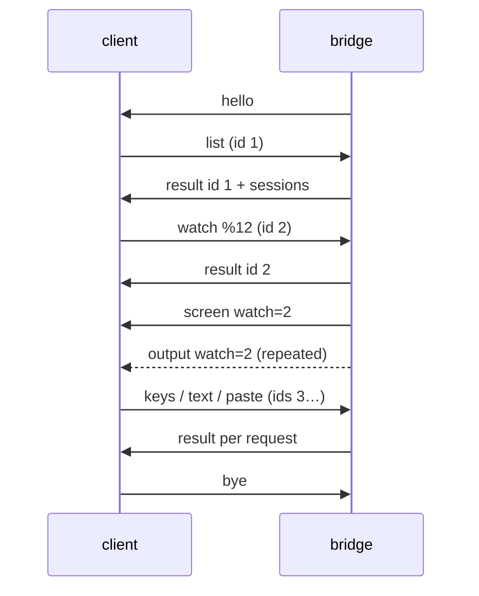

# muxa protocol, version 1

The contract between `muxa-bridge` and its clients. The fixtures in `fixtures/` are normative. Every implementation must decode each line and re-encode it to the same JSON value. Key order may differ. The Rust types reproduce each line byte for byte (`crates/muxa-protocol/tests/fixtures.rs`); the Swift types are checked with sorted keys (`apple/MuxaKit/Tests/MuxaProtocolTests`).

## Transport

- The client runs `muxa-bridge` over SSH as the exec command. There is no PTY.
- Each direction is a stream of JSON objects, one per line, in UTF-8. Lines end with `\n`.
- Byte payloads (`data`) are standard base64. Pane content is raw bytes, not UTF-8 text.
- Unknown fields must be ignored. A client must ignore message types it does not know. The bridge answers unknown request types with a `bad-request` error.
- A newer host may add a value to an enumerated field of a message: a kind, a state, an answer, a delivery, a code. A client reads the rest of the message and shows that value as unknown. One new value never fails a whole list. Requests are stricter: the bridge answers a request that names a value it does not know, `unknown` included, with `bad-request` before any change.
- One request line is at most 4 MiB.

## Session



1. The bridge sends `hello` first, unasked. The client checks `protocol` and closes on a mismatch.
2. The client sends requests. Each one gets exactly one `result` with the same `id`. Requests are run in the order they arrive, so keystrokes keep their order.
3. `watch` makes the bridge send a `screen` for that pane, then `output` as the pane changes. Both carry `watch`, the id of the watch request. The client must drop any `screen`/`output`/`pane-gone` whose `watch` is not its latest watch request.
4. A new `screen` can arrive at any time for the same watch, for example after the pane is resized on the desktop. Reset the emulator to `cols` x `rows` and feed `data`.
5. The client sends `ping` at least every 15 s. The bridge exits after 60 s without a request.
6. `bye` from the client ends the session. `bye` from the bridge says why it is exiting.

## Requests (client → bridge)

| type | fields | effect |
|---|---|---|
| `ping` | `id` | round trip through tmux |
| `list` | `id` | `result` carries `sessions` |
| `watch` | `id`, `pane` | show this pane; replaces the previous watch |
| `unwatch` | `id` | stop `screen`/`output` |
| `history` | `id`, `pane`, optional `lines` | the pane's scrollback, then its screen, once (capability `history`); a `history` comes before the `result`. See "Rendering a pane" |
| `viewport` | `id`, `cols`, `rows` | the grid the client's pane area shows at its default font (capability `viewport`); the bridge sizes the watched pane's window for it. See "Rendering a pane" |
| `keys` | `id`, `pane`, `keys[]` | named keys: up to three `C-`/`M-`/`S-` modifiers, then one printable ASCII character, `F1`–`F12`, or one of `Up Down Left Right Home End PageUp PageDown Enter Escape Tab BTab BSpace DC IC Space KPEnter` |
| `text` | `id`, `pane`, `text` | typed literally |
| `bytes` | `id`, `pane`, `data` | raw key bytes, for clients that encode keys themselves |
| `paste` | `id`, `pane`, `text` | pasted; bracketed when the program enabled bracketed paste |
| `chat` | `id`, `pane` | follow the agent conversation in this pane (capability `chat`); replaces the previous chat |
| `unchat` | `id` | stop `chat-entries` |
| `docs` | `id`, `pane` | list the pane's Markdown documents (capability `docs`); a `doc-list` comes before the `result` |
| `doc` | `id`, `pane`, `path` | open a listed document and follow it; replaces the open document |
| `undoc` | `id` | stop `doc-content` |
| `changes` | `id`, `pane` | list the files that differ from HEAD in the pane's repo (capability `changes`); a `change-list` comes before the `result` |
| `diff` | `id`, `pane`, `path`, optional `scope` (`uncommitted`, `branch`) | show a listed file's diff and follow it; replaces the open diff |
| `undiff` | `id` | stop `diff-content` |
| `images` | `id`, `pane` | list the image files in the pane's repo (capability `images`); an `image-list` comes before the `result` |
| `image` | `id`, `pane`, `path` | show a listed image and follow it; replaces the open image |
| `unimage` | `id` | stop `image-content` |
| `new-task` | `id`, `repo`, `branch`, optional `base` | start a task (capability `tasks`); a `task-created` comes before the `result` |
| `close-task` | `id`, `session`, `mode` | close a task's session (capability `close-task`), or an ask session (`work` level 5, Ask sessions below) |
| `list-tasks` | `id` | list the task records and workspaces (capability `task-records`); a `task-list` comes before the `result` |
| `create-task` | `id`, `workspace`, `title`, `goal`, optional `project`, `repo`, `branch`, `base`, `loop {check, maxAttempts?, timeout?}`, `worker` (Workers below), `read` (Reading Tasks below) | record a task and start its agent, with a Task Loop when `loop` is set (capability `task-loop`); a `task-saved` comes before the `result` |
| `update-task` | `id`, `task`, `rev`, `status`, optional `worktree` (`work` level 7) | set a task record's status; a `task-saved` comes before the `result` |
| `restart-agent` | `id`, `task`, optional `force`, `worker`, `rev` (Workers below) | restart the task's agent in the same pane, after a handoff (capability `task-handoff`); a `task-saved` comes before the `result` |
| `branch-task` | `id`, `task`, optional `branch` | give a reading Task a worktree and restart its agent there (capability `work` level 4, Reading Tasks below); a `task-saved` comes before the `result` |
| `park-task` | `id`, `task` | write the handoff and close the Task's session; the Task stays (capability `work` level 4); a `task-saved` comes before the `result` |
| `recover-restart` | `id`, `task`, `rev`, `operation`, `action` | explicitly resolve an interrupted restart (capability `task-restart-recovery`, contract below); `task-saved` precedes `result` |
| `start-loop` | `id`, `task`, `loop {check, maxAttempts?, timeout?}`, optional `reset` | start the task's Task Loop (capability `task-loop`); a `task-saved` comes before the `result` |
| `stop-loop` | `id`, `task` | stop the task's Task Loop (capability `task-loop`); a `task-saved` comes before the `result` |
| `list-routines` | `id` | list the host's Routines (capability `work` level 1, Routines below); a `routine-list` comes before the `result` |
| `run-routine` | `id`, `workspace`, `routine` | start a run of an enabled Routine now; needs the muxa daemon; a `routine-saved` comes before the `result` |
| `list-inbox` | `id` | list the stored Inbox entries (capability `work` level 1); an `inbox-list` comes before the `result` |
| `update-inbox` | `id`, `entry`, `action`, optional `text`, `option`, `worktree` (`work` level 7) | approve, dismiss or move down a stored entry; an `inbox-saved` comes before the `result` |
| `start-session` | `id`, `workspace`, `repo` | start an ask session: the workspace's agent in the repo's main checkout, with no Task (capability `work` level 2, Ask sessions below); a `session-started` comes before the `result` |
| `bye` | `id` | the bridge exits |

Pane ids look like `%12`. Session ids look like `$1`, and window ids like `@4`. Ids are the only way to target anything.

## Messages (bridge → client)

| type | fields |
|---|---|
| `hello` | `protocol`, `bridge` (version), `tmux` (version), `capabilities[]` |
| `result` | `id` (absent only for an unreadable request), optional `error {code, message}`, optional `sessions` |
| `screen` | `watch`, `pane`, `cols`, `rows`, `data` |
| `output` | `watch`, `pane`, `data` |
| `history` | `history`, `pane`, `cols`, `data`, optional `truncated` |
| `sessions-changed` | none. Send `list` again. Sent when tmux reports a structural change, and when an agent pane's role or state changed (checked every 2 seconds). Best effort: tmux reports pane changes only for the bridge's current session, so also re-list whenever the session list is shown. |
| `pane-gone` | `watch`, `pane`, optional `reason` |
| `chat-entries` | `chat`, `seq`, optional `reset`, `entries[]`, optional `status {state, since}`, optional `agent`, optional `truncated`, optional `prompt {entry, kind, question?, options[] {label, keys[], cancel?}}` |
| `chat-ended` | `chat`, `reason` |
| `doc-list` | `docs`, optional `root`, `entries[] {path, kind, title?, mtime?}`, optional `truncated` |
| `doc-content` | `doc`, `path`, `text`, optional `mtime` |
| `doc-ended` | `doc`, `reason` |
| `change-list` | `changes`, optional `root`, `entries[] {path, status, oldPath?, added?, removed?}`, optional `truncated`, optional `branch {base, commits, entries[], truncated?}` |
| `diff-content` | `diff`, `path`, optional `text`, optional `binary` |
| `diff-ended` | `diff`, `reason` |
| `image-list` | `images`, optional `root`, `entries[] {path, mtime?, size?}`, optional `truncated` |
| `image-content` | `image`, `path`, `data` (base64), optional `mtime` |
| `image-ended` | `image`, `reason` |
| `task-created` | `task`, `session` |
| `task-list` | `tasks`, `workspaces[] {name, root?, checks?, repos?}`, `entries[]` (task records), optional `truncated`, `workers[]` (Workers below) |
| `task-saved` | `task`, `record` (a task record) |
| `tasks-changed` | none. Send `list-tasks` again (capability `tasks-changed`) |
| `routine-list` | `routines`, `entries[]`, optional `problems[]` (Routines below) |
| `routine-saved` | `routine`, `entry` (a Routine) |
| `inbox-list` | `inbox`, `entries[]` (stored Inbox entries, newest first) |
| `inbox-saved` | `inbox`, `entry` (a stored Inbox entry) |
| `session-started` | `start`, `session`, `name` |
| `bye` | `reason` |

Error codes: `bad-request`, `invalid-pane`, `no-pane`, `unsupported-key`, `too-large`, `unsupported`, `task-failed`, `conflict`, `would-lose-work`, `tmux`, `internal`.

### Sessions

A session has `id`, `name`, optional `repo`, `repoDir` (the repo's main checkout, absolute), `branch`, `worktree`, `task` (tmux-agents' task name, `@agent_task`), `taskId` (the task record the session runs, from the session option `@muxa_task`; see Task records), `ask` (the workspace of an ask session, from the session option `@muxa_ask`; see Ask sessions), and `panes`. A pane has:
- `id`, `window`, `index`, `cols`, `rows`;
- `command`: the foreground process;
- `path`, `dead`;
- `role`: `agent`, `shell`, `hidden` or `unknown`;
- `shellForeground`;
- optional `agent {state, since}`.

- **Roles never come from screen content.** In order: `@muxa_role`, then agent-runner tags, then, in a window with no agent pane, the pane where an agent adapter sees its agent running (the window's other untagged panes are then `shell`), then `unknown`. Clients do not show `hidden` panes.
- **Repo without tags:** a session without `@agent_repo_dir` gets `repo` and `repoDir` from the git repo of its first visible pane, also when that pane is in a worktree.
- **Agent/Terminal toggle:** when a session has no `agent`/`shell` roles, the client may treat the pane in the same window whose `shellForeground` is true as the terminal. If there is none, it disables the toggle.
- **Agent state** (`running`, `waiting`, `idle`, `done`, `error`) is present only when an agent runner reports it, or, for a pane without a state tag, when the agent itself records it (for Claude Code, its session file). `since` is epoch seconds. When `shellForeground` is true, the state is likely stale: show it as such, or as unknown.

## Chat

A bridge with the `chat` capability can follow the conversation of a coding agent through an agent adapter (`docs/agents.md`). The pane itself is unaffected: watching and typing work as before.

1. `chat {pane}` answers `result`. On success, `chat-entries` messages follow. Each carries `chat`, the id of the chat request. The client drops any whose `chat` is not its latest chat request.
2. `unsupported` means no adapter knows the program in that pane. Show the terminal instead.
3. `seq` grows by one per message of a chat.
4. `reset: true` clears the list first. It comes first, and again whenever the bridge resends everything, for example after the client fell behind or the agent started a new conversation. On a reset, `agent` names the adapter (`claude-code`), and `truncated: true` says older history exists but was not sent.
5. Each entry has `id`, `kind` (`user`, `assistant`, `tool`, `notice`), `text`, and for a tool call `tool {name, summary, result?, error?}`. An entry replaces any earlier entry with the same `id`. A tool call is sent first without `result` and again when its result arrives.
6. `status` is the agent's state when the message was sent, with `since` in epoch seconds. Absent means unknown, for example when the pane is back at a shell. A message with no entries carries a status change alone.
7. `chat-ended` says the chat stopped, for example because the agent exited. Send `chat` again to follow a new one.
8. With the `chat-prompt` capability, `prompt` says what the agent waits on now, when its adapter knows that menu. Like `status`, every message carries the current one, and absent means none is known. A message with no entries carries a prompt change alone.
   - `entry` is the id of the tool entry the agent waits on.
   - `kind` is `permission` (may the agent run this call), `question` (pick an answer; `question` holds it) or `plan` (leave plan mode). Treat an unknown kind as a prompt without a known meaning, and still show its options.
   - Each option's `keys` are tmux key names that pick it: send them with `keys`. `cancel: true` marks a deny or cancel.
   - The options can be fewer than the agent's menu. The rest are only in the pane.

Entries are made by the bridge from the agent's own records, which are private formats. Expect missing kinds rather than wrong ones. `assistant` text is markdown.

## Documents

A bridge with the `docs` capability serves the Markdown documents that belong to a pane, for reading.

1. `docs {pane}` sends `doc-list`, then `result`. `docs` in the list is the request id.
2. The list holds the pane's agent documents first (`kind: plan`, for example the Claude Code plan of that session, path `plans/<name>`), then the Markdown files of the pane's git repo (`kind: repo`, path relative to the repo): tracked files, and untracked files git does not ignore. At most 2000; `truncated` says there were more. Last come a task's brief, handoff and last check, paths `.muxa/TASK.md`, `.muxa/HANDOFF.md` and `.muxa/CHECK.md` (`kind: repo`), when they exist at the repo root or, outside a repo, in the pane's directory (ADR 0015, 0018, 0019).
   - Outside a repo, the list also has files of the pane's directory (`kind: repo`, path relative to that directory), by the rule in "Files outside a repo" below.
3. `doc {pane, path}` opens one of them. `path` must be one the list for that pane contains now; anything else is `bad-request`. The bridge then sends `doc-content` with the whole text, and again whenever the file changes (checked every second). The client drops any whose `doc` is not its latest doc request.
4. `doc-ended` says the document is no longer readable, for example removed, larger than 2 MiB, or a symlink to outside its directory.

## Changes

A bridge with the `changes` capability shows what differs from HEAD in a pane's git repo, for reading. Staged and unstaged changes count as one.

1. `changes {pane}` sends `change-list`, then `result`. `changes` in the list is the request id.
2. Each entry has `path` (relative to the repo) and `status`: `modified`, `added`, `deleted`, `renamed` (with `oldPath`), `untracked` or `conflicted`. `added` and `removed` count lines; they are absent for a binary file. Untracked files that git ignores are not listed. At most 2000, in path order; `truncated` says there were more.
3. `diff {pane, path}` opens one of them. `path` must be one the list for that pane contains now; anything else is `bad-request`. The bridge then sends `diff-content` with the file's whole unified diff (`git diff` against HEAD; for an untracked file, against nothing), and again whenever it changes (checked every 2 seconds). A binary file has `binary: true` and no `text`.
4. `diff-ended` says the diff stopped, for example the file has no changes any more, or the diff is larger than 2 MiB.
5. With the `branch-changes` capability, `change-list` also has `branch`: what the branch's own commits changed since it left its base.
   - The base is origin's default branch (`origin/HEAD`). Without one, it is the main worktree's branch when the pane is in another worktree, else a local `main` or `master`. `base` names the ref, for example `origin/main`. The bridge never fetches.
   - The files are `git diff <fork point> HEAD`, where the fork point is `git merge-base HEAD <base>`. `commits` counts the commits since the fork point. Entries have the same shape as above; `untracked` does not occur.
   - `branch` is absent on the base itself, without a base, or when HEAD and the base share no history.
   - `diff {pane, path, scope: "branch"}` opens one of these files. Uncommitted changes are not part of it; they are in `entries`, so a file can be in both lists.

## Images

A bridge with the `images` capability serves the image files of a pane's git repo, for viewing, for example screenshots of a test run.

1. `images {pane}` sends `image-list`, then `result`. `images` in the list is the request id.
2. The list holds PNG, JPEG, GIF, WebP and HEIC files by extension, in any case: tracked files and untracked ones, **including files git ignores**. Only those extensions are listed. Each entry has `path` (relative to the repo), `mtime` and `size` in bytes. Newest first; at most 2000, the newest kept, and `truncated` says there were more.
3. `image {pane, path}` opens one of them. `path` must be one the list for that pane contains now; anything else is `bad-request`. The bridge then sends `image-content` with the whole file, and again whenever its time or size changes (checked every 2 seconds). The client drops any whose `image` is not its latest image request.
4. `image-ended` says the image is no longer readable, for example removed, larger than 16 MiB, or a symlink to outside the repo.
5. Outside a repo, the list holds the pane directory's images by the rule below, path relative to that directory, and has no `root`.

### Files outside a repo

When a pane's directory is in no git repo, `docs` and `images` serve (ADR 0033 §4a):

1. In a Task folder, every Markdown file or image under it. A Task folder is the `dir` of a Task record with no `branch` (a Task without a repo, or a reading Task) whose parent folder is `tasks/`. The bridge scans it without following symlinks, skips every name that starts with a dot (so `.muxa/` and `.claude/` are never listed; `.muxa/TASK.md` and the others are listed as above), and stops at 6 levels, 2000 entries or 250 ms.
2. In any other directory, only the paths that the Inbox items of that pane (`pane` is its id) attach.
3. Each file must stay inside the pane's directory after symlinks, when listed and on every read.

## Tasks

A bridge with the `tasks` capability starts tasks: a git worktree on a branch, and a new tmux session with an agent in it.

1. `new-task {repo, branch, base?}`. `repo` is an absolute path inside the repo, for example a session's `repoDir`. `base` is where a new branch starts; the repo's default branch when absent.
2. On success the bridge sends `task-created {task, session}`, then `result`. `task` is the request id. `session` is the session's name; list again to find its panes. A branch that already has a session gets that session, not a second one.
3. A wrong `repo`, `branch` or `base` is `bad-request`. A failed launch is `task-failed`; the message says why. A launch can take several seconds, and other requests are answered meanwhile.
4. The new session is detached. No attached client moves, and no existing window or pane changes.
5. `close-task {session, mode}` closes a task: a session with a `worktree`. `session` is its id. With `work` level 5 it also closes an ask session (Ask sessions below). Other sessions are `bad-request`. `mode` says what happens to the worktree:
   - `close`: removed with its branch when nothing can be lost: no uncommitted changes, and the branch is merged. Otherwise the request fails and nothing changes.
   - `keep`: kept.
   - `force`: removed with its branch, also with uncommitted changes or an unmerged branch. A client sends it only after the user said yes.

   Without `force`, the branch goes only when each of its commits is in the base branch or on a remote (ADR 0043). Clients attached to the session, the bridge's own included, move to the most recently used other session before it closes. The `result` comes when it is closed; a failure is `task-failed` with the reason.

## Task records

A bridge with the `task-records` capability keeps Tasks: durable records of work, stored on the host (ADR 0015). `new-task` and `close-task` above start and close a session for work. A task record is the Task itself: it has a goal and a status, and it outlives its session.

1. `list-tasks` sends `task-list`, then `result`. `tasks` in the list is the request id. `workspaces` are the host's workspaces, from its config; clients cannot change them. A workspace's optional `checks` is what a Task Loop may run there: `"any"`, or a list of exact commands. Absent means no loops in that workspace. `root` is the workspace's folder, absolute; older bridges omit it. `repos` are the workspace's main checkouts, absolute and sorted: the git repos one or two levels under `root` (ADR 0031) and those the config lists; absent when there are none. A client uses them to pick the workspace for a new task in a repo, and may show a repo under `root` by its relative path. `entries` are the records; `truncated` says the bridge left some out.
2. A task record has:
   - `id`, for example `t-7f3a2c`;
   - `rev`, an integer from 1, one higher after every write;
   - `workspace`, `title`, `goal`;
   - `status`: `open`, `review`, `done` or `dropped`, set by the user. One exception: a passing Task Loop moves `open` to `review` (ADR 0019 amends ADR 0015). Nothing else changes the status. Treat an unknown status as one without a known meaning, and still show the record;
   - `createdAt`, `updatedAt` in epoch seconds;
   - optional `project` (free text), `repo` (absolute), `branch`, `dir` (where the agent works, absolute), `session` (the last known session name, for display only) and `note` (from the bridge, for example why the launch failed);
   - optional `read: true`, with `work` level 4: a reading Task. It has `repo` and no `branch`, and `dir` is its own folder. See Reading Tasks below;
   - optional `runs`, with the `task-handoff` capability: the agents that worked on the task. See Handoff below;
   - optional `loop`: the task's Task Loop. See Task Loop below;
   - optional `pendingPrompt {kind, since, run}`: a prompt the host still waits to type into the agent. `kind` is `start` or `restart`, `since` is when the wait began (epoch seconds), and `run` is the `id` of the run it is for. It is cleared when the prompt is typed or given up;
3. `create-task {workspace, title, goal, project?, repo?, branch?, base?, loop?}` records a Task and starts an agent for it. `workspace` is a name from `task-list`. `loop` also starts a Task Loop; see Task Loop below.
   - `repo` is an absolute path inside a repo. With `work` level 2 it may also be relative to the workspace's `root`, for example `fairpull/fairpull-plan`. It must stay inside `root` after symlinks are resolved, unless it reaches a repo the config lists; a plain name may also name a listed repo by its folder name.
   - With `repo`, `branch` is required, except with `work` level 2: then the bridge names a new branch after the title, a lowercase ASCII slug of at most 40 characters, with `-2`, `-3`... when that branch or its worktree exists. The session starts as with `new-task`, and `base` means the same.
   - A repo that a workspace lists, or that is under its `root`, takes Tasks only from that workspace; from another one the request is `bad-request`.
   - Without `repo`, the task gets a directory in its workspace, `<root>/tasks/<slug>-<id>`, and a new session of the same name.
   - When the branch's session already runs another task that is `open` or `review`, the request is `bad-request`.
   - The bridge hands the goal to the agent. The session carries the record's id as `taskId`.
   - On success the bridge sends `task-saved {task, record}`, then `result`. `task` is the request id.
   - A failed launch still keeps the record, with a `note`. The bridge sends `task-saved` with it, then a `result` with `task-failed`. The record names a `session` only when one started before the failure.
   - A wrong workspace, `repo`, `branch` or `base`, or an empty `title`, is `bad-request`, and no record is kept.
   - The bridge writes `.muxa/TASK.md` in `dir`. It types `Read .muxa/TASK.md and start.` into the agent pane once the agent's state is `idle`, or a `done` that began after the wait. When that does not happen within 30 seconds, it does not type it, and the record's `note` says so. The record has a new `rev` then.
4. `update-task {task, rev, status}` sets the status of the record whose id is `task`. `rev` is the one the client last saw. When the record changed since, the request fails with `conflict` and nothing changes: list again and retry. On success, `task-saved` with the new record comes before the `result`. Setting `done` or `dropped` then closes the Task's session, as `close-task` does with mode `keep`: the worktree or folder stays (ADR 0037). This happens after the `result` and does not change it.
   - With `work` level 7 and `done` or `dropped`, `worktree` ends the Task with its worktree (ADR 0043). `remove`: when removing the worktree could lose work (uncommitted changes, or a branch that is not merged), the request fails with `would-lose-work`, the message says why, and nothing changes: no status, no session. Ask the user, then send `force`. Otherwise the session closes, the worktree and its branch are removed as `close-task` does with `close` or `force`, and then the status is saved. A parked Task (no session) has its worktree removed the same way. A Task without a repo keeps its folder. All of it happens before the `result`. Without `worktree`, the host acts as above. Other statuses never start or close a session. A request without `status` is `bad-request`: the `inbox {down?, until?}` of the removed Inbox queue (ADR 0027 §4, removed by ADR 0033) is no longer read. A record that a host stored with an `inbox` field still loads; the host keeps the field on disk and never sends it.
5. A session runs a Task when its `taskId` is the record's `id`. The agent's state stays on the session's panes; the Task's `status` does not follow it.
6. `taskId` comes from the session option `@muxa_task`. Options end with the tmux server, so a session without one gets the `id` of the record whose `dir` is the session's `worktree`, or the path of its first visible pane. A record whose tag a session carries is not matched again. The bridge does not write the tag back.

## Handoff

A bridge with the `task-handoff` capability records the agents that work on a Task, and can restart a Task's agent with a handoff (ADR 0018).

1. A task record's `runs` lists the agents the bridge started or restarted, oldest first, at most 50. Absent means none was recorded. Each run has:
   - `id`, an integer from 1, one higher than the previous run's;
   - `startedAt`, epoch seconds;
   - `reason`: `start` (`create-task`) or `restart` (`restart-agent`). Treat an unknown reason as one without a known meaning;
   - optional `agent`, the adapter that saw the agent, for example `claude-code` or `codex`. Absent until an adapter reported it;
   - optional `endedAt`, epoch seconds when the bridge restarted it. It is never set when the agent ends any other way;
   - optional `agentSession`, the agent's own session id, and `transcript`, the absolute path of its transcript on the host. A path only; the bridge never sends transcript content here.
2. Runs are recorded only when a bridge or the host daemon handles `create-task` or `restart-agent`. An agent quit or restarted by hand in its pane leaves no run.
3. `restart-agent {task, force?}` restarts the agent of the record whose id is `task`:
   - The agent pane is the first live `agent` pane of the session that runs the task (`taskId`). With none, the request is `task-failed`.
   - While the agent's state is `running`, the request is `bad-request`, unless `force` is true.
   - The bridge rewrites the header of `.muxa/TASK.md` and keeps the agent's notes below its marker. It writes `.muxa/HANDOFF.md` from facts: the runs, the record's status and note, git's branch, commits and status for a repo task, and recently changed files otherwise.
   - It restarts the agent in the same pane. The pane keeps its id and size, and no layout changes. It ends the open run and adds one with `reason: restart`.
   - On success the bridge sends `task-saved {task, record}`, then `result`. `task` is the request id.
   - Once the new agent has finished a turn (`idle` or `done`, since the restart), the bridge types `Read .muxa/TASK.md and .muxa/HANDOFF.md, then continue.` When that does not happen within 30 seconds, the record's `note` says so.
   - An unknown task is `bad-request`.

## Workers

ADR 0022 release W adds the optional `workers` capability within protocol v1. ADR 0027 section 1 sets the selection contract below. The bridge serves named create and Keep/default/named restart, and advertises `workers` when task records are on. The demo bridges do not advertise it and reject worker requests as `unsupported`.

Clients MUST check the capability before they send `worker` or restart `rev`. Older bridges may ignore unknown fields.

- `task-list` gains optional `workers[] {name, agent, description?, workspaces?, loop?}`. Missing means an empty list. Missing `workspaces` allows every workspace; `[]` allows none. `loop` uses LoopSpec's `{check, maxAttempts?, timeout?}` as creation defaults, subject to the workspace allowlist and `task-loop`. Selecting a worker never creates a loop or replaces an existing check. `agent` is a native program/adapter configuration id, not observed state. Unknown ids have no known launch action. Native args, instruction content, config paths and environment are never included.
- A worker is selected by name. The reserved name `default` is the workspace default agent. A host worker may not be named `default`.
- `create-task` gains optional `worker: string`: a worker name or `default`. Absent is the workspace default.
- `restart-agent` gains optional `worker` and `rev`. A worker-aware client always sends `worker`: a name or `default`. A legacy client omits it, and the Task keeps its current worker. JSON `null` is read as omitted.
- `rev` is optional. When sent, a stale revision is `conflict` before any side effect. Without it, no revision is checked.
- An unknown, removed or disallowed worker is `bad-request` before side effects. There is no fallback to another worker, also when a restart keeps a removed worker.
- Task records gain optional `worker: string`, the requested worker. Absence means the workspace default. This label does not prove the native role or its permissions were applied.
- Runs gain optional `worker: string`: the name requested for that run, or `default`. Missing means a legacy run: the worker is unrecorded, not the workspace default. Observed `run.agent` stays separate and comes only from the adapter.
- Runs that a host wrote before ADR 0027 carry `assignment {kind, name?}` on disk. The bridge keeps it on rewrite and lists `{"kind":"workspace-default"}` as `default` and `{"kind":"worker","name":N}` as `N`. Any other form lists as unrecorded.

After a restart, a guarded Codex run gets the fixed prompt in Terminal instead of automatic input (ADR 0027 section 2).

The shared `fixtures/workers/requests.jsonl` and `messages.jsonl` pin the request forms, worker metadata, scope defaults, legacy and recorded run workers, and errors. The hello fixture includes `workers`; no host sends it yet.

## Restart recovery (contract; capability gated)

`task-restart-recovery` is independent of `workers`. These additive protocol-v1 types do not by themselves enable a host implementation. Advertise the capability only after durable restart phases, recovery validation and failure probes work end to end. Hosts without it reject `recover-restart` as `unsupported` before side effects. `protocol/fixtures/restart-recovery/` describes the contract, including a hypothetical capability-bearing hello.

A Task record may have `restartOperation {id, phase, worker?, actions?}`. This is public recovery metadata; no process command, instruction bytes, staged file content or environment is sent. `worker` is the requested worker name or `default`, not confirmation of an effective native role. `actions` is a list of strings, absent meaning empty. Unknown phase/action strings remain displayable but do not acquire a known action. An incomplete or unrecognized persisted operation is exposed as `phase: "unknown"` with no permitted action; never treat it as absent or automatically retry ordinary restart. Clients block ordinary restart while a summary is present and offer Terminal when no recovery action is understood.

Clients intersect the host's `actions` with these known phase/action pairs and require the capability before offering mutation:

| Phase | Known actions |
|---|---|
| `prepared` | `cancel-prepared` |
| `dispatching`, `delivering` | `leave-unconfirmed` |
| `replaced` | `finish-replacement`, `leave-unconfirmed` |
| any other value | none |

`recover-restart {task, rev, operation, action}` carries the exact displayed Task revision and operation id. `action` is one of the three known strings above; unknown action values are bad-request. A stale revision/operation, live owner, unavailable action or failed identity/file reconciliation conflicts before any recovery write. Do not refetch a new revision and silently retry. On success a `task-saved` record precedes the normal `result`; no new reply type is introduced.

- `cancel-prepared` resolves only pre-dispatch intent without replacing a process.
- `finish-replacement` finalizes only a durably confirmed replacement and validated staged files. It never respawns or automatically types a prompt.
- `leave-unconfirmed` acknowledges uncertainty without replacing a process, typing input or resuming a loop. When dispatch outcome is unknown, the reserved historical run records the requested assignment and `outcome: "unconfirmed"`, with no invented observed agent identity. Delivery-only uncertainty retains the already finalized run. A resolved operation receipt is not an active `restartOperation` summary.

`AgentRun.outcome` is an optional string: `unconfirmed` means a process replacement or prompt-delivery outcome was not confirmed. Absence on an older run does not reconstruct historical certainty. Preserve future outcome strings without inventing a meaning. Later adapter observation does not erase an interrupted run's historical outcome.

The CLI `task recover ID` is inspection only; `--json` returns the Task record with its revision and summary. Mutation requires `--operation OP --rev N --action ACTION` together and sends those exact values once. Recovery action receipts and phase validation follow ADR 0024; matching content alone does not establish an idempotent retry after a newer operation.

## Task Loop

A bridge with the `task-loop` capability can run a Task Loop: after each finished turn of the task's agent, the host runs a check command, and types a fail prompt until the check passes (ADR 0019). The loop runs in the muxa daemon on the host, also while no client is connected. The bridge has the capability only when it reached a daemon of its own version.

1. A loop is asked for with `loop {check, maxAttempts?, timeout?}`, in `create-task` or in `start-loop`.
   - `check` is a shell command, run in the task's `dir`. It must be allowed by the workspace's `checks`: one of the listed strings, exactly, or any command of at most 4096 bytes with no control character for `"any"`.
   - `maxAttempts` is how many failed checks stop the loop: 1 to 10, default 3.
   - `timeout` is how many seconds one check may run: 10 to 3600, default 600.
   - A workspace without `checks`, a check it does not allow, or a repo task whose repo is not in the workspace is `bad-request`. Without a usable daemon, the request is `unsupported`, and the message says what to run on the host.
2. `start-loop {task, loop, reset?}` starts the loop of the record whose id is `task`, also a stopped or passed one. The attempt count goes on, unless `reset` is true. `stop-loop {task}` stops it with reason `user`. Both send `task-saved`, then `result`. An unknown task is `bad-request`.
3. A record's `loop` has:
   - `check`, `maxAttempts`, `timeout`, as above, with the defaults filled in;
   - `state`: `armed` (waits for the agent's next finished turn), `checking`, `paused`, `passed` or `stopped`. Treat an unknown state as one without a known meaning;
   - `attempts`, the failed checks so far;
   - `armedAt`, epoch seconds when the loop started or last typed a prompt, and `since`, epoch seconds of the last state change;
   - optional `reason`, set when the state is `paused` or `stopped`: `waiting` (paused while the agent waits for the user), `limit`, `timeout`, `error`, `no-agent`, `not-sent`, `stalled`, `status` (the user set a status other than `open`) or `user`. Treat an unknown reason as one without a known meaning;
   - optional `lastCheck {attempt, exit?, seconds, at}`: the last check's attempt, exit code, duration and end time in epoch seconds. `exit` is absent when the check timed out.
4. A passing check sets the state to `passed`, and moves a task with status `open` to `review`. The loop never sets any other status.
5. The loop never answers the agent's menus. While the agent is `waiting`, the loop is `paused`; it goes on after the user answered.
6. The check's output is in the task's `.muxa/CHECK.md` (see Documents). The record never carries it.
7. Clients put a task in **Needs attention** when its loop is `paused`, or `stopped` with a reason other than `user` or `status`, unless the task is `done` or `dropped`. `protocol/fixtures/inbox/groups.jsonl` pins the whole Inbox rule: each line has a `record`, the `sessions` of `list`, and the `group` it belongs to.

## Tasks changed

A bridge with the `tasks-changed` capability sends `tasks-changed` when a task record changed on the host, whoever wrote it: the daemon, another bridge, or `muxa-cli`. It looks every 2 seconds. The message has no fields. Send `list-tasks` again.

## Routines and stored Inbox entries

A Routine runs an agent on a trigger and publishes briefings and proposals to Inbox (ADR 0026). The host advertises the capability `work:<level>`; Routines and stored entries need level 1 or higher. Level 2 adds relative repos, a branch from the title and ask sessions (ADR 0031). Level 3 adds Inbox items (ADR 0033), level 4 reading Tasks, `branch-task` and `park-task` (ADR 0034), level 5 closing ask sessions with `close-task` (ADR 0039), level 6 `ask-agent` on an Inbox item and the workspace's Ask session (ADR 0041), level 7 `worktree` on `update-task` and `update-inbox` (ADR 0043), level 8 Captures, Work items and assistant requests (ADR 0046), and level 9 delegate notes, plans, the overall assistant's proposals, pins and deadlines (ADR 0047). Newer features raise the level instead of adding a capability each (ADR 0027 section 5). Read the highest level; ignore a `work:` value that is not a number.

1. `list-routines` sends `routine-list {routines, entries[], problems[]?}`. A Routine has:
   - `workspace` and `name`: together, its id;
   - optional `trigger {at, timezone, schedule?}`: `at` is a local `HH:MM`, `timezone` an IANA name, `schedule` the five cron fields that choose the days (ADR 0036), e.g. `0 8 * * 1-5`. A host before ADR 0036 sends no `schedule`: every day. Absent `trigger`: it runs only on `run-routine`;
   - `enabled`. Nothing runs while it is false, also not `run-routine`;
   - optional `worker` (absent: the workspace default agent) and `project` (the label on Tasks its proposals create);
   - optional `nextDue`, epoch seconds;
   - optional `lastSuccess {at, occurrence, task, published}`, `lastFailure {at, occurrence, task?, reason}` and `running {occurrence, startedAt, task?}`. `reason` is one sentence with ids only.

   `problems[] {workspace, reason}` lists workspaces whose `.muxa/routines.toml` could not be used; such a workspace lists no Routines. `reason` names the file and the Routine; a TOML parse error may quote the file. Absent: none.
2. `run-routine {workspace, routine}` starts a run now. A Routine has at most one open run: a second one is `conflict`. A disabled or unknown Routine is `bad-request`. Without a usable daemon, or with a Codex agent (ADR 0026, Consequences), it is `unsupported`. On success: `routine-saved {routine, entry}`, then `result`.
3. A run is a task record with `kind: "routine-run"`. `list-tasks` never lists it. Its session carries `taskId`, so a client can open it, and can show a need of the run (an agent waiting on the user) by matching `running.task` with a session's `taskId`.
4. Each scheduled run has an `occurrence` id: the local date and time, e.g. `2026-11-03T09:00`. A run-now is `now-<epoch seconds>`. After sleep or a restart, at most one missed occurrence runs. A repeated local time (DST) runs once. A local time that does not exist that day runs at the next valid minute.
5. `list-inbox` sends `inbox-list {inbox, entries[]}`, newest first. An entry has `id` (`e-` and 8 hex digits), `workspace`, `routine`, `key`, `kind` (`briefing` or `proposal`), `title`, `body`, optional `links[] {url, title?}`, `createdAt`, `run` (the run's record id), `occurrence`, `disposition` (`open`, `later`, `approved` or `dismissed`), optional `readAt` (epoch seconds), optional `until`, optional `proposal {action, target, content, hash}` and optional `task`. Treat an unknown kind or disposition as one without a known action. A `later` entry whose `until` has passed is listed as `open`.
6. `update-inbox {entry, action}`:
   - `approve`, for a proposal only: creates one Task, as `create-task` would, in the Routine's workspace and project, with the proposal unchanged in its goal, and its `hash` (`sha256:` and the hex SHA-256 of `action`, a NUL byte, `target`, a NUL byte, and `content`). The entry gets `disposition: "approved"` and `task`. Approving again returns the same entry and creates nothing.
   - `dismiss`; `later` sets `laterAt` and keeps the entry `open`, below the others (ADR 0040). A host before ADR 0040 needs `until` and hides the entry until then; a newer host ignores `until`. Neither touches a Task.
   - `read` sets `readAt` once, in any disposition, and changes nothing else. A host before this change refuses it.
   - On success: `inbox-saved {inbox, entry}`, then `result`. An unknown entry, a briefing to approve, or an entry already approved or dismissed is `bad-request`.

### Routine output

The run's agent writes its output to `.muxa/routine/output.json` in the run's directory. The last committed state is in `.muxa/routine/state.json` (absent before the first success). When the agent ends a turn, the host checks the output. A failed check types a fixed prompt, up to 3 times. A passing check stores the entries and the new state in one write, and the run is done.

```json
{
  "version": 1,
  "items": [
    {"kind": "briefing", "key": "slack:C01:1762150000", "title": "Release thread",
     "body": "The release moved to Thursday.",
     "links": [{"url": "https://example.slack.com/archives/C01/p1762150000", "title": "Thread"}]},
    {"kind": "proposal", "key": "linear:ENG-12:stale", "title": "Close the stale issue ENG-12",
     "body": "No activity for 30 days.", "action": "Close the issue", "target": "linear:ENG-12",
     "content": "Closing: no activity for 30 days."}
  ],
  "state": {"cursor": "1762150000"}
}
```

- `version` is 1. `items` holds at most the Routine's item limit (default 10, at most 50).
- `key`: 1 to 200 bytes, no control character, unique in the file. A key the Routine already stored is skipped, so a retry stores nothing twice.
- `title`: 1 to 200 characters, one line. `body`: at most 4096 bytes; line breaks and tabs are the only control characters.
- `links`: at most 10. `url` is `https` or `http`, at most 2048 bytes, without spaces; `title` at most 200 characters.
- A proposal also has `action` (1 to 200 characters, one line), `target` (1 to 500 bytes, one line) and `content` (at most 8192 bytes). A briefing has none of them.
- `state` is any JSON value, at most 16 KiB encoded. Absent keeps the previous state; it advances only with a successful publish.
- The whole file is at most 256 KiB, a regular file, not a symlink. Unknown fields are refused, so a typo is not lost silently.

The check's reasons are in `.muxa/checks/<attempt>.log`. Logs on the host carry ids, sizes and outcomes, never titles, bodies, links or state.

## Inbox items

A bridge with `work` level 3 keeps Inbox items: one stored question for the user each (ADR 0033). Fixtures: `fixtures/items/`.

1. `inbox-list` also has `items[]`: every item, a Routine's entries included, in the order to show them. Open items come first, `ask` before the rest, then newest first. Then the open ones with `laterAt`, in the order they were moved down (ADR 0040), then at most 100 answered or resolved ones, newest first. `entries` stays for older clients.
2. An item has:
   - `id`: `i-` and 8 hex digits for a Task's item; a Routine's entry keeps its `e-` id;
   - `kind`: `ask` (the agent waits on a menu), `review` (a finished turn, or a passed loop), `failure` (an error, a stopped loop, or a failed start; an item without `session` offers no `retry` or `reply`), `proposal`, `briefing`, at level 9 `sort` and `delegate` (Plans and the overall assistant below), or at level 10 `hypothesis` (Policies, corrections and hypotheses below);
   - `state`: `open`, `later`, `answered` or `resolved` (the need ended without an answer from the Inbox);
   - `question` (one line), `workspace`, `title` (the Task's or the entry's) and `createdAt`;
   - optional `readAt`, `laterAt` (epoch seconds: `later` moved it down), `until` (only from a host before ADR 0040, with `later`), `answeredAt`, and `answer` (with `answered`, the action given);
   - optional `summary`: the agent's last message for the turn, or the entry's body, at most 4096 bytes;
   - optional `task`, `session` (`$n`) and `pane` (`%n`). Open the pane's `changes`, `docs` and `images` with `pane` for the attachments;
   - optional `prompt`, with `ask`: the menu, as in Chat's `prompt`;
   - optional `attachments {changes?, docs[], images[], links[]}`. `changes {files, added, removed, scope?}` counts the pane's uncommitted changes when the item was made; `scope: "branch"` counts the branch's own commits instead, as `diff {scope: "branch"}` shows them. `docs` and `images` are paths as the pane's `docs` and `images` list them (ADR 0033 §4a), at most 20 of each:
     - in a repo, the Markdown files and images among those changes;
     - outside a repo, the ones under the pane's directory changed since the turn started, by modification time, newest first. `.muxa/`, `.claude/` and other dot-folders are skipped;
     - then, in any Task, the Markdown files and images the summary names, by a relative or an absolute path, that exist inside the pane's directory after symlinks and outside `.muxa/` and `.claude/`. Each path is listed once;
     - `links`: the summary's `http` and `https` links, each once, at most 10. A GitHub pull request's link has `title` `PR #<n>`;
   - optional `routine` and `proposal`, for a Routine's item;
   - `answers[]`: the actions the host accepts now, in the order to show them. Empty once answered or resolved. Show an unknown action as nothing. The first one is the main answer. A `review` has `accept, reply, keep-open, later`; a `failure` `retry, reply, drop, dismiss, later`; an `ask` about a permission `approve, reject, reply, later`; a briefing `dismiss, ask-agent, later`.
   - Labels are the client's. They name the result (ADR 0033 §4a): `accept` is "Done" (closes the Task) and `reply` "Send". On an `ask`, `approve` is "Allow", `reject` "Deny" and `reply` "Deny & send". A `proposal` keeps "Approve" and "Reject".
3. A host since ADR 0040 sends no `later` state; it lists a stored `later` item as `open` with `laterAt`. A Task has at most one `open` or `later` item; a newer need resolves the older one.
4. `update-inbox {entry, action, text?, option?, worktree?}` answers an item; `entry` is its id. On success: `inbox-saved {inbox, item}`, then `result`. For a Routine's entry, `inbox-saved` has `entry` too. With `work` level 7, an answer that makes the Task done or dropped takes `worktree` as `update-task` does, `would-lose-work` included; other answers ignore it.
   - `approve`: an `ask` picks the prompt's first option that is not `cancel`; a proposal is approved as above.
   - `reject`: an `ask` picks the prompt's `cancel` option; a proposal is dismissed.
   - `choose` with `option`, an index into the prompt's options: answers a question.
   - `accept`: a `review` marks the Task done. `keep-open` answers it and leaves the Task open.
   - ADR 0040 removed `redo` and `change-course`: `reply` sends the developer's own words. A host since then lists and takes neither.
   - `reply` with `text` (1 to 4096 bytes): a `review` or `failure` sends the text as it is, with no preface, and the Task goes on. An `ask` about a permission first picks the prompt's `cancel` option, waits up to 10 seconds until the adapter no longer reports that menu and reports the agent `idle` or `done`, then sends the text. When the agent does not take the denial in time, the answer is `conflict` and the item stays open; the menu was denied. Old clients drop the unknown `reply`, so no capability is needed.
   - `retry`: a `failure` restarts the agent, as `restart-agent`. `drop` marks the Task dropped.
   - `branch` and `keep`, with `work` level 4: a reading Task's `proposal` about its main checkout (Reading Tasks below). `branch` does `branch-task` with a branch from the title; `keep` answers it and changes nothing.
   - `dismiss` answers the item and does nothing else. `later` sets `laterAt` and leaves the item open; it ignores `until`. `read` sets `readAt` and leaves the item open.
   - `ask-agent` with `text` (1 to 4096 bytes), with `work` level 6: sends the item and the text to the workspace's Ask session (Ask sessions below) and leaves the item open. It is in `answers` of every open item without `session`, before `later`; an item with a session takes `reply`. On success: `session-started {start, session, name}`, `inbox-saved {inbox, item}`, then `result`.
   - An action not in `answers` is `bad-request`. An `ask` whose prompt changed since the item was made is `conflict`: list again. Nothing is sent to the pane then.

## Captures and Work items

A bridge with `work` level 8 keeps Captures, Work items and assistant requests (ADR 0046). None of them is a Task or an Inbox item. Fixtures: `fixtures/assistant/`.

1. `capture {clientId, text, source?, workspace?, assist?}` saves the user's input. `clientId` is 1 to 64 printable ASCII bytes, made by the client once per capture (a UUID). The same `clientId` returns the stored Capture and writes nothing, so a client resends an unsent capture without making two. `text` is 1 byte to 16 KiB. `source` is `app`, `tmux` or `cli`. Nothing starts an agent unless `assist {scope, purpose?}` is sent: then the host also makes a Work item in `workspace` (required) and a request, as `request-assistant` does, and the Capture is `sorted`. On success: `capture-saved {capture, entry, work?, request?}`, then `result`. When the assistant cannot start (no daemon, a refusal of item 7), the input is still kept: `capture-saved` with the unsorted Capture, then `result` with the error. A resend of a sorted Capture returns its Work item and request and starts nothing.
2. A Capture has `id` (`c-` and 8 hex digits), `rev`, `clientId`, `text` (never rewritten), `source`, `state` (`received`: unsorted; `sorted`), `createdAt`, `updatedAt`, optional `workspace` and `work[]` (the Work items it belongs to).
3. `sort-capture {capture, rev, action, work?, title?, workspace?}` sorts a `received` Capture: `work` makes a Work item (`title` absent: the text's first line, at most 200 characters), `link` adds it to the Work item `work`, `note` keeps it with no Work item. Each sets `state: "sorted"`. A stale `rev` is `conflict`. On success: `capture-saved {capture, entry, work?}`, then `result`.
4. A Work item has `id` (`w-` and 8 hex digits), `rev`, `title` (one line, at most 200 characters), `state`, `createdAt`, `updatedAt`, and optional `workspace`, `laterAt`, `mergedInto`, `captures[]`, `requests[]` (oldest first) and `tasks[]` (oldest first). `state` is `open`, `in-progress` (a linked Task or request is running), `waiting-decision` (a linked Task has an open Inbox item), `done` or `withdrawn`. The host derives `in-progress` and `waiting-decision` when it lists the item. A Task's or a request's end never makes a Work item `done`; only `complete` does. Treat an unknown state as `open`.
5. `update-work {work, rev, action, title?, workspace?, into?}`. A stale `rev` is `conflict`. On success: `work-saved {work, entry}`, then `result`.
   - `edit` sets `title` or `workspace`, or both.
   - `later` sets `laterAt`: the item is listed below the others, in the order moved down (ADR 0040). It is not hidden, and only `reopen` (and, at level 9, `pin`) clears it.
   - `complete` makes it `done`, and `withdraw` `withdrawn`. Neither touches its Tasks. `reopen` makes it `open` again and clears `laterAt`.
   - `merge` with `into`: this item becomes `withdrawn` with `mergedInto`, and its Captures and requests are added to `into`. Both texts stay.
6. `create-task` takes `work` and `workRev` (the item's `rev` the client saw). The record keeps `work`, and the Work item lists the Task. A second `create-task` with the same `work` and `workRev` returns the Task it made, also after a crash. An older host ignores both fields.
7. `request-assistant {work, rev, scope, workspace?, purpose?}` asks a workspace's agent to work on the Work item. `scope` is `research`, `compare` or `draft`; `workspace` absent takes the item's. It needs the muxa daemon and a workspace with `[workspace.assistant]`; else it is `unsupported` with the reason. A delegate that is Codex, or an agent with no muxa adapter, is `unsupported` too, before any run folder exists. An item without a workspace, an unknown one, a done or withdrawn item, or a `purpose` over 4096 bytes is `bad-request`; a stale `rev` is `conflict`. The same `work` and `rev` return the request already made, with its run, also after a crash. Every request raises the item's `rev`; asking again with the new `rev` adds a `version` to that workspace's request instead of a new request. The new version ends the older version's run: its record is dropped and its session closed. A limit reached (`max_open_runs`, `max_runs_per_day` of the workspace or of `[assistant]`) is `conflict`, naming the limit and when the day's count resets. On success: `work-saved {work, entry, request}`, then `result`. When the run does not start, `work-saved` carries the `failed` request, and the `result` has the error.
8. An assistant request has `id` (`q-` and 8 hex digits), `work`, `version`, `workspace`, `scope`, `delivery`, `deliveryAt`, `createdAt`, `updatedAt`, optional `purpose`, `run` (the current version's record, of kind `assistant-run`; `list-tasks` never lists it) and `results[]` (newest first, at most 10).
   - `delivery` is derived from the run and its adapter, never from the agent's words: `pending` (the prompt is not typed yet), `received` (typed and confirmed), `processing` (the adapter reports the agent busy; `deliveryAt` is when it became busy), `unconfirmed` (a send was interrupted; never retyped automatically; cancel the version or ask again), `resulted`, `failed` (no valid result after 3 checks, or the run could not start), `timed-out` (no result in the workspace's `run_timeout`; the agent is not stopped), `cancel-requested`, `cancelled`. Treat an unknown value as unknown.
   - A result has `version`, `at`, `summary` (at most 4096 bytes), optional `stale` (an older version's result), `findings[] {text, sources[] {url?, path?, title?, readAt?}}` (each with at least one source), `openQuestions[]`, `next[]`, `files[]` (absolute paths the run wrote) and `possibleDuplicates[] {work, reason}`. A result never changes the Work item's state.
9. `cancel-request {request, version}` stops that version's run: its record is dropped and its session closed. `delivery` is `cancel-requested` until the run's session is gone, then `cancelled`. A result that arrives later is not stored. Another `version` than the request's is `conflict`, a version with its result is `bad-request`, and a second cancel changes nothing. Without the muxa daemon it is `unsupported`. On success: `work-saved {work, entry, request}`, then `result`.
10. `inbox-list` also has `work[]`, `captures[]` and `requests[]`. `work` lists open items first, newest `createdAt` first, then the ones with `laterAt` in the order they were moved down, then at most 100 `done` or `withdrawn` ones, newest `updatedAt` first. A `mergedInto` item may be absent from the list. `captures` lists the `received` Captures, newest first. `requests` holds the requests of the listed Work items. A client before level 8 ignores the three arrays.
11. `get-work {work}` reads one Work item, for its detail view. On success: `work-detail {work, entry, captures[], requests[]}`, then `result`. `entry` is the item with its derived state, as `inbox-list` lists it. `captures` are the Captures `entry.captures` names, in that order, `received` or `sorted`, with their original `text`; an id whose Capture no longer exists is left out. `requests` are the item's requests, in `entry.requests` order, with their delivery derived as in `inbox-list`. An unknown `work` is `bad-request` (`no Work item w-…`). Clients send it only at level 8. An older level 8 host answers it with `bad-request`, as any unknown request.

Logs on the host carry ids, sizes and states, never Capture text, purposes, briefs or results.

### Assistant result file

A run of kind `assistant-run` works in `<root>/assistant/<scope>-<request>-v<version>-<id>/`, for example `research-q-0a1b2c3d-v2-t-1a2b3c`; its session has the same name. Neither holds Capture text. Its goal ends with the line `muxa-request: <request> v<version>`. The agent writes `.muxa/assistant/result.json` there and ends its turn. The host then checks the file in its own process. A failed check types a fixed prompt, up to 3 times; after the third, the request's `delivery` is `failed`. A passing check stores the result on the request in one write.

```json
{
  "version": 1,
  "request": "q-0a1b2c3d",
  "requestVersion": 2,
  "summary": "Two plans fit. Plan A is cheaper.",
  "findings": [
    {"text": "Plan A costs less per month.",
     "sources": [{"url": "https://example.com/pricing", "title": "Pricing", "readAt": 1762700000},
                 {"path": "/home/me/work/notes/hosting.md"}]}
  ],
  "openQuestions": ["Which region?"],
  "next": ["Ask for a quote."],
  "files": ["/home/me/work/assistant/hosting-t-1a2b3c/draft.md"],
  "possibleDuplicates": [{"work": "w-4e5f6a7b", "reason": "Same vendor."}]
}
```

- `version` is 1. `request` and `requestVersion` must be the run's own request and version.
- `summary`: 1 to 4096 bytes. In every text, line breaks and tabs are the only control characters.
- `findings`: at most 20. `text` is 1 to 1000 bytes. Each has 1 to 10 `sources`. A source has a `url` (`https` or `http`, at most 2048 bytes, without spaces), an absolute `path` (at most 4096 bytes), or both. It may also have `title` (1 to 200 characters, one line) and `readAt` (epoch seconds).
- `openQuestions` and `next`: at most 10 each, each 1 to 500 bytes.
- `files`: at most 20 absolute paths.
- `possibleDuplicates`: at most 5. `work` is another Work item on the host (`w-` and 8 lowercase hex digits). `reason` is 1 to 500 bytes.
- `notes`, with `work` level 9: the full replacement of the workspace's `NOTES.md`, at most 16 KiB, without NUL. The host stores it on the result as `notes {text, base}`, with `base` from the run's start (Plans and the overall assistant, item 1). An empty text proposes to empty the notes; the text the run read proposes nothing, and the result has no `notes`.
- The whole file is at most 64 KiB of UTF-8 without NUL. It is a regular file, and neither it nor `.muxa` or `.muxa/assistant` is a symlink. Unknown fields are refused.
- The result is not stored when the request has a newer version, or when it is being cancelled. A second pass for the same version changes nothing. A stored result makes the older ones `stale`, at most 10 are kept, and `delivery` becomes `resulted`. The Work item does not change.
- After a stored result, the host closes the run's session; its folder stays until the request's next version stores a result, or for 7 days. A failed run's record is dropped; its session and folder stay for inspection. A timed-out run's agent is not stopped: a later result is still stored.

The check's reasons are in `.muxa/checks/<attempt>.log` and name fields and indices, never values.

## Plans and the overall assistant

A bridge with `work` level 9 adds delegate notes, the overall assistant's plans and proposals, and pins and deadlines on Work items (ADR 0047). Levels add up. Clients send the new requests and actions only at level 9; a level 8 host answers them `bad-request`. Fixtures: `fixtures/assistant/`, from line 19 of `requests.jsonl` and line 13 of `messages.jsonl`.

1. Notes. Each workspace's delegate, and the overall assistant, keeps `<root>/.muxa/assistant/NOTES.md`. A run reads a copy of it, `.muxa/assistant/NOTES.md` in its run folder. A live file over 16 KiB, with a NUL byte, not UTF-8, or that is a symlink or not a regular file fails the run's start with its path and size, before any session exists: `work-saved` with the `failed` request, then `result` with `bad-request`. A result, or a plan, may carry `notes {text, base}`: the full new text (at most 16 KiB) and `base`, the lowercase hex SHA-256 of the file the run read (of no bytes when there was none). Nothing writes the live file until the user applies it, unless the workspace sets `[workspace.assistant] notes = "auto"`: then the host applies a stored proposal at once, while the live file still hashes to `base`, and keeps it for the user otherwise.
   - `apply-notes {source, version, base}`. `source` is a request (`q-…`, with the result's request `version`) or a plan (`p-…`, with the plan's `rev`). `base` is the proposal's. The host writes the text only while the live file still hashes to `base`; else `conflict`: ask again. A source or version without notes is `bad-request`; a plan's stale `rev` is `conflict`. On success: `work-saved {work, entry, request}` or `plan-saved {plan, entry}`, then `result`. A plan's notes are the overall workspace's.
2. A Work item also has optional `pinnedAt` (epoch seconds) and `due {at, timezone}` (`at` in epoch seconds, `timezone` an IANA name such as `Asia/Tokyo`). `update-work` takes:
   - `pin`, which sets `pinnedAt` and clears `laterAt`, and `unpin`, which clears `pinnedAt`. `work[]` in `inbox-list` lists the pinned open items first, in the order pinned, then as at level 8. A `pin` of a pinned item, or an `unpin` of an unpinned one, changes nothing and keeps `rev`. A `pin` of a done or withdrawn item is `bad-request`. `later`, `complete`, `withdraw` and `merge` clear `pinnedAt`.
   - `edit` with `due`. `at` is above 0 and `timezone` a known IANA name; else `bad-request`. Only the user sets `due`; a plan's estimated deadline stays in its `basis`. Clearing a `due` is not specified yet.
3. A plan is one overall run's answer to "what next". It has `id` (`p-` and 8 hex digits), `rev`, `at` (the schedule's time, or when `plan-now` asked), `inputsAt` (when the host read the brief's inputs), `delivery` and `deliveryAt` (as a request's), and optional `minutes`, `run`, `workspaces[]`, `top[]`, `dueSoon[]`, `unanswered[]`, `stale[]`, `changed[]`, `notes` and `reason`.
   - `workspaces`: the workspaces whose data the brief carried.
   - `top`: at most 3 rows, each `{work | item, why, next, minutes {low, high, estimated}, basis[], missing[]}`. A row names a Work item (`work`) or an Inbox item (`item`), never both. `minutes` is the agent's estimate, `low <= estimated <= high`. `basis[] {kind, text, source?, at?}` gives the reasons: `kind` is `due`, `dependency`, `goal`, `time` or `manual`, and at level 10 also `policy`, `hypothesis` or `correction`; `source` is a URL, a path or an id; `at` is epoch seconds. `missing[]` names what the agent would need to rank the row better. Pinned Work items fill the first rows, in pin order. A Work item with `laterAt` is never in `top`.
   - `dueSoon`: open Work items with `laterAt` whose `due` is past or within the next 24 hours, soonest first. Show them in one line under the rows ("Due soon, moved down by you"), not as rows.
   - The host derives `unanswered`, `stale` and `changed` when it lists the plan, as it derives `delivery`. `unanswered`: requests of open Work items whose current version has no result and is not cancelled. `stale`: requests of open Work items whose newest result is older than the Work item's last change (`updatedAt`). Both describe now, so only the newest `resulted` plan carries them. `changed[] {id, change}`: on each `resulted` plan, the rows that `entered` or `moved` since the previous `resulted` plan, in row order, then the ones that `left`. Every row of the first plan `entered`.
   - A plan with nothing to rank is `resulted` with no `top`. A plan never changes a Work item, an Inbox item, their order or `laterAt`.
   - A plan's `delivery` is `failed` when its run did not start, gave no valid plan after 3 checks, or a budget stopped a scheduled plan. A newer plan makes a plan whose run timed out or was interrupted (`timed-out`, `unconfirmed`) `cancelled`, and ends its run. Both carry `reason`: at most 500 bytes of host text that names ids and limits, never the agent's text. Show it as it is.
   - Treat an unknown `kind` or `change` as unknown.
4. `plan-now {minutes?}` starts an overall run now. `minutes` is the time the user has, 1 to 1440; else `bad-request`. On success: `plan-saved {plan, entry}` with a `pending` plan, then `result`. Without the muxa daemon or an overall workspace it is `unsupported`; while a plan is `pending`, `received` or `processing`, `conflict`. A budget reached (`max_open_runs` or `max_runs_per_day` of the overall workspace, `[assistant] max_runs_per_day`) is `conflict`, naming the limit and when the day's count resets. When the run does not start, `plan-saved` carries the `failed` plan and the `result` has the error.
   - The overall workspace's `[workspace.assistant] plans` also starts plans: at most 3 schedules of five cron fields, in `timezone` (an IANA name; default the host's zone). Without `plans`, one plan each weekday at 07:30 (`"30 7 * * 1-5"`); `plans = []` plans on demand only. Each schedule runs as a Routine's: the first look runs nothing, a time missed while the host slept runs once on wake-up, a repeated hour of a DST change runs once. Several schedules due at once make one plan; a time due while a plan is being made waits for it. A budget reached keeps the occurrence as a `failed` plan without `run`; the next occurrence runs again. The plan's `at` is the occurrence's time.
5. The overall assistant's proposals are Inbox items of kind `sort` and `delegate`. Their `workspace` is the overall assistant's, and their answers are `approve`, `reject` and `later`.
   - `sort {capture, action, workspace?, title?, work?}`: what `sort-capture` takes.
   - `delegate {work, workspace, scope, purpose, reason}`: what `request-assistant` takes. `workspace` is the receiving one. `purpose` (at most 1 KiB) is the ask; `reason` is why the overall assistant asks.
   - The host makes the items after it stores the plan, one per proposal, from the newest plan only. A proposal makes no item when an open item already asks about its Capture, or about its Work item and workspace, or when its Capture is sorted or its Work item closed.
   - `approve` runs the action once, as `sort-capture` or `request-assistant` would, at the Capture's or Work item's `rev` when it is approved. A second `approve` makes nothing new and returns what the first made. On success: `capture-saved` or `work-saved` with what it made, `inbox-saved {inbox, item}`, then `result`; a `delegate` whose run did not start has the run's error in `result`, as `request-assistant` has. A receiving workspace whose `overallRequests` is `none` refuses an approved `delegate` with `unsupported`, and the item stays open; so does any other refusal, such as a budget's `conflict`. A `sort` whose Capture was sorted meanwhile closes the item as `resolved`, with the reason in `summary`: `inbox-saved`, then `result` with `conflict`. `reject` answers the item and does nothing else.
   - A receiving workspace with `overall_requests = "auto"` gets the request without review: the host approves the item itself after it makes it, and the item is `answered` with `approve` and a `summary` that says so. Every budget of `request-assistant` applies, and `[assistant] max_auto_requests_per_day` (default 5) counts these requests across the host; a plan asks each workspace at most once. Past a limit, the item stays open with the limit in `summary`, for the user to approve; the host does not try it again. A `sort` is always reviewed.
6. `inbox-list` also has `plans[]` (the kept plans, newest first, at most 7) and `assistant {overall?, delegates[]}`. `overall` names the overall assistant's workspace; clients leave it out of the New Task and Capture workspace pickers. It takes no requests: `request-assistant` to it is `unsupported`. `delegates` lists every other workspace with `[workspace.assistant]`, in file order. A delegate is `{workspace, share, overallRequests, notesAt?}`: `share` is `none`, `outline` or `summaries` (what the overall assistant reads, ADR 0047 §3); `overallRequests` is `none`, `review` or `auto` (whether the overall assistant may ask it, ADR 0047 §4), and `none` while the workspace takes no requests; `notesAt` is when its `NOTES.md` last changed (epoch seconds), absent without a regular file. `assistant` is absent while `[assistant] enabled` is not true, or when no workspace has `[workspace.assistant]`. Treat an unknown value as unknown. A client before level 9 ignores both fields, and the new item kinds as any unknown kind.

Logs on the host carry ids, counts, hashes, states and schedule times, never notes, plan texts, reasons, purposes or summaries.

### Plan file

An overall run works as an `assistant-run` does, with a plan instead of a request: in `<root>/assistant/plan-<plan>-<id>/` of the overall workspace, with a session of the same name. Before the agent starts, the host writes its brief to `.muxa/assistant/BRIEF.md` there (what the workspaces share, the overall notes, this file's rules) and stamps `inputsAt` and `workspaces` on the plan. The goal points to the brief and ends with the line `muxa-plan: <plan>`. The agent writes `.muxa/assistant/plan.json` in its run folder and ends its turn. The host checks the file in its own process, as it checks `result.json`, and stores the plan in one write. A failed check types a fixed prompt, up to 3 times. The agent writes only the rows, the proposals and the notes; the host adds `inputsAt`, `workspaces`, `dueSoon`, `unanswered`, `stale` and `changed`. After a stored plan, the host closes the run's session; its folder stays until a newer plan is stored, or for 7 days. A failed run's session and folder stay for inspection.

```json
{
  "version": 1,
  "plan": "p-0a1b2c3d",
  "top": [
    {"work": "w-0b1c2d3e", "why": "Pinned by you, and due Wednesday.", "next": "Fill in the revenue table.",
     "minutes": {"low": 60, "high": 120, "estimated": 90},
     "basis": [{"kind": "manual", "text": "Pinned"}, {"kind": "due", "text": "Due Wednesday 16:00", "at": 1762930800}]},
    {"item": "i-1a2b3c4d", "why": "A capture waits to be sorted.", "next": "Approve or reject the sort.",
     "minutes": {"low": 1, "high": 5, "estimated": 2}, "missing": []}
  ],
  "proposals": [
    {"kind": "sort", "capture": "c-4e5f6a7b", "action": "work", "workspace": "work", "title": "Try the tool for business B"},
    {"kind": "delegate", "work": "w-7b8c9d0e", "workspace": "work", "scope": "compare",
     "purpose": "Prices and contract terms of the two offers", "reason": "Due Friday, and the last request was not confirmed."}
  ],
  "notes": "# Overall\n\n- Mornings are for the report.\n"
}
```

- `version` is 1. `plan` must be the run's own plan.
- `top`: 0 to 3 rows. Each has exactly one of `work` (an open Work item on the host) or `item` (an Inbox item in state `open`), and names it once. `why` and `next` are 1 to 500 bytes. `minutes` are whole numbers with `low <= estimated <= high <= 1440`. `basis`: at most 5, `kind` as above, `text` 1 to 500 bytes, `source` at most 2048 bytes, `at` epoch seconds. `missing`: at most 5, each 1 to 500 bytes.
- The pinned open Work items fill the first rows, in pin order, as many as fit. A Work item with `laterAt`, or a done or withdrawn one, is refused.
- `proposals`: at most 10, each with `kind`. The host keeps them with the plan and makes them Inbox items (item 5 above).
  - `sort`: `capture` an unsorted Capture, `action` `work`, `link` or `note`, `work` (an open Work item) with `link` only, and, with action `work` only, optional `workspace` (a workspace on the host) and `title` (at most 200 characters, one line), as `sort-capture` takes them.
  - `delegate`: `work` an open Work item, `workspace` one the overall assistant may ask (`overallRequests` is not `none`), `scope`, `purpose` 1 byte to 1 KiB, `reason` 1 to 500 bytes. At most one per `workspace`.
- `notes`: optional, at most 16 KiB.
- `hypotheses`, with `work` level 10: optional, at most 3, each `{text, scope, evidence[], confidence}`. `text` is 1 to 500 bytes; `scope` is `all` or a workspace on the host; `evidence` is 1 to 5 correction ids the brief carried; `confidence` is `low` or `medium`. The check refuses, naming the index:
  - an `evidence` id the brief did not carry;
  - `evidence` of `deferred` corrections only: Later alone is no ground;
  - `scope: all` whose evidence rows all belong to one sharing workspace. Rows of nobody's items, and of the overall workspace, count as the user's own;
  - more hypotheses than the slots the brief names (10 `proposed` at once).
  The host stores each as a `proposed` hypothesis (Policies, corrections and hypotheses below).
- With `work` level 10, a `basis` of kind `policy`, `hypothesis` or `correction` has the record's id in `source`. An id the brief did not carry is refused.
- In every text, line breaks and tabs are the only control characters. The whole file is at most 64 KiB of UTF-8 without NUL. It is a regular file, and neither it nor `.muxa` or `.muxa/assistant` is a symlink. Unknown fields are refused, so the host's fields cannot be written by the agent.

The check's reasons are in `.muxa/checks/<attempt>.log` and name fields and indices, never values.

## Policies, corrections and hypotheses

A bridge with `work` level 10 keeps the user's policies, the corrections it saw on plans, and the overall assistant's hypotheses (ADR 0048). Levels add up. Clients send the new requests and actions only at level 10; a level 9 host answers them `bad-request`. Fixtures: `fixtures/assistant/`, from line 28 of `requests.jsonl` and line 24 of `messages.jsonl`.

1. A policy is the user's own words. It has `id` (`y-` and 8 hex digits), `rev`, `text` (1 to 500 bytes, one paragraph), `scope` (`all`, or a workspace's name), `source` (`user`, or the `h-` hypothesis it was confirmed from), `createdAt`, `updatedAt`, and optional `from` and `until` (epoch seconds). A policy whose `until` is past is expired: it is listed for 30 days, then removed, and is in no brief. Only the user writes a policy; no agent and no run does.
   - `add-policy {text, scope, from?, until?}`. A `text` out of bounds, or a `scope` that is not `all` or a workspace on the host other than the overall one, is `bad-request`. A 51st active policy is `conflict`, naming the limit. On success: `policy-saved {policy, entry}`, then `result`.
   - `update-policy {policy, rev, action, text?, scope?, from?, until?}`. `edit` sets the fields sent: `policy-saved {policy, entry}`, then `result`. `delete` removes the policy: `result` only. A stale `rev` is `conflict`, an unknown `policy` `bad-request`. Clearing `from` or `until` is not specified yet.
2. A correction is what the host saw the user do while a plan was current (the newest `resulted` plan). It has `id` (`x-` and 8 hex digits), `kind`, `at`, `plan`, `inTop` (whether the plan's `top` listed the row), and optional `row` (the Work item or Inbox item; absent with `reordered`), `workspace` (the row's; absent for nobody's items), `before[]` and `after[]` (with `reordered`: the rows' order before and after) and `reason` (the user's text, at most 500 bytes). `kind` is:
   - `reordered`: `update-plan reorder`;
   - `dismissed`: `update-plan dismiss`;
   - `rejected`: `reject` on a `sort`, `delegate` or `hypothesis` item;
   - `pinned` and `unpinned`: `update-work pin` and `unpin`;
   - `deferred`: `update-work later`, or `later` on an item the plan listed. Later means "not now", never "unimportant".

   A reason is never required. A level 10 host records `later`, `pin` and `unpin` from clients of every level. The Work item or item is written first, the correction after. The host keeps 200 corrections for 90 days, oldest out first.
3. `update-plan {plan, rev, action, order?, row?, text?}` changes the newest `resulted` plan. Another plan, or a stale `rev`, is `conflict`. Each action records one correction. On success: `plan-saved {plan, entry}`, then `result`.
   - `reorder` takes `order`: every row of `top` (its `work` or `item`) once, in the user's order. The plan's `userOrder` becomes `order`.
   - `dismiss` takes `row`, a row of `top`, and optional `text` (at most 500 bytes), the correction's `reason`. The plan's `dismissed` gains `row`.
   - A plan has optional `userOrder[]` and `dismissed[]` (Work item and Inbox item ids). Show Today's rows in `userOrder` when present, and a dismissed row as one line. `top` keeps the agent's order, and the next plan does not start from `userOrder`.
4. A hypothesis is the overall assistant's guess at a preference. It has `id` (`h-` and 8 hex digits), `text` (1 to 500 bytes), `scope` (`all` or a workspace's name), `evidence[]` (1 to 5 correction ids), `confidence` (`low` or `medium`), `state`, `plan` (the plan that proposed it), `expiresAt` and `at` (epoch seconds). `state` is `proposed`, `confirmed` (it became a policy), `rejected`, or `expired` (nobody answered it in 14 days). `expiresAt` is when a `proposed` one expires, or when a `rejected` one leaves the brief, 90 days after the rejection. At most 10 are `proposed` at once.
5. The host makes one Inbox item of kind `hypothesis` per hypothesis of the newest plan, unless an active policy or an open hypothesis has the same text. Its `workspace` is the overall assistant's. Its `hypothesis {hypothesis, text, scope, evidence[], confidence}` carries the record's id and what `confirm` keeps. Its answers are `confirm`, `reject` and `later`.
   - `confirm` makes a policy with the hypothesis's `text` and `scope` and `source` its id, and makes the hypothesis `confirmed`. A second `confirm` makes nothing new and returns the policy the first made. On success: `policy-saved {policy, entry}`, `inbox-saved {inbox, item}`, then `result`. A 51st active policy is `conflict`, and the item stays open.
   - `reject` with optional `text` (at most 500 bytes) makes the hypothesis `rejected` and records a `rejected` correction with `text` as its `reason`. `reject` on a `sort` or `delegate` item takes `text` the same way. On success: `inbox-saved {inbox, item}`, then `result`.
6. `forget {record}` removes a correction (`x-…`) or a `proposed`, `rejected` or `expired` hypothesis (`h-…`). The field is `record` because `id` is the request's. Forgetting a correction also removes every `proposed` hypothesis whose `evidence` names it. On success: `result`. An unknown id is `bad-request`; so is a `confirmed` hypothesis, with a message naming its policy: delete the policy with `update-policy`. The next brief cannot carry a forgotten record, and a plan file citing its id is refused. A plan made before the forget keeps its rows and `basis` texts; show a `basis` whose id has no record as "forgotten".
7. `inbox-list` also has `policies[]` (active, then expired), `hypotheses[]` (`proposed` and `rejected`, newest first) and `corrections[]` (newest first, at most 50). A `basis` of kind `policy`, `hypothesis` or `correction` names its record in `source`; show the record's text from these arrays. A client before level 10 ignores the three arrays, the `hypothesis` item kind and the `confirm` answer, and shows an unknown `basis` kind as unknown. Treat an unknown `kind`, `state` or `confidence` as unknown.

Logs on the host carry ids, kinds, counts, scopes and states, never policy texts, reasons, hypothesis texts or evidence texts.

## Reading Tasks

A bridge with `work` level 4 has reading Tasks, `branch-task` and `park-task` (ADR 0034). Levels add up: level 4 has everything of level 3. Fixtures: `fixtures/reading/`.

1. `create-task {read: true, repo, ...}` with no `branch`, `base`, `loop` or named `worker` records a reading Task. The record keeps `repo` (the main checkout), has no `branch`, and has `read: true`. Without `repo`, or with any of the others, the request is `bad-request`.
   - The agent starts in the Task's own folder, `<root>/tasks/<slug>-<id>`, as for a Task without a repo. `dir` is that folder. No worktree is made.
   - `.muxa/TASK.md` names the main checkout and the rules: read its `AGENTS.md` or `CLAUDE.md` first, run git with `git -C <path>`, change nothing there, and ask for a branch when the work needs a change.
   - When the workspace's agent command starts Claude Code, the folder also gets `.claude/settings.local.json`: `permissions.additionalDirectories` lists the main checkout, and `permissions.deny` has `Edit(//<main checkout>/**)`. An existing file is kept. Other agents get only `TASK.md`.
2. When a reading Task's agent ends a turn and the main checkout's `git status --porcelain` has lines it did not have when the turn started, the turn's item is a `proposal` instead of a `review`: question "The agent changed the main checkout", the new status lines in `summary`, and their count in `attachments.changes`. Its answers are `branch`, `keep` and `later`. The bridge never reverts a file.
3. `branch-task {task, branch?}` turns a reading Task into a repo Task. Without `branch`, the bridge names one after the title, as `create-task` does at level 2.
   - It makes the worktree as for a new Task, under the Task's lock, and copies `.muxa/TASK.md` into it. The folder stays with what the Task wrote.
   - The record gets `branch` and `dir` (the worktree) and loses `read`. Then the agent restarts in the worktree as with `restart-agent`: `HANDOFF.md` is written there and also lists what changed in the folder.
   - A Task that is not a reading Task, a running agent, or a branch another open Task runs is `bad-request`. No session with an agent pane is `task-failed`. A restart that fails after the worktree was made keeps the record's new `branch` and `dir`, with a `note`; `restart-agent` then resumes the Task there.
4. `park-task {task}` writes `.muxa/HANDOFF.md`, then closes the Task's session, its device sessions first. The record, `TASK.md` and `dir` stay. The open run gets `endedAt`; `session` and `pendingPrompt` are cleared. A parked Task is `open` with no session. A Task with no session, a closed Task or a Task with a named worker is `bad-request`.
5. `restart-agent` on an open Task with no session resumes it: a new session in its `dir` with the workspace's agent, a run with `reason: restart`, and the restart prompt.
6. A workspace with `park_after = "12h"` in the host's `workspaces.toml` (`m`, `h` or `d`) lets the host daemon park a Task whose agent has been `idle` or `done` that long in its current run, with no `open` or `later` Inbox item, no active loop, no prompt wait and no restart in progress. Without it, nothing is parked.

## Ask sessions

A bridge with `work` level 2 starts ask sessions: the workspace's agent in a repo's main checkout, to ask about its code (ADR 0031). There is no Task, no worktree and no record.

1. `start-session {workspace, repo}`. `repo` is as in `create-task`: absolute, or relative to the workspace's `root`.
2. The bridge starts a detached session `ask-<repo>-<n>` in the repo's main checkout, on whatever branch it has, with the workspace's agent command and environment. It sends `session-started {start, session, name}`, then `result`. `start` is the request id, `session` the session's id (`$n`), `name` its name.
3. The session has no `taskId`, so it lists as a manual session. It has `ask`, the workspace's name. No attached client moves, and no existing window or pane changes.
4. An unknown workspace, a repo outside the root, or a repo of another workspace is `bad-request`. A failed start is `task-failed` or `tmux`.
5. The agent can change files in the main checkout. Nothing enforces read-only.
6. With `work` level 5, `close-task {session, mode}` closes an ask session (ADR 0039). `session` is its id. Only a session with `ask` and no `worktree` or `taskId` closes this way; any other session without a `worktree` is `bad-request`. Its device sessions close first, and the clients attached to it move to the most recently used other session, as for a task. `mode` changes nothing: the main checkout and its files stay as they are. A client shows Close Session only on a session with `ask`, and only with level 5. An older host sends no `ask`.
7. With `work` level 6, each workspace has one Ask session at its root (ADR 0041): an ask session with `ask` that the host tagged `@muxa_ask_root`, named `ask-<workspace>` (`-2`, `-3`... when taken). `update-inbox` with `ask-agent` starts it when none is open, and types one prompt into its agent pane: the item's kind, source, workspace, question, summary, proposal and links, then `My request: <text>`. A new agent gets up to 30 seconds to report `idle`, else `conflict`. An open one gets the text while it works; it is `conflict` when the agent waits on a menu, when its state is unknown, or when a person typed in the session in the last 5 seconds. Nothing is typed then.

## Rendering a pane

- Emulate a terminal of exactly `cols` x `rows`. Scale it to fit.
- **Viewport** (capability `viewport`, ADR 0020). A client may say which grid it would like with `viewport {cols, rows}`: the cols x rows its pane area shows at its default font. `cols` is 10 to 1000 and `rows` 5 to 1000; other values get `bad-request`.
  1. Send it before the first `watch`, and again after the pane area changes (rotation, split view, fold, window resize), once it has settled.
  2. It holds for the current watch and later ones.
  3. While the client watches a pane, the bridge sizes the pane's window so that the pane gets that grid, as tmux's `window-size latest` does for a terminal. This holds for any window of the session, not only the one a desktop client shows (ADR 0021). Typing in the pane (`keys`, `text`, `bytes`, `paste`) makes this client the latest one again. Typing on another tmux client in that window takes the window back.
  4. Only windows whose `window-size` is `latest` follow. The pane can still be any size: keep rendering the `screen` you get.
  5. A client that never sends `viewport` never changes a window's size.
- `screen.data` starts with a full reset (`ESC c`) and restores the screen, the cursor, the scroll region and the modes. Feed it to the emulator as-is.
- **History** (capability `history`). `history {pane, lines?}` sends the pane's last `lines` scrollback lines (1 to 10000, default 2000), then its visible screen, as `capture-pane -e` shows them. Other values get `bad-request`.
  1. `history.data` (base64) is lines `cols` wide, oldest first, each ending in `\n`, with colors as escape sequences. It is at most 8 MiB: the oldest lines go first. Feed it to a separate emulator `cols` wide with a scrollback, turning each `\n` into `\r\n`. It is not for the watch's emulator.
  2. `truncated: true` says the pane keeps older lines than were sent, also when the size limit left some out.
  3. Reading it changes nothing in the pane: no copy mode, no scroll position. While a program shows the alternate screen, the scrollback is the primary screen's.
- Bytes the emulator would send back to the host must be dropped: replies to device-attribute or cursor-position queries. tmux answers those itself.

## Versioning

`protocol` changes only on incompatible changes. Adding a message type, a request type, an optional field, a value of an enumerated message field or a capability is compatible. Clients check `capabilities` before using optional features.
