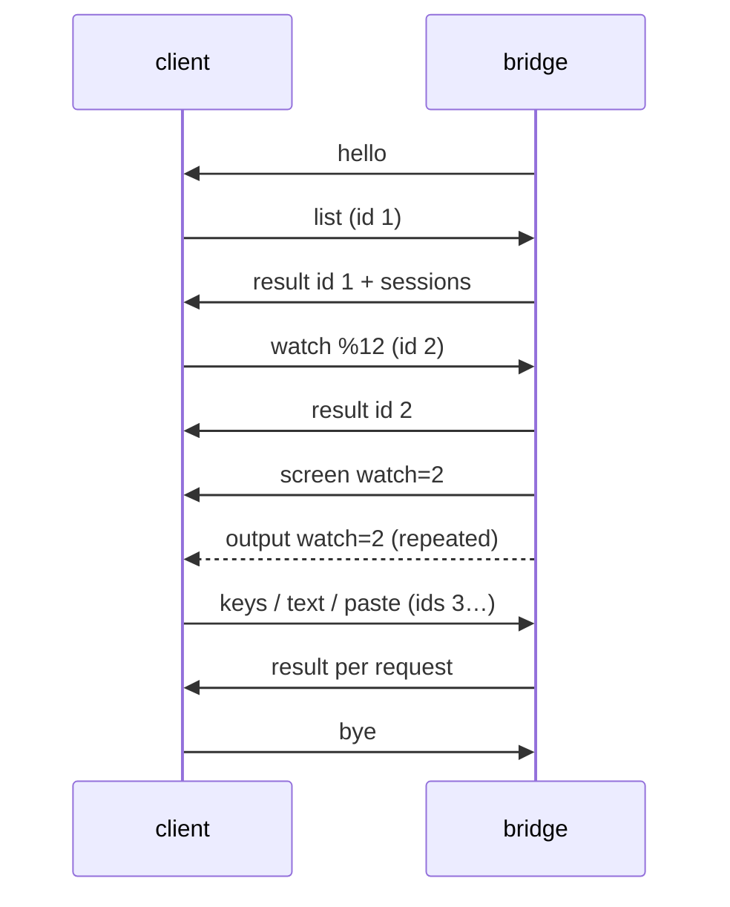

# muxa protocol, version 1

The contract between `muxa-bridge` and its clients. The fixtures in `fixtures/` are normative. Every implementation must decode each line and re-encode it to the same JSON value. Key order may differ. The Rust types reproduce each line byte for byte (`crates/muxa-protocol/tests/fixtures.rs`); the Swift types are checked with sorted keys (`apple/MuxaKit/Tests/MuxaProtocolTests`).

## Transport

- The client runs `muxa-bridge` over SSH as the exec command. There is no PTY.
- Each direction is a stream of JSON objects, one per line, in UTF-8. Lines end with `\n`.
- Byte payloads (`data`) are standard base64. Pane content is raw bytes, not UTF-8 text.
- Unknown fields must be ignored. A client must ignore message types it does not know. The bridge answers unknown request types with a `bad-request` error.
- One request line is at most 4 MiB.

## Session

1. The bridge sends `hello` first, unasked. The client checks `protocol` and closes on a mismatch.
2. The client sends requests. Each one gets exactly one `result` with the same `id`. Requests are run in the order they arrive, so keystrokes keep their order.
3. `watch` makes the bridge send a `screen` for that pane, then `output` as the pane changes. Both carry `watch`, the id of the watch request. The client must drop any `screen`/`output`/`pane-gone` whose `watch` is not its latest watch request.
4. A new `screen` can arrive at any time for the same watch, for example after the pane is resized on the desktop. Reset the emulator to `cols` x `rows` and feed `data`.
5. The client sends `ping` at least every 15 s. The bridge exits after 60 s without a request.
6. `bye` from the client ends the session. `bye` from the bridge says why it is exiting.

## Requests (client → bridge)

| type | fields | effect |
|---|---|---|
| `ping` | `id` | round trip through tmux |
| `list` | `id` | `result` carries `sessions` |
| `watch` | `id`, `pane` | show this pane; replaces the previous watch |
| `unwatch` | `id` | stop `screen`/`output` |
| `keys` | `id`, `pane`, `keys[]` | named keys: up to three `C-`/`M-`/`S-` modifiers, then one printable ASCII character, `F1`–`F12`, or one of `Up Down Left Right Home End PageUp PageDown Enter Escape Tab BTab BSpace DC IC Space KPEnter` |
| `text` | `id`, `pane`, `text` | typed literally |
| `bytes` | `id`, `pane`, `data` | raw key bytes, for clients that encode keys themselves |
| `paste` | `id`, `pane`, `text` | pasted; bracketed when the program enabled bracketed paste |
| `chat` | `id`, `pane` | follow the agent conversation in this pane (capability `chat`); replaces the previous chat |
| `unchat` | `id` | stop `chat-entries` |
| `docs` | `id`, `pane` | list the pane's Markdown documents (capability `docs`); a `doc-list` comes before the `result` |
| `doc` | `id`, `pane`, `path` | open a listed document and follow it; replaces the open document |
| `undoc` | `id` | stop `doc-content` |
| `changes` | `id`, `pane` | list the files that differ from HEAD in the pane's repo (capability `changes`); a `change-list` comes before the `result` |
| `diff` | `id`, `pane`, `path` | show a listed file's diff and follow it; replaces the open diff |
| `undiff` | `id` | stop `diff-content` |
| `new-task` | `id`, `repo`, `branch`, optional `base` | start a task (capability `tasks`); a `task-created` comes before the `result` |
| `close-task` | `id`, `session`, `mode` | close a task's session (capability `close-task`) |
| `bye` | `id` | the bridge exits |

Pane ids look like `%12`. Session ids look like `$1`, and window ids like `@4`. Ids are the only way to target anything.

## Messages (bridge → client)

| type | fields |
|---|---|
| `hello` | `protocol`, `bridge` (version), `tmux` (version), `capabilities[]` |
| `result` | `id` (absent only for an unreadable request), optional `error {code, message}`, optional `sessions` |
| `screen` | `watch`, `pane`, `cols`, `rows`, `data` |
| `output` | `watch`, `pane`, `data` |
| `sessions-changed` | none. Send `list` again. Sent when tmux reports a structural change, and when an agent pane's role or state changed (checked every 2 seconds). Best effort: tmux reports pane changes only for the bridge's current session, so also re-list whenever the session list is shown. |
| `pane-gone` | `watch`, `pane`, optional `reason` |
| `chat-entries` | `chat`, `seq`, optional `reset`, `entries[]`, optional `status {state, since}`, optional `agent`, optional `truncated` |
| `chat-ended` | `chat`, `reason` |
| `doc-list` | `docs`, optional `root`, `entries[] {path, kind, title?, mtime?}`, optional `truncated` |
| `doc-content` | `doc`, `path`, `text`, optional `mtime` |
| `doc-ended` | `doc`, `reason` |
| `change-list` | `changes`, optional `root`, `entries[] {path, status, oldPath?, added?, removed?}`, optional `truncated` |
| `diff-content` | `diff`, `path`, optional `text`, optional `binary` |
| `diff-ended` | `diff`, `reason` |
| `task-created` | `task`, `session` |
| `bye` | `reason` |

Error codes: `bad-request`, `invalid-pane`, `no-pane`, `unsupported-key`, `too-large`, `unsupported`, `task-failed`, `tmux`, `internal`.

### Sessions

A session has `id`, `name`, optional `repo`, `repoDir` (the repo's main checkout, absolute), `branch`, `worktree`, `task`, and `panes`. A pane has:
- `id`, `window`, `index`, `cols`, `rows`;
- `command`: the foreground process;
- `path`, `dead`;
- `role`: `agent`, `shell`, `hidden` or `unknown`;
- `shellForeground`;
- optional `agent {state, since}`.

- **Roles never come from screen content.** In order: `@muxa_role`, then agent-runner tags, then, in a window with no agent pane, the pane where an agent adapter sees its agent running (the window's other untagged panes are then `shell`), then `unknown`. Clients do not show `hidden` panes.
- **Repo without tags:** a session without `@agent_repo_dir` gets `repo` and `repoDir` from the git repo of its first visible pane, also when that pane is in a worktree.
- **Agent/Terminal toggle:** when a session has no `agent`/`shell` roles, the client may treat the pane in the same window whose `shellForeground` is true as the terminal. If there is none, it disables the toggle.
- **Agent state** (`running`, `waiting`, `idle`, `done`, `error`) is present only when an agent runner reports it, or, for a pane without a state tag, when the agent itself records it (for Claude Code, its session file). `since` is epoch seconds. When `shellForeground` is true, the state is likely stale: show it as such, or as unknown.

## Chat

A bridge with the `chat` capability can follow the conversation of a coding agent through an agent adapter (`docs/agents.md`). The pane itself is unaffected: watching and typing work as before.

1. `chat {pane}` answers `result`. On success, `chat-entries` messages follow. Each carries `chat`, the id of the chat request. The client drops any whose `chat` is not its latest chat request.
2. `unsupported` means no adapter knows the program in that pane. Show the terminal instead.
3. `seq` grows by one per message of a chat.
4. `reset: true` clears the list first. It comes first, and again whenever the bridge resends everything, for example after the client fell behind or the agent started a new conversation. On a reset, `agent` names the adapter (`claude-code`), and `truncated: true` says older history exists but was not sent.
5. Each entry has `id`, `kind` (`user`, `assistant`, `tool`, `notice`), `text`, and for a tool call `tool {name, summary, result?, error?}`. An entry replaces any earlier entry with the same `id`. A tool call is sent first without `result` and again when its result arrives.
6. `status` is the agent's state when the message was sent, with `since` in epoch seconds. Absent means unknown, for example when the pane is back at a shell. A message with no entries carries a status change alone.
7. `chat-ended` says the chat stopped, for example because the agent exited. Send `chat` again to follow a new one.

Entries are made by the bridge from the agent's own records, which are private formats. Expect missing kinds rather than wrong ones. `assistant` text is markdown.

## Documents

A bridge with the `docs` capability serves the Markdown documents that belong to a pane, for reading.

1. `docs {pane}` sends `doc-list`, then `result`. `docs` in the list is the request id.
2. The list holds the pane's agent documents first (`kind: plan`, for example the Claude Code plan of that session, path `plans/<name>`), then the Markdown files of the pane's git repo (`kind: repo`, path relative to the repo): tracked files, and untracked files git does not ignore. At most 2000; `truncated` says there were more.
3. `doc {pane, path}` opens one of them. `path` must be one the list for that pane contains now; anything else is `bad-request`. The bridge then sends `doc-content` with the whole text, and again whenever the file changes (checked every second). The client drops any whose `doc` is not its latest doc request.
4. `doc-ended` says the document is no longer readable, for example removed, larger than 2 MiB, or a symlink to outside its directory.

## Changes

A bridge with the `changes` capability shows what differs from HEAD in a pane's git repo, for reading. Staged and unstaged changes count as one.

1. `changes {pane}` sends `change-list`, then `result`. `changes` in the list is the request id.
2. Each entry has `path` (relative to the repo) and `status`: `modified`, `added`, `deleted`, `renamed` (with `oldPath`), `untracked` or `conflicted`. `added` and `removed` count lines; they are absent for a binary file. Untracked files that git ignores are not listed. At most 2000, in path order; `truncated` says there were more.
3. `diff {pane, path}` opens one of them. `path` must be one the list for that pane contains now; anything else is `bad-request`. The bridge then sends `diff-content` with the file's whole unified diff (`git diff` against HEAD; for an untracked file, against nothing), and again whenever it changes (checked every 2 seconds). A binary file has `binary: true` and no `text`.
4. `diff-ended` says the diff stopped, for example the file has no changes any more, or the diff is larger than 2 MiB.

## Tasks

A bridge with the `tasks` capability starts tasks: a git worktree on a branch, and a new tmux session with an agent in it.

1. `new-task {repo, branch, base?}`. `repo` is an absolute path inside the repo, for example a session's `repoDir`. `base` is where a new branch starts; the repo's default branch when absent.
2. On success the bridge sends `task-created {task, session}`, then `result`. `task` is the request id. `session` is the session's name; list again to find its panes. A branch that already has a session gets that session, not a second one.
3. A wrong `repo`, `branch` or `base` is `bad-request`. A failed launch is `task-failed`; the message says why. A launch can take several seconds, and other requests are answered meanwhile.
4. The new session is detached. No attached client moves, and no existing window or pane changes.
5. `close-task {session, mode}` closes a task: a session with a `worktree`. `session` is its id. Other sessions are `bad-request`. `mode` says what happens to the worktree:
   - `close`: removed when the branch is merged; otherwise the request fails and nothing changes.
   - `keep`: kept.
   - `force`: removed even when the branch is not merged.

   A worktree with uncommitted changes is never removed: the request fails and nothing changes. The branch is always kept. Clients attached to the session, the bridge's own included, move to the most recently used other session before it closes. The `result` comes when it is closed; a failure is `task-failed` with the reason.

## Rendering a pane

- Emulate a terminal of exactly `cols` x `rows`. Scale it to fit; never ask for another size.
- `screen.data` starts with a full reset (`ESC c`) and restores the screen, the cursor, the scroll region and the modes. Feed it to the emulator as-is.
- Bytes the emulator would send back to the host must be dropped: replies to device-attribute or cursor-position queries. tmux answers those itself.

## Versioning

`protocol` changes only on incompatible changes. Adding a message type, a request type, an optional field or a capability is compatible. Clients check `capabilities` before using optional features.
