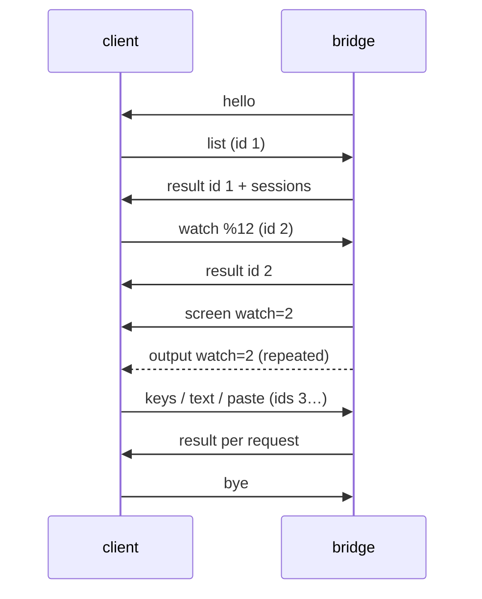

# muxa protocol, version 1

The contract between `muxa-bridge` and its clients. The fixtures in `fixtures/` are normative. Every implementation must decode each line and re-encode it to the same JSON value. Key order may differ. The Rust types reproduce each line byte for byte (`crates/muxa-protocol/tests/fixtures.rs`); the Swift types are checked with sorted keys (`apple/MuxaKit/Tests/MuxaProtocolTests`).

## Transport

- The client runs `muxa-bridge` over SSH as the exec command. There is no PTY.
- Each direction is a stream of JSON objects, one per line, in UTF-8. Lines end with `\n`.
- Byte payloads (`data`) are standard base64. Pane content is raw bytes, not UTF-8 text.
- Unknown fields must be ignored. A client must ignore message types it does not know. The bridge answers unknown request types with a `bad-request` error.
- One request line is at most 4 MiB.

## Session

1. The bridge sends `hello` first, unasked. The client checks `protocol` and closes on a mismatch.
2. The client sends requests. Each one gets exactly one `result` with the same `id`. Requests are run in the order they arrive, so keystrokes keep their order.
3. `watch` makes the bridge send a `screen` for that pane, then `output` as the pane changes. Both carry `watch`, the id of the watch request. The client must drop any `screen`/`output`/`pane-gone` whose `watch` is not its latest watch request.
4. A new `screen` can arrive at any time for the same watch, for example after the pane is resized on the desktop. Reset the emulator to `cols` x `rows` and feed `data`.
5. The client sends `ping` at least every 15 s. The bridge exits after 60 s without a request.
6. `bye` from the client ends the session. `bye` from the bridge says why it is exiting.

## Requests (client → bridge)

| type | fields | effect |
|---|---|---|
| `ping` | `id` | round trip through tmux |
| `list` | `id` | `result` carries `sessions` |
| `watch` | `id`, `pane` | show this pane; replaces the previous watch |
| `unwatch` | `id` | stop `screen`/`output` |
| `keys` | `id`, `pane`, `keys[]` | named keys: up to three `C-`/`M-`/`S-` modifiers, then one printable ASCII character, `F1`–`F12`, or one of `Up Down Left Right Home End PageUp PageDown Enter Escape Tab BTab BSpace DC IC Space KPEnter` |
| `text` | `id`, `pane`, `text` | typed literally |
| `bytes` | `id`, `pane`, `data` | raw key bytes, for clients that encode keys themselves |
| `paste` | `id`, `pane`, `text` | pasted; bracketed when the program enabled bracketed paste |
| `bye` | `id` | the bridge exits |

Pane ids look like `%12`. Session ids look like `$1`, and window ids like `@4`. Ids are the only way to target anything.

## Messages (bridge → client)

| type | fields |
|---|---|
| `hello` | `protocol`, `bridge` (version), `tmux` (version), `capabilities[]` |
| `result` | `id` (absent only for an unreadable request), optional `error {code, message}`, optional `sessions` |
| `screen` | `watch`, `pane`, `cols`, `rows`, `data` |
| `output` | `watch`, `pane`, `data` |
| `sessions-changed` | none. Send `list` again. Best effort: tmux reports pane changes only for the bridge's current session, so also re-list whenever the session list is shown. |
| `pane-gone` | `watch`, `pane`, optional `reason` |
| `bye` | `reason` |

Error codes: `bad-request`, `invalid-pane`, `no-pane`, `unsupported-key`, `too-large`, `tmux`, `internal`.

### Sessions

A session has `id`, `name`, optional `repo`, `branch`, `worktree`, `task`, and `panes`. A pane has:
- `id`, `window`, `index`, `cols`, `rows`;
- `command`: the foreground process;
- `path`, `dead`;
- `role`: `agent`, `shell`, `hidden` or `unknown`;
- `shellForeground`;
- optional `agent {state, since}`.

- **Roles come from tags only**, never from screen content: `@muxa_role`, then agent-runner tags, then `unknown`. Clients do not show `hidden` panes.
- **Agent/Terminal toggle:** when a session has no `agent`/`shell` roles, the client may treat the pane in the same window whose `shellForeground` is true as the terminal. If there is none, it disables the toggle.
- **Agent state** (`running`, `waiting`, `idle`, `done`, `error`) is present only when an agent runner reports it. `since` is epoch seconds. When `shellForeground` is true, the state is likely stale: show it as such, or as unknown.

## Rendering a pane

- Emulate a terminal of exactly `cols` x `rows`. Scale it to fit; never ask for another size.
- `screen.data` starts with a full reset (`ESC c`) and restores the screen, the cursor, the scroll region and the modes. Feed it to the emulator as-is.
- Bytes the emulator would send back to the host must be dropped: replies to device-attribute or cursor-position queries. tmux answers those itself.

## Versioning

`protocol` changes only on incompatible changes. Adding a message type, a request type, an optional field or a capability is compatible. Clients check `capabilities` before using optional features.
