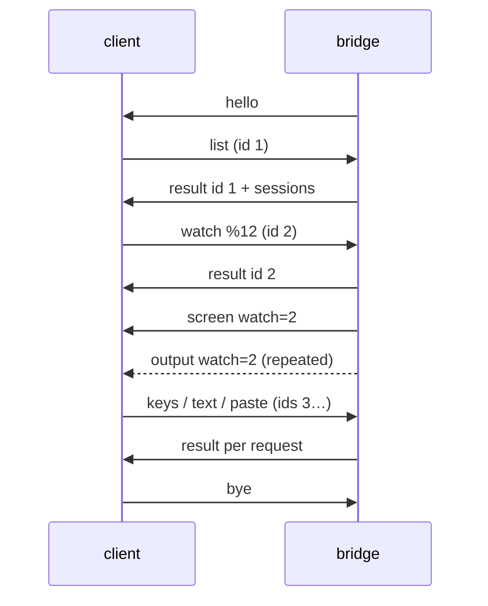

# muxa protocol, version 1

The contract between `muxa-bridge` and its clients. The fixtures in `fixtures/` are normative. Every implementation must decode each line and re-encode it to the same JSON value. Key order may differ. The Rust types reproduce each line byte for byte (`crates/muxa-protocol/tests/fixtures.rs`); the Swift types are checked with sorted keys (`apple/MuxaKit/Tests/MuxaProtocolTests`).

## Transport

- The client runs `muxa-bridge` over SSH as the exec command. There is no PTY.
- Each direction is a stream of JSON objects, one per line, in UTF-8. Lines end with `\n`.
- Byte payloads (`data`) are standard base64. Pane content is raw bytes, not UTF-8 text.
- Unknown fields must be ignored. A client must ignore message types it does not know. The bridge answers unknown request types with a `bad-request` error.
- One request line is at most 4 MiB.

## Session

1. The bridge sends `hello` first, unasked. The client checks `protocol` and closes on a mismatch.
2. The client sends requests. Each one gets exactly one `result` with the same `id`. Requests are run in the order they arrive, so keystrokes keep their order.
3. `watch` makes the bridge send a `screen` for that pane, then `output` as the pane changes. Both carry `watch`, the id of the watch request. The client must drop any `screen`/`output`/`pane-gone` whose `watch` is not its latest watch request.
4. A new `screen` can arrive at any time for the same watch, for example after the pane is resized on the desktop. Reset the emulator to `cols` x `rows` and feed `data`.
5. The client sends `ping` at least every 15 s. The bridge exits after 60 s without a request.
6. `bye` from the client ends the session. `bye` from the bridge says why it is exiting.

## Requests (client → bridge)

| type | fields | effect |
|---|---|---|
| `ping` | `id` | round trip through tmux |
| `list` | `id` | `result` carries `sessions` |
| `watch` | `id`, `pane` | show this pane; replaces the previous watch |
| `unwatch` | `id` | stop `screen`/`output` |
| `viewport` | `id`, `cols`, `rows` | the grid the client's pane area shows at its default font (capability `viewport`); the bridge sizes the watched pane's window for it. See "Rendering a pane" |
| `keys` | `id`, `pane`, `keys[]` | named keys: up to three `C-`/`M-`/`S-` modifiers, then one printable ASCII character, `F1`–`F12`, or one of `Up Down Left Right Home End PageUp PageDown Enter Escape Tab BTab BSpace DC IC Space KPEnter` |
| `text` | `id`, `pane`, `text` | typed literally |
| `bytes` | `id`, `pane`, `data` | raw key bytes, for clients that encode keys themselves |
| `paste` | `id`, `pane`, `text` | pasted; bracketed when the program enabled bracketed paste |
| `chat` | `id`, `pane` | follow the agent conversation in this pane (capability `chat`); replaces the previous chat |
| `unchat` | `id` | stop `chat-entries` |
| `docs` | `id`, `pane` | list the pane's Markdown documents (capability `docs`); a `doc-list` comes before the `result` |
| `doc` | `id`, `pane`, `path` | open a listed document and follow it; replaces the open document |
| `undoc` | `id` | stop `doc-content` |
| `changes` | `id`, `pane` | list the files that differ from HEAD in the pane's repo (capability `changes`); a `change-list` comes before the `result` |
| `diff` | `id`, `pane`, `path`, optional `scope` (`uncommitted`, `branch`) | show a listed file's diff and follow it; replaces the open diff |
| `undiff` | `id` | stop `diff-content` |
| `images` | `id`, `pane` | list the image files in the pane's repo (capability `images`); an `image-list` comes before the `result` |
| `image` | `id`, `pane`, `path` | show a listed image and follow it; replaces the open image |
| `unimage` | `id` | stop `image-content` |
| `new-task` | `id`, `repo`, `branch`, optional `base` | start a task (capability `tasks`); a `task-created` comes before the `result` |
| `close-task` | `id`, `session`, `mode` | close a task's session (capability `close-task`) |
| `list-tasks` | `id` | list the task records and workspaces (capability `task-records`); a `task-list` comes before the `result` |
| `create-task` | `id`, `workspace`, `title`, `goal`, optional `project`, `repo`, `branch`, `base`, `loop {check, maxAttempts?, timeout?}` | record a task and start its agent, with a Task Loop when `loop` is set (capability `task-loop`); a `task-saved` comes before the `result` |
| `update-task` | `id`, `task`, `rev`, `status` | set a task record's status; a `task-saved` comes before the `result` |
| `restart-agent` | `id`, `task`, optional `force` | restart the task's agent in the same pane, after a handoff (capability `task-handoff`); a `task-saved` comes before the `result` |
| `start-loop` | `id`, `task`, `loop {check, maxAttempts?, timeout?}`, optional `reset` | start the task's Task Loop (capability `task-loop`); a `task-saved` comes before the `result` |
| `stop-loop` | `id`, `task` | stop the task's Task Loop (capability `task-loop`); a `task-saved` comes before the `result` |
| `bye` | `id` | the bridge exits |

Pane ids look like `%12`. Session ids look like `$1`, and window ids like `@4`. Ids are the only way to target anything.

## Messages (bridge → client)

| type | fields |
|---|---|
| `hello` | `protocol`, `bridge` (version), `tmux` (version), `capabilities[]` |
| `result` | `id` (absent only for an unreadable request), optional `error {code, message}`, optional `sessions` |
| `screen` | `watch`, `pane`, `cols`, `rows`, `data` |
| `output` | `watch`, `pane`, `data` |
| `sessions-changed` | none. Send `list` again. Sent when tmux reports a structural change, and when an agent pane's role or state changed (checked every 2 seconds). Best effort: tmux reports pane changes only for the bridge's current session, so also re-list whenever the session list is shown. |
| `pane-gone` | `watch`, `pane`, optional `reason` |
| `chat-entries` | `chat`, `seq`, optional `reset`, `entries[]`, optional `status {state, since}`, optional `agent`, optional `truncated`, optional `prompt {entry, kind, question?, options[] {label, keys[], cancel?}}` |
| `chat-ended` | `chat`, `reason` |
| `doc-list` | `docs`, optional `root`, `entries[] {path, kind, title?, mtime?}`, optional `truncated` |
| `doc-content` | `doc`, `path`, `text`, optional `mtime` |
| `doc-ended` | `doc`, `reason` |
| `change-list` | `changes`, optional `root`, `entries[] {path, status, oldPath?, added?, removed?}`, optional `truncated`, optional `branch {base, commits, entries[], truncated?}` |
| `diff-content` | `diff`, `path`, optional `text`, optional `binary` |
| `diff-ended` | `diff`, `reason` |
| `image-list` | `images`, optional `root`, `entries[] {path, mtime?, size?}`, optional `truncated` |
| `image-content` | `image`, `path`, `data` (base64), optional `mtime` |
| `image-ended` | `image`, `reason` |
| `task-created` | `task`, `session` |
| `task-list` | `tasks`, `workspaces[] {name, checks?}`, `entries[]` (task records), optional `truncated` |
| `task-saved` | `task`, `record` (a task record) |
| `tasks-changed` | none. Send `list-tasks` again (capability `tasks-changed`) |
| `bye` | `reason` |

Error codes: `bad-request`, `invalid-pane`, `no-pane`, `unsupported-key`, `too-large`, `unsupported`, `task-failed`, `conflict`, `tmux`, `internal`.

### Sessions

A session has `id`, `name`, optional `repo`, `repoDir` (the repo's main checkout, absolute), `branch`, `worktree`, `task` (tmux-agents' task name, `@agent_task`), `taskId` (the task record the session runs, from the session option `@muxa_task`; see Task records), and `panes`. A pane has:
- `id`, `window`, `index`, `cols`, `rows`;
- `command`: the foreground process;
- `path`, `dead`;
- `role`: `agent`, `shell`, `hidden` or `unknown`;
- `shellForeground`;
- optional `agent {state, since}`.

- **Roles never come from screen content.** In order: `@muxa_role`, then agent-runner tags, then, in a window with no agent pane, the pane where an agent adapter sees its agent running (the window's other untagged panes are then `shell`), then `unknown`. Clients do not show `hidden` panes.
- **Repo without tags:** a session without `@agent_repo_dir` gets `repo` and `repoDir` from the git repo of its first visible pane, also when that pane is in a worktree.
- **Agent/Terminal toggle:** when a session has no `agent`/`shell` roles, the client may treat the pane in the same window whose `shellForeground` is true as the terminal. If there is none, it disables the toggle.
- **Agent state** (`running`, `waiting`, `idle`, `done`, `error`) is present only when an agent runner reports it, or, for a pane without a state tag, when the agent itself records it (for Claude Code, its session file). `since` is epoch seconds. When `shellForeground` is true, the state is likely stale: show it as such, or as unknown.

## Chat

A bridge with the `chat` capability can follow the conversation of a coding agent through an agent adapter (`docs/agents.md`). The pane itself is unaffected: watching and typing work as before.

1. `chat {pane}` answers `result`. On success, `chat-entries` messages follow. Each carries `chat`, the id of the chat request. The client drops any whose `chat` is not its latest chat request.
2. `unsupported` means no adapter knows the program in that pane. Show the terminal instead.
3. `seq` grows by one per message of a chat.
4. `reset: true` clears the list first. It comes first, and again whenever the bridge resends everything, for example after the client fell behind or the agent started a new conversation. On a reset, `agent` names the adapter (`claude-code`), and `truncated: true` says older history exists but was not sent.
5. Each entry has `id`, `kind` (`user`, `assistant`, `tool`, `notice`), `text`, and for a tool call `tool {name, summary, result?, error?}`. An entry replaces any earlier entry with the same `id`. A tool call is sent first without `result` and again when its result arrives.
6. `status` is the agent's state when the message was sent, with `since` in epoch seconds. Absent means unknown, for example when the pane is back at a shell. A message with no entries carries a status change alone.
7. `chat-ended` says the chat stopped, for example because the agent exited. Send `chat` again to follow a new one.
8. With the `chat-prompt` capability, `prompt` says what the agent waits on now, when its adapter knows that menu. Like `status`, every message carries the current one, and absent means none is known. A message with no entries carries a prompt change alone.
   - `entry` is the id of the tool entry the agent waits on.
   - `kind` is `permission` (may the agent run this call), `question` (pick an answer; `question` holds it) or `plan` (leave plan mode). Treat an unknown kind as a prompt without a known meaning, and still show its options.
   - Each option's `keys` are tmux key names that pick it: send them with `keys`. `cancel: true` marks a deny or cancel.
   - The options can be fewer than the agent's menu. The rest are only in the pane.

Entries are made by the bridge from the agent's own records, which are private formats. Expect missing kinds rather than wrong ones. `assistant` text is markdown.

## Documents

A bridge with the `docs` capability serves the Markdown documents that belong to a pane, for reading.

1. `docs {pane}` sends `doc-list`, then `result`. `docs` in the list is the request id.
2. The list holds the pane's agent documents first (`kind: plan`, for example the Claude Code plan of that session, path `plans/<name>`), then the Markdown files of the pane's git repo (`kind: repo`, path relative to the repo): tracked files, and untracked files git does not ignore. At most 2000; `truncated` says there were more. Last come a task's brief, handoff and last check, paths `.muxa/TASK.md`, `.muxa/HANDOFF.md` and `.muxa/CHECK.md` (`kind: repo`), when they exist at the repo root or, outside a repo, in the pane's directory (ADR 0015, 0018, 0019).
3. `doc {pane, path}` opens one of them. `path` must be one the list for that pane contains now; anything else is `bad-request`. The bridge then sends `doc-content` with the whole text, and again whenever the file changes (checked every second). The client drops any whose `doc` is not its latest doc request.
4. `doc-ended` says the document is no longer readable, for example removed, larger than 2 MiB, or a symlink to outside its directory.

## Changes

A bridge with the `changes` capability shows what differs from HEAD in a pane's git repo, for reading. Staged and unstaged changes count as one.

1. `changes {pane}` sends `change-list`, then `result`. `changes` in the list is the request id.
2. Each entry has `path` (relative to the repo) and `status`: `modified`, `added`, `deleted`, `renamed` (with `oldPath`), `untracked` or `conflicted`. `added` and `removed` count lines; they are absent for a binary file. Untracked files that git ignores are not listed. At most 2000, in path order; `truncated` says there were more.
3. `diff {pane, path}` opens one of them. `path` must be one the list for that pane contains now; anything else is `bad-request`. The bridge then sends `diff-content` with the file's whole unified diff (`git diff` against HEAD; for an untracked file, against nothing), and again whenever it changes (checked every 2 seconds). A binary file has `binary: true` and no `text`.
4. `diff-ended` says the diff stopped, for example the file has no changes any more, or the diff is larger than 2 MiB.
5. With the `branch-changes` capability, `change-list` also has `branch`: what the branch's own commits changed since it left its base.
   - The base is origin's default branch (`origin/HEAD`). Without one, it is the main worktree's branch when the pane is in another worktree, else a local `main` or `master`. `base` names the ref, for example `origin/main`. The bridge never fetches.
   - The files are `git diff <fork point> HEAD`, where the fork point is `git merge-base HEAD <base>`. `commits` counts the commits since the fork point. Entries have the same shape as above; `untracked` does not occur.
   - `branch` is absent on the base itself, without a base, or when HEAD and the base share no history.
   - `diff {pane, path, scope: "branch"}` opens one of these files. Uncommitted changes are not part of it; they are in `entries`, so a file can be in both lists.

## Images

A bridge with the `images` capability serves the image files of a pane's git repo, for viewing, for example screenshots of a test run.

1. `images {pane}` sends `image-list`, then `result`. `images` in the list is the request id.
2. The list holds PNG, JPEG, GIF, WebP and HEIC files by extension, in any case: tracked files and untracked ones, **including files git ignores**. Only those extensions are listed. Each entry has `path` (relative to the repo), `mtime` and `size` in bytes. Newest first; at most 2000, the newest kept, and `truncated` says there were more.
3. `image {pane, path}` opens one of them. `path` must be one the list for that pane contains now; anything else is `bad-request`. The bridge then sends `image-content` with the whole file, and again whenever its time or size changes (checked every 2 seconds). The client drops any whose `image` is not its latest image request.
4. `image-ended` says the image is no longer readable, for example removed, larger than 16 MiB, or a symlink to outside the repo.

## Tasks

A bridge with the `tasks` capability starts tasks: a git worktree on a branch, and a new tmux session with an agent in it.

1. `new-task {repo, branch, base?}`. `repo` is an absolute path inside the repo, for example a session's `repoDir`. `base` is where a new branch starts; the repo's default branch when absent.
2. On success the bridge sends `task-created {task, session}`, then `result`. `task` is the request id. `session` is the session's name; list again to find its panes. A branch that already has a session gets that session, not a second one.
3. A wrong `repo`, `branch` or `base` is `bad-request`. A failed launch is `task-failed`; the message says why. A launch can take several seconds, and other requests are answered meanwhile.
4. The new session is detached. No attached client moves, and no existing window or pane changes.
5. `close-task {session, mode}` closes a task: a session with a `worktree`. `session` is its id. Other sessions are `bad-request`. `mode` says what happens to the worktree:
   - `close`: removed when the branch is merged; otherwise the request fails and nothing changes.
   - `keep`: kept.
   - `force`: removed even when the branch is not merged.

   A worktree with uncommitted changes is never removed: the request fails and nothing changes. The branch is always kept. Clients attached to the session, the bridge's own included, move to the most recently used other session before it closes. The `result` comes when it is closed; a failure is `task-failed` with the reason.

## Task records

A bridge with the `task-records` capability keeps Tasks: durable records of work, stored on the host (ADR 0015). `new-task` and `close-task` above start and close a session for work. A task record is the Task itself: it has a goal and a status, and it outlives its session.

1. `list-tasks` sends `task-list`, then `result`. `tasks` in the list is the request id. `workspaces` are the host's workspaces, from its config; clients cannot change them. A workspace's optional `checks` is what a Task Loop may run there: `"any"`, or a list of exact commands. Absent means no loops in that workspace. `entries` are the records; `truncated` says the bridge left some out.
2. A task record has:
   - `id`, for example `t-7f3a2c`;
   - `rev`, an integer from 1, one higher after every write;
   - `workspace`, `title`, `goal`;
   - `status`: `open`, `review`, `done` or `dropped`, set by the user. One exception: a passing Task Loop moves `open` to `review` (ADR 0019 amends ADR 0015). Nothing else changes the status. Treat an unknown status as one without a known meaning, and still show the record;
   - `createdAt`, `updatedAt` in epoch seconds;
   - optional `project` (free text), `repo` (absolute), `branch`, `dir` (where the agent works, absolute), `session` (the last known session name, for display only) and `note` (from the bridge, for example why the launch failed);
   - optional `runs`, with the `task-handoff` capability: the agents that worked on the task. See Handoff below;
   - optional `loop`: the task's Task Loop. See Task Loop below;
   - optional `pendingPrompt {kind, since, run}`: a prompt the host still waits to type into the agent. `kind` is `start` or `restart`, `since` is when the wait began (epoch seconds), and `run` is the `id` of the run it is for. It is cleared when the prompt is typed or given up.
3. `create-task {workspace, title, goal, project?, repo?, branch?, base?, loop?}` records a Task and starts an agent for it. `workspace` is a name from `task-list`. `loop` also starts a Task Loop; see Task Loop below.
   - With `repo`, `branch` is required. The session starts as with `new-task`, and `base` means the same.
   - Without `repo`, the task gets a directory in its workspace, `<root>/tasks/<slug>-<id>`, and a new session of the same name.
   - When the branch's session already runs another task that is `open` or `review`, the request is `bad-request`.
   - The bridge hands the goal to the agent. The session carries the record's id as `taskId`.
   - On success the bridge sends `task-saved {task, record}`, then `result`. `task` is the request id.
   - A failed launch still keeps the record, with a `note`. The bridge sends `task-saved` with it, then a `result` with `task-failed`. The record names a `session` only when one started before the failure.
   - A wrong workspace, `repo`, `branch` or `base`, or an empty `title`, is `bad-request`, and no record is kept.
   - The bridge writes `.muxa/TASK.md` in `dir`. It types `Read .muxa/TASK.md and start.` into the agent pane once the agent's state is `idle`, or a `done` that began after the wait. When that does not happen within 30 seconds, it does not type it, and the record's `note` says so. The record has a new `rev` then.
4. `update-task {task, rev, status}` sets the status of the record whose id is `task`. `rev` is the one the client last saw. When the record changed since, the request fails with `conflict` and nothing changes: list again and retry. On success, `task-saved` with the new record comes before the `result`. Changing the status never starts or closes a session.
5. A session runs a Task when its `taskId` is the record's `id`. The agent's state stays on the session's panes; the Task's `status` does not follow it.
6. `taskId` comes from the session option `@muxa_task`. Options end with the tmux server, so a session without one gets the `id` of the record whose `dir` is the session's `worktree`, or the path of its first visible pane. A record whose tag a session carries is not matched again. The bridge does not write the tag back.

## Handoff

A bridge with the `task-handoff` capability records the agents that work on a Task, and can restart a Task's agent with a handoff (ADR 0018).

1. A task record's `runs` lists the agents the bridge started or restarted, oldest first, at most 50. Absent means none was recorded. Each run has:
   - `id`, an integer from 1, one higher than the previous run's;
   - `startedAt`, epoch seconds;
   - `reason`: `start` (`create-task`) or `restart` (`restart-agent`). Treat an unknown reason as one without a known meaning;
   - optional `agent`, the adapter that saw the agent, for example `claude-code` or `codex`. Absent until an adapter reported it;
   - optional `endedAt`, epoch seconds when the bridge restarted it. It is never set when the agent ends any other way;
   - optional `agentSession`, the agent's own session id, and `transcript`, the absolute path of its transcript on the host. A path only; the bridge never sends transcript content here.
2. Runs are recorded only when a bridge or the host daemon handles `create-task` or `restart-agent`. An agent quit or restarted by hand in its pane leaves no run.
3. `restart-agent {task, force?}` restarts the agent of the record whose id is `task`:
   - The agent pane is the first live `agent` pane of the session that runs the task (`taskId`). With none, the request is `task-failed`.
   - While the agent's state is `running`, the request is `bad-request`, unless `force` is true.
   - The bridge rewrites the header of `.muxa/TASK.md` and keeps the agent's notes below its marker. It writes `.muxa/HANDOFF.md` from facts: the runs, the record's status and note, git's branch, commits and status for a repo task, and recently changed files otherwise.
   - It restarts the agent in the same pane. The pane keeps its id and size, and no layout changes. It ends the open run and adds one with `reason: restart`.
   - On success the bridge sends `task-saved {task, record}`, then `result`. `task` is the request id.
   - Once the new agent has finished a turn (`idle` or `done`, since the restart), the bridge types `Read .muxa/TASK.md and .muxa/HANDOFF.md, then continue.` When that does not happen within 30 seconds, the record's `note` says so.
   - An unknown task is `bad-request`.

## Task Loop

A bridge with the `task-loop` capability can run a Task Loop: after each finished turn of the task's agent, the host runs a check command, and types a fail prompt until the check passes (ADR 0019). The loop runs in the muxa daemon on the host, also while no client is connected. The bridge has the capability only when it reached a daemon of its own version.

1. A loop is asked for with `loop {check, maxAttempts?, timeout?}`, in `create-task` or in `start-loop`.
   - `check` is a shell command, run in the task's `dir`. It must be allowed by the workspace's `checks`: one of the listed strings, exactly, or any command of at most 4096 bytes with no control character for `"any"`.
   - `maxAttempts` is how many failed checks stop the loop: 1 to 10, default 3.
   - `timeout` is how many seconds one check may run: 10 to 3600, default 600.
   - A workspace without `checks`, a check it does not allow, or a repo task whose repo is not in the workspace is `bad-request`. Without a usable daemon, the request is `unsupported`, and the message says what to run on the host.
2. `start-loop {task, loop, reset?}` starts the loop of the record whose id is `task`, also a stopped or passed one. The attempt count goes on, unless `reset` is true. `stop-loop {task}` stops it with reason `user`. Both send `task-saved`, then `result`. An unknown task is `bad-request`.
3. A record's `loop` has:
   - `check`, `maxAttempts`, `timeout`, as above, with the defaults filled in;
   - `state`: `armed` (waits for the agent's next finished turn), `checking`, `paused`, `passed` or `stopped`. Treat an unknown state as one without a known meaning;
   - `attempts`, the failed checks so far;
   - `armedAt`, epoch seconds when the loop started or last typed a prompt, and `since`, epoch seconds of the last state change;
   - optional `reason`, set when the state is `paused` or `stopped`: `waiting` (paused while the agent waits for the user), `limit`, `timeout`, `error`, `no-agent`, `not-sent`, `stalled`, `status` (the user set a status other than `open`) or `user`. Treat an unknown reason as one without a known meaning;
   - optional `lastCheck {attempt, exit?, seconds, at}`: the last check's attempt, exit code, duration and end time in epoch seconds. `exit` is absent when the check timed out.
4. A passing check sets the state to `passed`, and moves a task with status `open` to `review`. The loop never sets any other status.
5. The loop never answers the agent's menus. While the agent is `waiting`, the loop is `paused`; it goes on after the user answered.
6. The check's output is in the task's `.muxa/CHECK.md` (see Documents). The record never carries it.
7. Clients put a task in **Needs attention** when its loop is `paused`, or `stopped` with a reason other than `user` or `status`, unless the task is `done` or `dropped`. `protocol/fixtures/inbox/groups.jsonl` pins the whole Inbox rule: each line has a `record`, the `sessions` of `list`, and the `group` it belongs to.

## Tasks changed

A bridge with the `tasks-changed` capability sends `tasks-changed` when a task record changed on the host, whoever wrote it: the daemon, another bridge, or `muxa-cli`. It looks every 2 seconds. The message has no fields. Send `list-tasks` again.

## Rendering a pane

- Emulate a terminal of exactly `cols` x `rows`. Scale it to fit.
- **Viewport** (capability `viewport`, ADR 0020). A client may say which grid it would like with `viewport {cols, rows}`: the cols x rows its pane area shows at its default font. `cols` is 10 to 1000 and `rows` 5 to 1000; other values get `bad-request`.
  1. Send it before the first `watch`, and again after the pane area changes (rotation, split view, fold, window resize), once it has settled.
  2. It holds for the current watch and later ones.
  3. While the client watches a pane, the bridge sizes the pane's window so that the pane gets that grid, as tmux's `window-size latest` does for a terminal. This holds for any window of the session, not only the one a desktop client shows (ADR 0021). Typing in the pane (`keys`, `text`, `bytes`, `paste`) makes this client the latest one again. Typing on another tmux client in that window takes the window back.
  4. Only windows whose `window-size` is `latest` follow. The pane can still be any size: keep rendering the `screen` you get.
  5. A client that never sends `viewport` never changes a window's size.
- `screen.data` starts with a full reset (`ESC c`) and restores the screen, the cursor, the scroll region and the modes. Feed it to the emulator as-is.
- Bytes the emulator would send back to the host must be dropped: replies to device-attribute or cursor-position queries. tmux answers those itself.

## Versioning

`protocol` changes only on incompatible changes. Adding a message type, a request type, an optional field or a capability is compatible. Clients check `capabilities` before using optional features.
